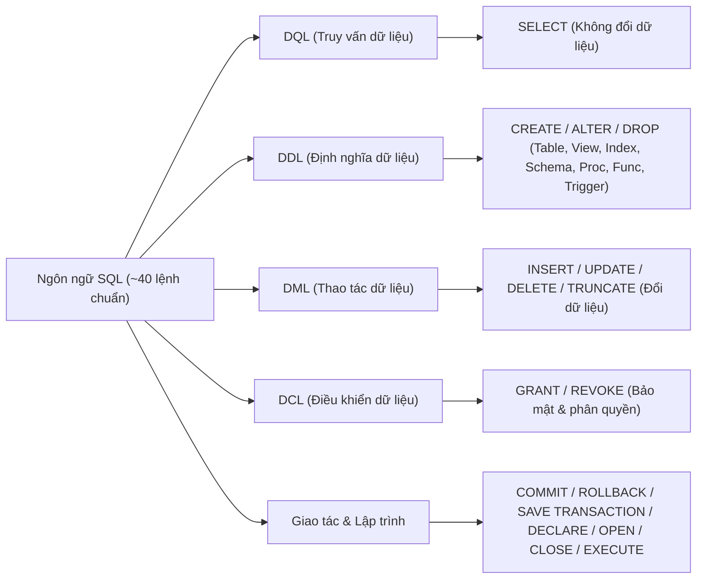
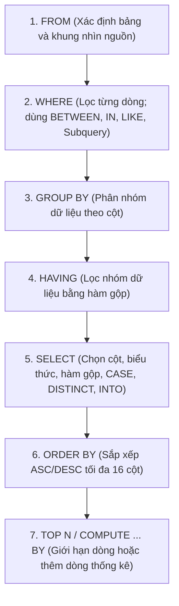

# Chương 4: Ngôn ngữ khai thác cơ sở dữ liệu (SQL) (Phương pháp Ghi chép Cornell)

> **Cấu trúc Ghi chép Cornell (Cornell Note-taking System):**
> - **Cột Trái (Cue Column — Từ khóa / Câu hỏi gợi nhớ):** Chứa các khái niệm cốt lõi, từ khóa cú pháp và câu hỏi tự kiểm tra giúp kích hoạt trí nhớ chủ động.
> - **Cột Phải (Note-taking Column — Ghi chú chi tiết):** Trình bày đầy đủ định nghĩa, bảng phân loại, cú pháp chuẩn, lưu ý bẫy thường gặp và ví dụ minh họa sát giáo trình.
> - **Phần Tổng kết (Summary):** Cô đọng kiến thức trọng tâm ngay sau mỗi mục và toàn chương để ôn tập nhanh.

---

## 1. Giới thiệu Ngôn ngữ SQL, Quy tắc Đặt tên, Kiểu Dữ liệu & Giá trị NULL (Mục 4.1)

| Từ khóa / Câu hỏi gợi nhớ | Ghi chú chi tiết (Nội dung cốt lõi) |
| :--- | :--- |
| **SQL là gì? Lịch sử hình thành & chuẩn hóa?** | - **SQL** (*Structured Query Language*): Tập lệnh chuẩn truy xuất và khai thác CSDL quan hệ.<br>- **Cột mốc lịch sử:**<br>  - Giữa thập niên 1970: IBM sử dụng đầu tiên trong HQTCSDL **System R**.<br>  - 11/1976: IBM công bố hệ ngôn ngữ SQL đầu tiên (**SEQUEL2**).<br>  - 1979: Tập đoàn **ORACLE** giới thiệu thương phẩm SQL đầu tiên; IBM cũng cài đặt trong **DB2** và **SQL/DS**.<br>  - 1986: **ANSI** chấp nhận chuẩn **SQL-86** (hay **SQL1**).<br>  - 1987: **ISO** chính thức chấp nhận chuẩn SQL. |
| **Tính chất của ngôn ngữ SQL là gì?** | - Là ngôn ngữ **phi thủ tục**, có **tính khai báo**: người dùng chỉ cần mô tả *yêu cầu cần thực hiện* mà không cần chỉ ra *cách thức thực hiện* chi tiết như thế nào.<br>- **Không phải ngôn ngữ lập trình** độc lập (như C, C++, Java...), nhưng có thể **nhúng vào các ngôn ngữ lập trình** để xây dựng ứng dụng tương tác CSDL.<br>- **Không thể tồn tại độc lập**: chỉ là một thành phần của HQTCSDL, đóng vai trò công cụ giao tiếp giữa người dùng và HQTCSDL (Oracle, MS Access, Visual FoxPro, SQL Server, DB2...). |
| **4 chức năng chính của SQL trong HQTCSDL?** | 1. **Định nghĩa dữ liệu:** Định nghĩa CSDL, cấu trúc lưu trữ, tổ chức dữ liệu và mối quan hệ giữa các thành phần.<br>2. **Truy xuất và thao tác dữ liệu:** Truy xuất, bổ sung, cập nhật, loại bỏ dữ liệu.<br>3. **Điều khiển truy cập:** Cấp phát và kiểm soát thao tác của người dùng để đảm bảo an toàn cho CSDL.<br>4. **Đảm bảo toàn vẹn dữ liệu:** Định nghĩa các ràng buộc toàn vẹn, đảm bảo tính hợp lệ và chính xác của dữ liệu trước cập nhật và lỗi hệ thống. |
| **SQL chuẩn gồm 4 nhóm lệnh nào?** | SQL chuẩn có khoảng **40 câu lệnh**, chia thành 4 nhóm chính:<br>1. **DQL** (*Data Query Language* — Truy vấn dữ liệu): `SELECT` (lấy thông tin, **không làm thay đổi dữ liệu** trong bảng).<br>2. **DDL** (*Data Definition Language* — Định nghĩa dữ liệu): `CREATE`, `DROP`, `ALTER`... (tạo, thay đổi cấu trúc bảng/đối tượng).<br>3. **DML** (*Data Manipulation Language* — Thao tác dữ liệu): `INSERT`, `DELETE`, `UPDATE`... (làm thay đổi dữ liệu lưu trong bảng).<br>4. **DCL** (*Data Control Language* — Điều khiển dữ liệu): `GRANT`, `REVOKE`... (quản lý quyền truy nhập). |
| **Các câu lệnh SQL phổ biến theo nhóm chức năng?** | - **Thao tác dữ liệu:** `SELECT` (truy xuất), `INSERT` (bổ sung), `UPDATE` (cập nhật), `DELETE` (xóa dữ liệu), `TRUNCATE` (xóa toàn bộ dữ liệu trong bảng).<br>- **Định nghĩa dữ liệu:** `CREATE/DROP/ALTER TABLE` (bảng), `CREATE/ALTER/DROP VIEW` (khung nhìn), `CREATE/DROP INDEX` (chỉ mục), `CREATE/DROP SCHEMA` (lược đồ CSDL), `CREATE/ALTER/DROP PROCEDURE` (thủ tục lưu trữ), `CREATE/ALTER/DROP FUNCTION` (hàm do user định nghĩa), `CREATE/ALTER/DROP TRIGGER` (trigger).<br>- **Điều khiển truy cập:** `GRANT` (cấp phát quyền), `REVOKE` (thu hồi quyền).<br>- **Quản lý giao tác:** `COMMIT` (ủy thác/kết thúc thành công), `ROLLBACK` (quay lui giao tác), `SAVE TRANSACTION` (đánh dấu một điểm trong giao tác).<br>- **Lập trình:** `DECLARE` (khai báo biến/con trỏ), `OPEN` (mở con trỏ), `CLOSE` (đóng con trỏ), `EXECUTE` (thực thi câu lệnh SQL). |
| **Cấu trúc chung của một câu lệnh SQL?** | - Bắt đầu bởi **từ lệnh** (từ khóa cho biết chức năng, vd: `SELECT`, `DELETE`, `COMMIT`...).<br>- Theo sau là các **mệnh đề**, mỗi mệnh đề bắt đầu bằng một từ khóa (vd: `FROM`, `WHERE`...).<br>- *Ví dụ:* `SELECT MACB, HOTEN, GIOITINH, CHUCVU FROM CANBO WHERE CHUCVU = 'GIAM DOC'` (từ lệnh `SELECT`, 2 mệnh đề `FROM` và `WHERE`). |
| **Quy tắc sử dụng tên bảng & tên cột trong SQL (4.1.2)?** | - Tên các đối tượng là **duy nhất** trong mỗi CSDL.<br>- **Cơ sở dữ liệu nhiều người dùng:** Mặc định tên bảng là bảng do chính người dùng đó sở hữu. Cho phép các người dùng khác nhau tạo bảng trùng tên; khi truy cập bảng của người dùng khác (nếu được phép), phải viết: `tên_người_sở_hữu.tên_bảng` (tương tự cho view, thủ tục, hàm).<br>- **Quy tắc `tên_bảng.tên_cột`:** Bình thường chỉ cần ghi tên cột. Nếu câu lệnh liên quan đến **từ 2 cột trở lên có cùng tên ở các bảng khác nhau**, **bắt buộc** ghi `tên_bảng.tên_cột`.<br>- *Ví dụ:* `SELECT MACB, HOTEN, GIOITINH, CHUCVU, PHONG.MAPHONG FROM CANBO, PHONG WHERE PHONG.MAPHONG = CANBO.MAPHONG` |
| **Bảng 4.1: Đầy đủ 22 kiểu dữ liệu thông dụng trong SQL?** | - **Nhóm chuỗi ký tự:**<br>  1. `CHAR(n)`: Chuỗi độ dài cố định.<br>  2. `NCHAR(n)`: Chuỗi độ dài cố định, hỗ trợ **UNICODE**.<br>  3. `VARCHAR(n)`: Chuỗi độ dài biến đổi (chính xác).<br>  4. `NVARCHAR(n)`: Chuỗi độ dài biến đổi (chính xác), hỗ trợ **UNICODE**.<br>- **Nhóm số nguyên:**<br>  5. `INTEGER`: Số nguyên từ $-2^{31}$ đến $2^{31} - 1$.<br>  6. `INT`: Tương đương `INTEGER`.<br>  7. `TINYINT` *(trong sách in là TINYTINT)*: Số nguyên từ $0$ đến $255$.<br>  8. `SMALLINT`: Số nguyên từ $-2^{15}$ đến $2^{15} - 1$ ($-32{,}768$ đến $32{,}767$).<br>  9. `BIGINT`: Số nguyên từ $-2^{63}$ đến $2^{63} - 1$.<br>- **Nhóm số thực & tiền tệ & logic:**<br>  10. `NUMERIC(p, s)`: Kiểu số với độ chính xác cố định.<br>  11. `DECIMAL(p, s)`: Tương tự `NUMERIC`.<br>  12. `FLOAT`: Số thực từ $-1.79E+308$ đến $1.79E+308$.<br>  13. `REAL`: Số thực từ $-3.40E+38$ đến $3.40E+38$.<br>  14. `MONEY`: Kiểu tiền tệ.<br>  15. `BIT`: Kiểu bit, nhận giá trị `0` hoặc `1`.<br>- **Nhóm ngày giờ:**<br>  16. `DATETIME`: Ngày giờ, chính xác đến phần trăm của giây.<br>  17. `SMALLDATETIME`: Ngày giờ, chính xác đến phút.<br>- **Nhóm nhị phân & văn bản lớn:**<br>  18. `BINARY`: Nhị phân độ dài cố định (tối đa $8{,}000$ bytes).<br>  19. `VARBINARY`: Nhị phân độ dài chính xác (tối đa $8{,}000$ bytes).<br>  20. `IMAGE`: Nhị phân độ dài chính xác (tối đa $2{,}147{,}483{,}647$ bytes).<br>  21. `TEXT`: Chuỗi độ dài lớn (tối đa $2{,}147{,}483{,}647$ ký tự).<br>  22. `NTEXT`: Chuỗi độ dài lớn hỗ trợ UNICODE (tối đa $1{,}073{,}741{,}823$ ký tự). |
| **Giá trị `NULL` là gì? Tại sao xuất hiện & khác gì `""` / `0`?** | - `NULL` biểu diễn **giá trị không xác định** trong CSDL quan hệ.<br>- **4 nguyên nhân xuất hiện `NULL`:**<br>  1. Giá trị có tồn tại nhưng không biết.<br>  2. Không xác định được giá trị đó có tồn tại hay không.<br>  3. Tại một thời điểm giá trị chưa có nhưng có thể sẽ có.<br>  4. Giá trị bị lỗi do tính toán (tràn số, chia cho 0...).<br>- **Lưu ý quan trọng:** Tuyệt đối **không nhầm lẫn** `NULL` với **chuỗi rỗng** (`''` đối với chuỗi) hay **giá trị `0`** (đối với số). |



> **Tóm tắt Mục 4.1 (Cornell Summary):** SQL là ngôn ngữ khai báo chuẩn hóa từ System R / SEQUEL2 (1976) đến ANSI SQL-86 và ISO (1987), gồm 4 nhóm lệnh trụ cột (DQL, DDL, DML, DCL). Khi viết truy vấn nhiều bảng có cột trùng tên phải dùng cú pháp `tên_bảng.tên_cột`, nắm vững 22 kiểu dữ liệu trong Bảng 4.1 và hiểu đúng `NULL` là giá trị không xác định, hoàn toàn khác `0` hay chuỗi rỗng.

---

## 2. Nhóm Lệnh Định nghĩa Dữ liệu (DDL): CREATE, ALTER, DROP & Khung nhìn VIEW (Mục 4.2)

| Từ khóa / Câu hỏi gợi nhớ | Ghi chú chi tiết (Nội dung cốt lõi) |
| :--- | :--- |
| **Cú pháp `CREATE TABLE` & các thành phần khai báo?** | ```sql<br>CREATE TABLE <Tablename> (<br>  Tên_cột1 <Kiểu> [(Kích_thước)] [DEFAULT BT] [NULL | NOT NULL] [Ràng_buộc],<br>  ...,<br>  Tên_cộtN <Kiểu> [(Kích_thước)] [DEFAULT BT] [NULL | NOT NULL] [Ràng_buộc]<br>  [, Ràng_buộc_mức_bảng]<br>)<br>```<br>- Mỗi bảng phải có **ít nhất 1 cột**, tên các cột trong cùng 1 bảng phải khác nhau.<br>- `DEFAULT BT`: Tự động gán giá trị `BT` nếu khi `INSERT` không chỉ định giá trị cho cột.<br>- `NULL / NOT NULL`: Quy định cột có chấp nhận `NULL` không; **cột làm khóa mặc nhiên `NOT NULL`**.<br>- **Mức cột vs Mức bảng:** Ràng buộc mức cột đặt ngay trong khai báo cột; **ràng buộc mức bảng** đặt sau danh sách cột, thường dùng khi ràng buộc có **từ 2 cột trở lên**. |
| **1. Ràng buộc `CHECK` hoạt động thế nào?** | - Quy định điều kiện/khuôn dạng dữ liệu hợp lệ trên cột; tự động kiểm tra mỗi khi `INSERT` hoặc `UPDATE`.<br>- **Cú pháp:** `[CONSTRAINT Tên_ràng_buộc] CHECK (Điều_kiện)`<br>- Một bảng có thể có nhiều ràng buộc `CHECK`.<br>- *Ví dụ:* `CONSTRAINT chkdiemvan CHECK (Diemvan >= 0 AND Diemvan <= 10)` hoặc `CONSTRAINT chklop CHECK (namnhaphoc <= YEAR(GETDATE()) AND Hedaotao IN (N'Chính quy', N'Tại chức'))`. |
| **2. Ràng buộc `PRIMARY KEY` có quy tắc gì?** | - Định nghĩa **khóa chính** giúp xác định duy nhất một bản ghi trong bảng.<br>- Mỗi bảng chỉ có **duy nhất 1 khóa chính** và **không chấp nhận `NULL`**.<br>- Đảm bảo **toàn vẹn thực thể** và là cơ sở cho **toàn vẹn tham chiếu**.<br>- **Cú pháp:** `[CONSTRAINT Tên_ràng_buộc] PRIMARY KEY [(danh_sách_cột)]`<br>- Nếu khóa chính gồm 1 cột và khai báo ở mức cột thì không cần danh sách cột; nếu khai báo mức bảng (từ 2 cột trở lên) **bắt buộc** liệt kê danh sách cột (vd: `CONSTRAINT pkdiemthi PRIMARY KEY (Mamonhoc, Masv)`). |
| **3. Ràng buộc `UNIQUE` khác gì `PRIMARY KEY`?** | - Quy định dữ liệu trong các cột chỉ ra **không được trùng nhau** trong bảng.<br>- Tạo nên **khóa phụ (khóa dự tuyển)** — có tính duy nhất nhưng không được chọn làm khóa chính.<br>- **Cú pháp:** `[CONSTRAINT Tên_ràng_buộc] UNIQUE [(danh_sách_cột)]`<br>- *Ví dụ:* `CONSTRAINT unique_tenlop UNIQUE (tenlop)`. |
| **4. Ràng buộc `FOREIGN KEY` & 4 tùy chọn tham chiếu?** | - Khai báo **khóa ngoại** liên kết bảng hiện tại với khóa chính hoặc khóa dự tuyển của bảng tham chiếu.<br>- **Cú pháp:**<br>```sql<br>[CONSTRAINT Tên_ràng_buộc] FOREIGN KEY [(DS_cột)]<br>REFERENCES Tên_bảng_tham_chiếu (DS_cột_tham_chiếu)<br>[ON DELETE CASCADE | NO ACTION | SET NULL | SET DEFAULT]<br>[ON UPDATE CASCADE | NO ACTION | SET NULL | SET DEFAULT]<br>```<br>- **Lưu ý quan hệ vòng:** Bảng tham chiếu phải tồn tại trước; nếu các bảng tham chiếu vòng lẫn nhau, phải tạo bảng trước rồi bổ sung `FOREIGN KEY` bằng `ALTER TABLE`.<br>- **4 cách xử lý khi bản ghi được tham chiếu bị xóa (`ON DELETE`) / cập nhật (`ON UPDATE`):**<br>  1. `CASCADE`: Tự động xóa / cập nhật theo bản ghi ở bảng tham chiếu.<br>  2. `NO ACTION` *(mặc định)*: Không cho phép xóa / cập nhật bản ghi ở bảng tham chiếu.<br>  3. `SET NULL`: Gán khóa ngoại thành `NULL` (yêu cầu cột cho phép `NULL`).<br>  4. `SET DEFAULT`: Gán khóa ngoại thành giá trị mặc định (yêu cầu cột có `DEFAULT`). |
| **`ALTER TABLE` làm được những thao tác nào?** | - **Bổ sung cột:** `ALTER TABLE <tên> ADD Tên_cột <Kiểu> [(KT)] [DEFAULT BT] [NULL/NOT NULL] [RB]`<br>- **Thay đổi định nghĩa cột:** `ALTER TABLE <tên> ALTER COLUMN Tên_cột <Kiểu> ...`<br>- **Xóa cột:** `ALTER TABLE <tên> DROP COLUMN Tên_cột`<br>- **Thêm ràng buộc:** `ALTER TABLE <tên> ADD CONSTRAINT Tên_RB Định_nghĩa_RB`<br>- **Xóa ràng buộc:** `ALTER TABLE <tên> DROP CONSTRAINT Tên_RB`<br>- **Chú ý bẫy thi:** Muốn xóa một cột đang gắn ràng buộc hoặc đang bị khóa ngoại tham chiếu, **phải xóa ràng buộc / khóa ngoại trước** rồi mới `DROP COLUMN`. |
| **`DROP TABLE` hoạt động ra sao & điều kiện tiên quyết?** | - **Cú pháp:** `DROP TABLE <Tablename>`<br>- Khi bảng bị xóa, tất cả **ràng buộc, chỉ mục, trigger** liên quan đến bảng đều bị xóa theo.<br>- **Chú ý:** **Không thể `DROP TABLE`** nếu bảng đó đang được bảng khác tham chiếu bởi một ràng buộc `FOREIGN KEY` -> phải `ALTER TABLE <bảng_con> DROP CONSTRAINT <tên_FK>` trước, sau đó mới `DROP TABLE <bảng_cha>`. |
| **Khung nhìn (`VIEW`) là gì? 3 lợi ích & quy tắc `CREATE VIEW`?** | - **Khái niệm:** `VIEW` là một **bảng ảo** chứa dữ liệu thu được từ một hoặc nhiều bảng thông qua câu lệnh `SELECT`; dữ liệu của View **không lưu vật lý** trên CSDL.<br>- **3 lợi ích:**<br>  1. **Bảo mật dữ liệu:** Chỉ cấp quyền trên phần dữ liệu cần thiết qua View, hạn chế truy cập trực tiếp bảng gốc.<br>  2. **Đơn giản hóa truy vấn:** Gom dữ liệu từ nhiều bảng thành một "bảng" thống nhất.<br>  3. **Độc lập dữ liệu:** Giữ góc nhìn ổn định cho người dùng ngay cả khi cấu trúc bảng cơ sở thay đổi.<br>- **Cú pháp:** `CREATE VIEW <Tên_View> [(danh_sách_tên_cột)] AS <Câu_lệnh_SELECT>`<br>- **2 trường hợp BẮT BUỘC chỉ ra danh sách tên cột của View:**<br>  1. Trong `SELECT` có ít nhất 1 cột là **biểu thức chưa đặt tiêu đề** (vd: `YEAR(NSINH)`).<br>  2. Tồn tại **2 cột** trong kết quả `SELECT` **có cùng tiêu đề cột**. |

> **Tóm tắt Mục 4.2 (Cornell Summary):** Nhóm DDL quản lý vòng đời cấu trúc đối tượng CSDL qua `CREATE`, `ALTER`, `DROP` và `VIEW`. Bốn ràng buộc cốt lõi (`CHECK`, `PRIMARY KEY`, `UNIQUE`, `FOREIGN KEY` với 4 hành vi `CASCADE`, `NO ACTION`, `SET NULL`, `SET DEFAULT`) bảo đảm toàn vẹn dữ liệu; khi xóa cột hoặc xóa bảng cha luôn phải gỡ bỏ ràng buộc phụ thuộc trước.

---

## 3. Nhóm Lệnh Cập nhật Dữ liệu (DML): INSERT, UPDATE, DELETE & TRUNCATE (Mục 4.3)

| Từ khóa / Câu hỏi gợi nhớ | Ghi chú chi tiết (Nội dung cốt lõi) |
| :--- | :--- |
| **`INSERT INTO ... VALUES` (thêm 1 bản ghi)?** | - **Cú pháp:** `INSERT INTO <Tên_bảng> [(DS_Tên_cột)] VALUES (DS_trị)`<br>- Nếu không ghi `DS_Tên_cột`, phải cung cấp **đầy đủ giá trị** theo đúng thứ tự các cột khi `CREATE TABLE`.<br>- Nếu chỉ định `DS_Tên_cột`, giá trị được gán tương ứng theo thứ tự danh sách; các cột không liệt kê sẽ nhận giá trị `NULL` (hoặc `DEFAULT`).<br>- *Ví dụ:* `INSERT INTO SINHVIEN (MaSV, HoTen, Phai, Makhoa) VALUES ('a001', 'Le Thi Tam', 0, 'TH')` |
| **`INSERT INTO ... SELECT` (thêm nhiều bản ghi từ bảng khác)?** | - **Cú pháp:** `INSERT INTO <Tên_bảng> [(DS_Tên_cột)] <Câu_lệnh_SELECT>`<br>- **Công dụng:** Bổ sung nhiều bản ghi mới lấy từ kết quả truy vấn của bảng khác.<br>- **Lưu ý bắt buộc:** Kết quả câu lệnh `SELECT` phải có **số lượng cột bằng nhau** và **tương thích kiểu dữ liệu** với danh sách cột đích.<br>- *Ví dụ:* `INSERT INTO LUUSINHVIEN SELECT HoTen, Phai, Nsinh, Namhoc FROM SINHVIEN WHERE Noisinh LIKE '%Hue%'` |
| **`UPDATE ... SET ... FROM ... WHERE`?** | - **Cú pháp:**<br>```sql<br>UPDATE <Tên_bảng><br>SET Tên_cột1 = Biểu_thức1 [, ..., Tên_cộtN = Biểu_thứcN]<br>[FROM DS_Bảng]<br>[WHERE <ĐK>]<br>```<br>- **Mệnh đề `WHERE`:** Lọc các bản ghi cần cập nhật. **Nếu bỏ qua `WHERE`, toàn bộ bản ghi trong bảng sẽ bị cập nhật.**<br>- **Mệnh đề `FROM`:** Dùng khi giá trị cập nhật phụ thuộc vào bảng khác; khi đó `WHERE` chứa điều kiện kết nối giữa các bảng.<br>- *Ví dụ:* `UPDATE NHATKYBANHANG SET THANHTIEN = SOLUONG * GIA FROM MATHANG WHERE NHATKYBANHANG.MAHANG = MATHANG.MAHANG` |
| **`DELETE FROM` khi xóa theo điều kiện 1 bảng & nhiều bảng?** | - **Cú pháp:** `DELETE FROM <Tên_bảng> [FROM DS_Bảng] [WHERE <ĐK>]`<br>- Nếu không có `WHERE`, **xóa toàn bộ** các bản ghi trong bảng.<br>- Nếu điều kiện xóa liên quan đến bảng khác, có thể dùng truy vấn con (`WHERE S# NOT IN (SELECT S# FROM SP)`) hoặc dùng thêm mệnh đề `FROM` kèm điều kiện nối:<br>  `DELETE FROM SINHVIEN FROM LOP WHERE TENLOP = 'TINK2' AND LOP.MALOP = SINHVIEN.MALOP` |
| **So sánh `DELETE FROM <Bảng>` và `TRUNCATE TABLE <Bảng>`?** | - Cả hai đều có thể xóa toàn bộ dữ liệu trong bảng nhưng **vẫn giữ lại cấu trúc bảng**.<br>- **Điểm khác biệt cốt lõi:** `TRUNCATE TABLE <Tên_bảng>` **thu hồi vùng nhớ** dành cho các bản ghi đã xóa để cấp phát cho các bản ghi khác sử dụng (nhanh và triệt để hơn), trong khi `DELETE FROM` không thu hồi vùng nhớ theo cơ chế đó và có thể kèm `WHERE` để xóa chọn lọc. |

> **Tóm tắt Mục 4.3 (Cornell Summary):** Ba lệnh cập nhật dữ liệu chính là `INSERT` (hỗ trợ cả `VALUES` từng dòng và `SELECT` hàng loạt), `UPDATE` (hỗ trợ `FROM` để tính toán từ bảng khác), và `DELETE` (hỗ trợ `FROM` hoặc subquery trong `WHERE`). Luôn cẩn trọng với mệnh đề `WHERE` khi chạy `UPDATE`/`DELETE`, và phân biệt rõ `TRUNCATE TABLE` (xóa sạch và thu hồi vùng nhớ) với `DELETE FROM`.

---

## 4. Lệnh Truy vấn SELECT, Truy vấn Con (Subquery) & Cấu trúc Điều khiển (Mục 4.4)

| Từ khóa / Câu hỏi gợi nhớ | Ghi chú chi tiết (Nội dung cốt lõi) |
| :--- | :--- |
| **Cú pháp tổng quát của lệnh `SELECT` (10 thành phần)?** | ```sql<br>SELECT [ALL | DISTINCT] [TOP N] <DS_chọn><br>[INTO <Tên_bảng_mới>]<br>FROM <DS_bảng / khung_nhìn><br>[WHERE <ĐK>]<br>[ORDER BY <DS_Cột_sắp_xếp>]<br>[GROUP BY <DS_cột>]<br>[HAVING <ĐK>]<br>[COMPUTE <DS_Hàm_gộp> BY <DS_cột>]<br>```<br>- Ba mệnh đề trụ cột: `SELECT` (cột cần xuất), `FROM` (bảng nguồn), `WHERE` (điều kiện lọc dòng). |
| **1–2. `ALL / DISTINCT` và `TOP N`?** | - **`ALL`** *(mặc định)*: Lấy tất cả các bản ghi truy xuất được.<br>- **`DISTINCT`**: Loại bỏ các dòng trùng lặp trong kết quả (vd: `SELECT DISTINCT P# FROM SP`).<br>- **`TOP N`**: Giới hạn chỉ lấy `N` dòng đầu tiên trong kết quả (vd: `SELECT TOP 5 Hoten, Nsinh FROM SINHVIEN`). |
| **3. `<DS_chọn>`, đặt bí danh & 6 hàm gộp + `CASE`?** | - `*`: Chọn tất cả các cột.<br>- Đặt lại tiêu đề cột: `Tên_trường AS Tiêu_đề` hoặc `Tiêu_đề = Tên_trường`.<br>- **6 hàm gộp định sẵn:**<br>  - `MAX(Cột/BT)`, `MIN(Cột/BT)`<br>  - `AVG([DISTINCT] Cột/BT)`, `SUM([DISTINCT] Cột/BT)`<br>  - `COUNT(*)`: Đếm tất cả bản ghi được chọn (kể cả `NULL`).<br>  - `COUNT([DISTINCT] Cột/BT)`: Chỉ đếm bản ghi có giá trị trên cột/BT **khác `NULL`**.<br>- **Quy tắc vàng:** Hàm gộp được dùng trong `SELECT` và `HAVING`, **KHÔNG được phép xuất hiện trong mệnh đề `WHERE`**.<br>- Có thể nhúng `CASE` vào `<DS_chọn>`: `SELECT Masv, Hoten, Phai = CASE Phai WHEN 1 THEN N'Nam' ELSE N'Nữ' END FROM Sinhvien`. |
| **4–5. Mệnh đề `INTO` và `FROM`?** | - **`INTO <Tên_bảng_mới>`:** Lưu kết quả truy vấn vào một bảng mới thay vì chỉ hiển thị ra cửa sổ Query.<br>- **`FROM <DS_bảng/khung_nhìn>`:** Chỉ định các bảng/view nguồn. Khi nhiều bảng có cột trùng tên phải ghi rõ `Tên_bảng.Tên_trường` và nối bảng trong `WHERE`. |
| **6. Mệnh đề `WHERE` với `BETWEEN`, `IN`, `LIKE`, Logic?** | - **Phép so sánh:** `=`, `<`, `>`, `<=`, `>=`, `<>`...<br>- **`[NOT] BETWEEN Trị1 AND Trị2`:** Kiểm tra giá trị nằm trong đoạn `[Trị1, Trị2]`.<br>- **`[NOT] IN (DS_giá_trị)`:** Kiểm tra thuộc tập hợp liệt kê (vd: `WHERE SOTINCHI IN (2, 4, 5)`).<br>- **`[NOT] LIKE <Xâu_ký_tự>`:** Tìm kiếm theo khuôn dạng với 3 ký tự đại diện:<br>  - `%`: Đại diện cho **nhiều ký tự** bất kỳ (0 hoặc nhiều).<br>  - `_`: Đại diện cho đúng **1 ký tự** bất kỳ.<br>  - `[]`: Đại diện cho **1 ký tự bất kỳ trong giới hạn** bên trong ngoặc (vd: `[a-f]`, `[AB]%`).<br>- **Phép toán logic:** `AND`, `OR`, `NOT`. |
| **7. Mệnh đề `ORDER BY`?** | - Sắp xếp kết quả theo thứ tự tăng (`ASC` — mặc định) hoặc giảm (`DESC`).<br>- Hỗ trợ tối đa **16 cột**, ưu tiên sắp xếp **từ trái qua phải**.<br>- Có thể chỉ định **số thứ tự của cột** thay cho tên cột (vd: `ORDER BY HSL DESC, NGAYSINH`). |
| **8–9. `GROUP BY` và `HAVING`?** | - **`GROUP BY <DS_cột>`:** Gom các bản ghi có cùng giá trị trên cột nhóm lại để tính toán thống kê bằng hàm gộp.<br>  - **Quy tắc bắt buộc:** Nếu `<DS_chọn>` vừa có hàm gộp vừa có cột/biểu thức thường, mọi cột/biểu thức không phải hàm gộp **bắt buộc phải có mặt đầy đủ trong `GROUP BY`**.<br>- **`HAVING <ĐK>`:** Đi kèm `GROUP BY` để lọc các **nhóm** thỏa điều kiện. `HAVING` **dùng được hàm gộp** (khác với `WHERE` chỉ lọc từng dòng đơn lẻ và không dùng được hàm gộp). |
| **10. Mệnh đề `COMPUTE ... BY`?** | - **Cú pháp:** `COMPUTE <DS_Hàm_gộp> [BY <DS_Cột>]`<br>- Tạo ra các **dòng thống kê phụ** bên dưới mỗi nhóm dữ liệu (nếu có `BY`) hoặc toàn bộ dữ liệu (nếu không có `BY`).<br>- **3 quy tắc bắt buộc khi dùng `COMPUTE ... BY`:**<br>  1. Phải kết hợp với `ORDER BY` để sắp xếp theo nhóm.<br>  2. Các cột trong hàm gộp của `COMPUTE` phải có mặt trong `<DS_chọn>` của `SELECT`.<br>  3. Danh sách cột sau `BY` của `COMPUTE` phải **giống hệt hoặc là tập con** của danh sách cột sau `ORDER BY`. |
| **Truy vấn con (`Subquery`) & 3 dạng trong `WHERE` (4.4.2)?** | - Là câu lệnh `SELECT` lồng trong cặp ngoặc `()` bên trong một `SELECT` cha; **không được chứa `COMPUTE` và `ORDER BY`**, thường trả về **1 cột** (ngoại trừ dùng với `EXISTS`).<br>- **Dạng 1 — Phép so sánh với `[ANY | ALL]`:**<br>  - `ALL`: Phải thỏa phép so sánh với **tất cả** giá trị trả về từ subquery (vd: `WHERE QTY >= ALL (SELECT QTY FROM SP)` tương đương `MAX`).<br>  - `ANY`: Chỉ cần thỏa với **ít nhất một** giá trị trả về từ subquery.<br>- **Dạng 2 — `[NOT] IN (Subquery)`:** Kiểm tra giá trị có thuộc tập kết quả của subquery hay không.<br>- **Dạng 3 — `[NOT] EXISTS (Subquery)`:** Kiểm tra sự tồn tại bản ghi trong kết quả subquery. Điểm khác biệt: DS chọn của subquery sau `EXISTS` **có thể chứa nhiều cột** (`SELECT *`). |
| **Cấu trúc điều khiển & Khai báo biến trong SQL (4.4.3)?** | - **Khai báo & gán biến:**<br>  - `DECLARE @Tên_biến <Kiểu_DL>` (vd: `DECLARE @SL INT`)<br>  - `SET @Tên_biến = Giá_trị` (giá trị có thể là kết quả câu lệnh `SELECT`).<br>- **Rẽ nhánh `IF ... ELSE`:** Nếu có từ 2 câu lệnh trở lên phải bọc trong `BEGIN ... END`.<br>- **Lựa chọn `CASE`:** `CASE [Biểu_thức] WHEN <GT/ĐK> THEN <KQ> ... [ELSE <KQ>] END`.<br>- **Vòng lặp `WHILE`:** `WHILE <ĐK> BEGIN ... [BREAK] [CONTINUE] END` (`BREAK` thoát vòng lặp ngay; `CONTINUE` quay lại đầu vòng lặp). |



> **Tóm tắt Mục 4.4 (Cornell Summary):** `SELECT` là lệnh trung tâm của SQL với 10 thành phần phối hợp từ lọc dòng (`WHERE`), phân nhóm & lọc nhóm (`GROUP BY` + `HAVING`), sắp xếp (`ORDER BY`) đến thống kê phụ (`COMPUTE ... BY`). Truy vấn con (`ANY`/`ALL`, `IN`, `EXISTS`) giải quyết điều kiện lồng ghép nhiều tầng, kết hợp cùng biến (`DECLARE`/`SET`) và cấu trúc điều khiển (`IF`, `CASE`, `WHILE`) để xử lý logic linh hoạt.

---

## 5. Các Lệnh về Bảo mật và Phân quyền trong SQL (DCL) (Mục 4.5)

| Từ khóa / Câu hỏi gợi nhớ | Ghi chú chi tiết (Nội dung cốt lõi) |
| :--- | :--- |
| **3 chức năng bảo mật CSDL trong SQL Server?** | 1. Tạo / xóa tài khoản đăng nhập vào hệ thống CSDL SQL Server.<br>2. Cấp phát quyền sử dụng đối tượng CSDL (bảng, view, thủ tục, hàm) và quyền thực thi câu lệnh SQL.<br>3. Thu hồi quyền đã cấp của người dùng. |
| **Tạo & xóa tài khoản đăng nhập (`sp_addlogin`, `sp_droplogin`)?** | - **Tạo bằng Enterprise Manager (EM):** `Security -> Login -> New Login` -> chọn **Windows Authentication** (tương tác Windows) hoặc **SQL Server Authentication** (riêng cho SQL Server), đặt Password, Default Database/Language, chọn **Server Roles**.<br>- **Tạo bằng T-SQL (`sp_addlogin`):**<br>  `EXEC sp_addlogin 'tên_tài_khoản', 'mật_khẩu', 'CSDL_mặc_định'`<br>  *Ví dụ:* `EXEC sp_addlogin 'user1', 'cntt', 'Master'`<br>- **Xóa tài khoản (`sp_droplogin`):** Dùng chuột phải -> `Delete` trong EM hoặc:<br>  `EXEC sp_droplogin 'tên_tài_khoản'` (vd: `EXEC sp_droplogin 'user1'`). |
| **Ai có quyền cấp phát quyền? Cú pháp `GRANT` trên đối tượng CSDL?** | - **Nguyên tắc:** Chỉ **người sở hữu CSDL** (hoặc người được ủy quyền `WITH GRANT OPTION`) mới có quyền cấp phát quyền.<br>- **Cú pháp T-SQL:**<br>```sql<br>GRANT ALL | <Các_Quyền><br>ON <TableName | ViewName> [(DS_cột)] | ON <Tên_Thủ_tục> | ON <Tên_Hàm><br>TO <DS_người_dùng><br>[WITH GRANT OPTION]<br>```<br>- **Phân loại quyền theo đối tượng:**<br>  - Trên **bảng / khung nhìn**: `SELECT`, `INSERT`, `DELETE`, `UPDATE`, `REFERENCES` (quyền tạo khóa ngoại tham chiếu tới bảng).<br>  - Trên **từng cột** của bảng / khung nhìn: chỉ gồm `SELECT`, `UPDATE`.<br>  - Trên **thủ tục lưu trữ / hàm**: `EXECUTE`.<br>- **`WITH GRANT OPTION`:** Cho phép người được cấp quyền **chuyển tiếp quyền** đó cho người dùng khác.<br>- *Ví dụ:* `GRANT SELECT, UPDATE ON HSCB (HOTEN, NSINH, HSL) TO User1, User2` |
| **Cú pháp `GRANT` quyền thực thi câu lệnh?** | - **Cú pháp:** `GRANT ALL | <Các_Câu_lệnh> TO <DS_người_dùng>`<br>- **Các câu lệnh được cấp:** `CREATE DATABASE`, `CREATE TABLE`, `CREATE VIEW`, `CREATE PROCEDURE`, `CREATE FUNCTION`, `CREATE DEFAULT`, `CREATE RULE`, `BACKUP DATABASE`.<br>- **Chú ý quan trọng:** Cú pháp cấp quyền thực thi câu lệnh **KHÔNG có tùy chọn `WITH GRANT OPTION`**, nên người dùng không thể chuyển tiếp các quyền lệnh này cho người khác. |
| **Cú pháp `REVOKE` thu hồi quyền & vai trò của `CASCADE`?** | - **Thu hồi quyền thực thi câu lệnh:**<br>  `REVOKE ALL | <Các_Câu_lệnh> FROM <DS_người_dùng>`<br>  *Ví dụ:* `REVOKE CREATE TABLE FROM User1`<br>- **Thu hồi quyền trên đối tượng CSDL:**<br>```sql<br>REVOKE ALL | <Các_quyền><br>ON <TableName | ViewName> [(DS_cột)] | ON <Tên_Thủ_tục> | ON <Tên_Hàm><br>FROM <DS_người_dùng> [CASCADE]<br>```<br>- **Vai trò của `CASCADE`:** Nếu trước đó đã cấp quyền kèm `WITH GRANT OPTION`, khi thu hồi **phải chỉ định `CASCADE`** để thu hồi đồng thời cả các quyền mà người đó đã chuyển tiếp cho người dùng khác.<br>- *Ví dụ:* `REVOKE SELECT, DELETE ON CANBO FROM User2` |

> **Tóm tắt Mục 4.5 (Cornell Summary):** DCL kiểm soát an toàn hệ thống qua vòng đời tài khoản (`sp_addlogin` / `sp_droplogin`), cấp quyền (`GRANT`) ở hai cấp (trên đối tượng CSDL — có thể giới hạn tới từng cột cho `SELECT`/`UPDATE` và hỗ trợ `WITH GRANT OPTION`; và quyền thực thi câu lệnh DDL — không có `WITH GRANT OPTION`), cùng lệnh thu hồi quyền (`REVOKE` kèm `CASCADE` khi cần thu hồi dây chuyền).

---

## Tóm tắt toàn chương (Cornell Summary)

1. **Tổng quan SQL (4.1):** Ngôn ngữ khai báo chuẩn của HQTCSDL quan hệ (~40 câu lệnh thuộc 4 nhóm **DQL, DDL, DML, DCL**). Cần nắm vững quy tắc phân biệt cột trùng tên `tên_bảng.tên_cột`, 22 kiểu dữ liệu trong Bảng 4.1 và bản chất giá trị `NULL`.
2. **DDL (4.2):** `CREATE TABLE` xây dựng bảng kèm 4 ràng buộc toàn vẹn (`CHECK`, `PRIMARY KEY`, `UNIQUE`, `FOREIGN KEY` với `CASCADE / NO ACTION / SET NULL / SET DEFAULT`); `ALTER TABLE` sửa cấu trúc; `DROP TABLE` xóa bảng (phải gỡ FK tham chiếu trước); `CREATE VIEW` tạo bảng ảo hỗ trợ bảo mật, đơn giản hóa truy vấn và độc lập dữ liệu.
3. **DML (4.3):** `INSERT INTO` (`VALUES` / `SELECT`), `UPDATE ... SET ... [FROM] [WHERE]`, `DELETE FROM ... [FROM] [WHERE]` và `TRUNCATE TABLE` (xóa sạch dữ liệu và thu hồi vùng nhớ).
4. **DQL & Điều khiển (4.4):** Thành thạo cú pháp 10 thành phần của `SELECT`, 6 hàm gộp, phân biệt `WHERE` (lọc dòng, không dùng hàm gộp) và `HAVING` (lọc nhóm, dùng được hàm gộp), `COMPUTE ... BY`, truy vấn con (`ANY/ALL`, `IN`, `EXISTS`), biến (`DECLARE`/`SET`) và `IF/CASE/WHILE`.
5. **DCL (4.5):** Quản lý đăng nhập (`sp_addlogin`, `sp_droplogin`), phân quyền chi tiết (`GRANT ... WITH GRANT OPTION`) và thu hồi dây chuyền (`REVOKE ... CASCADE`).

---

## Câu hỏi tự kiểm tra nhanh (Self-Testing Cues)

1. *SQL là ngôn ngữ thủ tục hay phi thủ tục? Vì sao `SELECT` thuộc nhóm DQL mà không làm thay đổi dữ liệu?*
2. *Trong trường hợp nào bắt buộc phải viết `tên_bảng.tên_cột` và `tên_người_sở_hữu.tên_bảng`?*
3. *Phân biệt `CHAR(n)`, `VARCHAR(n)`, `NCHAR(n)`, `NVARCHAR(n)` và nêu 4 nguyên nhân sinh ra giá trị `NULL`.*
4. *So sánh 4 tùy chọn `CASCADE`, `NO ACTION`, `SET NULL`, `SET DEFAULT` của `FOREIGN KEY` khi xóa/cập nhật bảng cha.*
5. *Khi tạo `VIEW`, trong 2 trường hợp nào bắt buộc phải khai báo danh sách tên cột sau tên View?*
6. *Sự khác nhau giữa `DELETE FROM T` và `TRUNCATE TABLE T` là gì?*
7. *Tại sao hàm gộp (`SUM`, `AVG`, `COUNT`...) dùng được trong `HAVING` mà không dùng được trong `WHERE`?*
8. *Nêu các điều kiện ràng buộc bắt buộc khi sử dụng mệnh đề `COMPUTE <Hàm gộp> BY <DS cột>`.*
9. *Truy vấn con đi sau `EXISTS` khác gì so với truy vấn con đi sau `IN` hoặc `ANY/ALL`?*
10. *Vì sao khi thu hồi quyền đã cấp bằng `WITH GRANT OPTION` phải dùng từ khóa `CASCADE` trong lệnh `REVOKE`?*
