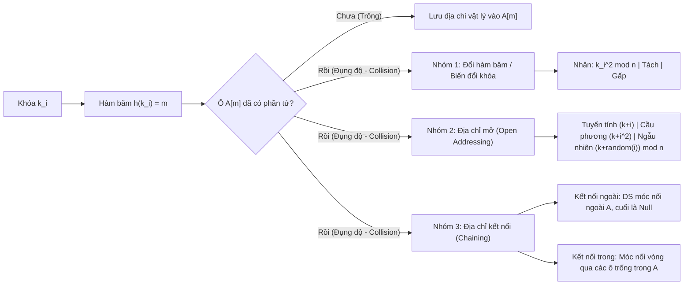
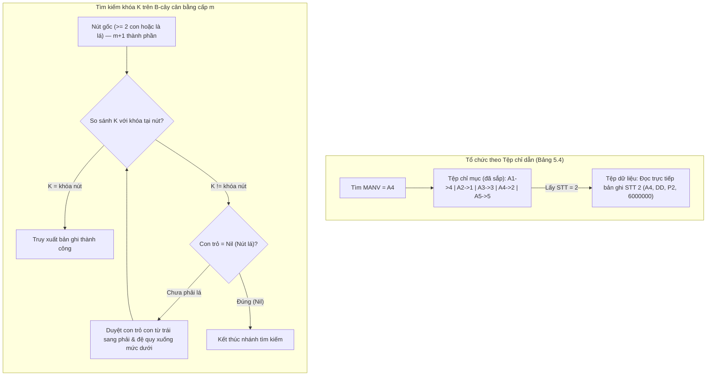

# Chương 5: Tổ chức vật lý của dữ liệu (Phương pháp Ghi chép Cornell)

> **Hướng dẫn sử dụng ghi chú Cornell (Cornell Note-taking System):**
> - **Cột Trái (Cue Column — Từ khóa / Câu hỏi gợi nhớ):** Chứa các khái niệm trọng tâm, câu hỏi kích thích trí nhớ và công thức mấu chốt. Hãy che cột phải và dùng cột trái để tự truy hồi kiến thức.
> - **Cột Phải (Note-taking Column — Ghi chú chi tiết):** Trình bày đầy đủ định nghĩa, ví dụ, cấu trúc lưu trữ, công thức và giải thuật bám sát Chương 5 giáo trình *Thực hành Cơ sở dữ liệu*.
> - **Phần Tổng kết (Summary):** Cô đọng bản chất cốt lõi ngay sau mỗi mục và cuối toàn chương để hệ thống hóa nhanh trước khi làm bài tập.

---

## 1. Các Khái niệm Cơ sở: Bản ghi Logic, Bản ghi Vật lý (Khối/Trang) & Tệp Bản ghi (Mục 5.1)

| Từ khóa / Câu hỏi gợi nhớ | Ghi chú chi tiết (Nội dung cốt lõi) |
| :--- | :--- |
| **Tổ chức lưu trữ CSDL trên bộ nhớ thứ cấp** | Trên bộ nhớ thứ cấp (`secondary`), CSDL được lưu trữ trong một hay nhiều **tệp (file)**; mỗi tệp gồm một hay nhiều **bản ghi (record)**; mỗi bản ghi gồm một hay nhiều **trường (field)**. Thông thường: `1 bản ghi` $\leftrightarrow$ `1 thực thể` và `1 trường` $\leftrightarrow$ `1 thuộc tính`. |
| **Bản ghi logic vs. Bản ghi vật lý (Khối / Trang)** | - **Bản ghi logic (Logical record):** Bản ghi ở mức khái niệm mà người dùng yêu cầu hệ QTCSDL cung cấp (ví dụ: bản ghi về nhân viên có mã số `NV01`). Các bản ghi logic có thể có kích thước khác nhau (giữa các quan hệ khác nhau). - **Bản ghi vật lý (Physical record):** Đơn vị truyền tải dữ liệu qua lại giữa đĩa từ và vùng nhớ đệm trong bộ nhớ chính. Trong nhiều tài liệu CSDL, bản ghi vật lý được gọi là **khối (block)** hoặc **trang (page)**. - Khối có kích thước cố định do tính chất vật lý đĩa từ và hệ điều hành quyết định; thông thường một khối chứa **nhiều hơn một** bản ghi logic. |
| **Cơ chế ánh xạ & Ví dụ bảng `NHÂN VIÊN` (Bảng 5.1)** | Khi người dùng yêu cầu bản ghi `NV01`, hệ QTCSDL ánh xạ bản ghi logic này vào một bản ghi vật lý và truy xuất nó ở vùng nhớ đệm trong bộ nhớ chính. **Ví dụ Bảng 5.1 (`NHÂN VIÊN` lưu trong 2 khối):** - **Khối 1:** `(SL21, AAAAAA, GIAM DOC, BH12334, P5)`, `(SG37, BBBBBB, THƯ KÝ, BX23467, P3)`, `(SG14, CCCCCC, NHAN VIEN, BH34555, P3)` - **Khối 2:** `(SA9, DDDDD, TRƯỞNG PHÒNG, BK33422, P7)`, `(SG5, EEEEEE, NHÂN VIÊN, BH34577, P3)`, `(SL41, FFFFFFF, NHÂN VIÊN, BA23667, P5)` |
| **Hai cách ánh xạ CSDL vào tệp** | 1. Sử dụng một số tệp mà mỗi tệp chỉ chứa các bản ghi có **cùng kích thước** (kích thước cố định). 2. Tổ chức các tệp chứa được các bản ghi có **kích thước khác nhau** (kích thước thay đổi). |
| **Tệp bản ghi kích thước cố định & Ví dụ `Taikhoan` (40 byte)** | **Ví dụ 1:** `Type Taikhoan = Record` &nbsp;&nbsp;`Tenchinhdanh : Char(22);` &nbsp;&nbsp;`Mataikhoan : Char(10);` &nbsp;&nbsp;`Sodu : Real;` `End;` - Nếu mỗi `Char` chiếm **1 byte**, mỗi số thực `Real` chiếm **8 byte** $\Rightarrow$ kích thước 1 bản ghi = $22 + 10 + 8 = \mathbf{40\text{ byte}}$. - Lưu liên tiếp: 40 byte đầu cho bản ghi 1, 40 byte tiếp theo cho bản ghi 2, ... |
| **Hai vấn đề lớn khi lưu/xóa bản ghi kích thước cố định** | 1. **Khó xóa bản ghi:** Không gian chứa bản ghi bị xóa phải được dùng lại cho bản ghi khác, hoặc phải đánh dấu để bỏ qua trong mọi xử lý. 2. **Bản ghi nằm chồng lên biên khối:** Nếu kích thước khối không phải là bội số của `40`, một phần bản ghi nằm ở khối này và phần còn lại nằm ở khối khác $\Rightarrow$ phải truy cập **cả 2 khối** mỗi khi đọc hoặc viết bản ghi đó. |
| **Các cách xử lý khoảng trống khi xóa bản ghi** | - *Cách 1 (Dịch chuyển tuần tự):* Đẩy mọi bản ghi đứng sau lên trước 1 vị trí $\to$ tốn rất nhiều thao tác dịch chuyển. - *Cách 2 (Chuyển bản ghi cuối):* Chuyển bản ghi cuối cùng của tệp vào chỗ bản ghi vừa xóa $\to$ đơn giản hơn nhưng vẫn tốn truy cập khối. - *Cách 3 (Chỉ đánh dấu xóa):* Không đủ, vì rất khó tìm lại khoảng trống khi thêm bản ghi mới. - **Giải pháp tối ưu — Đầu tệp (`file header`) & Danh sách móc nối:** Dành một số byte đầu tệp làm **đầu tệp (`file header`)** lưu địa chỉ (con trỏ) bản ghi bị xóa đầu tiên; bản ghi bị xóa đó lại lưu địa chỉ bản ghi bị xóa thứ hai,... tạo thành **danh sách móc nối các bản ghi bị xóa** (Ví dụ Hình 5.1: `Header` $\to$ `Record 1` $\to$ `Record 4` $\to$ `Record 6`). - **Khi thêm bản ghi mới:** Lấy ô trống mà `file header` trỏ tới và cập nhật `file header` trỏ sang bản ghi trống tiếp theo. Nếu không còn bản ghi trống nào, thêm bản ghi mới vào **cuối tệp**. |
| **Tệp bản ghi kích thước thay đổi & Ví dụ `Dstaikhoan`** | - **Nhược điểm khi thêm/xóa:** Với tệp kích thước cố định, chỗ trống vừa đúng 1 bản ghi mới; với tệp kích thước thay đổi, bản ghi thêm vào có thể không vừa với khoảng trống do phép xóa trước đó để lại. - **Ví dụ `Dstaikhoan`:** `Type Dstaikhoan = Record` &nbsp;&nbsp;`Tenchinhdanh : Char(22);` &nbsp;&nbsp;`ThongtinTK : Array [1..maxsize] of Record Mataikhoan : Char(10); Sodu : real; End;` `End;` (`ThongtinTK` là mảng có số phần tử tùy ý không vượt quá dung lượng đĩa từ). - **Giải pháp cài đặt đơn giản:** Thêm **ký hiệu kết thúc bản ghi** vào cuối mỗi bản ghi, rồi lưu trữ mỗi bản ghi như một xâu các byte liên tiếp. |

> **Tóm tắt Mục 1 (Cornell Summary):** Dữ liệu CSDL trên đĩa được tổ chức thành tệp chứa các bản ghi logic (ứng với thực thể) và truyền tải vào bộ nhớ chính theo từng bản ghi vật lý (khối/trang). Với tệp bản ghi kích thước cố định (như `Taikhoan` 40 byte), hai vấn đề chính là bản ghi vắt qua biên khối và quản lý ô trống khi xóa — được giải quyết hiệu quả bằng `file header` kết hợp danh sách móc nối các bản ghi bị xóa (`Record 1 -> 4 -> 6`). Với tệp kích thước thay đổi (`Dstaikhoan`), giải pháp đơn giản là gắn ký hiệu kết thúc bản ghi và lưu như xâu byte liên tiếp.

---

## 2. Phương pháp Tổ chức Tuần tự & Tổ chức Ngẫu nhiên (Hàm Băm - Hashing) (Mục 5.2.1 - 5.2.2.1)

| Từ khóa / Câu hỏi gợi nhớ | Ghi chú chi tiết (Nội dung cốt lõi) |
| :--- | :--- |
| **Phương pháp tổ chức tuần tự (Sequential)** | - Các phần tử (bản ghi) được xếp **lần lượt** hết phần tử này đến phần tử khác. - **Tìm kiếm tuần tự:** Dò tìm từ đầu tệp cho đến khi bắt gặp phần tử cần tìm. *(Ví dụ: Danh sách `(Mai, 17)`, `(Mận, 35)`, `(Đào, 24)`, `(Lan, 44)` — muốn biết tuổi của Đào phải đọc qua 3 bản ghi trước đó).* |
| **Các thao tác trên tệp tuần tự (`pack`)** | - **Thêm bản ghi:** Thêm vào **cuối tệp**. - **Chèn bản ghi vào giữa:** Phải thực hiện dịch chuyển các bản ghi phía sau xuống dưới, rồi mới đưa phần tử mới vào. - **Xóa bản ghi:** Đánh dấu vào bản ghi đó và không dùng con trỏ tới nó nữa (**xóa logic**). Muốn xóa hẳn về mặt vật lý, phải nhặt nhạnh các bản ghi không bị đánh dấu xóa và ghi lại thành tệp mới (thao tác **`pack`**). |
| **Phương pháp tổ chức ngẫu nhiên (Random / Hashing)** | - Mỗi phần tử được đặc trưng bởi khóa $k_i$ và lưu tại địa chỉ tính trực tiếp theo khóa. - Sử dụng một miền nhớ $A$ gọi là **miền rải** gồm $n$ ô nhớ ($A[0..n-1]$ nếu tệp có $n$ phần tử); mỗi ô $A[m]$ lưu **địa chỉ vật lý** của bản ghi có khóa tương ứng trên tệp. - Dùng hàm $h$ đặt tương ứng khóa $k_i$ với một số $m$ ($0 \le m < n$): $h(k_i) = m$ ($m$ gọi là **địa chỉ rải**). |
| **Quy trình truy cập phần tử theo tổ chức ngẫu nhiên** | Nhập khóa $k_i$ $\longrightarrow$ Tính $h(k_i) = m$ $\longrightarrow$ Lấy địa chỉ vật lý lưu trong ô $A[m]$ $\longrightarrow$ Dựa vào địa chỉ vật lý để định vị trực tiếp đến bản ghi cần tìm trên tệp. |
| **Hàm rải / Hàm băm (`Hashing function`) & Hàm modulo** | - **Khái niệm:** Quy luật đặt tương ứng khóa $k_i$ với số $m$ gọi là hàm rải (hàm băm). Băm là cắt nhỏ khóa mẫu tin rồi tổ hợp ra giá trị địa chỉ sao cho các mẫu tin phân bố rải khắp không gian nhớ, hạn chế trùng địa chỉ nhau. - Mục tiêu: Xây dựng $h$ **càng đơn ánh càng tốt** ($k_i \neq k_j \Rightarrow h(k_i) \neq h(k_j)$). - **Hàm modulo quen thuộc:** $h(k_i) = k_i \bmod n$. |
| **Ví dụ minh họa hàm modulo (Bảng 5.2 & Ví dụ 2)** | - **Bảng 5.2** ($n = 7$, tập khóa `[5, 14, 15, 3, 6, 4, 16]`): $h(5)=5,\; h(14)=0,\; h(15)=1,\; h(3)=3,\; h(6)=6,\; h(4)=4,\; h(16)=2$. Miền rải $A[0..6]$ chứa đủ 7 khóa, **không xảy ra đụng độ**. - **Ví dụ 2** ($n = 5$, tập khóa `[7, 10, 8, 3, 4]`): $h(7)=2,\; h(10)=0,\; h(8)=3,\; h(3)=3,\; h(4)=4$. Hai khóa `8` và `3` có cùng địa chỉ rải `3` $\Rightarrow$ xuất hiện **hiện tượng đụng độ**. |

> **Tóm tắt Mục 2 (Cornell Summary):** Tổ chức tuần tự lưu các bản ghi nối tiếp nhau, thuận tiện khi thêm cuối tệp nhưng chậm khi tìm kiếm, chèn giữa phải dịch chuyển và xóa chỉ là đánh dấu logic (cần `pack` để dọn tệp). Tổ chức ngẫu nhiên dùng hàm băm $h(k_i) = k_i \bmod n$ ánh xạ khóa vào miền rải $A[0..n-1]$ giúp truy cập gần như trực tiếp, nhưng có thể phát sinh đụng độ khi hai khóa khác nhau cho cùng một địa chỉ rải.

---

## 3. Hiện tượng Đụng độ (Collision) và Các Phương pháp Khắc phục Đụng độ (Mục 5.2.2.2)

| Từ khóa / Câu hỏi gợi nhớ | Ghi chú chi tiết (Nội dung cốt lõi) |
| :--- | :--- |
| **Hiện tượng đụng độ (`Collision`) là gì?** | Là hiện tượng có **nhiều phần tử có khóa khác nhau nhưng có địa chỉ rải giống nhau** ($k_i \neq k_j$ nhưng $h(k_i) = h(k_j) = m$). Có **3 nhóm phương pháp** khắc phục đụng độ: 1. Thay đổi hàm băm hay biến đổi khóa. 2. Phương pháp địa chỉ mở. 3. Phương pháp địa chỉ kết nối (kết nối ngoài & kết nối trong). |
| **Nhóm 1: Thay đổi hàm băm / Biến đổi khóa** | Chọn $h$ gần đơn ánh hơn, hoặc biến đổi tập khóa $k_i \to k_i'$ rồi mới lấy modulo: - **Phương pháp nhân:** $h(k_i) = k_i^2 \bmod n$. - **Phương pháp tách:** Tách khóa $k_i$ thành 2 hay nhiều phần khác nhau, cộng hoặc nhân các phần đó lại rồi mới lấy modulo. &nbsp;&nbsp;*Ví dụ 1:* $k_i = 1999 \to$ tách thành `19` và `99` $\to$ cộng lại: $19 + 99 = 118 \to h(118) = 118 \bmod n$. - **Phương pháp gấp:** Viết dãy chữ số của $k_i$ và gấp lại (như gấp giấy), cộng hoặc nhân các phần gấp rồi lấy modulo. &nbsp;&nbsp;*Ví dụ 2:* Khóa `199890` gấp 3 thành `19`, `89`, `90` $\to$ cộng lại: $19 + 89 + 90 = 198 \to h(198) = 198 \bmod n$. |
| **Nhóm 2: Phương pháp địa chỉ mở (`Open Addressing`)** | Nếu tại $A[m]$ xảy ra đụng độ giữa $k_i$ và $k_j$: phần tử đến trước giữ nguyên $A[m]$, phần tử sau được dời sang một ô **lân cận còn trống** bằng một trong 3 phép thử (với $1 \le i \le n - 1$): - **Thử tuyến tính:** $h(k) = (k + i) \bmod n$. - **Thử cầu phương:** $h(k) = (k + i^2) \bmod n$. - **Thử ngẫu nhiên:** $h(k) = (k + \text{random}(i)) \bmod n$. |
| **Ví dụ minh họa thử tuyến tính** | - **Ví dụ 1** (`K = [7, 10, 8, 3, 4]`, $n = 5$): Khóa `8` giữ $A[3]$; khóa `3` đụng độ tại `3`: thử $i=1 \to 4$ (có `4`), $i=2 \to 0$ (có `10`), $i=3 \to 1$ (trống) $\Rightarrow$ `3` lưu vào $A[1]$. - **Ví dụ 2** (`K = [5, 7, 10, 13, 15, 17, 24]`, $n = 7$): `10, 17, 24` cùng có $k \bmod 7 = 3$. `10` giữ $A[3]$; `17` thử $i=1 \to 18 \bmod 7 = 4 \Rightarrow A[4]$; `24` thử $i=1..6 \to 4, 5, 6, 0, 1, 2 \Rightarrow$ lưu vào $A[2]$. |
| **Nhóm 3a: Phương pháp kết nối ngoài (`External Chaining`)** | - Mỗi ô $A[m]$ của miền rải là **nút đầu của một danh sách móc nối** nằm ngoài miền rải, lưu con trỏ trỏ đến các phần tử đụng độ có cùng địa chỉ rải $m$, kết thúc danh sách bằng `Null`. - *Ví dụ (`[7, 10, 8, 3, 4]`, $n=5$):* $A[0] \to 10 \to \text{Null}$, $A[1] \to \text{Null}$, $A[2] \to 7 \to \text{Null}$, $A[3] \to 8 \to 3 \to \text{Null}$, $A[4] \to 4 \to \text{Null}$. - **Trình tự truy cập:** $k_i \to h(k_i) \to m \to A[m] \to$ tìm tuần tự trên danh sách móc nối có nút đầu $A[m]$. *(Giống các hộ tranh chấp số nhà mặt tiền $m$ cùng đi vào ngõ $m/1, m/2, \dots$)*. |
| **Nhóm 3b: Phương pháp kết nối trong (`Internal Chaining`)** | - Mỗi ô $A[m]$ chia làm **2 phần**: Phần 1 lưu địa chỉ vật lý của phần tử có địa chỉ rải $m$; Phần 2 lưu **con trỏ** đến một ô còn trống khác trong chính miền $A$ chứa phần tử đụng độ. - Nếu $h(k_i) = h(k_j) = h(k_l) = m$: $A[m]$ lưu $k_i$ và trỏ đến ô trống $A[t]$ lưu $k_j$; $A[t]$ trỏ đến ô trống $A[v]$ lưu $k_l$; $A[v]$ trỏ vòng lại về $A[m]$. - *Ví dụ (`[7, 10, 8, 3, 4]`, $n=5$):* Ô trống $A[1]$ lưu địa chỉ vật lý của khóa `3`; con trỏ ở $A[3]$ trỏ đến $A[1]$ và con trỏ ở $A[1]$ trỏ lại $A[3]$. - **Ưu/nhược điểm:** Cũng phải dò trên danh sách móc nối khi truy cập, nhưng **ít tốn bộ nhớ hơn** phương pháp kết nối ngoài. |

> **Tóm tắt Mục 3 (Cornell Summary):** Đụng độ xảy ra khi các khóa khác nhau ánh xạ về cùng một ô $A[m]$. Ba hướng giải quyết chính gồm: (1) biến đổi khóa hoặc đổi hàm băm (nhân, tách, gấp) để phân bố đều hơn; (2) địa chỉ mở dùng phép thử (tuyến tính, cầu phương, ngẫu nhiên) tìm ô trống kế tiếp ngay trong $A$; và (3) kết nối (kết nối ngoài dùng danh sách móc nối ngoài $A$ kết thúc bằng `Null`, kết nối trong tận dụng ô trống ngay trong $A$ nối thành vòng khép kín nên tiết kiệm bộ nhớ hơn).

---

## 4. Phương pháp Tổ chức theo Tệp Chỉ dẫn (Index File) & Tổ chức Dạng B-Cây (Mục 5.2.3 - 5.2.4)

| Từ khóa / Câu hỏi gợi nhớ | Ghi chú chi tiết (Nội dung cốt lõi) |
| :--- | :--- |
| **Phương pháp tổ chức theo Tệp chỉ dẫn (`Index File` / Tệp chỉ mục)** | Bên cạnh tệp dữ liệu chính (các bản ghi có thể chưa sắp xếp), ta tạo thêm một **tệp chỉ mục** gồm **2 trường chính**: 1. **Trường 1:** Giá trị khóa của các mẫu tin đã được **sắp thứ tự**. 2. **Trường 2 (`STT`):** Thứ tự vật lý của mẫu tin đó trên tệp dữ liệu. **Quy trình truy cập khóa $k_i$:** Tra tìm khóa $k_i$ trên tệp chỉ dẫn để lấy `STT` $\longrightarrow$ định vị trực tiếp tới bản ghi thứ `STT` trên tệp dữ liệu. |
| **Ví dụ tệp chỉ dẫn bảng `NHANVIEN` (Bảng 5.4)** | - **File dữ liệu `NHANVIEN`** (khóa `MANV`, lưu lộn xộn): `STT 1`: `A2` | `STT 2`: `A4` | `STT 3`: `A3` | `STT 4`: `A1` | `STT 5`: `A5` - **File chỉ mục** (sắp theo `MANV`): `(A1, 4)` — `(A2, 1)` — `(A3, 3)` — `(A4, 2)` — `(A5, 5)` - Khi tìm `MANV = A4`: tra tệp chỉ mục thấy `(A4, STT=2)` $\Rightarrow$ đọc trực tiếp bản ghi thứ 2 trên tệp dữ liệu. |
| **Phương pháp tổ chức dạng B-cây cân bằng (`Balanced B-Tree`)** | Là kiểu tổ chức dữ liệu phổ biến trong các hệ CSDL, tổ chức thành một tập các nút phân cấp cân bằng. |
| **3 tính chất của B-cây cân bằng cấp $m$** | 1. **Nút gốc:** Hoặc là 1 nút lá, hoặc có **ít nhất 2 nút con**. 2. **Các nút trung gian** (trừ nút gốc và nút lá): Có từ **$\lceil m/2 \rceil$ đến $m$ nút con**. 3. **Tính cân bằng:** Mọi đường đi từ nút gốc đến bất kỳ nút lá nào đều có **độ dài như nhau**. |
| **Cấu trúc lưu trữ của một nút B-cây cấp $m$** | Mỗi nút có **$m + 1$ thành phần**: - **1 thành phần** lưu trữ thông tin về mẫu tin (khóa/dữ liệu). - **$m$ thành phần còn lại** là các con trỏ trỏ đến tối đa $m$ nút con của nó. |
| **Thuật toán tìm kiếm khóa $K$ trên B-cây** | 1. Bắt đầu duyệt từ **nút gốc** đi xuống. 2. So sánh $K$ với khóa lưu trong nút đang xét (nút cha): nếu $K$ bằng khóa trong nút đó $\Rightarrow$ **truy xuất dữ liệu thành công**. 3. Ngược lại, lần xuống các nút con duyệt **từ trái sang phải** cho đến khi hết các nút con hoặc tiếp tục đệ quy xuống mức thấp hơn cho đến khi gặp **nút lá** (nút có con trỏ = `Nil`). |

> **Tóm tắt Mục 4 (Cornell Summary):** Tệp chỉ dẫn tách riêng một bảng chỉ mục nhỏ đã sắp xếp theo khóa kèm `STT` vật lý, giúp tra cứu nhanh mà không cần sắp xếp lại tệp dữ liệu gốc. B-cây cân bằng cấp $m$ tổ chức các nút gồm $m+1$ thành phần (1 thông tin mẫu tin + $m$ con trỏ con), đảm bảo mọi nút trong có $\lceil m/2 \rceil \dots m$ con và mọi đường đi từ gốc đến lá dài bằng nhau, cho phép tìm kiếm đệ quy từ gốc xuống lá ổn định và hiệu quả.

---

## Tóm tắt toàn chương (Cornell Summary)

1. **Đơn vị lưu trữ & Định dạng tệp (5.1):** Dữ liệu trên đĩa nằm trong các tệp chứa bản ghi logic và được nạp vào bộ nhớ chính theo đơn vị vật lý là **khối (block)** / **trang (page)**. Tệp bản ghi kích thước cố định (`40 byte`) dễ quản lý nhưng có thể bị vắt ngang biên khối và cần `file header` móc nối các ô bị xóa để tái sử dụng chỗ trống; tệp kích thước thay đổi khắc phục bằng ký hiệu kết thúc bản ghi.
2. **Tuần tự vs. Ngẫu nhiên / Băm (5.2.1 – 5.2.2):** Tổ chức tuần tự đơn giản khi nối cuối nhưng dò tìm $O(n)$, chèn phải dịch chuyển, xóa chỉ đánh dấu logic (cần `pack`). Tổ chức ngẫu nhiên dùng hàm băm $h(k_i) = k_i \bmod n$ ánh xạ vào miền rải $A[0..n-1]$; khi xảy ra **đụng độ**, ta xử lý bằng 3 hướng: đổi hàm băm (nhân, tách, gấp), địa chỉ mở (thử tuyến tính, cầu phương, ngẫu nhiên), hoặc kết nối (kết nối ngoài vs. kết nối trong).
3. **Chỉ mục & B-cây (5.2.3 – 5.2.4):** Tệp chỉ dẫn giữ khóa đã sắp xếp gắn với `STT` vật lý để định vị nhanh bản ghi trên tệp dữ liệu. B-cây cân bằng cấp $m$ duy trì độ sâu đồng nhất tới mọi nút lá, mỗi nút có $m+1$ thành phần và từ $\lceil m/2 \rceil$ đến $m$ con, hỗ trợ tìm kiếm từ gốc xuống lá hiệu quả cho các hệ QTCSDL.

---

## Câu hỏi tự kiểm tra nhanh (Self-Testing Cues)

1. Tại sao bản ghi có kích thước cố định `40 byte` lại có thể gây ra việc phải đọc **2 khối (block)** chỉ để lấy 1 bản ghi logic?
2. `File header` hoạt động như thế nào khi xóa và thêm mới bản ghi trong tệp có kích thước cố định? Tại sao cách này lại gặp khó khăn với tệp kích thước thay đổi?
3. Trong tệp tuần tự, sự khác biệt giữa **xóa logic** và thao tác **`pack`** là gì?
4. Tính kết quả biến đổi khóa `1999` theo phương pháp **tách** và `199890` theo phương pháp **gấp 3** trước khi lấy modulo $n$.
5. So sánh ưu/nhược điểm về bộ nhớ và cấu trúc con trỏ giữa **kết nối ngoài** (`Null`) và **kết nối trong** (móc nối vòng trong miền rải $A$).
6. Nêu đầy đủ **3 tính chất** của B-cây cân bằng cấp $m$ và cho biết ý nghĩa của `m + 1` thành phần trong một nút.
