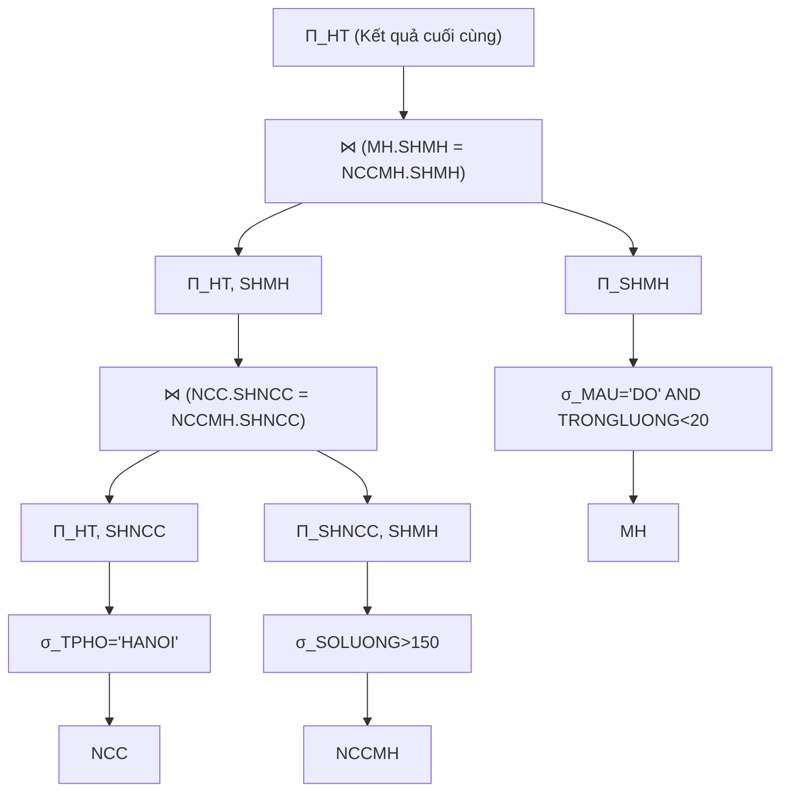
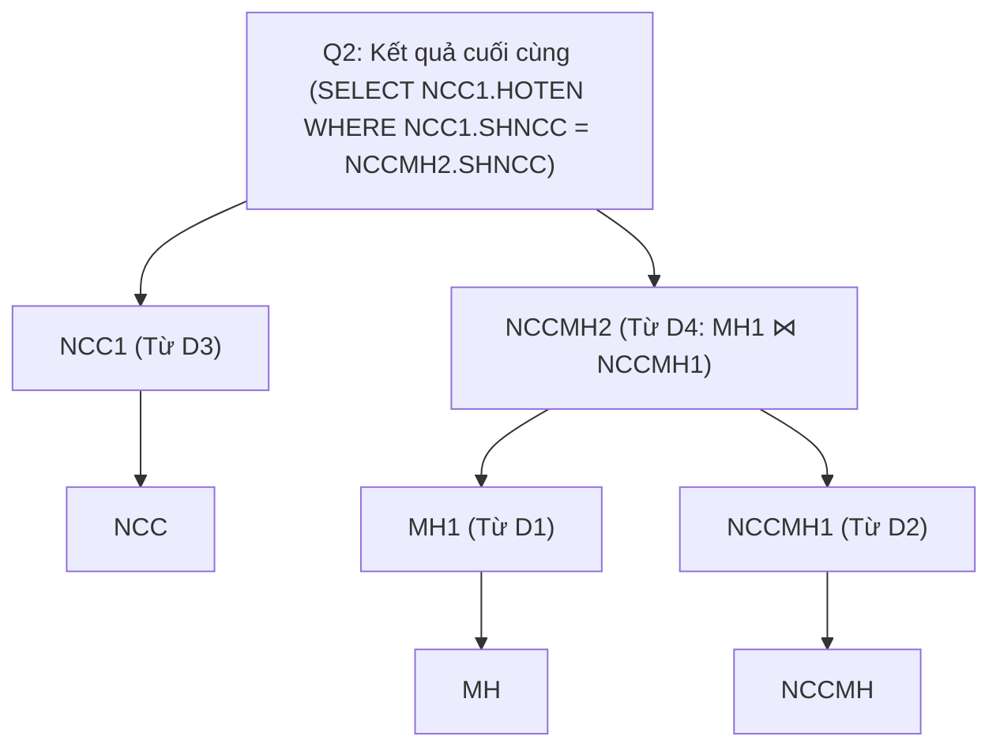

# Chương 6: Xử lý và tối ưu hóa câu hỏi (Phương pháp Ghi chép Cornell)

> **Cấu trúc ghi chép Cornell (Cornell Note-taking System):**
> - **Cột Trái (Cue Column — Từ khóa / Câu hỏi gợi nhớ):** Ghi các khái niệm trung tâm, tên quy tắc, công thức và câu hỏi định hướng giúp truy xuất nhanh kiến thức khi ôn tập.
> - **Cột Phải (Note-taking Column — Ghi chú chi tiết):** Trình bày đầy đủ nội dung cốt lõi, công thức toán học, ví dụ minh họa và các bước giải thuật bám sát giáo trình.
> - **Phần Tổng kết (Cornell Summary):** Tóm lược súc tích ý nghĩa trọng tâm ngay sau mỗi mục lớn và tổng hợp toàn chương ở cuối bài để củng cố trí nhớ dài hạn.

---

## 1. Lý do Phải Tối ưu hóa Câu hỏi & Định giá Chi phí Thực thi (Mục 6.1 - 6.2)

| Từ khóa / Câu hỏi gợi nhớ | Ghi chú chi tiết (Nội dung cốt lõi) |
| :--- | :--- |
| **Bộ xử lý câu hỏi làm gì khi nhận truy vấn?** | 1. Kiểm tra **cú pháp** câu hỏi có đúng không. 2. Kiểm tra **các quan hệ và thuộc tính** trong câu hỏi có tồn tại trong CSDL không. 3. Nếu hợp lệ, phát sinh **một phương án thực thi** (*execution plan*): xác định một dãy các bước định giá câu hỏi, mỗi bước ứng với một phép toán đại số quan hệ kèm chú giải phương pháp thực hiện phép toán đó. |
| **Sơ đồ xử lý câu truy vấn trên hệ QTCSDL gồm những bước nào?** | Quy trình xử lý tuần tự qua 6 thành phần chính: 1. **Câu hỏi (SQL Query)** $\rightarrow$ 2. **Phân tích ngữ nghĩa (Parse Query)** $\rightarrow$ 3. **Cây biểu thức** $\rightarrow$ 4. **Xây dựng kế hoạch truy vấn logic (Select Logical Query Plan)** $\rightarrow$ **Câu truy vấn logic** $\rightarrow$ 5. **Xây dựng kế hoạch truy vấn vật lý (Select Physical Query Plan)** $\rightarrow$ **Câu truy vấn vật lý** $\rightarrow$ 6. **Thực thi (Execute Plan)**. |
| **Giai đoạn lên phương án gồm 2 bước nào?** | Gồm **Tối ưu logic câu truy vấn** và **Tối ưu vật lý câu truy vấn**. Sau giai đoạn này, hệ thống chọn được một phương án có chi phí nhỏ nhất trong các phương án tương đương để thực thi. |
| **Quá trình tối ưu logic thực hiện những việc gì?** | Thực hiện ngay sau bước phân tích ngữ nghĩa: - **Phân tích câu hỏi:** Loại bỏ câu vô nghĩa, câu hỏi tương đương, câu chung chung về ngữ nghĩa. - Đưa các sơ đồ của bài toán về **dạng chuẩn tắc**. - **Tối ưu các biểu thức đại số quan hệ**, thực hiện **phép nửa nối**. - **Lưu ý quan trọng:** Giai đoạn này **không tính chi phí thực hiện** (việc định giá chi phí thuộc về giai đoạn tối ưu vật lý). |
| **Mục đích của tối ưu hóa câu hỏi là gì?** | Tìm ra **một phương án thực thi** trong số tất cả các phương án tương đương có thể có (theo nghĩa luôn cho cùng một kết quả), được định giá với **chi phí nhỏ nhất**. |
| **Chi phí thực thi được tính theo công thức nào? Thành phần nào chi phối?** | $\text{Tổng chi phí} = \text{Chi phí I/O (Input/Output)} + \text{Chi phí xử lý trên CPU}$ - **Chi phí CPU:** Đo bằng số phép so sánh để lấy ra số bộ cần tìm. - **Chi phí I/O (chi phối/vượt trội):** Do việc truyền dữ liệu giữa **bộ nhớ chính (RAM)** và **bộ nhớ thứ cấp (đĩa từ)**, vì dữ liệu CSDL thực tế quá lớn, không thể chứa hết trong bộ nhớ chính. |
| **Thỏa hiệp giữa thời gian và lưu trữ?** | Không nhất thiết tối ưu trên mọi khả năng cài đặt; có thể thỏa hiệp giữa thuật toán phức tạp / không gian lưu trữ với việc **tiết kiệm thời gian xử lý** (thường ưu tiên tối ưu thời gian hơn dung lượng đĩa cứng). - *Ví dụ nhân khẩu:* Máy xử lý nhanh $1.000\text{ bản ghi/giây}$, nhưng với $4.000.000\text{ bản ghi}$ phải mất $4.000\text{ giây}$ ($\approx 66{,}7$ phút) — thời gian chờ không thể chấp nhận nếu không tối ưu. |
| **Tại sao tích Descartes và phép kết nối gây nguy cơ thiếu không gian tính toán?** | Cho $r(A_1,\dots,A_n)$ có $n_1$ bộ và $s(B_1,\dots,B_m)$ có $n_2$ bộ $\Rightarrow r \times s$ tạo bảng trung gian có **$n + m$ thuộc tính** và **$n_1 \times n_2$ bộ**. - *Ví dụ bùng nổ kích thước:* Mỗi quan hệ chỉ có $10$ thuộc tính và $1.000$ bộ, rộng $5\text{ byte/trường}$ $\Rightarrow r \times s$ có $20$ thuộc tính và $1.000.000$ bộ $\Rightarrow$ tốn $1.000.000 \times 20 \times 5 = 100.000.000\text{ byte} \approx 1/10\text{ GB}$ cho bảng trung gian cùng thời gian truy xuất đĩa lớn. |
| **Không gian tìm kiếm phương án thực thi lớn cỡ nào?** | Nếu câu hỏi có $m$ phép toán và mỗi phép toán có $k$ phương pháp cài đặt khác nhau, số phương án thực thi tương đương có thể lên tới **$(m!) \cdot k^m$**. - Tập tất cả phương án tương đương là **không gian tìm kiếm**. Vì việc tìm phương án tối ưu tuyệt đối rất tốn kém và đòi hỏi thông tin cài đặt/nội dung tệp (thường không có sẵn trong thư mục DBMS), tối ưu hóa câu hỏi thường nhằm tìm **phương án tương đối hiệu quả, gần với tối ưu**. |
| **Ví dụ định giá chi phí I/O trên CSDL `NCC - MH - NCCMH` (Mục 6.2)?** | Cho CSDL: `NCC(SHNCC, HT, TPHO)` ($100$ bộ), `MH(SHMH, TENH, MAU, TRONGLUONG)`, `NCCMH(SHNCC, SHMH, SOLUONG)` ($10.000$ bộ, trong đó chỉ $50$ bộ có `SHMH = 'P2'`). Câu hỏi: *Tìm tên các nhà cung cấp có cung cấp mặt hàng số hiệu P2.* - **Biểu thức (1) — chưa tối ưu:** $\Pi_{HT}(\sigma_{SHMH='P2'}(NCCMH * NCC))$   - *Bước 1:* Kết nối `NCCMH * NCC` trên `SHNCC`: đọc $10.000$ bộ `NCCMH` + đọc $100$ bộ `NCC` + so sánh + ghi $10.000$ bộ kết quả trung gian ra đĩa $\Rightarrow 20.100$ I/O.   - *Bước 2:* Chọn `SHMH = 'P2'` trên kết quả B1: đọc lại $10.000$ bộ từ đĩa $\Rightarrow 50$ bộ (đủ nhỏ để giữ trong bộ nhớ chính) $\Rightarrow 10.000$ I/O.   - *Bước 3:* Chiếu lên `HT` trong bộ nhớ chính $\Rightarrow 0$ I/O.   - $\Rightarrow$ **Tổng chi phí BT(1) = $30.100$ thao tác I/O.** - **Biểu thức (2) — đã tối ưu:** $\Pi_{HT}(\sigma_{SHMH='P2'}(NCCMH) * NCC)$   - *Bước 1:* Chọn `SHMH = 'P2'` trên `NCCMH`: đọc $10.000$ bộ $\Rightarrow 50$ bộ giữ trong bộ nhớ chính $\Rightarrow 10.000$ I/O.   - *Bước 2:* Kết nối kết quả B1 với `NCC`: đọc $100$ bộ `NCC` $\Rightarrow 50$ bộ giữ trong bộ nhớ chính $\Rightarrow 100$ I/O.   - *Bước 3:* Chiếu lên `HT` trong bộ nhớ chính $\Rightarrow 0$ I/O.   - $\Rightarrow$ **Tổng chi phí BT(2) = $10.100$ thao tác I/O** (giảm gần $3$ lần so với BT(1)). |

> **Tóm tắt Mục 1 (Cornell Summary):** Tối ưu hóa câu hỏi nhằm chọn một phương án thực thi tương đương có tổng chi phí (chủ yếu là chi phí I/O đọc/ghi đĩa) nhỏ nhất từ không gian tìm kiếm khổng lồ $(m!) \cdot k^m$. Đưa phép chọn xuống thực hiện trước phép kết nối giúp loại bỏ dữ liệu thừa sớm, tránh ghi kết quả trung gian khổng lồ ra đĩa và giảm mạnh số thao tác I/O (như từ $30.100$ xuống $10.100$ I/O).

---

## 2. Các Phương pháp Tổng quát & 6 Chiến lược Tối ưu hóa của J.D. Ullman (Mục 6.3)

| Từ khóa / Câu hỏi gợi nhớ | Ghi chú chi tiết (Nội dung cốt lõi) |
| :--- | :--- |
| **4 phương pháp tổng quát để tối ưu hóa câu hỏi là gì?** | 1. **Biến đổi đại số quan hệ:** Dùng các luật (quy tắc) biến đổi biểu thức ĐSQH thành biểu thức tương đương tối ưu hơn. 2. **Phân rã câu hỏi (*Query Decomposition*):** Tách câu hỏi phức tạp thành các câu hỏi con đơn giản hơn. 3. **Phép nửa nối (*Semijoin*):** Giảm kích thước các quan hệ trước khi tham gia phép kết nối. 4. **Tối ưu hóa trên cơ sở ước lượng chi phí:** Liệt kê, ước lượng kích thước trung gian và chi phí các phương án để chọn phương án chi phí thấp nhất. |
| **Chiến lược 1 của J.D. Ullman?** | **Thực hiện phép chọn càng sớm càng tốt:** Đẩy phép chọn vào thực hiện trước giúp giảm số bộ tham gia vào các phép toán sau, thu nhỏ kết quả trung gian $\Rightarrow$ giảm chi phí truy cập bộ nhớ và lưu trữ. |
| **Chiến lược 2 của J.D. Ullman?** | **Tổ hợp phép chọn với tích Descartes thành phép kết nối:** Phép kết nối (đặc biệt là kết nối bằng — *equijoin*) ít tốn kém hơn nhiều so với tích Descartes $r \times s$. Khi tích Descartes là đối số của phép chọn chứa phép so sánh giữa thuộc tính của $r$ và $s$, hãy gộp thành phép kết nối. |
| **Chiến lược 3 của J.D. Ullman?** | **Tổ hợp dãy các phép toán một ngôi:** Nhóm một chuỗi liên tiếp các phép chọn hoặc các phép chiếu lại với nhau để giảm số lượng phép toán phải thực hiện. |
| **Chiến lược 4 của J.D. Ullman?** | **Tìm các biểu thức con chung:** Nếu một biểu thức con xuất hiện nhiều lần và kết quả đủ nhỏ để đọc nhanh từ bộ nhớ thứ cấp, nên tính trước một lần và lưu thành **View** (khung nhìn), giúp phân rã câu hỏi thành các câu hỏi con đơn giản hơn. |
| **Chiến lược 5 của J.D. Ullman?** | **Xử lý các quan hệ trước:** Thực hiện hai công việc chuẩn bị quan trọng trước khi truy vấn/khai thác dữ liệu: **sắp xếp trước các bộ giá trị** và **thiết lập bảng chỉ mục (*Index*)** cho các bảng dữ liệu để tăng tốc độ tìm kiếm và kết nối. |
| **Chiến lược 6 của J.D. Ullman?** | **Đánh giá trước khi thực hiện tính toán:** Khi chọn trình tự thực hiện phép toán hoặc chọn thứ tự đối số của phép toán hai ngôi, cần ước tính chi phí (số phép toán, thời gian, bộ nhớ) để xác định tổng chi phí cho từng phương án thực thi. |

> **Tóm tắt Mục 2 (Cornell Summary):** Hệ QTCSDL dựa trên 4 hướng tiếp cận chính (biến đổi ĐSQH, phân rã câu hỏi, phép nửa nối, ước lượng chi phí) và 6 chiến lược kinh điển của J.D. Ullman xoay quanh tư tưởng: lọc bộ sớm, gộp tích Descartes thành kết nối, gộp phép một ngôi, tái sử dụng biểu thức con chung (View), chuẩn bị sẵn sắp xếp/Index và định giá chi phí trước khi thực thi.

---

## 3. Tối ưu hóa Biểu thức bằng Phép Biến đổi Đại số Quan hệ & Cây Đại số (Mục 6.4)

| Từ khóa / Câu hỏi gợi nhớ | Ghi chú chi tiết (Nội dung cốt lõi) |
| :--- | :--- |
| **Thế nào là hai biểu thức tương đương $E_1 \equiv E_2$?** | - Một quan hệ là tập hợp gồm $k$ bộ; hai quan hệ tương đương khi và chỉ khi chúng có **cùng tập các bộ**. - Hai biểu thức ĐSQH $E_1$ và $E_2$ được gọi là tương đương (ký hiệu $E_1 \equiv E_2$ hoặc $E_1 = E_2$) nếu khi **thay thế cùng các quan hệ vào các biến quan hệ $R_1, R_2, \dots, R_n$ tương ứng**, chúng luôn cho **cùng một kết quả**. |
| **Quy tắc 1 (Tách/gộp chuỗi phép chọn)?** | Với $F_1, F_2$ là các điều kiện chọn trên quan hệ $r$: $$\sigma_{F_1 \land F_2}(r) = \sigma_{F_1}(\sigma_{F_2}(r)) = \sigma_{F_2}(\sigma_{F_1}(r))$$ - *Ví dụ 1:* $\sigma_{(C=A) \land (D=100)}(r) = \sigma_{C=A}(\sigma_{D=100}(r))$ - *Ví dụ 2:* $\sigma_{(Mau='Do') \land (TLuong<20)}(MH) = \sigma_{TLuong<20}(\sigma_{Mau='Do'}(MH))$ |
| **Quy tắc 2 (Giao hoán phép chọn và phép kết nối / tích Descartes)?** | Áp dụng cho cả phép kết nối ($*$, $\bowtie$) và tích Descartes ($\times$): - **2a.** Nếu $F$ chỉ liên quan đến các thuộc tính của $r_1$: $\sigma_F(r_1 * r_2) = \sigma_F(r_1) * r_2$ - **2b.** Nếu $F_1$ chỉ liên quan đến $r_1$ và $F_2$ chỉ liên quan đến $r_2$: $\sigma_{F_1 \land F_2}(r_1 * r_2) = \sigma_{F_1}(r_1) * \sigma_{F_2}(r_2)$ - **2c.** Nếu $F_1$ chỉ liên quan đến $r_1$, còn $F_2$ liên quan đến cả $r_1$ và $r_2$: $\sigma_{F_1 \land F_2}(r_1 * r_2) = \sigma_{F_2}(\sigma_{F_1}(r_1) * r_2)$ - *Ví dụ 1:* $\sigma_{(B=C) \land (D=10)}(r \times s) = \sigma_{B=C}(r \times \sigma_{D=10}(s))$ - *Ví dụ 2:* $\sigma_{(Tpho='HN') \land (SL>150) \land (NCC.SHNCC=NCCMH.SHNCC)}(NCC \times NCCMH) = \sigma_{NCC.SHNCC=NCCMH.SHNCC}(\sigma_{Tpho='HN'}(NCC) \times \sigma_{SL>150}(NCCMH))$ |
| **Quy tắc 3 (Giao hoán phép chiếu và phép kết nối / tích Descartes)?** | Giả sử $U = \{A_1,\dots,A_n, B_1,\dots,B_m\}$ với $A_i$ thuộc $r_1$, $B_i$ thuộc $r_2$ (áp dụng được cho cả $\times$): - **3a.** Nếu điều kiện kết nối $F$ chỉ chứa các thuộc tính thuộc $U$: $\Pi_U(r_1 \bowtie_F r_2) = \Pi_{A_1,\dots,A_n}(r_1) \bowtie_F \Pi_{B_1,\dots,B_m}(r_2)$ - **3b.** Nếu ngoài $U$, $F$ còn chứa các thuộc tính $A_1',\dots,A_u'$ của $r_1$ và $B_1',\dots,B_v'$ của $r_2$: $\Pi_U(r_1 \bowtie_F r_2) = \Pi_U(\Pi_{A_1,\dots,A_n, A_1',\dots,A_u'}(r_1) \bowtie_F \Pi_{B_1,\dots,B_m, B_1',\dots,B_v'}(r_2))$ - *Ví dụ 1:* $\Pi_{HT}(NCC * NCCMH) = \Pi_{HT}(\Pi_{HT, SHNCC}(NCC) * \Pi_{SHNCC}(NCCMH))$ - *Ví dụ 2:* $\Pi_{HT}((NCC * NCCMH) * MH) = \Pi_{HT}(\Pi_{HT, SHMH}(\Pi_{HT, SHNCC}(NCC) * \Pi_{SHNCC, SHMH}(NCCMH)) * \Pi_{SHMH}(MH))$ |
| **Quy tắc 4 & Quy tắc 5?** | - **Quy tắc 4 (Tính kết hợp):**   $(E_1 \bowtie_{F_1} E_2) \bowtie_{F_2} E_3 = E_1 \bowtie_{F_1} (E_2 \bowtie_{F_2} E_3)$; $(E_1 * E_2) * E_3 = E_1 * (E_2 * E_3)$; $(E_1 \times E_2) \times E_3 = E_1 \times (E_2 \times E_3)$. - **Quy tắc 5 (Thay chọn + tích Descartes bằng kết nối):** Nếu $F$ có dạng $r_1.A \ \theta \ r_2.B$ ($\theta$ là phép toán so sánh): $\sigma_F(r_1 \times r_2) = r_1 \bowtie_F r_2$.   - *Ví dụ:* $\sigma_{NCC.SHNCC=NCCMH.SHNCC}(NCC \times NCCMH) = NCC \bowtie_{NCC.SHNCC=NCCMH.SHNCC} NCCMH$. |
| **4 nguyên tắc tối ưu hóa trên cơ sở đại số (Mục 6.4.3)?** | 1. **Thực hiện phép chọn càng sớm càng tốt** (dùng Quy tắc biến đổi 1, 2). 2. **Tổ hợp phép chọn và tích Descartes thành phép kết nối** mỗi khi có thể (dùng Quy tắc biến đổi 5). 3. **Nếu có nhiều phép kết nối, thực hiện trước phép kết nối "thu hẹp" nhất** (cho kết quả nhỏ nhất, dựa vào hệ số chọn và thống kê — dùng Quy tắc biến đổi 4). 4. **Chiếu sớm để loại bỏ thuộc tính không cần thiết**, giúp các phép toán sau dùng quan hệ đầu vào nhỏ hơn (dùng Quy tắc biến đổi 3). |
| **Giải thuật tối ưu hóa 5 bước (Mục 6.4.4)?** | *(Theo hệ thống đánh số quy tắc đầy đủ của J.D. Ullman trích trong giáo trình)*: - **Bước 1:** Tách một phép chọn phức hợp thành chuỗi các phép chọn đơn (dùng Quy tắc tách chọn). - **Bước 2:** Di chuyển mỗi phép chọn xuống càng thấp càng tốt trên cây. - **Bước 3:** Di chuyển mỗi phép chiếu xuống càng thấp càng tốt trên cây (bằng các quy tắc giao hoán phép chiếu và quy tắc mở rộng phép chiếu qua phép chọn). - **Bước 4:** Tổ hợp dãy các phép chọn và phép chiếu thành một phép chọn, một phép chiếu, hoặc một phép chọn theo sau bởi một phép chiếu. - **Bước 5:** Gom phép chọn với tích Descartes thành phép kết nối (nếu được) và loại bỏ các phép chiếu không cần thiết. |
| **Cây đại số biểu diễn câu hỏi là gì?** | Là cây biểu diễn biểu thức ĐSQH của câu hỏi sau khi đã kiểm tra cú pháp, quan hệ, thuộc tính và điều kiện: - **Nút lá:** Biểu diễn các quan hệ ban đầu. - **Nút trung gian:** Biểu diễn các phép toán ĐSQH ($\sigma, \Pi, \times, \bowtie, *$). - **Nút gốc:** Biểu diễn kết quả cuối cùng của câu hỏi. - Từ cây đại số, phương án thực thi được tạo bằng cách đi dọc theo cây **từ lá tới gốc**. |
| **Ví dụ biến đổi 1: `NCC - MH - NCCMH` (Mục 6.4.6)?** | *Câu hỏi:* Tìm `HT` các NCC ở Hà Nội cung cấp mặt hàng màu đỏ có trọng lượng $< 20$ kg và số lượng $> 150$. - **Ban đầu:** $\Pi_{HT}(\sigma_{F}(NCC \times NCCMH \times MH))$ với $F = (TPHO='HANOI') \land (TRONGLUONG<20) \land (SOLUONG>150) \land (NCC.SHNCC=NCCMH.SHNCC) \land (MH.SHMH=NCCMH.SHMH)$. - **Bước 1 (Nguyên tắc 1 — Quy tắc 1, 2):** Tách và đẩy các chọn đơn xuống sát 3 lá: $\sigma_{TPHO='HANOI'}(NCC)$, $\sigma_{SOLUONG>150}(NCCMH)$, $\sigma_{MAU='DO' \land TRONGLUONG<20}(MH)$. - **Bước 2 (Nguyên tắc 2 — Quy tắc 5):** Thay tích Descartes kèm điều kiện bằng phép kết nối tự nhiên/kết nối bằng. - **Bước 3 (Nguyên tắc 4 — Quy tắc 3):** Đẩy các phép chiếu giữ thuộc tính kết nối và thuộc tính kết quả xuống sát các lá:   $\Pi_{HT}\Big(\Pi_{HT, SHMH}\big(\Pi_{HT, SHNCC}(\sigma_{TPHO='HANOI'}(NCC)) * \Pi_{SHMH, SHNCC}(\sigma_{SOLUONG>150}(NCCMH))\big) * \Pi_{SHMH}(\sigma_{MAU='DO' \land TRONGLUONG<20}(MH))\Big)$ |
| **Ví dụ biến đổi 2: `SACH - DOCGIA - MUONSACH` (Mục 6.4.6)?** | *Câu hỏi:* Danh sách `TenSach` và `TenDG` mượn sách trước ngày `11/06/16`. - **Ban đầu:** $\Pi_{TenSach, TenDG}(\sigma_{F}(MUONSACH \times DOCGIA \times SACH))$ với $F = (NgayMuon < 11/06/16) \land (DOCGIA.SoThe = MUONSACH.SoThe) \land (SACH.MaSach = MUONSACH.MaSach)$. - **Sau tối ưu (Quy tắc 1, 2, 5, 3):**   $\Pi_{TenSach, TenDG}\Big(\Pi_{MaSach, TenDG}\big(\Pi_{MaSach, SoThe}(\sigma_{NgayMuon < 11/06/16}(MUONSACH)) * \Pi_{SoThe, TenDG}(DOCGIA)\big) * \Pi_{MaSach, TenSach}(SACH)\Big)$ |

> **Tóm tắt Mục 3 (Cornell Summary):** Tối ưu hóa đại số biến đổi cây biểu thức từ lá lên gốc bằng 5 quy tắc cơ bản nhằm đẩy $\sigma$ và $\Pi$ xuống thấp nhất có thể, đổi $\sigma + \times$ thành $\bowtie$ và sắp xếp thứ tự kết nối thu hẹp nhất trước, qua đó cắt giảm tối đa số bộ và số cột trung gian.

---

## 4. Tối ưu hóa Nhờ Tách Câu hỏi, Phép Nửa nối & Ước lượng Chi phí (Mục 6.5 - 6.7)

| Từ khóa / Câu hỏi gợi nhớ | Ghi chú chi tiết (Nội dung cốt lõi) |
| :--- | :--- |
| **Nguyên lý của phương pháp tách câu hỏi (Mục 6.5)?** | - "Bẻ" một câu hỏi chứa nhiều biến quan hệ thành một dãy các **câu hỏi con ít phức tạp hơn** (1 biến hoặc 2 biến chung với phần còn lại) cho đến khi không thể tách được nữa. - Thực hiện trước các phép chọn (câu hỏi con 1 biến = chiếu của phép chọn), sau đó sắp thứ tự phép kết nối (câu hỏi con 2 biến = chiếu của phép kết nối) để làm xuất hiện phép nửa nối nếu có thể. - **Lưu ý đĩa:** Cần tính tới thời gian đọc/ghi kết quả trung gian ra đĩa; nếu bộ nhớ trong cho phép, nên chuyển các câu hỏi con thành **View** để tiết kiệm truy cập đĩa. |
| **Ví dụ 1 tách câu hỏi: `TAU - DUONG - HDONG`?** | *Câu hỏi:* Danh sách các toa (`TTự-toa`) khởi hành từ Ga Huế ngày `01/05/2021`. - `D1` (1 biến `HDONG`): `SELECT TTựTàu, TTựĐG FROM HĐỘNG WHERE Ngày = '01/05/2021' INTO T1` - `D2` (1 biến `DUONG`): `SELECT TTựĐG FROM ĐƯỜNG WHERE GA = 'HUE' INTO T2` - `Q1`: Thay `HDONG, DUONG` bằng `T1, T2`. - `D3` (2 biến `T1, T2`): `SELECT TTựTàu FROM T1, T2 WHERE T1.TTựĐG = T2.TTựĐG INTO T3` - `Q2` (kết quả cuối): `SELECT TTựToa FROM TÀU, T3 WHERE TÀU.TTựTàu = T3.TTựTàu`. |
| **Ví dụ 2 tách câu hỏi: `NCC - MH - NCCMH`?** | *Câu hỏi:* Họ tên NCC ở Hà Nội cung cấp mặt hàng màu đỏ, `TRLUONG < 20`, `SOLUONG > 150`. - `D1`: Chọn trên `MH` (`MAU='DO' AND TRLUONG<20`), giữ `SHMH` $\rightarrow$ `MH1`. - `D2`: Chọn trên `NCCMH` (`SOLUONG>150`), giữ `SHNCC, SHMH` $\rightarrow$ `NCCMH1`. - `D3`: Chọn trên `NCC` (`TPHO='HANOI'`), giữ `SHNCC, HOTEN` $\rightarrow$ `NCC1`. - `D4` (2 biến `MH1, NCCMH1`): Kết nối trên `SHMH`, chỉ giữ `SHNCC` $\rightarrow$ `NCCMH2` *(chọn tách cặp này trước vì không phải mang theo `HOTEN` và `SHMH` như khi tách `NCC1` với `NCCMH1`)*. - `Q2`: Kết nối `NCC1` và `NCCMH2` trên `SHNCC`, lấy `NCC1.HOTEN`. |
| **Phép nửa nối (*Semijoin*) là gì và có tác dụng gì (Mục 6.6)?** | - Cho $r$ trên $R(U_1)$ và $s$ trên $S(U_2)$. Phép nửa nối $r \ltimes s$ là quan hệ trên lược đồ $R$ gồm các bộ của $r * s$ chiếu lên $U_1$: $$r \ltimes s = \{t : t \in (r * s)[U_1]\} = r * (s[U_1 \cap U_2])$$ - **Tác dụng:** Khi kết nối $r$ và $s$ nhưng kết quả chỉ cần giữ các thuộc tính của $r$, ta chỉ dùng nửa nối $r \ltimes s$ để **lọc và thu nhỏ kích thước quan hệ $r$** (hoặc $s$) trước khi kết nối tiếp, giảm số thao tác vào/ra. |
| **Ví dụ dùng nửa nối trên `UONG - RUOU - NHASX - HANG`?** | *Câu hỏi:* Tên người uống rượu sản xuất tại `TTHUE` năm `2021`, độ $< 45$. - `D1`: Chọn `RUOU` (`Độ < 45 AND NamSX = 2021`), giữ `Sốhiệurượu` $\rightarrow$ `RUOU1`. - `D2`: Chọn `NHASX` (`VùngSX = 'TTHUE'`), giữ `MãNSX` $\rightarrow$ `NHASX1`. - `D3` (nửa nối `HANG` $\ltimes$ `RUOU1`): Lấy `Sốhiệurượu, MãNSX` từ `HANG` thỏa `HANG.Sốhiệurượu = RUOU1.Sốhiệurượu` $\rightarrow$ `HANG1`. - `D4` (nửa nối `HANG1` $\ltimes$ `NHASX1`): Lấy `Sốhiệurượu` từ `HANG1` thỏa `HANG1.MãNSX = NHASX1.MãNSX` $\rightarrow$ `HANG2`. - `Q3`: Kết nối `UONG` với `HANG2` trên `Sốhiệurượu`, lấy `UONG.TênNU`. |
| **Tối ưu hóa dựa trên ước lượng chi phí (Mục 6.7) hoạt động thế nào và có 2 khó khăn gì?** | - **Ý tưởng:** Liệt kê mọi phương án thực thi khả dĩ $\rightarrow$ ước lượng chi phí từng phương án $\rightarrow$ chọn phương án chi phí thấp nhất. - **2 khó khăn lớn:**   1. **Quá nhiều phương án** cần liệt kê.   2. **Khó ước lượng chi phí** ở các biểu thức phức tạp vì đầu ra của phép toán này là đầu vào của phép toán khác (ví dụ $(r * s) * t$ phải ước lượng kích thước trung gian $w = r * s$ rồi mới ước lượng $w * t$). - Do đó, bài toán mấu chốt là **ước lượng chính xác kích thước kết quả trung gian** của 3 phép toán dùng nhiều nhất: **Chọn ($\sigma$)**, **Chiếu ($\Pi$)** và **Kết nối ($\bowtie$ / $*$)**. |

> **Tóm tắt Mục 4 (Cornell Summary):** Tách câu hỏi chia nhỏ truy vấn thành các truy vấn con 1 biến và 2 biến; phép nửa nối $r \ltimes s$ cắt giảm kích thước quan hệ bằng cách chỉ giữ thuộc tính của $r$ trước khi nối tiếp; còn tối ưu dựa trên ước lượng chi phí đòi hỏi dự đoán chính xác kích thước kết quả trung gian của các phép chọn, chiếu, kết nối.

---

## Tóm tắt toàn chương (Cornell Summary)

1. **Bản chất tối ưu hóa câu hỏi:** Biến đổi hoặc lựa chọn một kế hoạch thực thi tương đương về mặt kết quả nhưng có **tổng chi phí ($\text{I/O} + \text{CPU}$) thấp nhất**, trong đó **chi phí I/O đĩa** mang tính quyết định do kích thước CSDL lớn và nguy cơ bùng nổ bảng trung gian $n_1 \times n_2$ của tích Descartes.
2. **Quy trình trên DBMS:** Câu hỏi SQL $\rightarrow$ Phân tích ngữ nghĩa $\rightarrow$ Cây biểu thức $\rightarrow$ Kế hoạch logic (tối ưu ĐSQH, nửa nối, chưa tính chi phí) $\rightarrow$ Kế hoạch vật lý (định giá chi phí, chọn phương pháp cài đặt) $\rightarrow$ Thực thi.
3. **4 trụ cột phương pháp:**
   - **Biến đổi đại số quan hệ:** Áp dụng 5 quy tắc biến đổi và giải thuật 5 bước để đẩy chọn và chiếu xuống sát nút lá, gom tích Descartes với chọn thành kết nối, và thực hiện kết nối thu hẹp nhất trước.
   - **Tách câu hỏi:** Phân rã câu hỏi nhiều biến thành chuỗi câu hỏi con 1 biến và 2 biến (ưu tiên dùng View trong RAM để giảm ghi đĩa).
   - **Phép nửa nối ($r \ltimes s = r * s[U_1 \cap U_2]$):** Thu gọn kích thước quan hệ tham gia kết nối khi chỉ cần thuộc tính của một vế.
   - **Ước lượng chi phí:** Dự đoán kích thước kết quả trung gian của $\sigma, \Pi, \bowtie$ để chọn phương án có chi phí tổng cộng nhỏ nhất trong không gian $(m!) \cdot k^m$.

---

## Câu hỏi tự kiểm tra nhanh (Self-Testing Cues)

1. Vì sao giai đoạn tối ưu logic câu truy vấn **không** tính chi phí thực hiện, còn chi phí I/O lại chiếm ưu thế so với chi phí CPU ở giai đoạn vật lý?
2. Giải thích vì sao trong ví dụ `NCC - MH - NCCMH`, biểu thức $\Pi_{HT}(\sigma_{SHMH='P2'}(NCCMH) * NCC)$ chỉ tốn $10.100$ I/O thay vì $30.100$ I/O như biểu thức chưa tối ưu?
3. Phát biểu đầy đủ **5 quy tắc biến đổi đại số quan hệ** và chỉ rõ quy tắc nào phục vụ cho việc đẩy phép chọn, đẩy phép chiếu, đổi thứ tự kết nối và thay tích Descartes bằng phép kết nối.
4. Khi tách câu hỏi trên `NCC - MH - NCCMH` ở Ví dụ 2 Mục 6.5, vì sao lại chọn gộp `MH1` với `NCCMH1` ở bước `D4` thay vì gộp `NCC1` với `NCCMH1` trước?
5. So sánh sự khác biệt giữa phép kết nối tự nhiên $r * s$ và phép nửa nối $r \ltimes s$; trong bài toán `UONG - RUOU - NHASX - HANG`, phép nửa nối đã giúp loại bỏ dữ liệu thừa theo trình tự nào?
6. Hai khó khăn cốt lõi của phương pháp tối ưu hóa dựa trên ước lượng chi phí (Mục 6.7) là gì?
