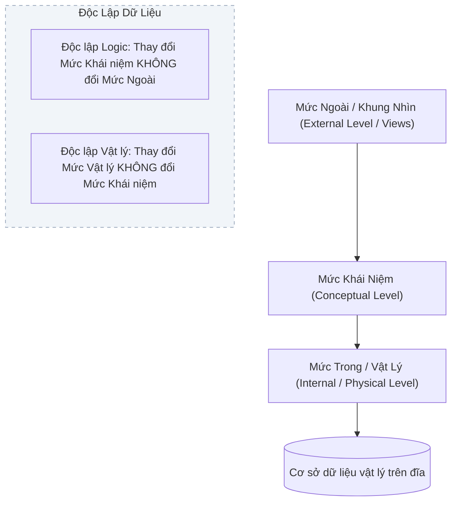

# CHƯƠNG 1: TỔNG QUAN VỀ CƠ SỞ DỮ LIỆU & KIẾN TRÚC ANSI/SPARC

### 1. Sơ đồ Kiến trúc Ba mức ANSI/SPARC

### 2. Các Khái Niệm Nền Tảng
- **Dữ liệu (Data):** Các sự kiện, số liệu thô chưa qua xử lý logic.
- **Thông tin (Information):** Dữ liệu đã qua xử lý, có ngữ nghĩa và đem lại giá trị ra quyết định.
- **Cơ sở dữ liệu (Database - CSDL):** Tập hợp dữ liệu có cấu trúc, có mối liên hệ logic và được lưu trữ trên bộ nhớ thứ cấp nhằm phục vụ nhiều người dùng đồng thời.
- **Hệ Quản trị CSDL (DBMS):** Hệ thống phần mềm cung cấp môi trường định nghĩa dữ liệu (DDL), thao tác dữ liệu (DML), điều khiển truy cập (DCL) và bảo đảm an toàn, toàn vẹn dữ liệu (ACID).
- **Kiến trúc ANSI/SPARC (3 mức trừu tượng hóa):**
  1. *Mức ngoài (External/View Level):* Giao diện và góc nhìn dữ liệu cá nhân hóa cho từng nhóm người dùng.
  2. *Mức khái niệm (Conceptual Level):* Toàn bộ cấu trúc logic tổng thể của CSDL (thực thể, thuộc tính, mối liên kết, ràng buộc), độc lập với thiết bị lưu trữ.
  3. *Mức trong (Internal/Physical Level):* Cách thức dữ liệu được tổ chức vật lý trên đĩa (cấu trúc tệp, khối đĩa, phương pháp băm, đánh chỉ mục B-Tree).
- **Tính độc lập dữ liệu (Data Independence):**
  - *Độc lập vật lý (Physical Data Independence):* Khả năng thay đổi cấu trúc lưu trữ hoặc thiết bị đĩa mà không phải sửa đổi lược đồ mức khái niệm.
  - *Độc lập logic (Logical Data Independence):* Khả năng mở rộng, sửa đổi lược đồ mức khái niệm (thêm thực thể, thuộc tính) mà không làm ảnh hưởng đến các ứng dụng hiện có ở mức ngoài.

---

## Tinh Hoa Kiến Thức & Tóm Tắt Chuyên Sâu (Key Takeaways)
> **Chuyên đề mở rộng:** Tổng quan Cơ sở Dữ liệu & Kiến trúc Hệ QTCSDL

### 1. Các Ý Niệm Cốt Lõi (Key Takeaways)
- **Cơ sở dữ liệu (Database):** Tập hợp dữ liệu có cấu trúc, lưu trữ trên bộ nhớ ngoài, có mối quan hệ logic, phục vụ nhiều người dùng và nhiều chương trình đồng thời.
- **Hệ quản trị CSDL (DBMS):** Phần mềm trung gian cung cấp các dịch vụ định nghĩa (DDL), thao tác (DML), kiểm soát an toàn và điều khiển tương tranh.
- **Giảm thiểu dư thừa & Không nhất quán:** Ưu điểm vượt trội của DBMS so với hệ thống quản lý tệp tin (File-based System).

### 2. Kiến Trúc 3 Mức ANSI/SPARC & Tính Độc Lập Dữ Liệu
1. **Mức ngoài (View / External Level):** Cách nhìn dữ liệu của từng đối tượng người dùng cụ thể thông qua khung nhìn (View).
2. **Mức khái niệm (Conceptual Level):** Mô tả toàn thể cấu trúc logic của toàn bộ CSDL (các thực thể, mối liên kết, kiểu dữ liệu và ràng buộc toàn vẹn).
3. **Mức trong (Internal / Physical Level):** Chi tiết cấu trúc lưu trữ vật lý trên đĩa (cấu trúc tệp, khối nhớ block, chỉ mục Index, băm Hash).

#### Hai cấp độ độc lập dữ liệu:
- **Độc lập dữ liệu logic:** Thay đổi mức khái niệm mà không ảnh hưởng đến mức ngoài và mã nguồn ứng dụng.
- **Độc lập dữ liệu vật lý:** Thay đổi cấu trúc lưu trữ và phương pháp truy xuất ở mức trong mà không ảnh hưởng đến mức khái niệm và mức ngoài.

### 3. Phân Phẩm Ngôn Ngữ CSDL
- **DDL (Data Definition Language):** `CREATE`, `ALTER`, `DROP`.
- **DML (Data Manipulation Language):** `SELECT`, `INSERT`, `UPDATE`, `DELETE`.
- **DCL (Data Control Language):** `GRANT`, `REVOKE`.
