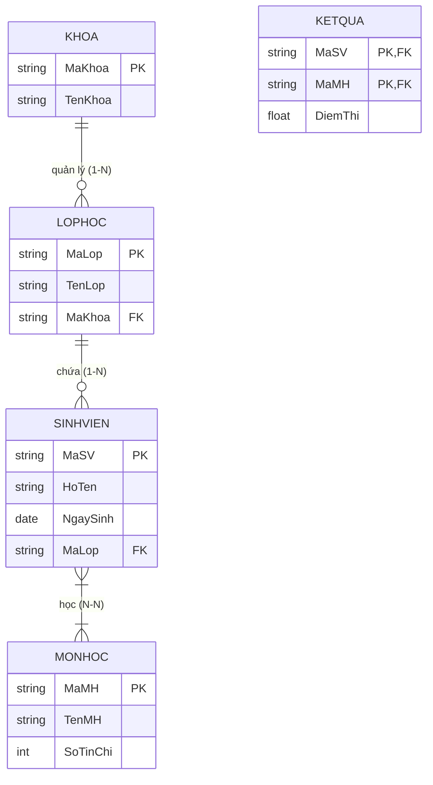

# CHƯƠNG 2: MÔ HÌNH THỰC THỂ - QUAN HỆ (E-R) & CHUYỂN ĐỔI SANG MÔ HÌNH QUAN HỆ

### 1. Sơ đồ Thực thể - Quan hệ Mẫu (ER Diagram)

### 2. Các Khái Niệm Cốt Lõi Của Mô Hình E-R
- **Thực thể (Entity) & Tập thực thể (Entity Set):** Đối tượng cụ thể trong thế giới thực có thể phân biệt được với các đối tượng khác.
  - *Thực thể mạnh (Strong Entity):* Tự thân xác định được sự tồn tại bằng khóa chính riêng.
  - *Thực thể yếu (Weak Entity):* Phải phụ thuộc vào sự tồn tại của một thực thể chủ (Owner Entity), sở hữu khóa bộ phận (Partial Key / Discriminator).
- **Phân loại Thuộc tính (Attributes):**
  - *Thuộc tính đơn (Simple):* Không thể phân chia nhỏ hơn (ví dụ: `DiemThi`).
  - *Thuộc tính kết hợp (Composite):* Gom từ nhiều thuộc tính thành phần (ví dụ: `DiaChi` gồm `SoNha`, `Duong`, `Quan`, `ThanhPho`).
  - *Thuộc tính đơn trị (Single-valued):* Chỉ nhận đúng 1 giá trị (ví dụ: `NgaySinh`).
  - *Thuộc tính đa trị (Multi-valued):* Có thể nhận nhiều giá trị cùng lúc (ví dụ: `SoDienThoai`, biểu diễn bằng hình elip nét đôi).
  - *Thuộc tính suy dẫn (Derived):* Giá trị tính toán được từ các thuộc tính khác (ví dụ: `Tuoi` suy ra từ `NgaySinh`, biểu diễn bằng hình elip nét đứt).
- **Bản số Mối quan hệ (Cardinality Ratio):**
  - **1 - 1 (Một - Một):** Mỗi cá thể của $A$ liên kết tối đa với 1 cá thể của $B$ và ngược lại.
  - **1 - N (Một - Nhiều):** Mỗi cá thể của $A$ liên kết với nhiều cá thể của $B$; mỗi cá thể của $B$ chỉ liên kết với duy nhất 1 cá thể của $A$.
  - **N - N (Nhiều - Nhiều):** Mỗi cá thể của $A$ liên kết với nhiều cá thể của $B$ và ngược lại.

### 3. Quy Tắc Ánh Xạ Từ Mô Hình E-R Sang Mô Hình Quan Hệ (7 Quy Tắc Chuẩn)
1. **Tập thực thể mạnh:** Chuyển thành một quan hệ độc lập. Khóa chính giữ nguyên.
2. **Tập thực thể yếu:** Chuyển thành một quan hệ có khóa chính gồm tổ hợp: `(Khóa thực thể chủ + Khóa bộ phận)`.
3. **Mối quan hệ 1 - N:** Lấy **khóa chính của bên Một** đưa sang bên **Nhiều** để làm **khóa ngoại**. Nếu mối quan hệ có thuộc tính riêng, chuyển các thuộc tính đó vào quan hệ bên Nhiều.
4. **Mối quan hệ N - N:** Bắt buộc tạo **một quan hệ mới riêng biệt**. Khóa chính của bảng mới là sự kết hợp khóa chính của cả hai thực thể tham gia:
   $$\text{PK} = (\text{PK}_A, \text{PK}_B)$$
5. **Mối quan hệ 1 - 1:** Có thể gộp thành một bảng duy nhất (nếu hai bên tham gia toàn bộ), hoặc đưa khóa chính của một bên sang làm khóa ngoại của bên kia (kèm ràng buộc `UNIQUE`).
6. **Thuộc tính đa trị:** Tạo một quan hệ mới gồm `(Khóa chính của thực thể gốc + Thuộc tính đa trị)`.
7. **Mối quan hệ bậc $\ge 3$ (N-ary Relationship):** Tạo một quan hệ riêng có khóa chính gồm khóa chính của tất cả các thực thể tham gia.
