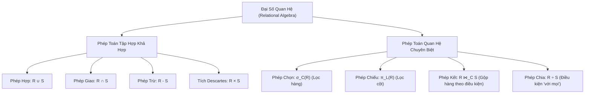

# CHƯƠNG 3: MÔ HÌNH DỮ LIỆU QUAN HỆ & ĐẠI SỐ QUAN HỆ

### 1. Bản Đồ Các Phép Toán Đại Số Quan Hệ (Relational Algebra)

### 2. Các Phép Toán Cốt Lõi & Ký Hiệu Hình Thức

| Phép toán | Ký hiệu | Ý nghĩa đại số | Điều kiện áp dụng |
| :--- | :---: | :--- | :--- |
| **Phép Chọn (Selection)** | $\sigma_C(R)$ | Lọc các bộ dữ liệu trong quan hệ $R$ thỏa mãn điều kiện logic $C$. | Điều kiện $C$ là biểu thức logic boolean trên các thuộc tính của $R$. |
| **Phép Chiếu (Projection)** | $\pi_L(R)$ | Trích xuất danh sách các thuộc tính $L$ từ $R$ và tự động loại bỏ các bộ trùng lặp. | $L$ là tập con các thuộc tính của $R$. |
| **Phép Hợp (Union)** | $R \cup S$ | Tập các bộ thuộc về $R$ hoặc thuộc về $S$ hoặc cả hai. | $R$ và $S$ phải **khả hợp** (cùng bậc và tương thích miền giá trị từng cặp thuộc tính). |
| **Phép Giao (Intersection)** | $R \cap S$ | Tập các bộ đồng thời xuất hiện ở cả $R$ và $S$. | $R$ và $S$ phải khả hợp. ($R \cap S = R - (R - S)$). |
| **Phép Trừ (Difference)** | $R - S$ | Tập các bộ thuộc về $R$ nhưng không thuộc về $S$. | $R$ và $S$ phải khả hợp. |
| **Tích Descartes (Cartesian)** | $R \times S$ | Ghép nối từng bộ của $R$ với mọi bộ của $S$. Bậc bằng $|R| + |S|$, số bộ bằng $|R| \times |S|$. | Không cần điều kiện khả hợp. |
| **Phép Kết Nối (Join)** | $R \bowtie_C S$ | Thực hiện tích Descartes $R \times S$ sau đó lọc theo điều kiện kết nối $C$: $\sigma_C(R \times S)$. | $C$ liên kết các thuộc tính tương thích giữa $R$ và $S$. |
| **Kết Tự Nhiên (Natural Join)** | $R \bowtie S$ | Kết bằng trên tất cả các thuộc tính trùng tên giữa $R$ và $S$, sau đó tự động khử một cột trùng. | Phải có ít nhất 1 thuộc tính trùng tên. |
| **Phép Chia (Division)** | $R \div S$ | Tìm các bộ trong $R$ liên kết được với **TẤT CẢ** các bộ trong $S$ (mệnh đề "với mọi"). | Thuộc tính của $S$ là tập con thực sự của $R$. |
