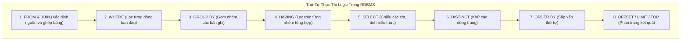

# CHƯƠNG 4: NGÔN NGỮ TRUY VẤN CƠ SỞ DỮ LIỆU SQL TOÀN DIỆN

### 1. Phân Nhóm và Thứ Tự Thực Thi Của Câu Lệnh SQL

### 2. Các Nhóm Lệnh SQL Cơ Bản
1. **DDL (Data Definition Language - Định nghĩa dữ liệu):**
   - `CREATE TABLE`, `ALTER TABLE`, `DROP TABLE`, `TRUNCATE TABLE`, `CREATE INDEX`.
   - Các ràng buộc toàn vẹn: `PRIMARY KEY`, `FOREIGN KEY ... REFERENCES`, `UNIQUE`, `NOT NULL`, `CHECK`, `DEFAULT`.
2. **DML (Data Manipulation Language - Thao tác dữ liệu):**
   - `INSERT INTO TenBang (Cot1, Cot2) VALUES (GiaTri1, GiaTri2)`
   - `UPDATE TenBang SET Cot1 = GiaTriMoi WHERE DieuKien`
   - `DELETE FROM TenBang WHERE DieuKien`
3. **DQL (Data Query Language - Truy vấn dữ liệu):**
   - Cú pháp chuẩn: `SELECT [DISTINCT] Cot FROM Bang [JOIN ...] WHERE ... GROUP BY ... HAVING ... ORDER BY ...`
4. **Các Phép Kết Nối Bảng (JOIN Types):**
   - `INNER JOIN`: Chỉ trả về các bản ghi khớp điều kiện ở cả hai bảng.
   - `LEFT OUTER JOIN`: Giữ toàn bộ bảng bên trái, bảng phải không khớp sẽ mang giá trị `NULL`.
   - `RIGHT OUTER JOIN`: Giữ toàn bộ bảng bên phải, bảng trái không khớp mang giá trị `NULL`.
   - `FULL OUTER JOIN`: Giữ toàn bộ bản ghi của cả hai bảng.
   - `CROSS JOIN`: Tích Descartes không điều kiện.
5. **Hàm Tổng Hợp (Aggregate Functions) & Mệnh đề `HAVING`:**
   - `COUNT()`, `SUM()`, `AVG()`, `MIN()`, `MAX()`.
   - **Quy tắc vàng:** Mệnh đề `WHERE` lọc các dòng *trước* khi gom nhóm; mệnh đề `HAVING` lọc các nhóm *sau* khi đã tính hàm tổng hợp.
