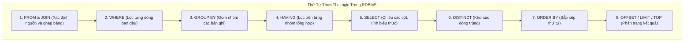

# CHƯƠNG 4: NGÔN NGỮ TRUY VẤN CƠ SỞ DỮ LIỆU SQL TOÀN DIỆN

### 1. Phân Nhóm và Thứ Tự Thực Thi Của Câu Lệnh SQL


### 2. Các Nhóm Lệnh SQL Cơ Bản
1. **DDL (Data Definition Language - Định nghĩa dữ liệu):**
   - `CREATE TABLE`, `ALTER TABLE`, `DROP TABLE`, `TRUNCATE TABLE`, `CREATE INDEX`.
   - Các ràng buộc toàn vẹn: `PRIMARY KEY`, `FOREIGN KEY ... REFERENCES`, `UNIQUE`, `NOT NULL`, `CHECK`, `DEFAULT`.
2. **DML (Data Manipulation Language - Thao tác dữ liệu):**
   - `INSERT INTO TenBang (Cot1, Cot2) VALUES (GiaTri1, GiaTri2)`
   - `UPDATE TenBang SET Cot1 = GiaTriMoi WHERE DieuKien`
   - `DELETE FROM TenBang WHERE DieuKien`
3. **DQL (Data Query Language - Truy vấn dữ liệu):**
   - Cú pháp chuẩn: `SELECT [DISTINCT] Cot FROM Bang [JOIN ...] WHERE ... GROUP BY ... HAVING ... ORDER BY ...`
4. **Các Phép Kết Nối Bảng (JOIN Types):**
   - `INNER JOIN`: Chỉ trả về các bản ghi khớp điều kiện ở cả hai bảng.
   - `LEFT OUTER JOIN`: Giữ toàn bộ bảng bên trái, bảng phải không khớp sẽ mang giá trị `NULL`.
   - `RIGHT OUTER JOIN`: Giữ toàn bộ bảng bên phải, bảng trái không khớp mang giá trị `NULL`.
   - `FULL OUTER JOIN`: Giữ toàn bộ bản ghi của cả hai bảng.
   - `CROSS JOIN`: Tích Descartes không điều kiện.
5. **Hàm Tổng Hợp (Aggregate Functions) & Mệnh đề `HAVING`:**
   - `COUNT()`, `SUM()`, `AVG()`, `MIN()`, `MAX()`.
   - **Quy tắc vàng:** Mệnh đề `WHERE` lọc các dòng *trước* khi gom nhóm; mệnh đề `HAVING` lọc các nhóm *sau* khi đã tính hàm tổng hợp.

---

## Tinh Hoa Kiến Thức & Tóm Tắt Chuyên Sâu (Key Takeaways)
> **Chuyên đề mở rộng:** Ngôn ngữ SQL & Kỹ thuật Truy vấn Nâng cao

### 1. Các Ý Niệm Cốt Lõi (Key Takeaways)
- **Bản chất SQL:** Ngôn ngữ khai báo (Declarative), chỉ định kết quả mong muốn thay vì thuật toán từng bước.
- **Thứ tự viết câu lệnh:** `SELECT` $\to$ `FROM` $\to$ `WHERE` $\to$ `GROUP BY` $\to$ `HAVING` $\to$ `ORDER BY`.
- **Thứ tự thực thi ngầm định trong DBMS:**
  $$\text{FROM} \longrightarrow \text{WHERE} \longrightarrow \text{GROUP BY} \longrightarrow \text{HAVING} \longrightarrow \text{SELECT} \longrightarrow \text{ORDER BY}$$

### 2. Kỹ Thuật Phân Biệt `WHERE` và `HAVING`
- `WHERE`: Lọc từng dòng dữ liệu **trước khi** gom nhóm. Không được dùng hàm kết hợp (`COUNT`, `SUM`, `AVG`, `MIN`, `MAX`) trong mệnh đề `WHERE`.
- `HAVING`: Lọc các nhóm **sau khi** đã tính toán hàm kết hợp.

### 3. Các Phép Kết Nối Bảng (JOIN)
- **INNER JOIN:** Chỉ lấy dữ liệu khi có sự tương ứng khóa ở cả 2 bảng.
- **LEFT JOIN:** Lấy toàn bộ bảng bên trái, bảng bên phải nếu thiếu sẽ điền `NULL`. Rất hữu ích để tìm các đối tượng **chưa từng phát sinh giao dịch/hoạt động**:
```sql
-- Tìm sinh viên chưa đăng ký bất kỳ môn học nào:
SELECT SV.MaSV, SV.HoTen
FROM SINH_VIEN SV
LEFT JOIN DANG_KY DK ON SV.MaSV = DK.MaSV
WHERE DK.MaSV IS NULL;
```

### 4. Các Mẫu Truy Vấn Con (Subquery Patterns)
1. **Toán tử `IN` / `NOT IN`:** So sánh với tập danh sách kết quả từ truy vấn con.
2. **Toán tử `EXISTS` / `NOT EXISTS`:** Kiểm tra sự tồn tại của ít nhất một dòng thỏa mãn điều kiện liên kết (cho hiệu năng tối ưu với bảng lớn).
