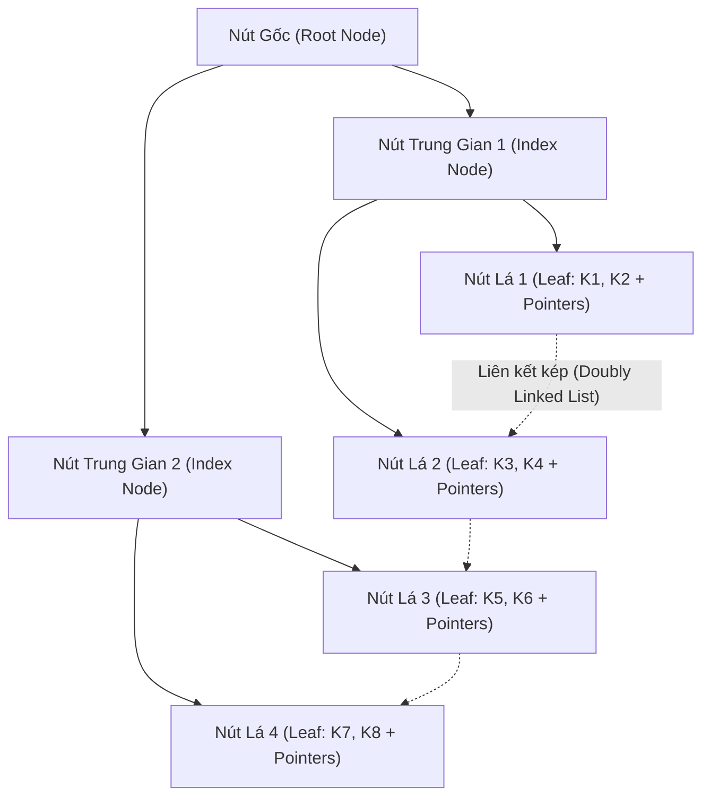

# CHƯƠNG 5: TỔ CHỨC VẬT LÝ DỮ LIỆU, HỆ SỐ KẾT KHỐI & CẤU TRÚC CHỈ MỤC CÂY B/B+

### 1. Sơ đồ Cấu trúc Cây Chỉ Mục B+ Tree (B+ Tree Index Architecture)

### 2. Các Công Thức Tính Toán Lưu Trữ Vật Lý
- **Đơn vị khối (Block):** Kích thước cố định $B$ byte (thường 4096 hoặc 8192 bytes).
- **Kích thước bản ghi (Record length):** $R$ byte.
- **Hệ số kết khối (Blocking Factor - $bfr$):** Số lượng bản ghi tối đa có thể xếp vào trong 1 khối đĩa:
  $$bfr = \left\lfloor \frac{B}{R} \right\rfloor$$
- **Số khối đĩa ($b$) cần thiết để lưu trữ tệp gồm $r$ bản ghi:**
  $$b = \left\lceil \frac{r}{bfr} \right\rceil$$

### 3. Phân Loại Cấu Trúc Tệp Cơ Bản

| Dạng tệp | Đặc điểm tổ chức | Chi phí Tìm kiếm | Chi phí Chèn |
| :--- | :--- | :---: | :---: |
| **Tệp Đống (Heap File)** | Bản ghi chèn tự do vào khối cuối còn trống. | $b/2$ khối (tuyến tính) | $O(1)$ I/O |
| **Tệp Tuần tự (Sequential)** | Bản ghi sắp thứ tự theo một khóa sắp xếp. | $\lceil \log_2 b \rceil$ khối (tìm nhị phân) | Cao (cần vùng tràn Overflow) |
| **Tệp Băm (Hash File)** | Dùng hàm băm $h(K)$ trỏ trực tiếp tới Bucket. | $\approx 1$ I/O (nếu không đụng độ) | $O(1)$ I/O |

### 4. Kỹ Thuật Chỉ Mục (Indexing)
- **Chỉ mục chính (Primary Index):** Xây dựng trên trường khóa chính của tệp dữ liệu đã sắp thứ tự. Thường là **chỉ mục thưa (Sparse Index)** - mỗi mục chỉ mục đại diện cho một khối đĩa (Anchor record).
- **Chỉ mục gom cụm (Clustering Index):** Xây dựng trên trường không phải khóa của tệp đã sắp xếp.
- **Chỉ mục phụ (Secondary Index):** Xây dựng trên trường bất kỳ của tệp chưa sắp xếp. Bắt buộc là **chỉ mục dày (Dense Index)** - mỗi bản ghi tương ứng một mục chỉ mục.
- **Cây B+ (B+ Tree) - Chuẩn công nghiệp RDBMS:**
  - Mọi con trỏ trỏ tới dữ liệu thực tế đều nằm tại các **nút lá**.
  - Các nút trong chỉ đóng vai trò dẫn đường (Routing keys).
  - Các nút lá liên kết với nhau thành **danh sách liên kết hai chiều**, hỗ trợ cực mạnh truy vấn tìm kiếm theo khoảng (Range Queries).
  - Độ cao cây $h \le \lceil \log_{\lceil m/2 \rceil} N \rceil$, duy trì thời gian tìm kiếm ổn định $O(\log N)$ với độ cao thường chỉ từ 2 đến 4 tầng.

---

## Tinh Hoa Kiến Thức & Tóm Tắt Chuyên Sâu (Key Takeaways)
> **Chuyên đề mở rộng:** Tổ chức vật lý dữ liệu & Cấu trúc chỉ mục B/B+

### 1. TỔNG QUAN VÀ KHÁI NIỆM CỐT LÕI (OVERVIEW)
Tổ chức tệp vật lý và tối ưu hóa câu hỏi truy vấn là hai khía cạnh nền tảng quyết định hiệu năng thực tế của một Hệ Quản trị Cơ sở Dữ liệu (DBMS). Trong khi tổ chức vật lý quy định cách các bản ghi dữ liệu và chỉ mục được lưu trữ trên bộ nhớ thứ cấp (khối đĩa - disk block), thì bộ tối ưu hóa truy vấn (Query Optimizer) chịu trách nhiệm lựa chọn cây thực thi có chi phí vào/ra (I/O) và thời gian thực hiện tối thiểu cho mỗi câu lệnh đại số quan hệ / SQL.

---

### 2. TỔ CHỨC DỮ LIỆU TRÊN BỘ NHỚ NGOÀI
#### 2.1. Đơn vị lưu trữ và Hệ số kết khối ($bfr$)
- Dữ liệu trên đĩa từ được chia thành các **khối (Block)** có kích thước cố định $B$ (thường là 4KB, 8KB,...).
- Mỗi bản ghi có kích thước $R$ byte.
- **Hệ số kết khối (Blocking Factor - $bfr$)**: Số bản ghi tối đa chứa được trong 1 khối:
  $$bfr = \left\lfloor \frac{B}{R} \right\rfloor$$
- Số khối cần thiết để lưu trữ một tệp gồm $r$ bản ghi:
  $$b = \left\lceil \frac{r}{bfr} \right\rceil$$

#### 2.2. Các dạng tổ chức tệp cơ bản
1. **Tệp đống (Heap File / Unordered File):**
   - Bản ghi được chèn vào cuối tệp khi có không gian trống.
   - Thao tác chèn nhanh: $O(1)$.
   - Tìm kiếm tuyến tính: Chi phí trung bình $\approx b/2$ khối, xấu nhất $b$ khối.
2. **Tệp tuần tự sắp thứ tự (Ordered / Sequential File):**
   - Bản ghi được sắp xếp theo giá trị của trường khóa sắp xếp (Ordering Key).
   - Tìm kiếm nhị phân theo trường khóa: Chi phí $\approx \lceil \log_2 b \rceil$ lần đọc khối.
   - Thao tác chèn và xóa tốn kém do phải dịch chuyển các bản ghi (cần vùng tràn - overflow area).
3. **Tệp băm (Hash File):**
   - Áp dụng hàm băm $h(K)$ lên khóa băm để xác định trực tiếp địa chỉ khối (Bucket).
   - Truy xuất theo khóa chính đạt chi phí lý thuyết $\approx 1$ I/O.
   - Không hỗ trợ hiệu quả truy vấn theo khoảng giá trị (Range query).

---

### 3. CẤU TRÚC CHỈ MỤC (INDEXING TECHNIQUES)
#### 3.1. Phân loại chỉ mục
- **Chỉ mục chính (Primary Index):** Xây dựng trên tệp dữ liệu đã sắp thứ tự theo khóa chính. Chỉ mục thưa (Sparse Index) chỉ lưu giá trị khóa đầu tiên của mỗi khối (Anchor record).
- **Chỉ mục gom cụm (Clustering Index):** Xây dựng trên tệp đã sắp thứ tự theo một trường không phải khóa chính (các bản ghi trùng giá trị gom vào các khối liền kề).
- **Chỉ mục phụ (Secondary Index):** Xây dựng trên một trường bất kỳ của tệp (tệp có thể chưa sắp xếp). Thường là chỉ mục dày (Dense Index) với mỗi bản ghi tương ứng một mục trong chỉ mục.

#### 3.2. Cây chỉ mục đa mức B-Tree và B+ Tree
- **Cây B+ (B+ Tree):** Cấu trúc cân bằng vượt trội dùng làm tiêu chuẩn trong RDBMS:
  - Tất cả các khóa dữ liệu và con trỏ bản ghi thực tế chỉ nằm ở các **nút lá**.
  - Các nút lá được liên kết kép với nhau tuần tự, cho phép duyệt theo khoảng giá trị cực kỳ nhanh.
  - Các nút trong (nút chỉ mục) chỉ chứa khóa dẫn đường và con trỏ đến nút con.
  - Chi phí tìm kiếm, chèn, xóa luôn được bảo đảm ở mức $O(\log_m N)$, với $m$ là bậc của cây (thường rất lớn, từ vài chục đến hàng trăm, giúp cây có độ cao thấp chỉ 2 - 4 mức).

---
