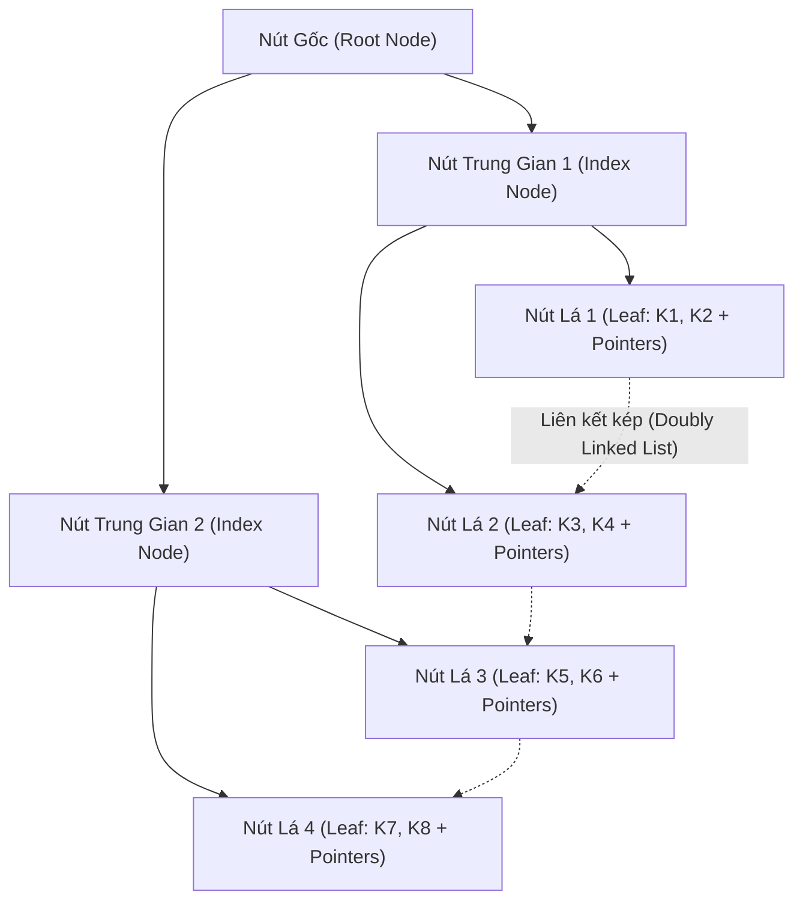

# CHƯƠNG 5: TỔ CHỨC VẬT LÝ DỮ LIỆU, HỆ SỐ KẾT KHỐI & CẤU TRÚC CHỈ MỤC CÂY B/B+

### 1. Sơ đồ Cấu trúc Cây Chỉ Mục B+ Tree (B+ Tree Index Architecture)

### 2. Các Công Thức Tính Toán Lưu Trữ Vật Lý
- **Đơn vị khối (Block):** Kích thước cố định $B$ byte (thường 4096 hoặc 8192 bytes).
- **Kích thước bản ghi (Record length):** $R$ byte.
- **Hệ số kết khối (Blocking Factor - $bfr$):** Số lượng bản ghi tối đa có thể xếp vào trong 1 khối đĩa:
  $$bfr = \left\lfloor \frac{B}{R} \right\rfloor$$
- **Số khối đĩa ($b$) cần thiết để lưu trữ tệp gồm $r$ bản ghi:**
  $$b = \left\lceil \frac{r}{bfr} \right\rceil$$

### 3. Phân Loại Cấu Trúc Tệp Cơ Bản

| Dạng tệp | Đặc điểm tổ chức | Chi phí Tìm kiếm | Chi phí Chèn |
| :--- | :--- | :---: | :---: |
| **Tệp Đống (Heap File)** | Bản ghi chèn tự do vào khối cuối còn trống. | $b/2$ khối (tuyến tính) | $O(1)$ I/O |
| **Tệp Tuần tự (Sequential)** | Bản ghi sắp thứ tự theo một khóa sắp xếp. | $\lceil \log_2 b \rceil$ khối (tìm nhị phân) | Cao (cần vùng tràn Overflow) |
| **Tệp Băm (Hash File)** | Dùng hàm băm $h(K)$ trỏ trực tiếp tới Bucket. | $\approx 1$ I/O (nếu không đụng độ) | $O(1)$ I/O |

### 4. Kỹ Thuật Chỉ Mục (Indexing)
- **Chỉ mục chính (Primary Index):** Xây dựng trên trường khóa chính của tệp dữ liệu đã sắp thứ tự. Thường là **chỉ mục thưa (Sparse Index)** - mỗi mục chỉ mục đại diện cho một khối đĩa (Anchor record).
- **Chỉ mục gom cụm (Clustering Index):** Xây dựng trên trường không phải khóa của tệp đã sắp xếp.
- **Chỉ mục phụ (Secondary Index):** Xây dựng trên trường bất kỳ của tệp chưa sắp xếp. Bắt buộc là **chỉ mục dày (Dense Index)** - mỗi bản ghi tương ứng một mục chỉ mục.
- **Cây B+ (B+ Tree) - Chuẩn công nghiệp RDBMS:**
  - Mọi con trỏ trỏ tới dữ liệu thực tế đều nằm tại các **nút lá**.
  - Các nút trong chỉ đóng vai trò dẫn đường (Routing keys).
  - Các nút lá liên kết với nhau thành **danh sách liên kết hai chiều**, hỗ trợ cực mạnh truy vấn tìm kiếm theo khoảng (Range Queries).
  - Độ cao cây $h \le \lceil \log_{\lceil m/2 \rceil} N \rceil$, duy trì thời gian tìm kiếm ổn định $O(\log N)$ với độ cao thường chỉ từ 2 đến 4 tầng.
