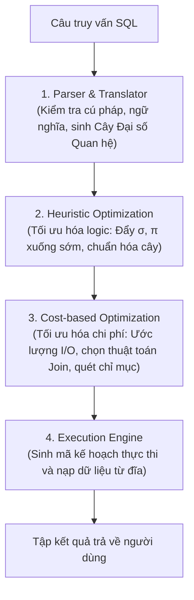

# CHƯƠNG 6: XỬ LÝ VÀ TỐI ƯU HÓA CÂU HỎI TRUY VẤN (QUERY OPTIMIZATION)

### 1. Quy Trình 4 Giai Đoạn Xử Lý Câu Truy Vấn Trong DBMS

### 2. Các Quy Tắc Biến Đổi Đại Số Tương Đương Cốt Lõi
1. **Tách phép chọn hội:**
   $$\sigma_{C_1 \land C_2 \dots \land C_n}(R) \equiv \sigma_{C_1}(\sigma_{C_2}(\dots (\sigma_{C_n}(R))))$$
2. **Giao hoán phép chọn:**
   $$\sigma_{C_1}(\sigma_{C_2}(R)) \equiv \sigma_{C_2}(\sigma_{C_1}(R))$$
3. **Đẩy phép chọn qua phép kết nối (Pushing Selection down Join):**
   Nếu điều kiện chọn $C$ chỉ liên quan đến các thuộc tính của quan hệ $R$:
   $$\sigma_C(R \bowtie S) \equiv (\sigma_C(R)) \bowtie S$$
4. **Đẩy phép chiếu qua phép kết nối (Pushing Projection down Join):**
   Nếu $L = L_1 \cup L_2$ với $L_1 \subseteq R$ và $L_2 \subseteq S$:
   $$\pi_L(R \bowtie S) \equiv \pi_L(\pi_{L_1 \cup JoinAttrs}(R) \bowtie \pi_{L_2 \cup JoinAttrs}(S))$$
5. **Giao hoán và kết hợp của phép kết nối:**
   $$R \bowtie S \equiv S \bowtie R$$
   $$(R \bowtie S) \bowtie T \equiv R \bowtie (S \bowtie T)$$
6. **Thay thế Tích Descartes kèm phép chọn bằng Phép kết bằng:**
   $$\sigma_{R.A = S.A}(R \times S) \equiv R \bowtie_{R.A = S.A} S$$

### 3. So Sánh Các Thuật Toán Thực Thi Phép Kết Vật Lý (Physical Join Algorithms)

| Thuật toán Join | Điều kiện hoạt động tối ưu | Chi phí I/O xấp xỉ |
| :--- | :--- | :---: |
| **Nested-Loop Join (Vòng lặp lồng)** | Một trong hai bảng rất nhỏ (vài dòng). | $b_R + |r_R| \cdot b_S$ |
| **Block Nested-Loop Join** | Đọc theo từng khối khối nhớ đệm Buffer. | $b_R + \lceil b_R / (M-2) \rceil \cdot b_S$ |
| **Index Nested-Loop Join** | Bảng trong có chỉ mục (Index) trên cột kết nối. | $b_R + |r_R| \cdot (\text{Độ cao Index} + 1)$ |
| **Sort-Merge Join** | Hai bảng đã sắp thứ tự sẵn theo cột kết nối. | $b_R + b_S$ (tuyến tính) |
| **Hash Join** | Bảng không có chỉ mục, bộ nhớ đệm đủ lớn. | $3(b_R + b_S)$ |
