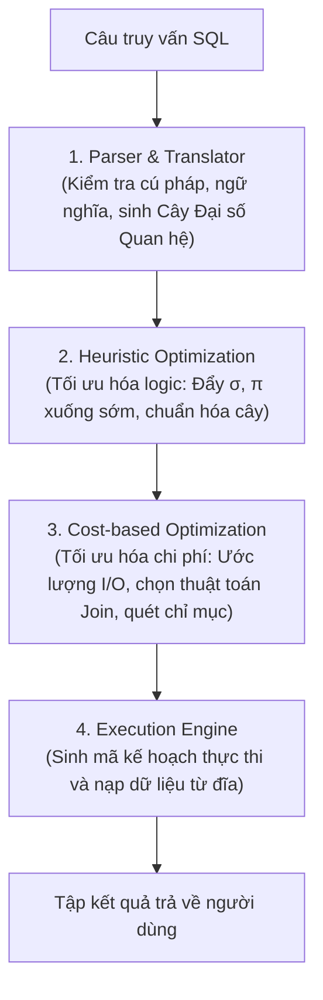

# CHƯƠNG 6: XỬ LÝ VÀ TỐI ƯU HÓA CÂU HỎI TRUY VẤN (QUERY OPTIMIZATION)

### 1. Quy Trình 4 Giai Đoạn Xử Lý Câu Truy Vấn Trong DBMS

### 2. Các Quy Tắc Biến Đổi Đại Số Tương Đương Cốt Lõi
1. **Tách phép chọn hội:**
   $$\sigma_{C_1 \land C_2 \dots \land C_n}(R) \equiv \sigma_{C_1}(\sigma_{C_2}(\dots (\sigma_{C_n}(R))))$$
2. **Giao hoán phép chọn:**
   $$\sigma_{C_1}(\sigma_{C_2}(R)) \equiv \sigma_{C_2}(\sigma_{C_1}(R))$$
3. **Đẩy phép chọn qua phép kết nối (Pushing Selection down Join):**
   Nếu điều kiện chọn $C$ chỉ liên quan đến các thuộc tính của quan hệ $R$:
   $$\sigma_C(R \bowtie S) \equiv (\sigma_C(R)) \bowtie S$$
4. **Đẩy phép chiếu qua phép kết nối (Pushing Projection down Join):**
   Nếu $L = L_1 \cup L_2$ với $L_1 \subseteq R$ và $L_2 \subseteq S$:
   $$\pi_L(R \bowtie S) \equiv \pi_L(\pi_{L_1 \cup JoinAttrs}(R) \bowtie \pi_{L_2 \cup JoinAttrs}(S))$$
5. **Giao hoán và kết hợp của phép kết nối:**
   $$R \bowtie S \equiv S \bowtie R$$
   $$(R \bowtie S) \bowtie T \equiv R \bowtie (S \bowtie T)$$
6. **Thay thế Tích Descartes kèm phép chọn bằng Phép kết bằng:**
   $$\sigma_{R.A = S.A}(R \times S) \equiv R \bowtie_{R.A = S.A} S$$

### 3. So Sánh Các Thuật Toán Thực Thi Phép Kết Vật Lý (Physical Join Algorithms)

| Thuật toán Join | Điều kiện hoạt động tối ưu | Chi phí I/O xấp xỉ |
| :--- | :--- | :---: |
| **Nested-Loop Join (Vòng lặp lồng)** | Một trong hai bảng rất nhỏ (vài dòng). | $b_R + |r_R| \cdot b_S$ |
| **Block Nested-Loop Join** | Đọc theo từng khối khối nhớ đệm Buffer. | $b_R + \lceil b_R / (M-2) \rceil \cdot b_S$ |
| **Index Nested-Loop Join** | Bảng trong có chỉ mục (Index) trên cột kết nối. | $b_R + |r_R| \cdot (\text{Độ cao Index} + 1)$ |
| **Sort-Merge Join** | Hai bảng đã sắp thứ tự sẵn theo cột kết nối. | $b_R + b_S$ (tuyến tính) |
| **Hash Join** | Bảng không có chỉ mục, bộ nhớ đệm đủ lớn. | $3(b_R + b_S)$ |

---

## Tinh Hoa Kiến Thức & Tóm Tắt Chuyên Sâu (Key Takeaways)
> **Chuyên đề mở rộng:** Quy trình xử lý & Tối ưu hóa câu hỏi truy vấn

### 1. TỔNG QUAN VÀ KHÁI NIỆM CỐT LÕI (OVERVIEW)
Tổ chức tệp vật lý và tối ưu hóa câu hỏi truy vấn là hai khía cạnh nền tảng quyết định hiệu năng thực tế của một Hệ Quản trị Cơ sở Dữ liệu (DBMS). Trong khi tổ chức vật lý quy định cách các bản ghi dữ liệu và chỉ mục được lưu trữ trên bộ nhớ thứ cấp (khối đĩa - disk block), thì bộ tối ưu hóa truy vấn (Query Optimizer) chịu trách nhiệm lựa chọn cây thực thi có chi phí vào/ra (I/O) và thời gian thực hiện tối thiểu cho mỗi câu lệnh đại số quan hệ / SQL.

---

### 4. BỘ TỐI ƯU HÓA CÂU HỎI TRUY VẤN (QUERY OPTIMIZATION)
#### 4.1. Quy trình xử lý câu truy vấn
1. **Phân tích cú pháp và kiểm tra ngữ nghĩa (Parser & Translator):** Chuyển câu lệnh SQL thành biểu thức Đại số quan hệ và Cây truy vấn ban đầu.
2. **Tối ưu hóa logic (Heuristic / Rule-based Optimization):** Sử dụng các luật biến đổi đại số tương đương để tái cấu trúc cây truy vấn thành dạng hiệu quả hơn.
3. **Tối ưu hóa vật lý (Cost-based Optimization):** Ước lượng chi phí thực thi dựa trên thống kê danh mục (Catalogue stats: số bản ghi, số khối, số giá trị phân biệt $V(A, R)$) và chọn thuật toán cụ thể (Nested Loop Join, Hash Join, Index Scan...).
4. **Sinh mã thực thi (Code Generator):** Tạo kế hoạch thực thi (Execution Plan) để chuyển cho Engine xử lý.

#### 4.2. Các quy tắc biến đổi đại số tương đương quan trọng
- Giao hoán và kết hợp phép tích Descartes và phép kết:
  $$E_1 \bowtie E_2 \equiv E_2 \bowtie E_1$$
  $$(E_1 \bowtie E_2) \bowtie E_3 \equiv E_1 \bowtie (E_2 \bowtie E_3)$$
- Tách và đẩy phép chọn $\sigma$ xuống sớm (Pushing Selection down):
  $$\sigma_{c_1 \land c_2}(R) \equiv \sigma_{c_1}(\sigma_{c_2}(R))$$
  $$\sigma_{c}(E_1 \bowtie E_2) \equiv (\sigma_c(E_1)) \bowtie E_2 \quad \text{(khi } c \text{ chỉ liên quan đến các thuộc tính của } E_1\text{)}$$
- Đẩy phép chiếu $\pi$ xuống sớm (Pushing Projection down):
  $$\pi_{L}(E_1 \bowtie E_2) \equiv \pi_{L}(\pi_{L_1}(E_1) \bowtie \pi_{L_2}(E_2))$$
  Loại bỏ sớm các thuộc tính không cần thiết để giảm độ rộng bản ghi $R$, từ đó tăng $bfr$ và giảm số khối cần nạp vào bộ nhớ RAM.

#### 4.3. Các chiến lược Heuristic cốt lõi
1. **Thực hiện phép chọn $\sigma$ càng sớm càng tốt:** Giảm triệt để số lượng bộ (cardinality) trước khi thực hiện các phép kết đắt đỏ.
2. **Thực hiện phép chiếu $\pi$ càng sớm càng tốt:** Giảm kích thước mỗi bộ (tuple width), tiết kiệm bộ đệm Buffer Pool.
3. **Thay thế tích Descartes kèm phép chọn bằng phép kết tự nhiên hoặc kết bằng:** Chuyển $\sigma_{R.A = S.A}(R \times S) \longrightarrow R \bowtie_{R.A = S.A} S$.
4. **Xác định thứ tự kết hợp tối ưu:** Kết các quan hệ có kích thước kết quả trung gian nhỏ nhất trước.
