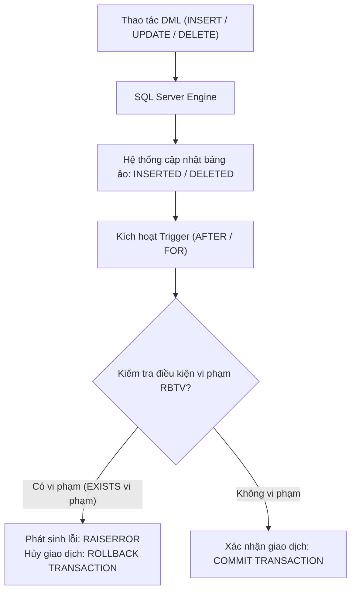

# CHƯƠNG 1 (QUYỂN 2): RÀNG BUỘC TOÀN VẸN & KỸ THUẬT CÀI ĐẶT TRIGGER

### 1. Sơ Đồ Quy Trình Hoạt Động Của Trigger Trong RDBMS

### 2. Bốn Yếu Tố Cấu Thành Một Ràng Buộc Toàn Vẹn (RBTV)
1. **Điều kiện (Condition):** Quy tắc nghiệp vụ bắt buộc phải thỏa mãn (phát biểu bằng logic vị từ hoặc ngôn ngữ tự nhiên).
2. **Bối cảnh (Context):** Tập các quan hệ mà quy tắc nghiệp vụ đó tác động trực tiếp tới.
3. **Tầm ảnh hưởng (Scope of Impact):** Bảng ma trận xác định thao tác Thêm ($+$), Xóa ($-$), Sửa ($*$) nào trên từng quan hệ có nguy cơ gây vi phạm.
4. **Hành động khi vi phạm (Action on Violation):** Phản ứng của hệ quản trị CSDL khi phát hiện vi phạm (thường là từ chối giao dịch `ROLLBACK TRANSACTION` hoặc lan truyền `ON DELETE CASCADE`).

### 3. Thiết Kế Bảng Tầm Ảnh Hưởng (Impact Matrix)

| Quan hệ trong bối cảnh | Thêm (Insert) | Xóa (Delete) | Sửa (Update) |
| :--- | :---: | :---: | :---: |
| **Bảng con (Tham chiếu $FK$)** | $+$ | $-$ | $* (FK)$ |
| **Bảng cha (Được tham chiếu $PK$)** | $-$ | $+$ | $* (PK)$ |

- Ký hiệu:
  - `+` : Cần kiểm tra ràng buộc khi thao tác diễn ra.
  - `-` : Không cần kiểm tra ràng buộc (không bao giờ làm vi phạm).
  - `*` : Chỉ cần kiểm tra khi thuộc tính được sửa nằm trong danh sách thuộc tính tham gia ràng buộc.

### 4. Cơ Chế Bảng Ảo Tạm Thời Trong Trigger (T-SQL)
- **`INSERTED`:** Chứa bản sao các dòng mới được thêm vào (với `INSERT`) hoặc các dòng mang giá trị mới sau khi cập nhật (với `UPDATE`).
- **`DELETED`:** Chứa bản sao các dòng vừa bị xóa đi (với `DELETE`) hoặc các dòng mang giá trị cũ trước khi bị cập nhật (với `UPDATE`).
