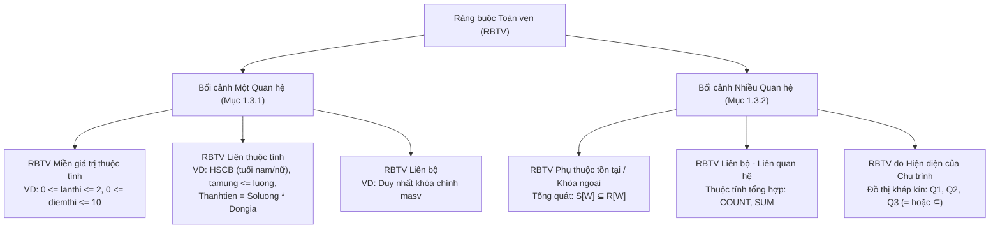
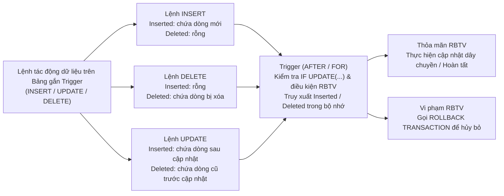

# Phần II - Chương 1: Ràng buộc toàn vẹn trên cơ sở dữ liệu (Phương pháp Ghi chép Cornell)

> **Hướng dẫn học tập theo Phương pháp ghi chép Cornell (Cornell Note-taking System):**
> Tài liệu lý thuyết Phần II - Chương 1 được biên soạn theo cấu trúc **Cornell Note-taking System**, bám sát *Giáo trình Thực hành Cơ sở dữ liệu (Phần II - Thiết kế)* (Lê Anh Phương, Nguyễn Thị Hương Giang, Lê Phước Nam Hà; Nxb. Đại học Huế, 2022), gồm 3 vùng nhận thức gắn kết chặt chẽ:
> 1. **Cột Trái (Cue Column - Từ khóa / Câu hỏi gợi nhớ):** Tập hợp các khái niệm trung tâm, ký hiệu toán học, bảng tầm ảnh hưởng, thuật ngữ SQL Server và câu hỏi truy xuất chủ động (Active Recall).
> 2. **Cột Phải (Note-taking Column - Ghi chú chi tiết):** Hệ thống hóa đầy đủ, mạch lạc toàn bộ định nghĩa, 4 yếu tố của RBTV, phân loại bối cảnh 1 và nhiều quan hệ, phụ thuộc hàm và kỹ thuật cài đặt Trigger trong SQL Server.
> 3. **Phần Tổng kết (Cornell Summary - Cuối mỗi mục & cuối chương):** Cô đọng các ý cốt lõi nhất để ôn tập nhanh trước khi làm bài tập trắc nghiệm, trả lời ngắn và tự luận.

---

## 1. Định nghĩa & 4 Yếu tố của Ràng buộc Toàn vẹn (Mục 1.1 - 1.2)

| Từ khóa / Câu hỏi gợi nhớ | Ghi chú chi tiết (Nội dung cốt lõi) |
| :--- | :--- |
| **Khái niệm Ràng buộc toàn vẹn (RBTV)**<br>*RBTV là gì và có ý nghĩa như thế nào trong phân tích thiết kế CSDL?* | • **Định nghĩa:** **Ràng buộc toàn vẹn (RBTV - Integrity Constraint)** là một **điều kiện bất biến** không được vi phạm trong một CSDL — tức là những mối liên hệ, sự ràng buộc qua lại giữa các thuộc tính hoặc giữa các bộ mà tất cả các bộ của những quan hệ có liên quan đều phải thỏa mãn **ở bất kỳ thời điểm nào**.<br>• **Bản chất thực tiễn:** RBTV thường là các **quy tắc quản lý** được áp đặt lên các đối tượng của thế giới thực. Người phân tích thiết kế phải phát hiện đầy đủ và mô tả chính xác, rõ ràng; RBTV được xem như một công cụ để **diễn đạt ngữ nghĩa của CSDL**, đảm bảo tính an toàn và toàn vẹn dữ liệu. |
| **Hai cơ sở dữ liệu ví dụ xuyên suốt chương**<br>*Kể tên các quan hệ và tập RBTV mẫu trong CSDL Quản lý sinh viên và Quản lý hóa đơn bán hàng.* | • **Ví dụ 1 — CSDL Quản lý sinh viên:**<br>  ◦ `KHOA(makhoa, tenkhoa)`<br>  ◦ `LOPHOC(malop, tenlop, sosinhvien, makhoa)`<br>  ◦ `SINHVIEN(masv, tensv, nsinh, malop)`<br>  ◦ `KETQUA(masv, mamon, lanthi, diemthi)`<br>  ◦ **5 RBTV tiêu biểu (`R1..R5`):** `R1` Mỗi lớp học phải thuộc một khoa nhất định trong `KHOA`; `R2` Mỗi sinh viên đều phải thuộc một lớp nhất định trong `LOPHOC`; `R3` Mỗi sinh viên có một mã số riêng biệt không trùng với bất cứ sinh viên nào; `R4` Mỗi sinh viên chỉ được thi tối đa `2` lần cho mỗi môn học; `R5` Số lượng sinh viên của một lớp học (`sosinhvien`) phải bằng số bộ giá trị của các sinh viên có cùng mã lớp.<br>• **Ví dụ 2 — CSDL Quản lý hóa đơn bán hàng:**<br>  ◦ `HOADON(Sohoadon, Sochungloaimathang, Tongtrigia)`<br>  ◦ `DMHANG(Mahang, Tenhang)`<br>  ◦ `CHITIETHD(Sohoadon, Mahang, Soluong, Dongia, Thanhtien)`<br>  ◦ **3 RBTV tiêu biểu (`R1..R3`):** `R1` Mỗi bộ thuộc `CHITIETHD` phải có một mã hàng thuộc về `DMHANG`; `R2` Với mọi hóa đơn trong `HOADON`, `Tongtrigia` phải bằng tổng `Thanhtien` các mặt hàng trong `CHITIETHD` có cùng số hóa đơn; `R3` `Sochungloaimathang` trong `HOADON` bằng số bộ của `CHITIETHD` có cùng số hóa đơn. |
| **Thời điểm & Cơ chế kiểm tra RBTV**<br>*Hệ QTCSDL kiểm tra RBTV bằng cách nào và vào những thời điểm nào?* | • **Cách thức kiểm tra:** Qua khai báo cấu trúc bảng (khóa nội/khóa chính, khóa ngoại, miền giá trị, `NOT NULL`) hoặc thông qua các thủ tục kiểm tra và xử lý (Trigger, Check constraint, Assertion, Transaction) do người phân tích thiết kế cài đặt.<br>• **2 thời điểm kiểm tra RBTV:**<br>  1. **Kiểm tra ngay khi thực hiện thao tác cập nhật CSDL (thêm, sửa, xóa):** Thao tác chỉ hợp lệ nếu không vi phạm bất kỳ RBTV nào; nếu vi phạm, thao tác bị coi là không hợp lệ và bị hệ thống **hủy bỏ**.<br>  2. **Kiểm tra định kỳ hay đột xuất:** Khi phát hiện vi phạm, hệ thống sẽ có xử lý ngầm định hoặc yêu cầu người sử dụng xử lý những sai sót một cách tường minh. |
| **4 yếu tố xác định một RBTV (Mục 1.2)**<br>*Khi đặc tả một RBTV cần chỉ rõ 4 yếu tố nào?* | 1. **Điều kiện** của ràng buộc toàn vẹn.<br>2. **Bối cảnh** xảy ra ràng buộc toàn vẹn (trên một hay nhiều quan hệ, cụ thể là những quan hệ nào).<br>3. **Tầm ảnh hưởng** của ràng buộc toàn vẹn.<br>4. **Hành động** khi ràng buộc toàn vẹn bị vi phạm.<br>*(Lưu ý: phần Tóm tắt cuối chương trong giáo trình tóm gọn 3 yếu tố phân tích cốt lõi là nội dung/điều kiện, bối cảnh và tầm ảnh hưởng; khi cài đặt đầy đủ cần xác định cả 4 yếu tố trên).* |
| **Yếu tố 1: Điều kiện của RBTV (Mục 1.2.1)**<br>*Các cách biểu diễn điều kiện RBTV và biểu thức cụ thể cho QLSV & Hóa đơn?* | • **Phương tiện biểu diễn:** Ngôn ngữ tự nhiên, thuật giải (ngôn ngữ tựa Pascal), đại số quan hệ (phép chiếu và phép toán tập con $\subseteq$) hoặc phụ thuộc hàm.<br>• **Biểu diễn `R1..R5` (CSDL Quản lý sinh viên):**<br>  ◦ `R1`: $\forall\text{ bộ } lh \in \text{LOPHOC},\ \exists\text{ bộ } kh \in \text{KHOA} : lh.\text{makhoa} = kh.\text{makhoa}$ hay $\text{LOPHOC}[\text{makhoa}] \subseteq \text{KHOA}[\text{makhoa}]$.<br>  ◦ `R2`: $\forall\text{ bộ } sv \in \text{SINHVIEN},\ \exists\text{ bộ } lh \in \text{LOPHOC} : sv.\text{malop} = lh.\text{malop}$ hay $\text{SINHVIEN}[\text{malop}] \subseteq \text{LOPHOC}[\text{malop}]$.<br>  ◦ `R3`: $\forall\text{ bộ } sv_1, sv_2 \in \text{SINHVIEN},\ sv_1 \neq sv_2 \Rightarrow sv_1.\text{masv} \neq sv_2.\text{masv}$.<br>  ◦ `R4`: $\forall\text{ bộ } kq \in \text{KETQUA}$ thì $0 \leq kq.\text{lanthi} \leq 2$ (lưu ý: nếu chỉ xét lần thi thực tế có thể viết $1 \leq kq.\text{lanthi} \leq 2$, giáo trình viết $0 \leq kq.\text{lanthi} \leq 2$).<br>  ◦ `R5`: $\forall\text{ bộ } lh \in \text{LOPHOC}$ thì $lh.\text{sosinhvien} = \text{COUNT}(sv \in \text{SINHVIEN} : sv.\text{malop} = lh.\text{malop})$.<br>• **Biểu diễn `R1..R3` (CSDL Quản lý hóa đơn):**<br>  ◦ `R1`: $\forall\ cthd \in \text{CHITIETHD},\ \exists\ hh \in \text{DMHANG} : cthd.\text{Mahang} = hh.\text{Mahang}$ hay $\text{CHITIETHD}[\text{Mahang}] \subseteq \text{DMHANG}[\text{Mahang}]$.<br>  ◦ `R2`: $\forall\ hd \in \text{HOADON} : hd.\text{Tongtrigia} = \text{SUM}(cthd.\text{Thanhtien} : cthd.\text{Sohoadon} = hd.\text{Sohoadon})$.<br>  ◦ `R3`: $\forall\ hd \in \text{HOADON} : hd.\text{Sochungloaimathang} = \text{COUNT}(cthd \in \text{CHITIETHD} : cthd.\text{Sohoadon} = hd.\text{Sohoadon})$. |
| **Yếu tố 2: Bối cảnh của RBTV (Mục 1.2.2)**<br>*Bối cảnh của RBTV là gì? Phân biệt bối cảnh 1 quan hệ và nhiều quan hệ.* | • **Định nghĩa:** **Bối cảnh** là những quan hệ mà RBTV có hiệu lực (những quan hệ cần sử dụng để kiểm tra RBTV). Bối cảnh có thể gồm **một** hoặc **nhiều** quan hệ.<br>• **Ví dụ trong CSDL Quản lý sinh viên:**<br>  ◦ Bối cảnh của `R3` và `R4` chỉ là **1 quan hệ** (`SINHVIEN` đối với `R3`, `KETQUA` đối với `R4`).<br>  ◦ Bối cảnh của `R1` là **2 quan hệ** (`LOPHOC`, `KHOA`).<br>  ◦ Bối cảnh của `R2` là **2 quan hệ** (`SINHVIEN`, `LOPHOC`).<br>  ◦ Bối cảnh của `R5` là **2 quan hệ** (`LOPHOC`, `SINHVIEN`). |
| **Yếu tố 3: Tầm ảnh hưởng của RBTV (Mục 1.2.3)**<br>*Ý nghĩa các ký hiệu `+`, `-`, `-(*)` trong bảng tầm ảnh hưởng là gì?* | • **Định nghĩa:** Chỉ khi có thao tác cập nhật (**Thêm, Sửa, Xóa**) mới có nguy cơ vi phạm RBTV. **Tầm ảnh hưởng** xác định thao tác nào trên quan hệ nào có thể dẫn tới vi phạm RBTV.<br>• **Cấu trúc bảng tầm ảnh hưởng đơn:** 4 cột — Cột 1 là tên các quan hệ liên quan, 3 cột sau là `Thêm`, `Sửa`, `Xóa`.<br>• **Quy ước ký hiệu:**<br>  ◦ `+`: Thao tác có nguy cơ dẫn tới vi phạm RBTV (cần kiểm tra; đối với cột `Sửa` ghi rõ tên thuộc tính bên cạnh/dưới, ví dụ `+(makhoa)`).<br>  ◦ `-` (hoặc để trống theo cách trình bày bảng): Không có nguy cơ vi phạm RBTV.<br>  ◦ `-(*)`: Không bị vi phạm vì **quy ước không được phép sửa đổi giá trị thuộc tính khóa**.<br>• **Ý nghĩa:** Cho biết khi tiến hành một thao tác cập nhật trên một quan hệ cụ thể thì **những RBTV nào cần phải kiểm tra**. |
| **Bảng tầm ảnh hưởng đơn & Bảng tầm ảnh hưởng tổng hợp**<br>*Trình bày bảng tầm ảnh hưởng của `R1..R5` và bảng tổng hợp cho CSDL Quản lý sinh viên.* | • **Tầm ảnh hưởng từng RBTV (`R1..R5`):**<br>  ◦ **`R1` (`LOPHOC`, `KHOA`):** `LOPHOC`: Thêm `+`, Sửa `+(makhoa)`, Xóa `-`; `KHOA`: Thêm `-`, Sửa `-(*)`, Xóa `+`.<br>  ◦ **`R2` (`SINHVIEN`, `LOPHOC`):** `SINHVIEN`: Thêm `+`, Sửa `+(malop)`, Xóa `-`; `LOPHOC`: Thêm `-`, Sửa `-(*)`, Xóa `+`.<br>  ◦ **`R3` (`SINHVIEN`):** `SINHVIEN`: Thêm `+`, Sửa `-(*)`, Xóa `-`.<br>  ◦ **`R4` (`KETQUA`):** `KETQUA`: Thêm `+`, Sửa `+(lanthi)`, Xóa `-`.<br>  ◦ **`R5` (`LOPHOC`, `SINHVIEN`):** `LOPHOC`: Thêm `+`, Sửa `+(sosinhvien)`, Xóa `-`; `SINHVIEN`: Thêm `+`, Sửa `+(malop)`, Xóa `+`.<br>• **Bảng tầm ảnh hưởng tổng hợp (CSDL Quản lý sinh viên):**<br><br>\| RBTV \| KHOA (T) \| KHOA (S) \| KHOA (X) \| LOPHOC (T) \| LOPHOC (S) \| LOPHOC (X) \| SINHVIEN (T) \| SINHVIEN (S) \| SINHVIEN (X) \| KETQUA (T) \| KETQUA (S) \| KETQUA (X) \|<br>\| :--- \| :---: \| :---: \| :---: \| :---: \| :---: \| :---: \| :---: \| :---: \| :---: \| :---: \| :---: \| :---: \|<br>\| **R1** \| - \| -(\*) \| + \| + \| +(makhoa) \| - \| - \| - \| - \| - \| - \| - \|<br>\| **R2** \| - \| - \| - \| - \| -(\*) \| + \| + \| +(malop) \| - \| - \| - \| - \|<br>\| **R3** \| - \| - \| - \| - \| - \| - \| + \| -(\*) \| - \| - \| - \| - \|<br>\| **R4** \| - \| - \| - \| - \| - \| - \| - \| - \| - \| + \| +(lanthi) \| - \|<br>\| **R5** \| - \| - \| - \| + \| +(sosvien) \| - \| + \| +(malop) \| + \| - \| - \| - \| |
| **Yếu tố 4: Hành động khi RBTV bị vi phạm (Mục 1.2.4)**<br>*Khi RBTV bị vi phạm, hệ thống áp dụng 2 giải pháp xử lý nào?* | 1. **Đưa ra thông báo và yêu cầu sửa chữa dữ liệu** của các thuộc tính cho phù hợp với quy tắc quản lý, đảm bảo tính nhất quán của dữ liệu.<br>2. **Từ chối thao tác cập nhật:** Việc từ chối phải đi kèm những **thông báo đầy đủ, rõ ràng** giải thích vì sao thao tác bị từ chối và cần phải sửa lại những dữ liệu nào. |

> **Tóm tắt Mục 1 (Cornell Summary):**
> **Ràng buộc toàn vẹn (RBTV)** là điều kiện bất biến diễn đạt ngữ nghĩa và quy tắc quản lý của CSDL, được kiểm tra ngay khi cập nhật (thêm/sửa/xóa) hoặc định kỳ/đột xuất. Mỗi RBTV gồm **4 yếu tố**: (1) **Điều kiện** (ngôn ngữ tự nhiên, thuật giải, ĐSQH, phụ thuộc hàm), (2) **Bối cảnh** (1 hoặc nhiều quan hệ liên quan), (3) **Tầm ảnh hưởng** (dùng ký hiệu `+`, `-`, `-(*)` trên bảng đơn và bảng tổng hợp để biết thao tác nào cần kiểm tra ràng buộc nào), và (4) **Hành động khi vi phạm** (thông báo yêu cầu sửa hoặc từ chối kèm giải thích rõ ràng).

---

## 2. Phân loại Ràng buộc Toàn vẹn: Bối cảnh Một Quan hệ & Nhiều Quan hệ (Mục 1.3)

### Sơ đồ 1: Cây Phân loại các Kiểu Ràng buộc Toàn vẹn



| Từ khóa / Câu hỏi gợi nhớ | Ghi chú chi tiết (Nội dung cốt lõi) |
| :--- | :--- |
| **RBTV bối cảnh 1 quan hệ: Miền giá trị của thuộc tính (Mục 1.3.1.1)**<br>*RBTV miền giá trị là gì và cần kiểm tra khi thao tác nào?* | • **Khái niệm:** Thuộc tính không chỉ có kiểu dữ liệu mà còn bị **giới hạn bởi miền giá trị** hợp lệ trong kiểu dữ liệu đó. Khi thực hiện thao tác **Thêm** hoặc **Sửa** bộ giá trị của quan hệ đều phải kiểm tra ràng buộc này.<br>• **Ví dụ trên quan hệ `KETQUA`:**<br>  ◦ `R1`: $\forall kq \in \text{KETQUA} : 0 \leq kq.\text{lanthi} \leq 2$ (mỗi sinh viên chỉ thi tối đa 2 lần/môn).<br>  ◦ `R2`: $\forall kq \in \text{KETQUA} : 0 \leq kq.\text{diemthi} \leq 10$ (điểm thi không vượt quá 10). |
| **RBTV bối cảnh 1 quan hệ: Liên thuộc tính (Mục 1.3.1.2)**<br>*Phân biệt các ví dụ `HSCB`, `NHANVIEN` và xử lý thuộc tính tính toán `Thanhtien`.* | • **Khái niệm:** Ràng buộc có liên quan tới **nhiều thuộc tính trong cùng một quan hệ** (thuộc tính này liên quan hoặc được tính toán từ giá trị các thuộc tính khác trong cùng một bộ).<br>• **Ví dụ 1 — `HSCB(macb, hoten, phai, ngsinh)` (tuổi làm cán bộ nhà nước):**<br>  ◦ $\forall cb \in \text{HSCB}$:<br>    ▪ Nếu `cb.phai = nam` thì $18 \leq \text{year}(\text{date}()) - \text{year}(\text{nsinh}) \leq 62$.<br>    ▪ Nếu `cb.phai = nu` thì $18 \leq \text{year}(\text{date}()) - \text{year}(\text{nsinh}) \leq 60$.<br>• **Ví dụ 2 — `NHANVIEN(manv, tennv, luong, tamung, conlai)`:**<br>  ◦ $\forall nv \in \text{NHANVIEN} : nv.\text{tamung} \leq nv.\text{luong}$.<br>• **Ví dụ 3 — Thuộc tính tính toán `Thanhtien` trong `CHITIETHD`:**<br>  ◦ $\forall cthd \in \text{CHITIETHD} : cthd.\text{Thanhtien} = cthd.\text{Soluong} \times cthd.\text{Dongia}$.<br>  ◦ **Lưu ý thiết kế:** Nếu thuộc tính `A` được tính toán hoàn toàn từ các thuộc tính khác trong cùng bộ, nó làm **tăng chi phí lưu trữ và chi phí kiểm tra RBTV**, nên trong quá trình thiết kế CSDL ta có thể **loại bỏ thuộc tính `A`** ra khỏi lược đồ quan hệ. |
| **RBTV bối cảnh 1 quan hệ: Liên bộ (Mục 1.3.1.3)**<br>*RBTV liên bộ thường dùng để diễn đạt quy định nào?* | • **Khái niệm:** Là loại ràng buộc giữa **các bộ trong cùng một quan hệ**, thường dùng để quy định **tính duy nhất của khóa**.<br>• **Ví dụ trên `SINHVIEN`:** $\forall\text{ bộ } sv_1, sv_2 \in \text{SINHVIEN},\ sv_1 \neq sv_2 \Rightarrow sv_1.\text{masv} \neq sv_2.\text{masv}$. |
| **RBTV nhiều quan hệ: Phụ thuộc tồn tại / Khóa ngoại (Mục 1.3.2.1)**<br>*Phát biểu tổng quát $S[W] \subseteq R[W]$ và bảng tầm ảnh hưởng tổng quát như thế nào?* | • **Khái niệm:** Mỗi bộ của quan hệ này chỉ hợp lệ nếu tồn tại một bộ tương ứng ở quan hệ khác; xảy ra khi có **khóa ngoại**.<br>• **Các ví dụ tiêu biểu:**<br>  ◦ Hóa đơn: $\text{CHITIETHD}[\text{sohoadon}] \subseteq \text{HOADON}[\text{sohoadon}]$; $\text{CHITIETHD}[\text{mahang}] \subseteq \text{DMHANG}[\text{mahang}]$.<br>  ◦ Sinh viên: $\text{LOPHOC}[\text{makhoa}] \subseteq \text{KHOA}[\text{makhoa}]$; $\text{SINHVIEN}[\text{malop}] \subseteq \text{LOPHOC}[\text{malop}]$; $\text{KETQUA}[\text{masv}] \subseteq \text{SINHVIEN}[\text{masv}]$.<br>  ◦ Nhận xét: Vế phải phép $\subseteq$ là phép chiếu trên **thuộc tính khóa nội** của một quan hệ; vế trái là phép chiếu trên **thuộc tính khóa ngoại** của quan hệ khác.<br>• **Phát biểu tổng quát:** Cho 2 quan hệ $R$ và $S$, $W$ là tập thuộc tính khóa ngoại của $S$ đối với $R$. Phụ thuộc tồn tại của $S$ vào $R$ được biểu diễn là **$S[W] \subseteq R[W]$**.<br>• **Bảng tầm ảnh hưởng tổng quát:**<br><br>\| Quan hệ \| Thêm \| Sửa \| Xóa \|<br>\| :--- \| :---: \| :---: \| :---: \|<br>\| **$S$** (chứa khóa ngoại $W$) \| + \| +(W) \| - \|<br>\| **$R$** (chứa khóa nội $W$) \| - \| -(\*) \| + \|<br><br>  ◦ *Giải thích:* Trên $R$, Thêm và Sửa (không đổi khóa) không vi phạm, chỉ **Xóa** bộ ở $R$ mới có nguy cơ vi phạm. Ngược lại, trên $S$, Xóa không vi phạm, chỉ **Thêm** và **Sửa (trên thuộc tính khóa ngoại $W$)** mới cần kiểm tra RBTV. |
| **RBTV nhiều quan hệ: Liên bộ - Liên quan hệ (Mục 1.3.2.2)**<br>*Khi nào xuất hiện RBTV liên bộ - liên quan hệ? Vì sao đôi khi cố ý nhập thừa `Thanhtien`?* | • **Khái niệm:** Xuất hiện khi có **thuộc tính mang tính chất tổng hợp**, giá trị được tính toán từ các thuộc tính khác trên một hay nhiều bộ của các quan hệ trong CSDL (thường dùng `COUNT`, `SUM`).<br>• **Ví dụ 1 — `LOPHOC` & `SINHVIEN`:** $lh.\text{sosinhvien} = \text{COUNT}(sv \in \text{SINHVIEN} : sv.\text{malop} = lh.\text{malop})$.<br>• **Ví dụ 2 — `HOADON` & `CHITIETHD`:**<br>  ◦ `R1`: $hd.\text{Sochungloaimathang} = \text{COUNT}(cthd \in \text{CHITIETHD} : cthd.\text{sohoadon} = hd.\text{sohoadon})$.<br>  ◦ `R2`: $hd.\text{Tongtrigia} = \text{SUM}(cthd.\text{Thanhtien} : cthd \in \text{CHITIETHD},\ cthd.\text{sohoadon} = hd.\text{sohoadon})$.<br>• **Xử lý dư thừa có chủ ý vs. loại bỏ thuộc tính tính toán:**<br>  ◦ Việc nhập "thừa" dữ liệu `Thanhtien` rồi đối chiếu với công thức tính toán chính là một phương pháp để **kiểm tra tính đúng đắn của dữ liệu**.<br>  ◦ Ngược lại, để đảm bảo **không bị dư thừa dữ liệu** cho `CHITIETHD`, có thể **loại bỏ `Thanhtien`**; khi đó `R2` được viết lại thành:<br>    $hd.\text{Tongtrigia} = \text{SUM}(cthd.\text{Soluong} \times cthd.\text{Dongia} : cthd.\text{sohoadon} = hd.\text{sohoadon})$. |
| **RBTV nhiều quan hệ: Do sự hiện diện của chu trình (Mục 1.3.2.3)**<br>*Đồ thị cấu trúc CSDL dựng thế nào? Phân biệt dấu `=` và `⊆` trong chu trình `Q1 - Q2 - Q3`.* | • **Cách biểu diễn CSDL dưới dạng đồ thị:** Mỗi nút biểu diễn **một quan hệ** hoặc **một thuộc tính**; thuộc tính thuộc quan hệ được biểu diễn bởi **một cung vô hướng** nối nút thuộc tính với nút quan hệ. Nếu tồn tại **đường khép kín** thì đồ thị có **chu trình**, làm nảy sinh RBTV nhằm đảm bảo tính nhất quán dữ liệu.<br>• **Ví dụ chu trình `Q1(manv, maphong)`, `Q2(maphong, madean)`, `Q3(madean, manv)`:**<br>  ◦ Có **2 cách** xác định đề án của mỗi nhân viên: (Cách 1) Trực tiếp qua `Q3`; (Cách 2) Qua phép kết nối `Q1` với `Q2` theo `maphong`.<br>  ◦ Một CSDL là **nhất quán** nếu qua các cách khác nhau chỉ xác định được một kết quả phù hợp:<br>    ▪ Nếu quy định *"Mỗi nhân viên được tham gia vào **tất cả** các đề án do phòng đó phụ trách"* $\rightarrow$ dùng dấu **`=`**:<br>      $$\text{Q3}[\text{manv}, \text{madean}] = (\text{Q1} \bowtie \text{Q2})[\text{manv}, \text{madean}]$$<br>    ▪ Nếu quy định *"Mỗi nhân viên được tham gia vào **một số** đề án do phòng đó phụ trách"* $\rightarrow$ dùng dấu **`⊆`**:<br>      $$\text{Q3}[\text{manv}, \text{madean}] \subseteq (\text{Q1} \bowtie \text{Q2})[\text{manv}, \text{madean}]$$ |

> **Tóm tắt Mục 2 (Cornell Summary):**
> RBTV được phân làm 2 nhóm lớn theo bối cảnh: **(1) Bối cảnh 1 quan hệ** gồm miền giá trị thuộc tính, liên thuộc tính (`HSCB` nam 18–62 / nữ 18–60, `NHANVIEN` `tamung <= luong`, `CHITIETHD` `Thanhtien`) và liên bộ (tính duy nhất của khóa); **(2) Bối cảnh nhiều quan hệ** gồm phụ thuộc tồn tại / khóa ngoại ($S[W] \subseteq R[W]$, cần kiểm tra khi Thêm/Sửa $W$ ở $S$ và Xóa ở $R$), liên bộ - liên quan hệ (thuộc tính tổng hợp `COUNT`, `SUM`) và RBTV do chu trình trên đồ thị (`Q1, Q2, Q3` dùng `=` khi tham gia tất cả đề án hoặc `⊆` khi tham gia một số đề án).

---

## 3. Biểu diễn Ràng buộc Toàn vẹn bằng Phụ thuộc Hàm (Mục 1.4)

| Từ khóa / Câu hỏi gợi nhớ | Ghi chú chi tiết (Nội dung cốt lõi) |
| :--- | :--- |
| **Định nghĩa Phụ thuộc hàm (PTH - Mục 1.4.1)**<br>*Khi nào nói $X \to Y$ trên lược đồ quan hệ $R(U)$?* | • **Vai trò:** Phụ thuộc hàm là công cụ dùng để biểu diễn một cách hình thức một số RBTV, có tầm quan trọng rất lớn trong phân tích và thiết kế CSDL.<br>• **Định nghĩa hình thức:** Cho lược đồ quan hệ $R(U)$ trên tập thuộc tính $U$; $X, Y \subset U$. Ta nói **$X$ xác định hàm $Y$** hay **$Y$ phụ thuộc hàm vào $X$**, ký hiệu **$X \to Y$**, nếu với mọi quan hệ $r$ xây dựng trên $R(U)$ và với mọi bộ $t_1, t_2 \in r$:<br>  $$t_1[X] = t_2[X] \implies t_1[Y] = t_2[Y]$$<br>  *(trong đó $t[X]$ là bộ $t$ thu hẹp trên tập thuộc tính $X$).*<br>• **Ý nghĩa trực giác:** Ứng với một giá trị của $X$ thì xác định được **một giá trị duy nhất** của $Y$. Ta thường dùng PTH để biểu diễn các ràng buộc về **tính duy nhất của khóa**. |
| **Các ví dụ biểu diễn RBTV bằng PTH (Mục 1.4.2)**<br>*Viết các PTH cho `SINHVIEN`, `HOADON`, `CHITIETHD`.* | • **Ví dụ 1 — `SINHVIEN(masv, tensv, ngsinh, malop)`:**<br>  ◦ Ràng buộc liên bộ $\forall sv_1, sv_2 \in \text{SINHVIEN},\ sv_1.\text{masv} = sv_2.\text{masv} \implies sv_1 = sv_2$ (hay $sv_1[\text{tensv, ngsinh, malop}] = sv_2[\text{tensv, ngsinh, malop}]$) được biểu diễn bằng PTH:<br>    `f1: masv -> tensv, ngsinh, malop` (vì `masv` là khóa, biết `masv` xác định tất cả thông tin còn lại của sinh viên).<br>• **Ví dụ 2 — CSDL Quản lý hóa đơn:**<br>  ◦ Trên `HOADON(Sohoadon, Sochungloaimathang, Tongtrigia)`:<br>    `f1: Sohoadon -> Sochungloaimathang, Tongtrigia` (vì `Sohoadon` là khóa).<br>  ◦ Trên `CHITIETHD(Sohoadon, Mahang, Soluong, Dongia, Thanhtien)`:<br>    `f1: Sohoadon, Mahang -> Soluong, Dongia, Thanhtien`<br>    `f2: Soluong, Dongia -> Thanhtien` |
| **Giới hạn của Phụ thuộc hàm**<br>*Phụ thuộc hàm có biểu diễn được mọi RBTV hay không?* | • **Chú ý quan trọng:** **Không phải mọi ràng buộc toàn vẹn đều biểu diễn được bằng phụ thuộc hàm.**<br>• *Ví dụ minh họa giới hạn:* Các ràng buộc miền giá trị (`0 <= diemthi <= 10`), ràng buộc so sánh (`tamung <= luong`), ràng buộc tổng hợp (`SUM`, `COUNT`) hay phụ thuộc tồn tại ($S[W] \subseteq R[W]$) không biểu diễn được bằng PTH mà phải dùng ĐSQH, vị từ lượng từ hoặc Trigger. |

> **Tóm tắt Mục 3 (Cornell Summary):**
> **Phụ thuộc hàm** $X \to Y$ trên $R(U)$ quy định mọi $t_1, t_2 \in r$ có $t_1[X] = t_2[X]$ thì $t_1[Y] = t_2[Y]$ (một giá trị của $X$ xác định duy nhất một giá trị của $Y$). PTH thường dùng để biểu diễn hình thức tính duy nhất của khóa (như `masv -> tensv, ngsinh, malop` hay `Sohoadon, Mahang -> Soluong, Dongia, Thanhtien`), nhưng **không phải mọi RBTV đều biểu diễn được bằng PTH**.

---

## 4. Xử lý Vi phạm Ràng buộc Toàn vẹn bằng Trigger trong SQL Server (Mục 1.5)

### Sơ đồ 2: Cơ chế Hoạt động của Trigger và Hai Bảng Tạm `Inserted` / `Deleted`



| Từ khóa / Câu hỏi gợi nhớ | Ghi chú chi tiết (Nội dung cốt lõi) |
| :--- | :--- |
| **Khái niệm & Lợi ích của Trigger (Mục 1.5)**<br>*Trigger là gì và có tác dụng gì đối với tính toàn vẹn & hiệu năng CSDL?* | • **Định nghĩa:** **Trigger** là một đối tượng chứa một tập các câu lệnh SQL được **tự động thực hiện** khi xảy ra thao tác làm thay đổi dữ liệu (`INSERT`, `UPDATE`, `DELETE`) trên **một bảng gắn với nó**.<br>• **2 tác dụng chính:**<br>  1. **Nhận biết, ngăn chặn và hủy bỏ** những thao tác làm thay đổi trái phép dữ liệu; đồng thời tự động thực hiện một loạt thao tác khác (như cập nhật tồn kho, sĩ số) để đảm bảo tính hợp lệ và toàn vẹn dữ liệu.<br>  2. **Kiểm tra những mối quan hệ phức tạp** giữa các bảng trong CSDL, góp phần tăng hiệu năng và độ tin cậy của hệ thống. |
| **Quy trình tạo & Cú pháp chuẩn của Trigger (Mục 1.5.1)**<br>*Các bước tạo Trigger trong SQL Server và cấu trúc cú pháp lệnh `CREATE TRIGGER`?* | • **Thao tác trên SSMS:**<br>  ◦ Bước 1: Mở dấu `+` ở bảng gắn Trigger $\rightarrow$ chọn **Triggers** $\rightarrow$ Right-Click $\rightarrow$ **New Trigger** $\rightarrow$ xóa comment/câu lệnh mẫu thừa.<br>  ◦ Bước 2: Gõ lệnh `CREATE TRIGGER` theo cú pháp:<br>```sql<br>CREATE TRIGGER <TÊN TRIGGER><br>ON <TÊN BẢNG><br>AFTER [INSERT][, UPDATE][, DELETE]<br>AS<br>BEGIN<br>    [IF UPDATE (<TÊN CỘT>) [AND/OR UPDATE (<TÊN CỘT>) ...]]<br>    -- CÁC CÂU LỆNH CỦA TRIGGER<br>END<br>```<br>  ◦ Bước 3: Bấm **F5** (hoặc nút **Execute**) để thực thi; Right-Click mục Triggers $\rightarrow$ **Refresh** để xem Trigger mới; muốn chỉnh sửa chọn Right-Click tên Trigger $\rightarrow$ **Modify**. |
| **Cơ chế 2 bảng tạm `Inserted` và `Deleted`**<br>*Dữ liệu trong `Inserted` và `Deleted` thay đổi ra sao với `INSERT`, `DELETE`, `UPDATE`?* | • **Bản chất:** SQL Server tự động tạo 2 bảng tạm **`Inserted`** và **`Deleted`** trong bộ nhớ với **cấu trúc tương tự bảng gắn Trigger**.<br>• **Trạng thái dữ liệu theo từng lệnh kích hoạt:**<br>  ◦ **`INSERT`:** Các dòng dữ liệu mới được chép vào **`Inserted`**; bảng **`Deleted` không có dữ liệu**.<br>  ◦ **`DELETE`:** Các dòng dữ liệu bị xóa được chép vào **`Deleted`**; bảng **`Inserted` không có dữ liệu**.<br>  ◦ **`UPDATE`:** Bảng **`Deleted`** chứa các dòng **dữ liệu cũ** chịu tác động của lệnh; bảng **`Inserted`** chứa các dòng **sau khi đã được cập nhật**.<br>• **Phạm vi sống:** Chỉ truy xuất được bên trong Trigger; ngay khi Trigger hoàn tất thì hai bảng này không thể truy xuất được nữa. |
| **Ví dụ Trigger khi thêm dữ liệu: `NKBH_INSERT` (Mục 1.5.2)**<br>*Trigger giảm `SLHIENCO` khi bán hàng trên `NHATKYBANHANG` hoạt động thế nào?* | • **Lược đồ:** `MATHANG(MAH, TENH, SLHIENCO)` và `NHATKYBANHANG(STT, NGAY, MAH, SLBAN, GIA)`.<br>• **Yêu cầu:** Khi `INSERT` bản ghi bán hàng vào `NHATKYBANHANG`, tự động giảm `SLHIENCO` trong `MATHANG`:<br>```sql<br>CREATE TRIGGER NKBH_INSERT<br>ON NHATKYBANHANG<br>AFTER INSERT<br>AS<br>UPDATE MATHANG<br>SET MATHANG.SLHIENCO = MATHANG.SLHIENCO - INSERTED.SLBAN<br>FROM MATHANG, INSERTED<br>WHERE MATHANG.MAH = INSERTED.MAH<br>``` |
| **Các câu lệnh quản trị & `IF UPDATE` trên Trigger (Mục 1.5.3)**<br>*Liệt kê 5 lệnh quản trị Trigger và giới hạn của `IF UPDATE`.* | 1. **Xem danh sách Trigger hiện có trên bảng:** `SP_HELPTRIGGER <TÊN BẢNG>`<br>2. **Vô hiệu hóa / Kích hoạt lại Trigger (không xóa):**<br>   ◦ `ALTER TABLE <TÊN BẢNG> DISABLE TRIGGER <TÊN TRIGGER>`<br>   ◦ `ALTER TABLE <TÊN BẢNG> ENABLE TRIGGER <TÊN TRIGGER>`<br>3. **Xóa Trigger:** `DROP TRIGGER <TÊN TRIGGER>`<br>4. **Xem mã lệnh Trigger:** `SP_HELPTEXT <TÊN TRIGGER>`<br>5. **Chỉ định cột kích hoạt bằng `IF UPDATE(<TÊN CỘT>)`:** Trigger chỉ xử lý khi việc thay đổi liên quan đến cột chỉ định. **Lưu ý:** `IF UPDATE` **không sử dụng được với câu lệnh `DELETE`**. |
| **Ví dụ Trigger khi cập nhật dữ liệu: `NKBH_UPDATE` (Mục 1.5.4)**<br>*Vì sao công thức cập nhật tồn kho khi sửa `SLBAN` là `+ DELETED.SLBAN - INSERTED.SLBAN`?* | • **Yêu cầu:** Cập nhật lại `SLHIENCO` trong `MATHANG` mỗi khi thay đổi `SLBAN` của một bản ghi trong `NHATKYBANHANG`.<br>```sql<br>CREATE TRIGGER NKBH_UPDATE<br>ON NHATKYBANHANG<br>AFTER UPDATE<br>AS<br>IF UPDATE(SLBAN)<br>    UPDATE MATHANG<br>    SET MATHANG.SLHIENCO = MATHANG.SLHIENCO + DELETED.SLBAN - INSERTED.SLBAN<br>    FROM MATHANG, DELETED, INSERTED<br>    WHERE (MATHANG.MAH = DELETED.MAH) AND (DELETED.STT = INSERTED.STT)<br>```<br>• **Hành vi:** Lệnh `UPDATE NHATKYBANHANG SET SLBAN = SLBAN + 5 WHERE STT = 4` kích hoạt nhánh `IF UPDATE(SLBAN)` (hoàn lại `DELETED.SLBAN = 4`, trừ đi `INSERTED.SLBAN = 9`, tức giảm thêm 5); còn `SET NGAY = '11/11/20' WHERE STT = 1` **không kích hoạt** khối xử lý này vì không cập nhật cột `SLBAN`. |
| **Lệnh `ROLLBACK TRANSACTION` trong Trigger (Mục 1.5.5)**<br>*`ROLLBACK TRANSACTION` dùng để làm gì? Nêu ví dụ `MATHANG_DELETE`.* | • **Mục đích:** Hủy bỏ hoàn toàn tác dụng của câu lệnh làm kích hoạt Trigger khi phát hiện vi phạm RBTV.<br>• **Ví dụ — Không cho phép xóa dữ liệu trên bảng `MATHANG`:**<br>```sql<br>CREATE TRIGGER MATHANG_DELETE<br>ON MATHANG<br>FOR DELETE<br>AS<br>    ROLLBACK TRANSACTION<br>``` |

> **Tóm tắt Mục 4 (Cornell Summary):**
> **Trigger** trong SQL Server là tập lệnh SQL gắn với một bảng, tự động kích hoạt khi `INSERT`, `UPDATE`, `DELETE`, sử dụng 2 bảng tạm trong bộ nhớ là **`Inserted`** (chứa dòng mới khi `INSERT`/`UPDATE`) và **`Deleted`** (chứa dòng cũ/bị xóa khi `DELETE`/`UPDATE`). Ta có thể giới hạn cột theo dõi bằng `IF UPDATE(<cột>)` (không dùng cho `DELETE`), quản trị bằng `SP_HELPTRIGGER`, `SP_HELPTEXT`, `DISABLE/ENABLE TRIGGER`, `DROP TRIGGER`, và hủy bỏ thao tác vi phạm RBTV bằng **`ROLLBACK TRANSACTION`**.

---

## Tóm tắt toàn chương (Cornell Summary)

1. **Định nghĩa & Kiểm tra RBTV (Mục 1.1):** Ràng buộc toàn vẹn là điều kiện bất biến diễn đạt ngữ nghĩa và quy tắc quản lý mà mọi bộ trong các quan hệ liên quan phải thỏa mãn ở mọi thời điểm; được kiểm tra ngay khi cập nhật (`INSERT/UPDATE/DELETE`) hoặc định kỳ/đột xuất.
2. **4 Yếu tố của RBTV (Mục 1.2):** Mọi RBTV cần xác định rõ **Điều kiện** (ngôn ngữ tự nhiên, thuật giải, ĐSQH, PTH), **Bối cảnh** (1 hoặc nhiều quan hệ), **Tầm ảnh hưởng** (`+`, `-`, `-(*)` trên bảng đơn và bảng tổng hợp), và **Hành động khi vi phạm** (thông báo yêu cầu sửa hoặc từ chối thao tác kèm giải thích).
3. **Phân loại RBTV (Mục 1.3):**
   - *Bối cảnh 1 quan hệ:* Miền giá trị thuộc tính, liên thuộc tính (`HSCB`, `NHANVIEN`, `CHITIETHD`), liên bộ (tính duy nhất của khóa).
   - *Bối cảnh nhiều quan hệ:* Phụ thuộc tồn tại / khóa ngoại ($S[W] \subseteq R[W]$), liên bộ - liên quan hệ (`COUNT`, `SUM`), và RBTV do chu trình trên đồ thị (`Q1, Q2, Q3` với `=` hoặc `⊆`).
4. **Biểu diễn bằng Phụ thuộc hàm (Mục 1.4):** $X \to Y$ nghĩa là $\forall t_1, t_2 \in r,\ t_1[X] = t_2[X] \implies t_1[Y] = t_2[Y]$, chủ yếu biểu diễn tính duy nhất của khóa; lưu ý không phải mọi RBTV đều biểu diễn được bằng PTH.
5. **Xử lý vi phạm bằng Trigger (Mục 1.5):** SQL Server dùng `CREATE TRIGGER ... AFTER INSERT/UPDATE/DELETE`, khai thác bảng tạm `Inserted`/`Deleted`, kết hợp `IF UPDATE(...)`, các lệnh quản trị (`SP_HELPTRIGGER`, `SP_HELPTEXT`, `DISABLE/ENABLE`, `DROP`) và `ROLLBACK TRANSACTION` để ngăn chặn vi phạm hoặc đồng bộ dữ liệu liên quan.

---

## Câu hỏi tự kiểm tra nhanh (Self-Testing Cues)

1. Nêu định nghĩa **Ràng buộc toàn vẹn (RBTV)** và phân biệt 2 thời điểm kiểm tra RBTV trong hệ QTCSDL.
2. Trình bày **4 yếu tố** của một RBTV; giải thích ý nghĩa 3 ký hiệu `+`, `-`, `-(*)` trong bảng tầm ảnh hưởng và công dụng của **Bảng tầm ảnh hưởng tổng hợp**.
3. Phân biệt 3 loại RBTV có **bối cảnh 1 quan hệ** (miền giá trị, liên thuộc tính, liên bộ) và lấy ví dụ trên `KETQUA`, `HSCB`, `NHANVIEN`, `SINHVIEN`.
4. Viết dạng tổng quát và bảng tầm ảnh hưởng của **RBTV phụ thuộc tồn tại (khóa ngoại)** $S[W] \subseteq R[W]$.
5. Trong đồ thị chu trình `Q1(manv, maphong)`, `Q2(maphong, madean)`, `Q3(madean, manv)`, khi nào biểu thức điều kiện dùng dấu `=` và khi nào dùng dấu `⊆`?
6. Phát biểu định nghĩa **Phụ thuộc hàm** $X \to Y$ và giải thích vì sao thuộc tính `Thanhtien` trong `CHITIETHD` vừa có thể là nguyên nhân dư thừa, vừa đôi khi được giữ lại để kiểm tra dữ liệu.
7. So sánh nội dung hai bảng tạm **`Inserted`** và **`Deleted`** trong 3 trường hợp `INSERT`, `DELETE`, `UPDATE`; nêu tác dụng của `IF UPDATE`, `ROLLBACK TRANSACTION`, `SP_HELPTRIGGER` và `SP_HELPTEXT`.
