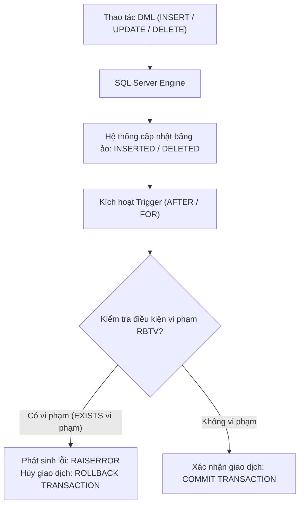

# CHƯƠNG 1 (QUYỂN 2): RÀNG BUỘC TOÀN VẸN & KỸ THUẬT CÀI ĐẶT TRIGGER

### 1. Sơ Đồ Quy Trình Hoạt Động Của Trigger Trong RDBMS

### 2. Bốn Yếu Tố Cấu Thành Một Ràng Buộc Toàn Vẹn (RBTV)
1. **Điều kiện (Condition):** Quy tắc nghiệp vụ bắt buộc phải thỏa mãn (phát biểu bằng logic vị từ hoặc ngôn ngữ tự nhiên).
2. **Bối cảnh (Context):** Tập các quan hệ mà quy tắc nghiệp vụ đó tác động trực tiếp tới.
3. **Tầm ảnh hưởng (Scope of Impact):** Bảng ma trận xác định thao tác Thêm ($+$), Xóa ($-$), Sửa ($*$) nào trên từng quan hệ có nguy cơ gây vi phạm.
4. **Hành động khi vi phạm (Action on Violation):** Phản ứng của hệ quản trị CSDL khi phát hiện vi phạm (thường là từ chối giao dịch `ROLLBACK TRANSACTION` hoặc lan truyền `ON DELETE CASCADE`).

### 3. Thiết Kế Bảng Tầm Ảnh Hưởng (Impact Matrix)

| Quan hệ trong bối cảnh | Thêm (Insert) | Xóa (Delete) | Sửa (Update) |
| :--- | :---: | :---: | :---: |
| **Bảng con (Tham chiếu $FK$)** | $+$ | $-$ | $* (FK)$ |
| **Bảng cha (Được tham chiếu $PK$)** | $-$ | $+$ | $* (PK)$ |

- Ký hiệu:
  - `+` : Cần kiểm tra ràng buộc khi thao tác diễn ra.
  - `-` : Không cần kiểm tra ràng buộc (không bao giờ làm vi phạm).
  - `*` : Chỉ cần kiểm tra khi thuộc tính được sửa nằm trong danh sách thuộc tính tham gia ràng buộc.

### 4. Cơ Chế Bảng Ảo Tạm Thời Trong Trigger (T-SQL)
- **`INSERTED`:** Chứa bản sao các dòng mới được thêm vào (với `INSERT`) hoặc các dòng mang giá trị mới sau khi cập nhật (với `UPDATE`).
- **`DELETED`:** Chứa bản sao các dòng vừa bị xóa đi (với `DELETE`) hoặc các dòng mang giá trị cũ trước khi bị cập nhật (với `UPDATE`).

---

## Tinh Hoa Kiến Thức & Tóm Tắt Chuyên Sâu (Key Takeaways)
> **Chuyên đề mở rộng:** Phụ thuộc Hàm, Bao đóng & Thuật toán Tìm Khóa

### 1. Các Ý Niệm Cốt Lõi (Key Takeaways)
- **Phụ thuộc hàm (FD):** $X \to Y \iff (\forall t_1, t_2 \in r)(t_1[X] = t_2[X] \implies t_1[Y] = t_2[Y])$.
- **Hệ tiên đề Armstrong:**
  1. *Phản xạ:* $Y \subseteq X \implies X \to Y$.
  2. *Tăng trưởng:* $X \to Y \implies XZ \to YZ$.
  3. *Bắc cầu:* $X \to Y \land Y \to Z \implies X \to Z$.
  *Quy tắc dẫn xuất:* Hợp ($X \to Y, X \to Z \implies X \to YZ$), Phân rã ($X \to YZ \implies X \to Y, X \to Z$), Tựa bắc cầu.

### 2. Bao Đóng Của Tập Thuộc Tính ($X^+$) & Bài Toán Thành Viên
- **Bao đóng $X^+$:** Tập các thuộc tính $A$ sao cho $X \to A \in F^+$.
- **Bài toán thành viên:** Kiểm tra $X \to Y \in F^+ \iff Y \subseteq X^+$.

### 3. Thuật Toán Tìm Tất Cả Các Khóa (Lucchenssi - Osborn)
Phân loại tập thuộc tính toàn thể $U$ thành 4 nhóm:
- **Nhóm $L$ (Chỉ xuất hiện vế trái):** Bắt buộc có mặt trong mọi khóa.
- **Nhóm $R$ (Chỉ xuất hiện vế phải):** Không bao giờ xuất hiện trong bất kỳ khóa tối thiểu nào.
- **Nhóm $D$ (Độc lập, không xuất hiện trong $F$):** Bắt buộc có mặt trong mọi khóa.
- **Nhóm $M$ (Trung gian, xuất hiện cả hai vế):** Cần kết hợp thử nghiệm với tập nguồn $X_0 = L \cup D$.

**Quy trình tìm khóa:**
1. Đặt $X_0 = L \cup D$. Nếu $X_0^+ = U \implies X_0$ là khóa duy nhất.
2. Nếu $X_0^+ \ne U$, lần lượt thử kết hợp $X_0$ với các tập con $Y \subseteq M$ theo kích thước tăng dần. Nếu $(X_0 \cup Y)^+ = U$ và không chứa khóa đã tìm thấy trước đó, thì $(X_0 \cup Y)$ là khóa.

### 4. Phủ Tối Thiểu (Minimal Cover - $F_{min}$)
Tập $F_{min}$ tương đương $F$ đạt 3 điều kiện:
1. Vế phải đơn thuộc tính ($|Y| = 1$).
2. Không có thuộc tính dư thừa vế trái (loại bỏ $B \in X$ nếu $A \in (X \setminus \{B\})_F^+$).
3. Không có phụ thuộc hàm dư thừa (loại bỏ $f: X \to A$ nếu $A \in X_{F \setminus \{f\}}^+$).
