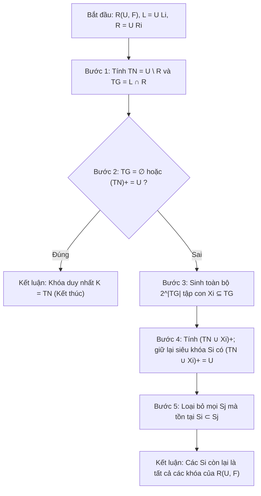

# Phần II - Chương 2: Phụ thuộc hàm và khóa (Phương pháp Ghi chép Cornell)

> **Hướng dẫn sử dụng Ghi chép Cornell:**
> - **Cột Trái (Cue Column):** Chứa từ khóa, định lý, thuật ngữ cốt lõi và câu hỏi gợi nhớ để ôn tập chủ động.
> - **Cột Phải (Note-taking Column):** Chứa định nghĩa toán học chuẩn xác, chứng minh, thuật toán (từng bước & mã giả) và ví dụ minh họa từ giáo trình Phần II.
> - **Phần Tổng kết (Summary):** Tóm tắt cô đọng ý chính ngay sau mỗi mục và tổng kết toàn chương nhằm củng cố khả năng hệ thống hóa kiến thức.

---

## 1. Tổng quan Dị thường Dữ liệu, Định nghĩa Phụ thuộc Hàm & Hệ Tiên đề Armstrong (Mục 2.1 - 2.7)

| Từ khóa / Câu hỏi gợi nhớ | Ghi chú chi tiết (Nội dung cốt lõi) |
| :--- | :--- |
| **4 vấn đề khi thiết kế lược đồ chưa chuẩn (`NHACC`)** | Xét lược đồ `NHACC(TENNCC, DCNCC, TENMH, DONGIA)` nảy sinh **4 vấn đề**:<br>1. **Sự dư thừa dữ liệu:** Địa chỉ của nhà cung cấp bị lặp lại mỗi khi cung cấp thêm mặt hàng mới (VD: địa chỉ ông *Trần Bình An* `40. Chi Lăng` lặp lại 3 lần cho Tivi, Tủ Lạnh, Máy Tính).<br>2. **Sự mâu thuẫn khi bổ sung:** Nếu một NCC cung cấp mặt hàng mới nhưng địa chỉ thay đổi thì xuất hiện mâu thuẫn — một người có hai địa chỉ khác nhau (VD: *Lê Văn Hiến* vừa có `15 Trần Hưng Đạo` vừa có `15. Phan Bội Châu`).<br>3. **Sự bất thường khi loại bỏ:** Khi xóa mặt hàng do một NCC cung ứng (VD: xóa dòng `Quạt máy` của *Lê Thị Hoàn*), toàn bộ thông tin về NCC đó cũng bị mất khỏi CSDL và không thể tìm lại khi cần.<br>4. **Sự bất thường khi bổ sung:** Không thể lưu trữ thông tin của một nhà cung cấp mới nếu nhà cung cấp đó chưa cung cấp mặt hàng nào.<br>**Cách khắc phục:** Tách `NHACC` thành hai quan hệ `NCC(TENNCC, DCNCC)` (bảng `NGUOINCC`) và `CCAP(TENNCC, TENMH, GIA)` (bảng `CungCap`) — giữ nguyên lượng thông tin nhưng loại bỏ các dị thường. |
| **2 phương pháp thiết kế CSDL quan hệ** | 1. **Phương pháp 1:** Thiết kế xuất phát từ **mô hình thực thể - quan hệ (E-R)** (VD: tách `SV(MaSV, HT, NS, MaKhoa)` và `Khoa(MaKhoa, TenKhoa, TruongKhoa)`).<br>2. **Phương pháp 2:** Thiết kế bằng **phương pháp chuẩn hóa** — xuất phát từ một lược đồ tổng hợp (VD: `SinhVien(MaSV, HT, NS, MaKhoa, TenKhoa, TruongKhoa)`), phát hiện dư thừa và dị thường cập nhật rồi tách thành các lược đồ con tương tự kết quả của phương pháp 1. |
| **Cơ sở lý thuyết & Định nghĩa toán học của Phụ thuộc hàm ($X \to Y$)** | - Trên một quan hệ, không phải mọi tập bộ dữ liệu đều hợp lệ (VD: bảng `XEMAY(SOXE, LOAIXE, CHUXE)` không thể có cùng biển số `75 F1 053.24` mà hai loại xe `Dream` và `Wave`). Cần các **ràng buộc liên bộ, liên thuộc tính** gọi là **phụ thuộc hàm (Functional Dependence)**.<br>- **Định nghĩa:** Cho lược đồ quan hệ $R(U)$ trên tập thuộc tính $U$ và $X, Y \subseteq U$. Thuộc tính $Y$ gọi là **phụ thuộc hàm** vào $X$ trên $R(U)$ (hay $X$ **xác định hàm** $Y$), ký hiệu $X \to Y$, nếu với mọi quan hệ $r$ trên $R(U)$ và mọi cặp bộ $t_1, t_2 \in r$: nếu $t_1[X] = t_2[X]$ thì $t_1[Y] = t_2[Y]$.<br>- Khi đó nói $r$ thỏa mãn $X \to Y$ (hoặc $X \to Y$ đúng trên $r$). Nếu không thỏa, viết $X \not\to Y$.<br>- **Ví dụ:** `XEMAY(SOXE, LOAIXE, CHUXE)` có `SOXE -> LOAIXE, CHUXE`; `NHANVIEN(MSNV, HOTEN, DIACHI, CVIEC, MAPH)` có `MSNV -> HOTEN, DIACHI, CVIEC, MAPH`.<br>- **Nhận xét:** Nếu $K \subseteq U$ là siêu khóa của $R(U)$ thì $K \to Y$ với mọi $Y \subseteq U$. Lược đồ quan hệ có tập ràng buộc PTH $F$ được ký hiệu là $R(U, F)$. |
| **Phụ thuộc hàm suy dẫn logic ($F \models X \to Y$) & tập $F^*$** | - **Định nghĩa:** Cho $R(U)$, tập PTH $F$ và $X, Y \subseteq U$. Ta nói $X \to Y$ được **suy dẫn logic từ $F$**, ký hiệu $F \models X \to Y$, nếu với mọi quan hệ $r$ trên $R(U)$ thỏa mọi PTH trong $F$ thì $r$ cũng thỏa $X \to Y$.<br>- **Ký hiệu:** $F^* = \{f \mid F \models f\}$.<br>- **Ví dụ minh họa:**<br>  - Với $U = \{A,B,C\}, F = \{A \to B, B \to C\}$: suy dẫn được $F \models A \to C$ (vì $t_1[A]=t_2[A] \Rightarrow t_1[B]=t_2[B] \Rightarrow t_1[C]=t_2[C]$).<br>  - Phản ví dụ bác bỏ suy dẫn logic: Với $F = \{A \to B, C \to AB\}$, quan hệ $r = \{(1,0,1), (1,0,0)\}$ thỏa $F$ nhưng không thỏa $B \to C$ (do cùng $B=0$ mà $C$ khác nhau) $\Rightarrow B \to C \notin F^*$. Tương tự với $F = \{A \to B\}$, $r = \{(a_1, b_1), (a_2, b_1)\}$ thỏa $F$ nhưng không thỏa $B \to A$. |
| **Hệ tiên đề Armstrong (1974) & tập $F^+$** | Cho $R(U)$ và $X, Y, Z \subseteq U$. **Hệ tiên đề Armstrong** gồm 3 luật:<br>- **(A1) Tiên đề phản xạ:** Nếu $Y \subseteq X$ thì $X \to Y$ *(các PTH có vế trái chứa vế phải gọi là **PTH tầm thường**)*.<br>- **(A2) Tiên đề tăng trưởng:** Nếu $X \to Y$ và $Z \subseteq U$ thì $XZ \to YZ$ *(ký hiệu $XZ$ thay cho $X \cup Z$)*.<br>- **(A3) Tiên đề bắc cầu:** Nếu $X \to Y$ và $Y \to Z$ thì $X \to Z$.<br>- **Ký hiệu:** $F^+ = \{g \mid g$ được suy dẫn từ $F$ bằng cách áp dụng các tiên đề Armstrong$\}$, gọi là suy dẫn Armstrong ($F \vdash g$).<br>- **Ví dụ:** $F = \{AB \to C, C \to A\}$. Áp dụng (A2) cho $C \to A$ (tăng $B$) $\Rightarrow BC \to AB$ (1); áp dụng (A2) cho $AB \to C$ (tăng $AB$) $\Rightarrow AB \to ABC$ (2); từ (1), (2) theo (A3) $\Rightarrow BC \to ABC \in F^+$. |
| **Mệnh đề 1 (Tính đúng của Hệ tiên đề Armstrong)** | **Phát biểu:** Hệ tiên đề Armstrong là **đúng**, nghĩa là mọi $f$ suy dẫn Armstrong từ $F$ đều đúng trên mọi quan hệ $r$ thuộc $R(U, F)$ (tức $F^+ \subseteq F^*$).<br>**Chứng minh:**<br>- *Phản xạ (A1):* Nếu $Y \subseteq X$ và $t_1[X]=t_2[X]$ thì đương nhiên $t_1[Y]=t_2[Y] \Rightarrow X \to Y$ đúng trên $r$.<br>- *Tăng trưởng (A2):* Nếu $t_1[XZ]=t_2[XZ]$ thì $t_1[X]=t_2[X]$ và $t_1[Z]=t_2[Z]$. Vì $X \to Y$ nên $t_1[Y]=t_2[Y]$, suy ra $t_1[YZ]=t_2[YZ]$.<br>- *Bắc cầu (A3):* Từ $t_1[X]=t_2[X]$ và $X \to Y$ có $t_1[Y]=t_2[Y]$; kết hợp $Y \to Z$ có $t_1[Z]=t_2[Z] \Rightarrow X \to Z$ đúng trên $r$. |
| **Hệ tiên đề Armstrong mở rộng (A4, A5, A6) & Chứng minh** | Từ A1–A3 chứng minh được 3 quy tắc mở rộng:<br>- **(A4) Tiên đề hợp:** Nếu $X \to Y$ và $X \to Z$ thì $X \to YZ$.<br>  *Chứng minh:* $X \to Y \xrightarrow{(A2)\text{ tăng }X} X \to XY$ (1); $X \to Z \xrightarrow{(A2)\text{ tăng }Y} XY \to YZ$ (2); từ (1), (2) theo (A3) $\Rightarrow X \to YZ$.<br>- **(A5) Tiên đề tựa bắc cầu:** Nếu $X \to Y$ và $YZ \to W$ thì $XZ \to W$.<br>  *Chứng minh:* $X \to Y \xrightarrow{(A2)\text{ tăng }Z} XZ \to YZ$; kết hợp $YZ \to W$ theo (A3) $\Rightarrow XZ \to W$.<br>- **(A6) Tiên đề tách:** Nếu $X \to Y$ và $Z \subseteq Y$ thì $X \to Z$.<br>  *Chứng minh:* Do $Z \subseteq Y$, theo (A1) có $Y \to Z$; kết hợp $X \to Y$ theo (A3) $\Rightarrow X \to Z$.<br>- **Ví dụ:** $F = \{AB \to C, B \to D, CD \to E, EC \to GH, G \to A\}$: từ $B \to D$ suy ra $AB \to D$, hợp với $AB \to C$ được $AB \to CD$, bắc cầu với $CD \to E$ được $AB \to E \in F^+$; hợp tiếp được $AB \to EC$, bắc cầu $EC \to GH$ và tách được $AB \to G \in F^+$. |
| **Mệnh đề 2 & Định lý tính đúng – tính đủ ($F^+ = F^*$)** | - **Mệnh đề 2:** Với $X, Y \subseteq U$, $X \to Y \in F^+ \iff Y \subseteq X^+$, trong đó $X^+ = \{A \in U \mid X \to A \in F^+\}$.<br>  *Chứng minh:* $(\Rightarrow)$ Lấy $A \in Y$, theo luật tách (A6) từ $X \to Y \in F^+$ suy ra $X \to A \in F^+ \Rightarrow A \in X^+$. $(\Leftarrow)$ Nếu $Y = A_1\dots A_k \subseteq X^+$ thì $X \to A_i \in F^+$ với mọi $i$, theo luật hợp (A4) suy ra $X \to Y \in F^+$.<br>- **Định lý (Tính đúng & Tính đủ của hệ tiên đề Armstrong):** Hệ tiên đề Armstrong là **đúng** ($F^+ \subseteq F^*$) và **đầy đủ** ($F^* \subseteq F^+$), nghĩa là $F^+ = F^*$ (suy dẫn logic và suy dẫn Armstrong là một).<br>- **Chứng minh tính đủ (phản chứng):** Giả sử $X \to Y \notin F^+$, ta chứng minh $X \to Y \notin F^*$ bằng cách xây dựng quan hệ $r$ gồm 2 bộ $t_1, t_2$: trên $X^+$ cả hai bộ đều nhận giá trị `1...1`; trên $U \setminus X^+$ bộ $t_1$ nhận `0...0`, bộ $t_2$ nhận `1...1`.<br>  1. Mọi $V \to W \in F$ đều đúng trên $r$: nếu trái lại thì $V \subseteq X^+$ và $W \not\subseteq X^+$, khi đó theo Mệnh đề 2 có $X \to V \in F^+$, bắc cầu $V \to W \in F$ suy ra $X \to W \in F^+ \Rightarrow W \subseteq X^+$ (vô lý).<br>  2. $X \to Y$ không đúng trên $r$: vì $X \subseteq X^+$ nên $t_1[X]=t_2[X]$; nếu $X \to Y$ đúng thì $t_1[Y]=t_2[Y] \Rightarrow Y \subseteq X^+ \Rightarrow X \to Y \in F^+$ (trái giả thiết). Vậy $X \to Y \notin F^*$. |

> **Tóm tắt Mục 1 (Cornell Summary):** Thiết kế lược đồ chưa chuẩn gây ra 4 dị thường (dư thừa, mâu thuẫn khi bổ sung, bất thường khi xóa và khi thêm). Phụ thuộc hàm $X \to Y$ mô tả ràng buộc xác định giá trị giữa các thuộc tính. Hệ tiên đề Armstrong (A1 phản xạ, A2 tăng trưởng, A3 bắc cầu) cùng 3 luật mở rộng (A4 hợp, A5 tựa bắc cầu, A6 tách) vừa đúng vừa đầy đủ ($F^+ = F^*$), kết nối trực tiếp bài toán suy dẫn với bao đóng $X^+$ qua Mệnh đề 2 ($X \to Y \in F^+ \iff Y \subseteq X^+$).

---

## 2. Bao đóng của Tập Thuộc tính $X^+$ & Bài toán Thành viên (Mục 2.8 - 2.9)

| Từ khóa / Câu hỏi gợi nhớ | Ghi chú chi tiết (Nội dung cốt lõi) |
| :--- | :--- |
| **Định nghĩa Bao đóng $X^+$ (Mục 2.8.1)** | Cho lược đồ quan hệ $R(U, F)$ và $X \subseteq U$. **Bao đóng của $X$** (ký hiệu $X^+$) là tập tất cả các thuộc tính $A \in U$ mà $X \to A$ được suy dẫn Armstrong từ $F$:<br>$$X^+ = \{A \in U \mid X \to A \in F^+\}$$ |
| **7 tính chất cơ bản của tập bao đóng $X^+$ (Mục 2.8.2)** | Với mọi $X, Y \subseteq U$, ta có 7 tính chất sau:<br>1. **Tính phản xạ:** $X \subseteq X^+$ *(vì $\forall A \in X$, theo A1 có $X \to A \in F^+$)*.<br>2. **Tính đơn điệu:** Nếu $X \subseteq Y$ thì $X^+ \subseteq Y^+$ *(vì $X \subseteq Y \Rightarrow Y \to X \in F^+$, kết hợp $X \to A \in F^+$ suy ra $Y \to A \in F^+$)*.<br>3. $X \to X^+$ và $X^+ \to X$ *(do $X \subseteq X^+$ nên $X^+ \to X$ theo A1; theo định nghĩa $X^+ = X \cup Z$ với mọi $A \in Z$ có $X \to A$, theo A4 và A1 suy ra $X \to X^+$)*.<br>4. **Tính lũy đẳng:** $(X^+)^+ = X^+$ *(theo TC1, 2 có $X^+ \subseteq (X^+)^+$; ngược lại $A \in (X^+)^+ \Rightarrow X^+ \to A$, kết hợp $X \to X^+$ suy ra $X \to A \Rightarrow A \in X^+$)*.<br>5. $X^+ \cup Y^+ \subseteq (XY)^+$ *(nếu $A \in X^+$ hoặc $A \in Y^+$ thì $X \to A$ hoặc $Y \to A$; tăng trưởng tạo $XY \to AY$ hoặc $XY \to AX$, rồi tách được $XY \to A \Rightarrow A \in (XY)^+$)*.<br>6. $X^+ = Y^+ \iff X \to Y \text{ và } Y \to X$ *(suy ra trực tiếp từ TC3: $X \to X^+ = Y^+ \to Y$ và ngược lại)*.<br>7. $X \to Y \in F^+ \iff Y \subseteq X^+$ *(chính là Mệnh đề 2)*. |
| **Thuật toán tìm Bao đóng $X^+$ (Mục 2.8.3)** | - **Ý tưởng:** Vì $X \subseteq X^+$, xuất phát từ $X$ và bổ sung dần vế phải $R$ của các PTH $L \to R \in F$ thỏa $L \subseteq X_i$ (vì $X \to L$ và $L \to R \Rightarrow X \to R \Rightarrow R \subseteq X^+$). Dừng khi không bổ sung thêm được thuộc tính mới.<br>- **Các bước lặp:**<br>  - **Input:** $R(U, F), X \subseteq U$. **Output:** $X^+$.<br>  - **Bước 1:** Đặt $X_0 = X$.<br>  - **Bước 2:** Tính $X_{i} = X_{i-1} \cup R$ với các $L \to R \in F$ mà $L \subseteq X_{i-1}$ ($i = 1, 2, \dots$).<br>  - **Bước 3:** Dừng lại khi $X_i = X_{i+1}$. Kết luận $X^+ = X_i$.<br>- **Ví dụ 1:** $U = \{ABCDEG\}, F = \{AB \to C, D \to EG, ACD \to B, C \to A, BC \to D, BE \to C, CG \to BD, CE \to AG\}$, $X = BD$:<br>  - $X_0 = BD$; $X_1 = BD \cup EG = BDEG$ ($D \to EG$); $X_2 = BDEG \cup C = BDEGC$ ($BE \to C$); $X_3 = BDEGC \cup A = ABDEGC$ ($C \to A$); $X_4 = X_3 \Rightarrow (BD)^+ = \{ABDEGC\}$.<br>- **Ví dụ 2:** $U = \{ABCDEGH\}, F = \{B \to A, DA \to CE, D \to H, GH \to C, AC \to D\}$, $X = BD$:<br>  - $X_0 = BD \to X_1 = ABD$ ($B \to A$) $\to X_2 = ABDH$ ($D \to H$) $\to X_3 = ABCDEH$ ($DA \to CE$) $\to X_4 = X_3 \Rightarrow (BD)^+ = \{ABCDEH\}$. |
| **Chứng minh tính đúng & hữu hạn dừng (Mục 2.8.4)** | **Mệnh đề:** Thuật toán tính $X^+$ là **đúng** và **hữu hạn dừng**.<br>1. **Tính hữu hạn dừng:** Vì $U$ và $F$ đều hữu hạn, mỗi bước kết nạp thêm thuộc tính vào $X_i \subseteq U$ nên chắc chắn tồn tại chỉ số $i$ sao cho $X_i = X_{i+1} = \dots$.<br>2. **Tính đúng ($X^+ = X_i$):**<br>   - *Chiều $X_i \subseteq X^+$ (quy nạp theo $k$):* Với $k=0$, $X_0 = X \subseteq X^+$. Giả sử $X_k \subseteq X^+$; nếu $X_{k+1} = X_k \cup A$ với $A \in W$, $V \to W \in F$ và $V \subseteq X_k$, thì $V \subseteq X^+ \Rightarrow X \to V$, kết hợp $V \to W$ suy ra $X \to A \Rightarrow A \in X^+$, nên $X_{k+1} \subseteq X^+$.<br>   - *Chiều $X^+ \subseteq X_i$ (phản chứng):* Xét $X_i$ tại bước dừng ($X_i = X_{i+1}$) và dựng quan hệ $r$ gồm 2 bộ giống nhau (`1`) trên $X_i$ và khác nhau (`0` và `1`) trên $U \setminus X_i$. Mọi PTH $Y \to Z \in F$ đều đúng trên $r$ (nếu không thì $Y \subseteq X_i$ và $Z \not\subseteq X_i$, trái điều kiện dừng $X_{i+1}=X_i$). Với $A \in X^+$, ta có $X \to A \in F^+ = F^*$, suy ra $X \to A$ đúng trên $r$; mà $X \subseteq X_i$ nên 2 bộ bằng nhau trên $X$, buộc phải bằng nhau trên $A \Rightarrow A \in X_i$. |
| **Mã giả tựa Pascal của thuật toán bao đóng (Mục 2.8.5)** | ```pascal<br>Input: Lược đồ R(U, F), X ⊆ U.<br>Output: Y = X+ = {A ∈ U | X -> A ∈ F+}<br>Phương pháp:<br>  Y := X;<br>  REPEAT<br>    Z := Y;<br>    FOR mỗi (L -> R) ∈ F DO<br>      IF L ⊆ Y THEN Y := Y ∪ R;<br>  UNTIL Y = Z;<br>  RETURN Y;<br>```<br>*Nhận xét tối ưu:* Có thể đánh dấu loại bỏ các PTH đã sử dụng một lần trong các lần duyệt sau và cải tiến cách kiểm tra $L \subseteq Y$. |
| **Bài toán thành viên & Ý nghĩa thực tiễn (Mục 2.9)** | - **Phát biểu:** Cho $R(U, F)$ và $X \to Y$ trên $U$. Kiểm tra xem $X \to Y \in F^+$ hay không?<br>- **Khó khăn nếu tính trực tiếp $F^+$:** Dù $F$ nhỏ nhưng $F^+$ có thể có kích thước hàm mũ (VD: $F = \{A \to B_1, \dots, A \to B_n\}$ sinh ra tới $2^n$ PTH dạng $A \to Y$).<br>- **Giải pháp hiệu quả:** Áp dụng Mệnh đề 2: $X \to Y \in F^+ \iff Y \subseteq X^+$. Chỉ cần chạy thuật toán tính $X^+$ và kiểm tra $Y \subseteq X^+$.<br>- **Ý nghĩa thực tiễn:** Khi phát sinh một ràng buộc PTH mới trong thực tế, kiểm tra xem nó có suy dẫn được từ $F$ không: nếu có $\Rightarrow$ không cần thêm vào $F$; nếu không nhưng đúng thực tế $\Rightarrow$ bổ sung vào $F$ để được $F'$ và $R'(U, F')$.<br>- **Ví dụ:** $U = ABCDEGH, F = \{AB \to C, B \to D, CD \to E, EC \to GH, G \to A\}$. Do $(AB)^+ = ABCDEGH$ chứa cả $E$ và $G$ nên $AB \to E \in F^+$ và $AB \to G \in F^+$. |

> **Tóm tắt Mục 2 (Cornell Summary):** Bao đóng $X^+$ tập hợp mọi thuộc tính suy dẫn được từ $X$ dưới $F$, sở hữu 7 tính chất nền tảng (phản xạ, đơn điệu, lũy đẳng...). Thuật toán lặp tìm $X^+$ (cùng mã giả `REPEAT ... UNTIL Y = Z`) đảm bảo đúng và hữu hạn dừng, giúp giải quyết tức thời **bài toán thành viên** ($X \to Y \in F^+ \iff Y \subseteq X^+$) mà không cần liệt kê toàn bộ $F^+$.

---

## 3. Khóa của Lược đồ Quan hệ & Các Thuật toán Tìm Khóa (Mục 2.10 - 2.12)

| Từ khóa / Câu hỏi gợi nhớ | Ghi chú chi tiết (Nội dung cốt lõi) |
| :--- | :--- |
| **Định nghĩa Khóa, Siêu khóa & Thuộc tính khóa (Mục 2.10.1)** | Cho lược đồ quan hệ $R(U, F)$ và $K \subseteq U$:<br>- $K$ là **khóa** của $R$ nếu thỏa mãn 2 điều kiện:<br>  - **(i)** $K \to U \in F^+$ *(điều kiện xác định toàn bộ lược đồ)*.<br>  - **(ii)** Với mọi $K' \subset K$ (tập con thực sự) thì $K' \to U \notin F^+$ *(tính tối thiểu của khóa)*.<br>- Nếu $K$ chỉ thỏa điều kiện **(i)** thì $K$ gọi là **siêu khóa** của $R$.<br>- Nếu $K$ là một khóa của $R$ và $A \in K$ thì $A$ gọi là **thuộc tính khóa**. |
| **3 tính chất cơ bản của Khóa & Siêu khóa (Mục 2.10.2)** | - **a.** Nếu $K$ là khóa của $R(U, F)$ thì $K^+ = U$ *(từ $K \to U \in F^+$, tách ra $K \to A \in F^+$ với mọi $A \in U$)*.<br>- **b.** $K$ là siêu khóa $\iff K^+ = U$.<br>- **c.** Cho $K \subseteq U$ và $A \in K$. Nếu $K \setminus \{A\} \to A$ thì $K$ **không thể là khóa** *(vì khi đó $K' = K \setminus \{A\} \subset K$ thỏa $K' \to K \to U$, mâu thuẫn tính tối thiểu)*. |
| **Bổ đề, Định lý 1 & 3 Hệ quả về Tập nguồn – Tập trung gian (Mục 2.10.3)** | Cho $R(U, F)$ với $F = \{L_i \to R_i \mid i = 1..n\}$. Đặt $L = \bigcup_{i=1}^n L_i$ và $R = \bigcup_{i=1}^n R_i$.<br>- **Bổ đề:** Với $A \notin L$, nếu $X \to Y \in F^+$ thì $X \setminus \{A\} \to Y \setminus \{A\} \in F^+$.<br>- **Định lý 1:** Nếu $K$ là khóa của $R(U, F)$ thì:<br>$$(U \setminus R) \subseteq K \subseteq (U \setminus R) \cup (L \cap R)$$<br>  *Ý tưởng chứng minh:* (1) Vì $K^+ = U$ và thuật toán bao đóng chỉ nạp thêm các thuộc tính thuộc $R$ vào $K$, nên $U = K^+ \subseteq K \cup R \Rightarrow U \setminus R \subseteq K$. (2) Phân hoạch $U = (U \setminus R) \cup (L \cap R) \cup (R \setminus L)$. Nếu tồn tại $A \in K \cap (R \setminus L)$ thì $K \to L$, mà $A \notin L$, theo Bổ đề suy ra $K \setminus \{A\} \to L$; lại có $L \to R$ và $A \in R$ nên $K \setminus \{A\} \to A$, mâu thuẫn tính chất (c) của khóa. Vậy $K \cap (R \setminus L) = \emptyset$.<br>- **Hệ quả 1:** $(U \setminus R) \cup (L \cap R)$ là một **siêu khóa** của $R(U, F)$ *(vì mọi khóa đều là tập con của nó)*.<br>- **Hệ quả 2:** Nếu $R \setminus L \neq \emptyset$ thì tồn tại ít nhất một khóa $K \neq U$.<br>- **Hệ quả 3:** Nếu $L \cap R = \emptyset$ thì $K = U \setminus R$ là **khóa duy nhất** của $R(U, F)$.<br>- *Ví dụ:* $U = \{ABCDEFGH\}, F = \{AB \to C, D \to GH, E \to F\} \Rightarrow L = ABDE, R = CGHF, L \cap R = \emptyset \Rightarrow$ Khóa duy nhất $K = U \setminus R = \{ABDE\}$. |
| **Định lý 2 & Định lý 3 (Điều kiện khóa duy nhất)** | - **Định lý 2:** Giao của tất cả các khóa $K$ của $R(U, F)$ đúng bằng tập thuộc tính không nằm ở vế phải của bất kỳ PTH nào trong $F$: $\bigcap K = U \setminus R$.<br>- **Định lý 3:** $R(U, F)$ có **khóa duy nhất** $\iff (U \setminus R)^+ = U$. Khi đó, $K = U \setminus R$ chính là khóa duy nhất của $R(U, F)$.<br>  *Chứng minh tóm tắt:* $(\Rightarrow)$ Khóa duy nhất $K = \bigcap K = U \setminus R \Rightarrow (U \setminus R)^+ = U$. $(\Leftarrow)$ Nếu $(U \setminus R)^+ = U$ thì $U \setminus R$ là siêu khóa nên chứa ít nhất một khóa $K$; kết hợp Định lý 1 ($U \setminus R \subseteq K$) suy ra $K = U \setminus R$ là khóa duy nhất. |
| **Thuật toán `KEY(U, F, K)` tìm một khóa từ siêu khóa (Mục 2.11)** | - **Các cách lấy siêu khóa ban đầu:** $K = U$; hoặc $K = (U \setminus R) \cup (L \cap R)$; hoặc với $X \to Y \in F$ (chọn vế phải $Y$ dài nhất để siêu khóa nhỏ gọn), lấy $K = X \cup (U \setminus Y)$ *(vì $(X \cup (U \setminus Y))^+ = U$)*.<br>- **Thuật toán `KEY(U, F, K)`:**<br>  - **Input:** $R(U, F)$, siêu khóa $K$ của $R$. **Output:** Một khóa $M \subseteq K$.<br>  - **Bước 1:** Đặt $M := K$.<br>  - **Bước 2:** `FOR` mỗi thuộc tính $A \in M$ `DO`: `IF` $(M \setminus \{A\})^+ = U$ `THEN` $M := M \setminus \{A\}$.<br>  - **Bước 3:** `RETURN` $M$.<br>- **Nhận xét:** Do thứ tự duyệt các thuộc tính $A \in M$ khác nhau có thể loại bỏ các thuộc tính khác nhau, thuật toán `KEY` chỉ tìm ra **một khóa** (không tìm hết mọi khóa) và kết quả có thể khác nhau tùy thứ tự xét.<br>- **Quy trình kiểm tra & tìm 1 khóa:** Kiểm tra $X$ có là khóa không bằng cách tính $X^+$ (nếu $X^+ \neq U$ thì không; nếu $X^+ = U$ thì kiểm tra $\forall A_i \in X, (X \setminus \{A_i\})^+ \neq U$). Để tìm 1 khóa: thử $(U \setminus R)^+ = U$ (khóa duy nhất); nếu không, dùng `KEY` từ siêu khóa ban đầu.<br>- **Ví dụ:** $U = CDEFGH, F = \{CG \to E, D \to F, C \to F, EF \to D, GE \to CH\}$. Có $U \setminus R = G$, $G^+ = G \neq U$ (nhiều hơn 1 khóa). Lấy siêu khóa từ $GE \to CH$: $K = GE \cup (U \setminus CH) = DEFG$. Lần lượt thử bỏ: bỏ $D$ còn $(EFG)^+ = U \Rightarrow M = EFG$; giữ $E$ vì $(FG)^+ = FG \neq U$; bỏ $F$ còn $(EG)^+ = U \Rightarrow$ Khóa $K_1 = EG$. |
| **Định lý 5 (`Lucchenssi - Osborn`) & Thuật toán 1 tìm tất cả các khóa (Mục 2.12.1 - 2.12.2.1)** | - **Định lý 5 (`Lucchenssi - Osborn`):** Cho $H$ là tập khác rỗng các khóa của $R(U, F)$. Điều kiện cần và đủ để có thể bổ sung một khóa mới vào $H$ là tồn tại $K \in H$ và $L_i \to R_i \in F$ sao cho tập $T = L_i \cup (K \setminus R_i)$ **không chứa** bất kỳ phần tử nào của $H$. Khi đó, $T$ là một **siêu khóa**.<br>- **Thuật toán 1 (Lucchenssi - Osborn):**<br>  - **Bước 1:** Tìm khóa đầu tiên $H := \{KEY(U, F, \text{Siêu khóa})\}$.<br>  - **Bước 2:** Duyệt từng $K \in H$ và từng $L_i \to R_i \in F$: tính $T = L_i \cup (K \setminus R_i)$. Nếu $T$ không chứa bất kỳ khóa $P \in H$ nào thì thêm $KEY(U, F, T)$ vào $H$.<br>  - **Bước 3:** Dừng khi không sinh thêm khóa mới; trả về $H$.<br>- **Ví dụ:** $U = ABCDEG, F = \{A \to BC, B \to D, AD \to E, CD \to A\}$. Tìm được $K_1 = AG$ từ $ADEG$. Xét $K_1 = AG$ với $CD \to A$ cho $T = CDG$ (không chứa $AG$) $\Rightarrow K_2 = CDG$. Xét $K_2 = CDG$ với $B \to D$ cho $T = BCG \Rightarrow K_3 = BCG$. Xét $K_3 = BCG$ không sinh thêm khóa mới. Vậy $H = \{AG, CDG, BCG\}$. |
| **Thuật toán 2 tìm tất cả các khóa bằng bảng Tập nguồn $TN$ & Tập trung gian $TG$ (Mục 2.12.2.2)** | - **Bước 1:** Xác định Tập nguồn $TN = U \setminus R$ và Tập trung gian $TG = L \cap R$.<br>- **Bước 2:** Nếu $TG = \emptyset$ (hoặc $(TN)^+ = U$) thì lược đồ chỉ có **1 khóa duy nhất** là $TN = U \setminus R$ và kết thúc. Ngược lại, sang Bước 3.<br>- **Bước 3:** Liệt kê tất cả $2^{\|TG\|}$ tập con $X_i \subseteq TG$. Khi đó mọi khóa đều có dạng $K = TN \cup X_i$.<br>- **Bước 4 (Tìm siêu khóa $S_i$):** Với mỗi $X_i$, tính $(TN \cup X_i)^+$. Nếu $(TN \cup X_i)^+ = U$ thì $S_i = TN \cup X_i$ là một siêu khóa.<br>- **Bước 5 (Lọc khóa tối thiểu):** Trong tập các siêu khóa tìm được, nếu $S_i \subset S_j$ thì loại bỏ $S_j$. Các siêu khóa tối thiểu còn lại chính là **tất cả các khóa** của $R(U, F)$.<br>- **Ví dụ:** $U = \{ABCDEI\}, F = \{ACD \to EBI, CE \to AD\}$. Ta có $L = ACDE, R = EBIAD \Rightarrow TN = C, TG = ADE$. Lập bảng 8 tập con $X_i$ của $ADE$: các $TN \cup X_i$ có bao đóng bằng $U$ là $EC, ADC, AEC, DEC, ADEC$. Loại các tập chứa $EC$ hoặc $ADC$ $\Rightarrow$ **2 khóa:** $K_1 = EC, K_2 = ADC$. |



> **Tóm tắt Mục 3 (Cornell Summary):** Mọi khóa $K$ đều thỏa $(U \setminus R) \subseteq K \subseteq (U \setminus R) \cup (L \cap R)$ và giao mọi khóa bằng $TN = U \setminus R$. Lược đồ có khóa duy nhất khi và chỉ khi $(U \setminus R)^+ = U$. Thuật toán `KEY(U, F, K)` rút gọn một siêu khóa thành 1 khóa; để tìm **tất cả các khóa**, có thể dùng Thuật toán 1 (`Lucchenssi - Osborn`) dựa trên $T = L_i \cup (K \setminus R_i)$ hoặc Thuật toán 2 lập bảng $2^{\|TG\|}$ tập con của $TG = L \cap R$ kết hợp với $TN$.

---

## 4. Tập Phụ thuộc Hàm Tương đương & Phủ Tối thiểu (Phủ Cực tiểu) (Mục 2.13)

| Từ khóa / Câu hỏi gợi nhớ | Ghi chú chi tiết (Nội dung cốt lõi) |
| :--- | :--- |
| **Hai tập PTH phủ nhau & tương đương ($F^+ = G^+$) (Mục 2.13.1)** | - **Định nghĩa 1:** Cho hai tập PTH $F$ và $G$ trên $U$.<br>  - Ta nói **$G$ phủ $F$** nếu $F \subseteq G^+$ (tương đương $F^+ \subseteq G^+$), nghĩa là $\forall (X \to Y) \in F$ đều có $Y \subseteq X^{+_G}$.<br>  - Ta nói **$F$ tương đương với $G$** ($F \equiv G$) nếu $F$ phủ $G$ và $G$ phủ $F$, tức là $F^+ = G^+$.<br>- **Ý nghĩa:** Khi $F \equiv G$, có thể thay thế $F$ bằng $G$ trên lược đồ $R$ mà vẫn bảo toàn toàn bộ ngữ nghĩa ràng buộc.<br>- **Ví dụ:** $F = \{A \to DE, B \to C, C \to D\}$ và $G = \{A \to B, B \to C, C \to D, D \to E\}$. Ta có $(A)^{+_G} = ABCDE \supseteq DE \Rightarrow F \subseteq G^+$ ($G$ phủ $F$). Nhưng $(A)^{+_F} = ADE$ không chứa $B \Rightarrow A \to B \notin F^+$ ($F$ không phủ $G$). Vậy $F$ và $G$ không tương đương. |
| **Phụ thuộc hàm đầy đủ (Full Functional Dependence)** | - **Định nghĩa 2:** Với $X \to Y \in F$, ta nói $Y$ **phụ thuộc đầy đủ** vào $X$ nếu với mọi tập con thực sự $X' \subset X$ thì $X' \to Y \notin F^+$ (hay $X' \not\to Y$). Ngược lại là **phụ thuộc hàm không đầy đủ** (vế trái có thuộc tính dư thừa).<br>- **Ví dụ 1:** `DIEMTHI(MASV, HT, MAMH, DIEM)`: `MASV, HT, MAMH -> DIEM` không đầy đủ vì tập con `{MASV, MAMH} -> DIEM`; còn `MASV, MAMH -> DIEM` là PTH đầy đủ.<br>- **Ví dụ 2:** $U = ABCDEG, F = \{D \to E, CE \to G, C \to A, ACD \to B\}$. `CE -> G` là đầy đủ (vì $C^+ = CA \not\ni G$ và $E^+ = E \not\ni G$); còn `ACD -> B` không đầy đủ (vì $(CD)^+ = CDEGAB \ni B$). |
| **Định nghĩa Phủ tối thiểu (Phủ cực tiểu) — 3 điều kiện** | Cho $R = \langle U, F \rangle$. Tập $F$ được gọi là **phủ tối thiểu** (hay **phủ cực tiểu**) của $R$ khi và chỉ khi thỏa mãn đồng thời **3 điều kiện**:<br>1. **Vế phải đơn thuộc tính:** Vế phải của mọi PTH trong $F$ chỉ gồm đúng **1 thuộc tính** ($X \to A$).<br>2. **Vế trái không dư thừa (PTH đầy đủ):** Mọi PTH trong $F$ đều là phụ thuộc hàm đầy đủ, tức là $\forall (X \to A) \in F, \forall B \in X: (X \setminus \{B\}) \to A \notin F^+$ *(hay $A \notin (X \setminus \{B\})^+$)*.<br>3. **Không có PTH dư thừa:** Không thể suy dẫn một PTH từ các PTH còn lại, tức là $\forall (X \to A) \in F: (X \to A) \notin (F \setminus \{X \to A\})^+$ *(hay $A \notin X^{+_{F \setminus \{X \to A\}}}$)*. |
| **Định lý tồn tại & Phương pháp 3 bước tìm Phủ tối thiểu (Mục 2.13.2)** | - **Định lý:** Với mỗi tập PTH $F$, bao giờ cũng tồn tại ít nhất một tập phụ thuộc hàm tối thiểu $G$ tương đương với $F$.<br>- **Ý nghĩa thực tiễn:** Luôn tìm được tập ràng buộc ít điều kiện nhất mà không bỏ sót bất kỳ ràng buộc nào của bài toán.<br>- **Thuật toán 3 bước `TimPhuToiThieu`:**<br>  - **Bước 1 (Thỏa ĐK 1 — Tách vế phải):** Thay mọi PTH dạng $X \to A_1A_2\dots A_m$ ($m \ge 2$) bằng $m$ PTH: $X \to A_1, X \to A_2, \dots, X \to A_m$.<br>  - **Bước 2 (Thỏa ĐK 2 — Loại thuộc tính dư ở vế trái):** Với mỗi $X \to A \in F$ và mỗi $B \in X$, tính $(X \setminus \{B\})^{+_F}$. Nếu $A \in (X \setminus \{B\})^{+_F}$ thì $B$ dư thừa $\Rightarrow$ cập nhật $X := X \setminus \{B\}$ (thay $X \to A$ bằng $(X \setminus \{B\}) \to A$).<br>  - **Bước 3 (Thỏa ĐK 3 — Loại PTH dư thừa):** Với mỗi $X \to A \in F$, đặt $G = F \setminus \{X \to A\}$. Nếu $A \in X^{+_G}$ (tức $X \to A \in G^+$) thì $X \to A$ dư thừa $\Rightarrow$ loại bỏ khỏi $F$: $F := G$.<br>  - **Kết luận:** Tập $F$ sau Bước 3 chính là một phủ tối thiểu $G$ của $F$ ban đầu. |
| **Lưu ý tính không duy nhất & Phủ tối ưu (Mục 2.13.2.3)** | - **Không duy nhất:** Vì thứ tự xét các PTH trong $F$ và thứ tự xét các thuộc tính trong vế trái ở Bước 2 và Bước 3 có thể khác nhau, một tập $F$ có thể có **nhiều phủ tối thiểu $G$ khác nhau**.<br>- **Phủ phụ thuộc hàm tối ưu:** Trong các phủ tối thiểu $G$ của $F$, tập $G$ có **lực lượng (số lượng PTH) nhỏ nhất** gọi là **phủ phụ thuộc hàm tối ưu** của $F$.<br>- **Ví dụ 1:** $F = \{AI \to M, AB \to M, B \to M\}$: Bước 1 giữ nguyên; Bước 2 xét $AB \to M$ có $(AB \setminus A)^+ = B^+ = BM \ni M \Rightarrow A$ dư thừa, thay bằng $B \to M$ (trùng nên còn $\{AI \to M, B \to M\}$); Bước 3 không PTH nào dư thừa $\Rightarrow G = \{AI \to M, B \to M\}$.<br>- **Ví dụ 2:** $F = \{A \to BCDE, CD \to E, C \to B\}$: Bước 1 tách thành $\{A \to B, A \to C, A \to D, A \to E, CD \to E, C \to B\}$; Bước 2 thấy $CD \to E$ đầy đủ; Bước 3 lần lượt loại $A \to B$ (vì $A \to C \to B$) và $A \to E$ (vì $A \to CD \to E$) $\Rightarrow G = \{A \to C, A \to D, CD \to E, C \to B\}$. |


> **Tóm tắt Mục 4 (Cornell Summary):** Hai tập PTH tương đương khi $F^+ = G^+$. Phủ tối thiểu $G$ của $F$ thỏa 3 tiêu chuẩn: (1) vế phải 1 thuộc tính, (2) vế trái không dư thuộc tính (PTH đầy đủ), (3) không dư PTH. Thuật toán 3 bước (tách vế phải $\rightarrow$ rút gọn vế trái $\rightarrow$ xóa PTH dư) luôn tìm được một phủ tối thiểu; phủ tối thiểu có lực lượng nhỏ nhất gọi là phủ tối ưu.

---

## Tóm tắt toàn chương (Cornell Summary)

1. **Động lực & Khái niệm Phụ thuộc hàm:** Thiết kế CSDL quan hệ theo chuẩn hóa giúp loại bỏ 4 dị thường (dư thừa dữ liệu, mâu thuẫn khi sửa/thêm, bất thường khi xóa, bất thường khi thêm). Ràng buộc ngữ nghĩa liên bộ được mô hình hóa bằng **phụ thuộc hàm** $X \to Y$ ($t_1[X]=t_2[X] \Rightarrow t_1[Y]=t_2[Y]$).
2. **Hệ tiên đề Armstrong & Bao đóng:** Bộ 3 tiên đề Armstrong (A1 Phản xạ, A2 Tăng trưởng, A3 Bắc cầu) cùng 3 luật mở rộng (A4 Hợp, A5 Tựa bắc cầu, A6 Tách) là **đúng và đầy đủ** ($F^+ = F^*$). Mệnh đề cốt lõi $X \to Y \in F^+ \iff Y \subseteq X^+$ chuyển bài toán suy dẫn thành thuật toán tính **bao đóng $X^+$** hữu hạn dừng, giải quyết triệt để **bài toán thành viên**.
3. **Khóa của Lược đồ Quan hệ:** $K$ là khóa nếu $K^+ = U$ (siêu khóa) và tối thiểu. Với $TN = U \setminus R$ và $TG = L \cap R$, mọi khóa đều thỏa $TN \subseteq K \subseteq TN \cup TG$, giao mọi khóa là $TN$, và khóa là duy nhất $\iff (TN)^+ = U$. Tìm 1 khóa dùng `KEY(U, F, K)`; tìm mọi khóa dùng Thuật toán 1 (`Lucchenssi - Osborn`) hoặc Thuật toán 2 (bảng $2^{\|TG\|}$ tập con).
4. **Phủ tối thiểu (Phủ cực tiểu):** Mọi tập $F$ đều có phủ tối thiểu $G \equiv F$ tìm qua 3 bước chuẩn: *(1) Tách vế phải về 1 thuộc tính $\rightarrow$ (2) Loại thuộc tính dư ở vế trái $\rightarrow$ (3) Loại PTH suy diễn được từ các PTH còn lại*.

---

## Câu hỏi tự kiểm tra nhanh (Self-Testing Cues)

1. **Nêu 4 dị thường trên lược đồ `NHACC(TENNCC, DCNCC, TENMH, DONGIA)` và cách tách bảng để khắc phục?**
2. **Phát biểu 3 tiên đề Armstrong (A1, A2, A3) và chứng minh 3 tiên đề mở rộng (A4, A5, A6) từ A1–A3?**
3. **Tại sao phải dùng quan hệ 2 bộ $t_1, t_2$ phân hoạch theo $X^+$ và $U \setminus X^+$ để chứng minh tính đầy đủ của hệ tiên đề Armstrong?**
4. **Viết thuật toán lặp và mã giả tựa Pascal tính bao đóng $X^+$; giải thích cách dùng $X^+$ để giải bài toán thành viên?**
5. **Phát biểu điều kiện cần và đủ để lược đồ $R(U, F)$ có khóa duy nhất; giải thích cách tìm tất cả các khóa bằng cặp tập $TN = U \setminus R$ và $TG = L \cap R$?**
6. **Phủ tối thiểu của tập PTH cần thỏa 3 điều kiện gì? Tại sao thứ tự thực hiện ở Bước 2 và Bước 3 có thể tạo ra nhiều phủ tối thiểu khác nhau?**
