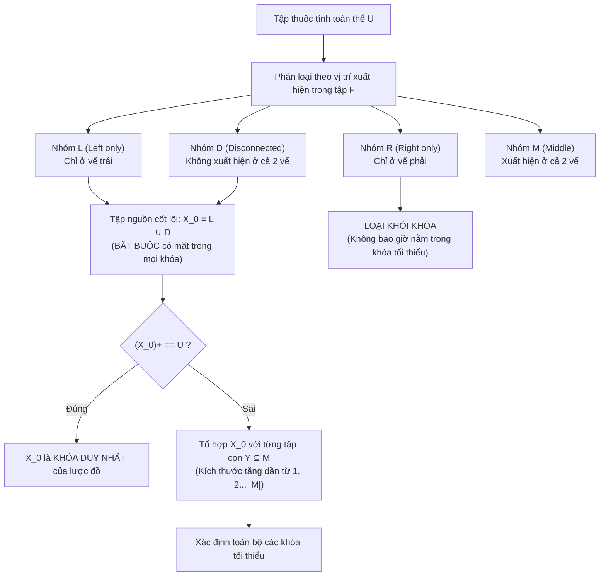

# CHƯƠNG 2 (QUYỂN 2): PHỤ THUỘC HÀM, BAO ĐÓNG & THUẬT TOÁN TÌM KHÓA

### 1. Sơ Đồ Thuật Toán Phân Loại Thuộc Tính Tìm Tất Cả Các Khóa (Lucchenssi - Osborn)

### 2. Các Khái Niệm & Định Nghĩa Toán Học Nền Tảng
- **Phụ thuộc hàm (Functional Dependency):**
  Cho lược đồ quan hệ $R(U)$ và $X, Y \subseteq U$. Ta nói $X \to Y$ nếu với mọi cặp bộ $t_1, t_2 \in r$:
  $$t_1[X] = t_2[X] \implies t_1[Y] = t_2[Y]$$
- **Hệ tiên đề Armstrong:**
  1. *Tiên đề Phản xạ:* Nếu $Y \subseteq X \subseteq U \implies X \to Y$.
  2. *Tiên đề Tăng trưởng:* Nếu $X \to Y$ và $Z \subseteq U \implies XZ \to YZ$.
  3. *Tiên đề Bắc cầu:* Nếu $X \to Y$ và $Y \to Z \implies X \to Z$.
- **Các quy tắc suy dẫn thứ cấp:**
  - Quy tắc Hợp: $X \to Y \land X \to Z \implies X \to YZ$.
  - Quy tắc Phân rã: $X \to YZ \implies X \to Y \land X \to Z$.
  - Quy tắc Tựa bắc cầu: $X \to Y \land WY \to Z \implies WX \to Z$.
- **Bao đóng của tập thuộc tính ($X^+$):** Tập tất cả các thuộc tính $A \in U$ sao cho $X \to A \in F^+$.
- **Bài toán thành viên:** Kiểm tra $X \to Y \in F^+ \iff Y \subseteq X^+$.
- **Định nghĩa Khóa (Candidate Key):** $K \subseteq U$ là khóa của $R(U, F)$ nếu:
  1. $K^+ = U$ ($K$ là siêu khóa).
  2. $\forall K' \subset K \implies K'^+ \ne U$ (Tính tối thiểu, không rút gọn được nữa).

### 3. Thuật Toán 3 Bước Tìm Phủ Tối Thiểu (Minimal Cover - $F_{min}$)
1. **Bước 1 (Đơn thuộc tính hóa vế phải):** Tách các phụ thuộc hàm có vế phải nhiều thuộc tính thành các phụ thuộc hàm đơn ($X \to A_1 A_2 \implies X \to A_1, X \to A_2$).
2. **Bước 2 (Loại bỏ thuộc tính dư thừa vế trái):** Với mỗi $X \to A \in F$ và mỗi $B \in X$, đặt $Z = X \setminus \{B\}$. Nếu $A \in Z_F^+ \implies$ loại bỏ $B$ khỏi vế trái ($Z \to A$).
3. **Bước 3 (Loại bỏ phụ thuộc hàm dư thừa):** Với mỗi $f: X \to A \in F$, đặt $G = F \setminus \{f\}$. Nếu $A \in X_G^+ \implies$ loại bỏ hoàn toàn $f$ khỏi $F$.
