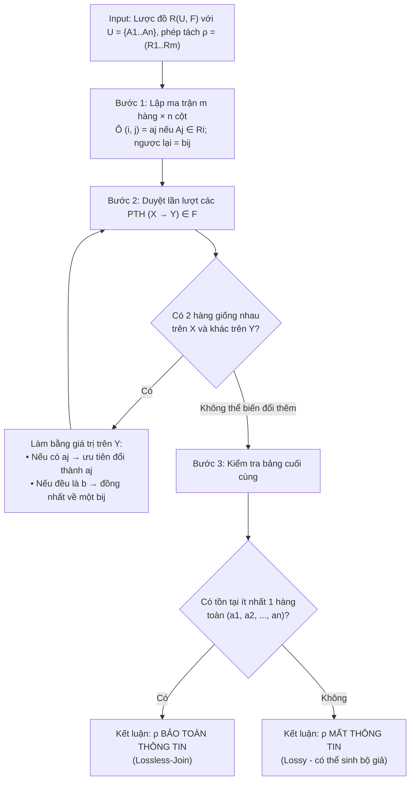
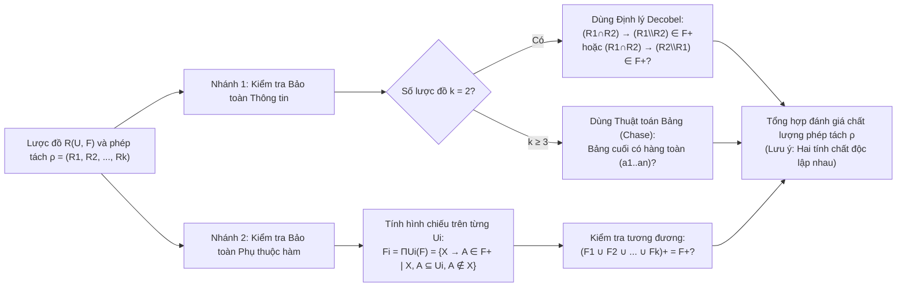

# Phần II - Chương 3: Lý thuyết phân tách lược đồ quan hệ (Phương pháp Ghi chép Cornell)

> **Hướng dẫn học tập theo Phương pháp ghi chép Cornell (Cornell Note-taking System):**
> Tài liệu lý thuyết Phần II - Chương 3 được biên soạn theo cấu trúc **Cornell Note-taking System**, bám sát *Giáo trình Thực hành Cơ sở dữ liệu (Phần II - Thiết kế)* (Nxb. Đại học Huế, 2022), gồm 3 vùng nhận thức gắn kết chặt chẽ:
> 1. **Cột Trái (Cue Column - Từ khóa / Câu hỏi gợi nhớ):** Tập hợp các khái niệm trung tâm, điều kiện toán học, định lý và câu hỏi truy xuất chủ động (Active Recall).
> 2. **Cột Phải (Note-taking Column - Ghi chú chi tiết):** Hệ thống hóa đầy đủ định nghĩa phép tách, phân tích 4 dị thường dữ liệu, phép tách bảo toàn thông tin, Định lý Decobel (Delobel), thuật toán bảng (Chase), hình chiếu tập phụ thuộc hàm và phép tách bảo toàn phụ thuộc hàm.
> 3. **Phần Tổng kết (Cornell Summary - Cuối mỗi mục & cuối chương):** Cô đọng các ý cốt lõi nhất để ôn tập nhanh trước khi giải 70 câu trắc nghiệm, 5 câu trả lời ngắn và 20 bài tự luận.

---

## 1. Giới thiệu & Định nghĩa Phép tách Lược đồ Quan hệ (Mục 3.1 - 3.2)

| Từ khóa / Câu hỏi gợi nhớ | Ghi chú chi tiết (Nội dung cốt lõi) |
| :--- | :--- |
| **Động lực & Mục tiêu của Lý thuyết phân tách** *Vì sao cần tách một lược đồ quan hệ $R(U, F)$ thành các lược đồ con?* | • Xét lược đồ quan hệ $R$ được xây dựng trên tập thuộc tính $U$ và tập ràng buộc phụ thuộc hàm $F$. • **Hai lý do thực tiễn dẫn đến phép tách:**   1. **Hạn chế dư thừa dữ liệu và giảm dị thường dữ liệu** trên $R$ khi thiết kế CSDL quan hệ tốt hơn.   2. **Phân chia công việc quản lý dữ liệu** trên $R$ cho nhiều người cùng làm rồi ghép nối kết quả lại sao cho vẫn thu được đầy đủ thông tin ban đầu như làm việc trên toàn bộ $R$. |
| **Ví dụ mở đầu: Lược đồ `SINHVIEN` (Mục 3.1)** *Xét lược đồ `SINHVIEN(HOTEN, NGAYSINH, LOP, MONHOC, DIEM)` với 5 bộ mẫu trong giáo trình.* | • Lược đồ: `SINHVIEN(HOTEN, NGAYSINH, LOP, MONHOC, DIEM)` biểu diễn thông tin sinh viên và điểm thi các môn học:   - `(Nam, 25/05/2004, Tin K20A, Cơ sở dữ liệu, 7)`   - `(Hùng, 11/06/2004, Tin K20B, Cơ sở dữ liệu, 9)`   - `(Hoa, 15/07/2003, Tin K20A, Đại số, 10)`   - `(Nam, 23/05/2003, Tin K21A, Đại số, 9)`   - `(Hoa, 17/07/2004, Tin K20A, Cơ sở dữ liệu, 8)` |
| **4 vấn đề tồn tại trên lược đồ chưa tách** *Liệt kê 4 loại dư thừa và dị thường dữ liệu xuất hiện trên `SINHVIEN`.* | 1. **Dư thừa về dữ liệu:** Thông tin về `HOTEN`, `NGAYSINH` và `LOP` của mỗi sinh viên phải lưu trữ lặp đi lặp lại nhiều lần nếu sinh viên đó có nhiều điểm ứng với nhiều môn học. 2. **Mâu thuẫn khi bổ sung dữ liệu:** Khi nhập thêm điểm một môn học khác cho một sinh viên nhưng `LOP` của sinh viên đó đã thay đổi, trong quan hệ sẽ xuất hiện sự mâu thuẫn (cùng một sinh viên thuộc hai lớp khác nhau), gây mất nhất quán dữ liệu. 3. **Dị thường khi bổ sung dữ liệu:** Không thể bổ sung một bộ dữ liệu lưu thông tin về một sinh viên nếu sinh viên đó chưa có điểm thi ít nhất một môn học. 4. **Dị thường khi xóa dữ liệu:** Mỗi khi xóa một bộ điểm thi của một sinh viên nào đó (nếu là bộ điểm duy nhất của sinh viên đó) sẽ làm xóa mất cả các thông tin cá nhân (`HOTEN`, `NGAYSINH`, `LOP`) của sinh viên khỏi CSDL. |
| **Hướng khắc phục & Hệ quả phép nối** *Tách `SINHVIEN` như thế nào và phát sinh thao tác gì khi truy vấn lại?* | • **Giải pháp tách đôi:** Tách `SINHVIEN` thành 2 lược đồ con:   - `SVIEN(HOTEN, NGAYSINH, LOP)`   - `DIEMTHI(HOTEN, MONHOC, DIEM)` • **Kết quả:** Các vấn đề dư thừa và dị thường nêu trên không còn. • **Hệ quả:** Khi muốn biết đồng thời thông tin cá nhân (`NGAYSINH`, `LOP`) và điểm thi các môn học (`MONHOC`, `DIEM`) của sinh viên, ta phải thực hiện **phép nối tự nhiên** (`*` hay $\bowtie$) trên hai lược đồ `SVIEN` và `DIEMTHI`. *(Lưu ý: nếu `HOTEN` bị trùng giữa hai sinh viên khác nhau như `Nam` sinh 25/05/2004 và `Nam` sinh 23/05/2003, phép nối theo `HOTEN` sẽ sinh ra các bộ giả — đây là lý do phải nghiên cứu phép tách bảo toàn thông tin ở Mục 3.3).* |
| **Định nghĩa Phép tách lược đồ quan hệ (Mục 3.2)** *Điều kiện cần và đủ để $\rho = (R_1, R_2, \dots, R_n)$ là một phép tách của $R$ là gì?* | • Cho lược đồ quan hệ $R(U, F)$ và các lược đồ con $R_1(U_1, F_1), \dots, R_n(U_n, F_n)$. • **Định nghĩa:** $\rho$ được gọi là một **phép tách** $R$ thành các lược đồ con $R_1, R_2, \dots, R_n$ nếu hợp tập thuộc tính của tất cả các lược đồ con đúng bằng $U$:   $$\bigcup_{i=1}^{n} U_i = U$$ • **Ký hiệu:** $\rho = (R_1, R_2, \dots, R_n)$. Ta đồng nhất lược đồ quan hệ $R_i$ với tập thuộc tính $U_i$ của nó. • **Mục đích:** Loại bỏ dư thừa và các dị thường xuất hiện trong CSDL. |
| **Ví dụ phân biệt phép tách hợp lệ & không hợp lệ** *Kiểm tra $\rho = (AB, BC, ACD)$ trên $R(A,B,C,D)$ và $\rho_1, \rho_2$ trên $R(A,B,C)$.* | • **Ví dụ 1:** Cho $R(A, B, C, D)$. Xét $\rho = (AB, BC, ACD)$:   $AB \cup BC \cup ACD = \{A, B, C, D\} = U \implies \rho$ **là một phép tách** của $R$. • **Ví dụ 2:** Cho $R(A, B, C)$:   - $\rho_1 = (AB, BC)$: $AB \cup BC = \{A, B, C\} = U \implies \rho_1$ **là một phép tách** của $R$.   - $\rho_2 = (A, AC)$: $A \cup AC = \{A, C\} \neq \{A, B, C\}$ (thiếu thuộc tính $B$) $\implies \rho_2$ **không phải là phép tách** của $R$. |

> **Tóm tắt Mục 1 (Cornell Summary):**
> Lưu trữ gộp nhiều thông tin không phụ thuộc cùng khóa trên một lược đồ như `SINHVIEN(HOTEN, NGAYSINH, LOP, MONHOC, DIEM)` gây ra 4 lỗi nghiêm trọng: **dư thừa dữ liệu**, **mâu thuẫn khi bổ sung**, **dị thường khi bổ sung** và **dị thường khi xóa**. Một tập các lược đồ con $\rho = (R_1, R_2, \dots, R_n)$ được gọi là một **phép tách** của $R(U, F)$ khi và chỉ khi $\bigcup_{i=1}^n U_i = U$ (không được làm rơi mất bất kỳ thuộc tính nào của $U$).

---

## 2. Phép tách Bảo toàn Thông tin & Định lý Delobel (Decobel) (Mục 3.3)

| Từ khóa / Câu hỏi gợi nhớ | Ghi chú chi tiết (Nội dung cốt lõi) |
| :--- | :--- |
| **Yêu cầu cốt lõi khi ghép nối các lược đồ con** *Thế nào là tách mà bảo toàn thông tin?* | • Khi tách $R$ thành các lược đồ con để loại bỏ dư thừa/dị thường, việc khôi phục thông tin tổng hợp đòi hỏi thực hiện **phép kết nối tự nhiên** giữa các quan hệ con. • Yêu cầu đặt ra là khi nối tự nhiên các hình chiếu của một quan hệ $r$ trên các lược đồ con, ta phải thu được **đúng thông tin như quan hệ ban đầu**, không làm sai lệch hay phát sinh dữ liệu giả (*spurious tuples*). |
| **Định nghĩa Phép tách bảo toàn thông tin (Mục 3.3.1)** *Biểu thức toán học định nghĩa phép tách bảo toàn thông tin (kết nối không mất thông tin) là gì?* | • Cho lược đồ quan hệ $R(U, F)$ và phép tách $\rho = (R_1, R_2, \dots, R_m)$ trên $R$. • $\rho$ được gọi là **phép tách bảo toàn thông tin** (hay phép tách kết nối không mất thông tin) nếu **với mọi quan hệ $r$** trên $R(U, F)$ (thỏa $F$) thì:   $$r = \Pi_{R_1}(r) * \Pi_{R_2}(r) * \dots * \Pi_{R_m}(r)$$ • **Ý nghĩa:** Tách ra thành các hình chiếu $\Pi_{R_i}(r)$ rồi kết nối tự nhiên (`*` hay $\bowtie$) lại thì thu được chính xác quan hệ $r$ ban đầu. • **Ghi chú bản chất tập hợp:** Với mọi $r$, luôn có $r \subseteq \Pi_{R_1}(r) * \dots * \Pi_{R_m}(r)$. Phép tách bị **mất thông tin** khi tồn tại ít nhất một quan hệ $r$ thỏa $F$ sao cho $r \subsetneq \Pi_{R_1}(r) * \dots * \Pi_{R_m}(r)$ (tức xuất hiện thêm các **bộ giả** không có trong $r$ gốc). |
| **Định lý Decobel (Delobel) cho phép tách đôi (Mục 3.3.2)** *Điều kiện cần và đủ để phép tách gồm 2 lược đồ $\rho = (R_1, R_2)$ bảo toàn thông tin là gì?* | • Cho lược đồ quan hệ $R(U, F)$ và phép tách đôi $\rho = (R_1, R_2)$ (với $R_1 \cup R_2 = U$). • **Định lý Decobel:** $\rho = (R_1, R_2)$ là phép tách **bảo toàn thông tin** khi và chỉ khi:   $$(R_1 \cap R_2) \to (R_1 \setminus R_2) \in F^+ \quad \text{hoặc} \quad (R_1 \cap R_2) \to (R_2 \setminus R_1) \in F^+$$   *(Viết gọn trong giáo trình: $R_1 \cap R_2 \to R_1 \setminus R_2$ hoặc $R_1 \cap R_2 \to R_2 \setminus R_1$, tương đương $(R_1 \cap R_2)^+ \supseteq R_1$ hoặc $(R_1 \cap R_2)^+ \supseteq R_2$, nghĩa là giao của hai lược đồ con phải là siêu khóa của ít nhất một trong hai lược đồ con).* |
| **Phát biểu tương đương của Định lý Decobel** *Dạng phát biểu theo bộ ba tập thuộc tính $U = (X, Y, Z)$.* | • Cho tập thuộc tính $U = (X, Y, Z)$ (tức $U = X \cup Y \cup Z$). • Lúc đó phép tách thành 2 lược đồ $\rho = (XY, XZ)$ (giáo trình ký hiệu $\rho_1 = (X, Y), \rho_2 = (X, Z)$) là **bảo toàn thông tin** khi và chỉ khi:   $$X \to Y \in F^+ \quad \text{hoặc} \quad X \to Z \in F^+$$ • **Ứng dụng nhanh:** Nếu $R_1 \cap R_2 = \emptyset$, hiển nhiên $\emptyset$ không thể xác định hàm $R_1$ hay $R_2$ (trừ trường hợp tầm thường hằng số), nên phép tách rời nhau về thuộc tính **chắc chắn mất thông tin**. |

> **Tóm tắt Mục 2 (Cornell Summary):**
> Một phép tách $\rho = (R_1, \dots, R_m)$ **bảo toàn thông tin** khi với mọi thể hiện $r$ thỏa $F$, phép nối tự nhiên các hình chiếu khôi phục đúng $r$: $r = \Pi_{R_1}(r) * \dots * \Pi_{R_m}(r)$ (không sinh bộ giả). Riêng với **phép tách đôi** $\rho = (R_1, R_2)$, **Định lý Decobel (Delobel)** cho tiêu chuẩn kiểm tra tức thì: phần giao $R_1 \cap R_2$ phải xác định hàm ít nhất một trong hai phần hiệu $R_1 \setminus R_2$ hoặc $R_2 \setminus R_1$ (tức $R_1 \cap R_2$ là siêu khóa của ít nhất một lược đồ con).

---

## 3. Thuật toán Bảng (Chase) Kiểm tra Phép tách Bảo toàn Thông tin (Mục 3.4)

### Sơ đồ 1: Thuật toán Bảng (Chase) Kiểm tra Phép tách Bảo toàn Thông tin

| Từ khóa / Câu hỏi gợi nhớ | Ghi chú chi tiết (Nội dung cốt lõi) |
| :--- | :--- |
| **Bài toán & Đầu vào/Đầu ra của Thuật toán Bảng (Mục 3.4)** *Khi phép tách có từ 3 lược đồ con trở lên ($m \ge 3$), dùng thuật toán nào?* | • Định lý Decobel chỉ áp dụng trực tiếp cho $m = 2$; với phép tách tổng quát $\rho = (R_1, R_2, \dots, R_m)$, ta dùng **Thuật toán bảng (Chase)**. • **Input:** Lược đồ quan hệ $R(U, F)$ với $U = \{A_1, A_2, \dots, A_n\}$ ($n$ thuộc tính) và phép tách $\rho = (R_1, R_2, \dots, R_m)$ ($m$ lược đồ con). • **Output:** Kết luận phép tách $\rho$ có bảo toàn thông tin hay không. |
| **3 bước thực hiện Thuật toán Bảng** *Mô tả chính xác quy tắc khởi tạo ô $(i, j)$, quy tắc ưu tiên biến đổi và điều kiện kết luận.* | • **Bước 1 (Thiết lập bảng):** Lập ma trận gồm **$n$ cột** (ứng với $A_1, \dots, A_n$) và **$m$ hàng** (ứng với $R_1, \dots, R_m$). Phần tử tại hàng $i$, cột $j$ được gán:   $$(i, j) = \begin{cases} a_j & \text{nếu thuộc tính } A_j \in R_i \\ b_{ij} & \text{ngược lại (} A_j \notin R_i\text{)} \end{cases}$$ • **Bước 2 (Biến đổi bảng):**   - Lần lượt áp dụng các phụ thuộc hàm $(X \to Y) \in F$ cho bảng.   - Nếu phát hiện trên bảng có **2 hàng giống nhau trên tất cả các thuộc tính thuộc $X$** nhưng **khác nhau trên $Y$**, ta làm bằng các giá trị của chúng trên $Y$.   - **Quy tắc ưu tiên:** Khi làm bằng giá trị trên một cột thuộc $Y$, nếu một trong hai giá trị là $a_j$ thì **ưu tiên làm bằng là $a_j$**; ngược lại (cả hai đều mang ký hiệu $b$) thì làm bằng thành một trong các ký hiệu $b$ đó (thường chọn ký hiệu có chỉ số nhỏ hơn).   - Tiếp tục lặp lại quá trình áp dụng các PTH trong $F$ cho đến khi **không thể biến đổi bảng được nữa** (thu được bảng cuối cùng). • **Bước 3 (Xem xét bảng cuối cùng):**   - Nếu trong bảng cuối cùng **có chứa ít nhất một hàng gồm toàn các ký hiệu $a$** $(a_1, a_2, \dots, a_n)$ $\implies$ kết luận $\rho$ là phép tách **bảo toàn thông tin**.   - Ngược lại (không có hàng nào toàn $a$) $\implies$ kết luận phép tách $\rho$ là **mất thông tin**. |
| **Ví dụ minh họa chi tiết (Mục 3.4)** *Kiểm tra $\rho = \{BC, AC, ABDE, ABDF\}$ trên $R(A,B,C,D,E,F)$ với $F = \{AB \to C, C \to B, ABD \to E, F \to A\}$.* | • **Bước 1: Thiết lập bảng ($4 \times 6$):**   - `BC`: $(b_{11}, a_2, a_3, b_{14}, b_{15}, b_{16})$   - `AC`: $(a_1, b_{22}, a_3, b_{24}, b_{25}, b_{26})$   - `ABDE`: $(a_1, a_2, b_{33}, a_4, a_5, b_{36})$   - `ABDF`: $(a_1, a_2, b_{43}, a_4, b_{45}, a_6)$ • **Bước 2: Biến đổi bảng:**   1. Áp dụng $AB \to C$: hàng 3 (`ABDE`) và hàng 4 (`ABDF`) giống nhau trên $AB$ $(a_1, a_2)$ $\implies$ thay $b_{43}$ bằng $b_{33}$.   2. Áp dụng $C \to B$: hàng 1 (`BC`) và hàng 2 (`AC`) giống nhau trên $C$ $(a_3)$ $\implies$ ưu tiên $a_2$, thay $b_{22}$ bằng $a_2$.   3. Áp dụng $ABD \to E$: hàng 3 (`ABDE`) và hàng 4 (`ABDF`) giống nhau trên $ABD$ $(a_1, a_2, a_4)$ $\implies$ ưu tiên $a_5$, thay $b_{45}$ bằng $a_5$ *(lưu ý bản in OCR của giáo trình có chỗ ghi nhầm ký hiệu thành $b_{43}$ ở bước này, đúng theo cột $E$ là $b_{45}$)*.   4. Áp dụng lại $AB \to C$: lúc này hàng 2 (`AC`), hàng 3 (`ABDE`) và hàng 4 (`ABDF`) đều có $AB = (a_1, a_2)$ $\implies$ ưu tiên $a_3$, thay cả hai giá trị $b_{33}$ ở hàng 3 và hàng 4 bằng $a_3$. • **Bảng cuối cùng:**   - `BC`: $(b_{11}, a_2, a_3, b_{14}, b_{15}, b_{16})$   - `AC`: $(a_1, a_2, a_3, b_{24}, b_{25}, b_{26})$   - `ABDE`: $(a_1, a_2, a_3, a_4, a_5, b_{36})$   - `ABDF`: **$(a_1, a_2, a_3, a_4, a_5, a_6)$** *(toàn ký hiệu $a$!)*. • **Bước 3: Kết luận:** Vì hàng `ABDF` gồm toàn các ký hiệu $(a_1, a_2, a_3, a_4, a_5, a_6)$, phép tách $\rho$ **bảo toàn thông tin**. |

> **Tóm tắt Mục 3 (Cornell Summary):**
> **Thuật toán Bảng (Chase)** là công cụ tổng quát kiểm tra bảo toàn thông tin cho phép tách $m$ lược đồ bất kỳ: (1) Điền $a_j$ nếu $A_j \in R_i$, $b_{ij}$ nếu không; (2) Lặp áp dụng các PTH $X \to Y \in F$ để làm bằng cột $Y$ giữa các hàng khớp $X$, luôn **ưu tiên giữ $a_j$**; (3) Khi dừng, chỉ cần tồn tại **một hàng toàn $a_1 \dots a_n$** thì phép tách bảo toàn thông tin, ngược lại là mất thông tin. Lưu ý quan trọng: khi một biến $b_{ij}$ đã được làm bằng với một $b_{kj}$ trước đó, nếu về sau một trong hai ô được gán $a_j$ thì toàn bộ các ô đang mang chung giá trị $b$ đó cũng đồng loạt đổi thành $a_j$.

---

## 4. Hình chiếu Tập Phụ thuộc Hàm & Phép tách Bảo toàn Phụ thuộc Hàm (Mục 3.5)

### Sơ đồ 2: Quy trình Kiểm tra Kép (Bảo toàn Thông tin & Bảo toàn Phụ thuộc Hàm)

| Từ khóa / Câu hỏi gợi nhớ | Ghi chú chi tiết (Nội dung cốt lõi) |
| :--- | :--- |
| **Định nghĩa 1: Hình chiếu tập phụ thuộc hàm $\Pi_{U_i}(F)$ (Mục 3.5)** *Chiếu của $F$ trên tập thuộc tính con $U_i$ được xác định như thế nào?* | • Cho lược đồ quan hệ $R(U, F)$ và $U_i \subseteq U$. • **Hình chiếu** của $F$ trên tập thuộc tính $U_i$, ký hiệu $\Pi_{U_i}(F)$, là tập các phụ thuộc hàm trong bao đóng $F^+$ chỉ chứa các thuộc tính thuộc $U_i$:   $$\Pi_{U_i}(F) = \{ X \to A \in F^+ \mid X, A \subseteq U_i \text{ và } A \notin X \}$$ • **Lưu ý thực hành:** Để không bỏ sót các phụ thuộc hàm suy diễn (bắc cầu), cần tính trên **$F^+$** (tức tính bao đóng $X^+_F \cap U_i$ cho các tập con $X \subset U_i$), không chỉ lọc các PTH viết sẵn trong $F$. |
| **Ví dụ minh họa tính hình chiếu** *Cho $U = \{A, B, C\}$, $F = \{A \to B, AB \to C\}$. Xác định $\Pi_{AC}(F)$.* | • Xét các tập con của $U_1 = \{A, C\}$:   - Với $X = A$: $A^+_F = \{A, B, C\}$, giao với $AC$ được $\{A, C\} \implies A \to C \in F^+$. (Giải thích theo tiên đề Armstrong: $A \to B \implies A \to AB$ theo luật tăng trưởng; kết hợp $AB \to C \implies A \to C$ theo luật bắc cầu).   - Với $X = C$: $C^+_F = \{C\} \implies$ không suy ra thuộc tính nào khác trong $AC$. • Kết quả: $\Pi_{AC}(F) = \{A \to C\}$ (dù bản thân $A \to C$ không viết tường minh trong $F$). |
| **Định nghĩa 2: Phép tách bảo toàn phụ thuộc hàm** *Khi nào phép tách $\rho = (R_1, \dots, R_k)$ được gọi là bảo toàn phụ thuộc hàm?* | • Cho lược đồ quan hệ $R(U, F)$ và phép tách $\rho = (R_1, R_2, \dots, R_k)$ với $R_i = \langle U_i, F_i \rangle$ trong đó $F_i = \Pi_{U_i}(F)$ ($i = 1 \dots k$). • $\rho$ gọi là **phép tách bảo toàn phụ thuộc hàm** nếu $\bigcup_{i=1}^k F_i$ tương đương với $F$, tức là:   $$\left(\bigcup_{i=1}^{k} F_i\right)^+ = F^+$$ • **Ý nghĩa thực tiễn:** Mọi ràng buộc toàn vẹn (PTH) của $R$ ban đầu đều có thể kiểm tra cục bộ ngay trên từng bảng con $R_i$ mà không cần phải thực hiện phép nối các bảng lại. |
| **Ví dụ 1 trong giáo trình & Lưu ý kiểm tra đầy đủ** *Xét $U = ABCD$, $F = \{A \to D, D \to B, A \to C\}$ và $\rho = (ABC, AD)$.* | • Tính hình chiếu trên từng lược đồ con:   - $\Pi_{ABC}(F) = \{A \to C, A \to B\}$ (do $A \to D$ và $D \to B \implies A \to B \in F^+$).   - $\Pi_{AD}(F) = \{A \to D\}$. • **Lưu ý sư phạm quan trọng đối với ví dụ này:** Giáo trình (Mục 3.5, Ví dụ 1) kết luận $\Pi_{ABC}(F) \cup \Pi_{AD}(F) \equiv F$ là bảo toàn PTH; tuy nhiên khi kiểm tra chặt chẽ bằng bao đóng trên $G = \{A \to C, A \to B, A \to D\}$, ta thấy $D^+_G = \{D\}$ không chứa $B$, nghĩa là $D \to B \notin G^+$ (do $D$ và $B$ không cùng nằm trong một lược đồ con nào). Vì vậy theo đúng định nghĩa $\left(\bigcup F_i\right)^+ = F^+$, để bảo toàn cả $D \to B$ thì phép tách cần thêm lược đồ chứa $BD$, chẳng hạn $\rho' = (ABC, AD, BD)$ hoặc $(AC, BD, AD)$. |
| **Ví dụ 2: Bảo toàn PTH nhưng Mất thông tin** *Xét $U = \{A, B, C, D\}$, $F = \{A \to B, C \to D\}$ và $\rho = (AB, CD)$.* | • **Kiểm tra Bảo toàn phụ thuộc hàm:**   - $\Pi_{AB}(F) = \{A \to B\}$; $\Pi_{CD}(F) = \{C \to D\}$.   - $\left(\Pi_{AB}(F) \cup \Pi_{CD}(F)\right)^+ = \{A \to B, C \to D\}^+ = F^+ \implies \rho$ **bảo toàn phụ thuộc hàm**. • **Kiểm tra Bảo toàn thông tin (Bảng Chase):**   - Hàng `AB`: $(a_1, a_2, b_{13}, b_{14})$   - Hàng `CD`: $(b_{21}, b_{22}, a_3, a_4)$   - Không có hai hàng nào bằng nhau trên $A$ hoặc trên $C$, bảng không thể biến đổi và không có hàng toàn $a$ $\implies \rho$ **mất thông tin**! *(Kiểm tra nhanh bằng Định lý Decobel: $AB \cap CD = \emptyset$, không suy ra được $AB$ hay $CD$)*. |
| **Quan hệ giữa hai tiêu chí bảo toàn** *Bảo toàn thông tin và Bảo toàn PTH có suy ra nhau không?* | • **Không.** Hai tính chất này độc lập nhau:   - Có phép tách **vừa bảo toàn thông tin vừa bảo toàn PTH** (ví dụ phân rã về 3NF có bổ sung khóa nếu cần).   - Có phép tách **bảo toàn PTH nhưng mất thông tin** (như $\rho = (AB, CD)$ với $F = \{A \to B, C \to D\}$).   - Có phép tách **bảo toàn thông tin nhưng mất PTH** (thường gặp khi phân rã về BCNF, ví dụ $R(ABCDE)$ với $F = \{AB \to C, CD \to E, DE \to B\}$ tách về BCNF thành $(ABC, DEB, ADE)$ làm mất $CD \to E$). |

> **Tóm tắt Mục 4 (Cornell Summary):**
> Hình chiếu $\Pi_{U_i}(F) = \{X \to A \in F^+ \mid X, A \subseteq U_i, A \notin X\}$ lấy mọi PTH suy diễn được từ $F^+$ nằm gọn trong $U_i$ (chứ không chỉ lấy các PTH viết sẵn trong $F$). Phép tách $\rho = (R_1, \dots, R_k)$ **bảo toàn phụ thuộc hàm** khi $\left(\bigcup_{i=1}^k \Pi_{U_i}(F)\right)^+ = F^+$. Khi thiết kế CSDL, cần kiểm tra **cả hai** tiêu chí (bảo toàn thông tin và bảo toàn PTH) vì một phép tách bảo toàn PTH vẫn có thể làm mất thông tin (như $\rho = (AB, CD)$).

---

## Tóm tắt toàn chương (Cornell Summary)

1. **Giới thiệu & Định nghĩa phép tách (Mục 3.1 - 3.2):** Lưu trữ gộp thuộc tính trên một lược đồ (như `SINHVIEN`) gây ra **4 vấn đề**: dư thừa dữ liệu, mâu thuẫn khi bổ sung, dị thường khi bổ sung và dị thường khi xóa. Phép tách $\rho = (R_1, R_2, \dots, R_n)$ của $R(U, F)$ phải thỏa $\bigcup_{i=1}^n U_i = U$ nhằm loại bỏ các dị thường nhưng vẫn phải đảm bảo ghép nối lại được thông tin gốc.
2. **Phép tách bảo toàn thông tin & Định lý Decobel (Mục 3.3):** Phép tách $\rho$ bảo toàn thông tin khi $r = \Pi_{R_1}(r) * \dots * \Pi_{R_m}(r)$ với mọi $r$ thỏa $F$ (không sinh bộ giả). Đối với phép tách đôi $\rho = (R_1, R_2)$, **Định lý Decobel (Delobel)** khẳng định điều kiện cần và đủ là $(R_1 \cap R_2) \to (R_1 \setminus R_2) \in F^+$ hoặc $(R_1 \cap R_2) \to (R_2 \setminus R_1) \in F^+$.
3. **Thuật toán Bảng / Chase (Mục 3.4):** Với phép tách $m$ lược đồ con trên $n$ thuộc tính, khởi tạo bảng $a_j / b_{ij}$, lần lượt áp dụng các PTH $X \to Y \in F$ để đồng nhất giá trị trên $Y$ (luôn **ưu tiên $a_j$**) đến khi dừng. Phép tách bảo toàn thông tin khi và chỉ khi bảng cuối cùng có ít nhất một hàng toàn $a_1, a_2, \dots, a_n$.
4. **Hình chiếu & Bảo toàn phụ thuộc hàm (Mục 3.5):** Hình chiếu $\Pi_{U_i}(F)$ chứa các PTH của $F^+$ nằm trong $U_i$. Phép tách $\rho$ bảo toàn PTH khi $\left(\bigcup_{i=1}^k \Pi_{U_i}(F)\right)^+ = F^+$. Bảo toàn thông tin và bảo toàn PTH là hai tính chất độc lập cần kiểm tra song song.

---

## Câu hỏi tự kiểm tra nhanh (Self-Testing Cues)

1. Phân tích **4 vấn đề** (dư thừa dữ liệu, mâu thuẫn khi bổ sung, dị thường khi bổ sung, dị thường khi xóa) trên lược đồ `SINHVIEN(HOTEN, NGAYSINH, LOP, MONHOC, DIEM)` và giải thích vai trò của phép nối tự nhiên sau khi tách thành `SVIEN` và `DIEMTHI`.
2. Cho $R(A, B, C, D)$ và $\rho_1 = (AB, BC, D)$, $\rho_2 = (AB, AC)$. Phép tách nào là phép tách hợp lệ của $R$ theo định nghĩa Mục 3.2?
3. Phát biểu định nghĩa **phép tách bảo toàn thông tin** và **Định lý Decobel (Delobel)** cho phép tách đôi $\rho = (R_1, R_2)$. Vì sao hai lược đồ rời nhau ($R_1 \cap R_2 = \emptyset$) không thể tạo thành phép tách bảo toàn thông tin (với tập PTH phi tầm thường)?
4. Mô tả 3 bước của **Thuật toán Bảng (Chase)** và giải thích ý nghĩa của quy tắc *"ưu tiên làm bằng thành $a_j$"*.
5. Tại sao khi tính hình chiếu $\Pi_{U_i}(F)$ ta phải xét trên $F^+$ thay vì chỉ lọc các PTH có mặt trực tiếp trong $F$? Lấy ví dụ $F = \{A \to B, AB \to C\}$ và $U_1 = \{A, C\}$.
6. Cho ví dụ một phép tách **bảo toàn phụ thuộc hàm nhưng mất thông tin**, và một phép tách **bảo toàn thông tin nhưng mất phụ thuộc hàm**.
