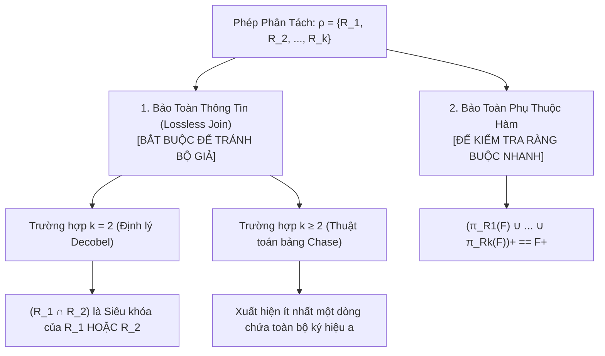

# CHƯƠNG 3 (QUYỂN 2): LÝ THUYẾT PHÂN TÁCH LƯỢC ĐỒ & BẢO TOÀN THÔNG TIN

### 1. Sơ Đồ Tiêu Chuẩn Đánh Giá Phép Phân Tách Lược Đồ Quan Hệ

### 2. Hai Tính Chất Sống Còn Của Phép Phân Tách
1. **Bảo toàn thông tin (Lossless-Join Decomposition):**
   - Đảm bảo rằng khi thực hiện phép kết tự nhiên các quan hệ con lại với nhau, ta thu được chính xác quan hệ ban đầu, không làm mất dữ liệu và không sinh ra các bộ dữ liệu giả mạo (Spurious Tuples):
     $$r = \pi_{R_1}(r) \bowtie \pi_{R_2}(r) \bowtie \dots \bowtie \pi_{R_k}(r)$$
2. **Bảo toàn tập phụ thuộc hàm (Dependency Preservation):**
   - Đảm bảo rằng việc kiểm tra các ràng buộc phụ thuộc hàm có thể thực hiện độc lập trên từng quan hệ con mà không cần tốn chi phí thực hiện phép kết nối các bảng lại với nhau:
     $$\left( \bigcup_{i=1}^k \pi_{R_i}(F) \right)^+ = F^+$$

### 3. Công Cụ Kiểm Tra Hình Thức
- **Định lý Decobel (cho 2 quan hệ con $\rho = \{R_1, R_2\}$):**
  $$\text{Lossless Join} \iff (R_1 \cap R_2) \to (R_1 \setminus R_2) \in F^+ \quad \text{HOẶC} \quad (R_1 \cap R_2) \to (R_2 \setminus R_1) \in F^+$$
- **Thuật toán bảng Chase (cho $k \ge 2$ quan hệ con):**
  - Khởi tạo bảng $k$ hàng $\times$ $n$ cột ($a_j$ nếu thuộc tính thuộc $R_i$, ngược lại $b_{ij}$).
  - Biến đổi đồng nhất các hàng theo từng phụ thuộc hàm trong $F$.
  - Nếu xuất hiện **ít nhất một dòng toàn ký hiệu $a$** $\implies$ Phép tách **bảo toàn thông tin**.
