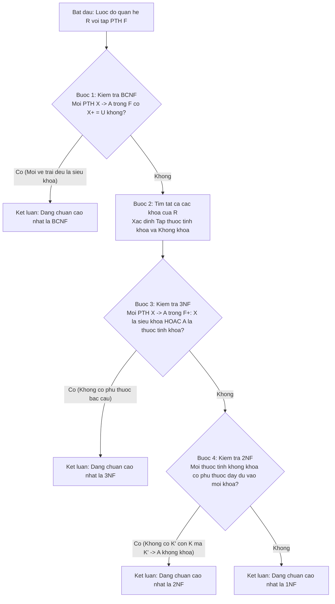
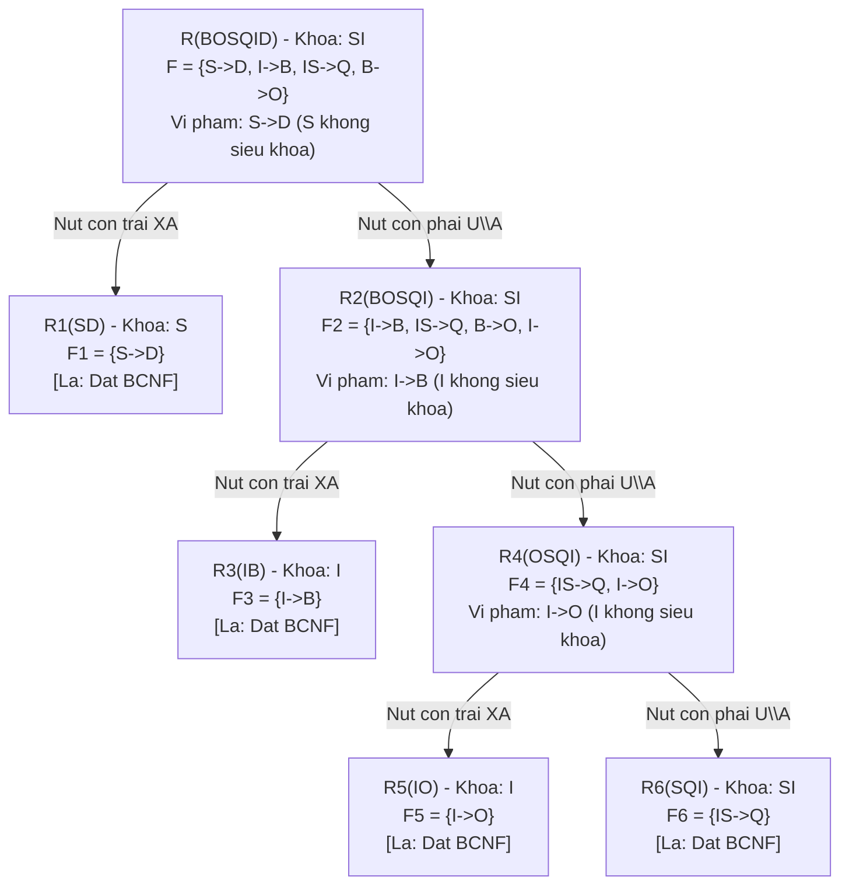
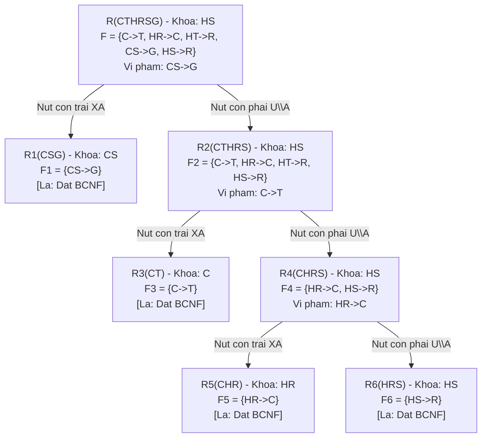

# Phần II - Chương 4: Chuẩn hóa cơ sở dữ liệu (Phương pháp Ghi chép Cornell)

> **Hướng dẫn học tập theo Phương pháp ghi chép Cornell (Cornell Note-taking System):**
> Tài liệu lý thuyết Phần II - Chương 4 được biên soạn theo cấu trúc **Cornell Note-taking System**, bám sát *Giáo trình Thực hành Cơ sở dữ liệu (Phần II - Thiết kế)* (Lê Anh Phương, Nguyễn Thị Hương Giang, Lê Phước Nam Hà, Nguyễn Văn Khang, Hồ Thị Kim Thoa; Nxb. Đại học Huế, 2022), gồm 3 vùng nhận thức gắn kết chặt chẽ:
> 1. **Cột Trái (Cue Column - Từ khóa / Câu hỏi gợi nhớ):** Tập hợp các khái niệm trung tâm, thuật ngữ chuẩn hóa, tiêu chuẩn phân loại và câu hỏi truy xuất chủ động (Active Recall).
> 2. **Cột Phải (Note-taking Column - Ghi chú chi tiết):** Hệ thống hóa đầy đủ định nghĩa, nhận xét, mệnh đề kèm chứng minh, quy trình kiểm tra, thuật toán phân tách 3NF/BCNF và toàn bộ ví dụ minh họa chuẩn xác.
> 3. **Phần Tổng kết (Cornell Summary - Cuối mỗi mục & cuối chương):** Cô đọng kiến thức cốt lõi nhất để ôn tập nhanh trước khi giải 70 câu trắc nghiệm, 5 câu trả lời ngắn và 20 bài tập tự luận.

---

## 1. Tổng quan Các Dạng Chuẩn, Thuộc tính Nguyên tố, Phụ thuộc Đầy đủ & Bắc cầu (Mục 4.1 - 4.2)

| Từ khóa / Câu hỏi gợi nhớ | Ghi chú chi tiết (Nội dung cốt lõi) |
| :--- | :--- |
| **Mục tiêu chuẩn hóa lược đồ quan hệ** *Tại sao phải chuẩn hóa CSDL và bài toán đặt ra là gì?* | • Việc phân tách các lược đồ quan hệ nhằm 2 mục tiêu chính:   1. **Tránh dư thừa dữ liệu.**   2. **Tránh các dị thường trong việc cập nhật dữ liệu** (thêm, xóa, sửa). • **Bài toán đặt ra:** Nên tách như thế nào để khi kết nối lại vẫn giữ nguyên thông tin ban đầu (**tách kết nối không mất thông tin**) và các lược đồ con đạt tiêu chuẩn chất lượng. • **Định nghĩa chuẩn hóa:** Quá trình biến đổi các lược đồ quan hệ thành các dạng phù hợp với các tiêu chuẩn đặt ra gọi là **quá trình chuẩn hóa**. |
| **Tháp phân cấp các dạng chuẩn (Mục 4.1)** *Nêu thứ tự các dạng chuẩn của Boyce-Codd và quan hệ bao hàm giữa chúng.* | • Lý thuyết chuẩn hóa xác định các **dạng chuẩn (Normal Form)** của lược đồ quan hệ và xây dựng thuật toán phân tách lược đồ về dạng chuẩn mong muốn. • Thang phân cấp các dạng chuẩn cơ bản (theo Boyce-Codd):   `Dạng không chuẩn hóa` $\rightarrow$ **1NF** (First Normal Form) $\rightarrow$ **2NF** (Second Normal Form) $\rightarrow$ **3NF** (Third Normal Form) $\rightarrow$ **BCNF** (Boyce-Codd Normal Form). • **Quan hệ chất lượng:** $\text{BCNF}$ tốt hơn $\text{3NF}$, $\text{3NF}$ tốt hơn $\text{2NF}$, $\text{2NF}$ tốt hơn $\text{1NF}$ (tức là $\text{BCNF} \subset \text{3NF} \subset \text{2NF} \subset \text{1NF}$). • **Quy ước ký hiệu (Mục 4.2):** Đồng nhất tên lược đồ quan hệ $R$ với tập thuộc tính $U$ của nó; lược đồ quan hệ với tập phụ thuộc hàm (PTH) $F$ được ký hiệu là $\langle R, F \rangle$ hoặc $R(U, F)$. |
| **Thuộc tính nguyên tố (Mục 4.2.1)** *Khi nào một thuộc tính được gọi là nguyên tố?* | • **Định nghĩa:** Một thuộc tính được gọi là **nguyên tố** nếu giá trị của nó **không thể chia nhỏ được nữa**. • **Ví dụ:** Thuộc tính `điểmthi`, thuộc tính `phái` là các thuộc tính nguyên tố. (Ngược lại, thuộc tính chứa danh sách nhiều giá trị như `CacMonday = "Pascal, Excel"` không phải thuộc tính nguyên tố). |
| **Phụ thuộc hàm đầy đủ (Mục 4.2.2)** *Điều kiện để $Y$ phụ thuộc hàm đầy đủ vào $X$ là gì?* | • **Định nghĩa:** Cho lược đồ quan hệ $\langle R, F \rangle$ và phụ thuộc hàm $X \to Y \in F^+$. Ta nói **$Y$ phụ thuộc đầy đủ vào $X$** nếu với mọi tập con thực sự $X' \subset X$ ($X' \neq X$, $X' \neq \emptyset$) thì $X' \not\to Y \in F^+$ (tức là $Y \not\subseteq (X')^+$). • Nói cách khác, không thể bỏ bớt bất kỳ thuộc tính nào ở vế trái $X$ mà vẫn suy diễn được $Y$. |
| **Phụ thuộc bắc cầu (Mục 4.2.3)** *Phát biểu điều kiện $A$ phụ thuộc bắc cầu vào $X$ và tác hại của nó.* | • **Định nghĩa:** Cho lược đồ quan hệ $R(U, F)$ và $X \subseteq U$, $A \in U$. Thuộc tính $A$ được gọi là **phụ thuộc bắc cầu vào $X$** nếu tồn tại $Y \subseteq U$ sao cho:   $$X \to Y, \quad Y \to A, \quad Y \not\to X \quad \text{với } A \notin XY$$ • **Ví dụ 1:** Cho $AB \to DE$ và $E \to F$. Khi đó $F$ là **phụ thuộc bắc cầu** vào $AB$ (vì $AB \to E$, $E \to F$, $E \not\to AB$, $F \notin ABE$). • **Chú ý quan trọng:** **Phụ thuộc không đầy đủ** và **phụ thuộc bắc cầu vào khóa** là hai nguyên nhân trực tiếp dẫn đến tình trạng **dư thừa dữ liệu** và **dị thường khi cập nhật dữ liệu**. |
| **Ví dụ minh họa 3 dị thường cập nhật: `NHACC`** *Phân tích lược đồ `NHACC` để thấy rõ dị thường thêm, xóa, sửa.* | • Xét lược đồ `NHACC(MNCC, TENNCC, DCHI, MHANG, DGIA)` với:   $F = \{\text{MNCC} \to \text{TENNCC, DCHI};\; \text{MNCC, MHANG} \to \text{DGIA}\}$. • Khóa duy nhất của lược đồ là $\{\text{MNCC, MHANG}\}$. • Ta thấy tồn tại $\text{MNCC} \subset \text{Khóa}$ mà $\text{MNCC} \to \text{TENNCC, DCHI} \in F^+$, nên `TENNCC`, `DCHI` **không phụ thuộc đầy đủ vào khóa** $\rightarrow$ `TENNCC`, `DCHI` bị lặp lại ở nhiều bộ của cùng một nhà cung cấp. • **3 dị thường phát sinh:**   1. **Dị thường thêm (Insertion anomaly):** Khi thêm một nhà cung cấp mới chưa cung cấp mặt hàng nào thì không biết đưa giá trị gì vào vị trí khóa/thuộc tính `MHANG`, `DGIA`.   2. **Dị thường xóa (Deletion anomaly):** Khi xóa hết các mặt hàng của một nhà cung cấp nào đó thì ta làm mất luôn toàn bộ thông tin về nhà cung cấp (`TENNCC`, `DCHI`) đó.   3. **Dị thường sửa (Update anomaly):** Khi sửa tên hoặc địa chỉ của một nhà cung cấp ở một bộ mà các bộ khác giữ nguyên sẽ khiến cùng một nhà cung cấp có nhiều tên/địa chỉ khác nhau (mất nhất quán). |

> **Tóm tắt Mục 1 (Cornell Summary):**
> **Chuẩn hóa** là quá trình biến đổi lược đồ quan hệ theo thang chuẩn `1NF -> 2NF -> 3NF -> BCNF` nhằm loại bỏ dư thừa và các dị thường thêm, xóa, sửa mà vẫn đảm bảo kết nối không mất thông tin. Hai nguyên nhân gốc rễ gây dị thường là **phụ thuộc bộ phận vào khóa** (vi phạm phụ thuộc hàm đầy đủ) và **phụ thuộc bắc cầu vào khóa** (như minh họa trên `NHACC`).

---

## 2. Hệ thống Các Dạng Chuẩn: 1NF, 2NF, 3NF và Boyce-Codd (BCNF) (Mục 4.3.1 - 4.3.4)

| Từ khóa / Câu hỏi gợi nhớ | Ghi chú chi tiết (Nội dung cốt lõi) |
| :--- | :--- |
| **Dạng chuẩn 1 - 1NF (Mục 4.3.1)** *Định nghĩa 1NF, ví dụ chuyển đổi từ chưa chuẩn hóa sang 1NF và quy ước mặc định.* | • **Định nghĩa:** Lược đồ quan hệ $R(U, F)$ đạt **dạng chuẩn 1 (1NF)** nếu và chỉ nếu **mỗi thuộc tính của nó chỉ chứa các giá trị nguyên tố**, tức là các giá trị không thể chia nhỏ được. • **Ví dụ (Bảng 4.1 $\rightarrow$ Bảng 4.2):**   ◦ *Bảng 4.1 (Chưa chuẩn hóa):* `(Gv01 | "Pascal, Excel")`, `(Gv02 | "Hóa, Sinh")` — cột `CacMonday` chứa đa trị.   ◦ *Bảng 4.2 (Đạt 1NF):* Tách thành từng dòng nguyên tố `(Gv01 | Pascal)`, `(Gv01 | Excel)`, `(Gv02 | Hóa)`, `(Gv02 | Sinh)`. • **Quy ước:** Tất cả các lược đồ quan hệ nếu không nói rõ nó không là 1NF thì mặc nhiên xem như nó **thuộc 1NF**. |
| **Dạng chuẩn 2 - 2NF: Định nghĩa, Nhận xét & Ví dụ (Mục 4.3.2a, b)** *Điều kiện đạt 2NF và 2 nhận xét giúp nhận diện nhanh 2NF là gì?* | • **Định nghĩa:** Lược đồ quan hệ $R(U, F)$ ở **dạng chuẩn 2 (2NF)** nếu là 1NF và **mọi thuộc tính không khóa của $R$ đều phụ thuộc hàm đầy đủ vào mọi khóa của $R$**.   ◦ $R \in \text{2NF} \iff \forall A$ là thuộc tính không khóa, $\forall K \in \text{tập khóa của } R$: $K \to A \in F^+$ là PTH đầy đủ.   ◦ $R \notin \text{2NF} \iff \exists A$ không khóa, $\exists K \in \text{tập khóa}$ sao cho $K \to A \in F^+$ không đầy đủ. • **Ví dụ 1 (Không phải 2NF):** $U = \{ABCDEH\}$, $F = \{A \to E, C \to D, E \to DH\}$.   ◦ Có $R_{HS} = \{E, D, H\} \implies U \setminus R_{HS} = ABC$ và $(ABC)^+ = ABCDEH = U \implies$ Khóa duy nhất $K = ABC$.   ◦ Thuộc tính không khóa: $\{D, E, H\}$. Vì $A \subset ABC$ mà $A \to E$ (và $C \subset ABC$ mà $C \to D$) nên $E, D$ không phụ thuộc đầy đủ vào khóa $\implies R \notin \text{2NF}$. • **2 Nhận xét nhận diện nhanh 2NF:**   1. Nếu **mọi khóa của $R$ đều chỉ có 1 thuộc tính** thì $R \in \text{2NF}$ (không có tập con thực sự khác rỗng của khóa).   2. Nếu **tập các thuộc tính không khóa của $R = \emptyset$** (mọi thuộc tính đều là thuộc tính khóa) thì $R$ ít nhất là ở dạng chuẩn 2. • **Ví dụ 2:** $U = \{\text{MASO, HT, NSINH, TDO, PHAI}\}$, $F = \{\text{MASO} \to \text{HT, NSINH, TDO, PHAI}\}$. Khóa duy nhất là `MASO` (1 phần tử) $\implies$ đạt **2NF**. • **Ví dụ 3:** $U = \{ABCD\}$, $F = \{AB \to C, D \to B, C \to ABD\}$. Có 3 khóa $K_1 = AB$, $K_2 = AD$, $K_3 = C$. Tập thuộc tính không khóa $= \emptyset \implies$ đạt **2NF**. |
| **Dạng chuẩn 2 - 2NF: Mệnh đề & Phương pháp kiểm tra (Mục 4.3.2c, d)** *Trình bày 3 bước kiểm tra một lược đồ có đạt 2NF không.* | • **Mệnh đề:** $R(U, F) \in \text{2NF} \iff$ (i) $R(U, F) \in \text{1NF}$ và (ii) $\forall A$ không khóa, $\forall$ khóa $K$ của $R$, không tồn tại $K' \subset K$ ($K' \neq \emptyset$) sao cho $K' \to A \in F^+$. • **Phương pháp kiểm tra 2NF (3 bước):**   1. Tìm **tất cả các khóa** của lược đồ.   2. Tìm **tập thuộc tính không khóa** (các thuộc tính không tham gia vào bất kỳ khóa nào).   3. Tính bao đóng của các tập con thực sự của mỗi khóa để xét xem có tập con nào chứa thuộc tính không khóa không. Nếu có $\implies$ **không là 2NF**; ngược lại $\implies$ **là 2NF**. • **Ví dụ 4:** $U = \{ABCDE\}$, $F = \{AB \to C, BC \to D, CD \to E\}$.   ◦ $(U \setminus R_{HS})^+ = (AB)^+ = ABCDE = U \implies$ khóa duy nhất $K = AB$.   ◦ Thuộc tính không khóa: $C, D, E$. Tập con của khóa: $A, B$.   ◦ $A^+ = A$, $B^+ = B$ (không chứa $C, D, E$) $\implies$ mọi thuộc tính không khóa phụ thuộc đầy đủ vào khóa $\implies R \in \text{2NF}$. |
| **Dạng chuẩn 3 - 3NF: Định nghĩa, Nhận xét & Mệnh đề (Mục 4.3.3a, b, c)** *Định nghĩa 3NF, mệnh đề tương đương và chứng minh 2 chiều của mệnh đề 3NF.* | • **Định nghĩa:** Lược đồ $R(U, F)$ ở **dạng chuẩn 3 (3NF)** nếu:   1. $R(U, F) \in \text{2NF}$.   2. **Mọi thuộc tính không khóa không phụ thuộc bắc cầu vào khóa chính** của $R(U, F)$. • **Ví dụ 1:** $U = \{S, I, D, M\}$, $F = \{SI \to D; SD \to M\}$. Khóa duy nhất $SI$; không khóa: $D, M$. Vì $S^+ = S, I^+ = I$ nên $R \in \text{2NF}$, nhưng $M$ phụ thuộc bắc cầu vào $SI$ ($SI \to SD \to M$) $\implies R \notin \text{3NF}$. • **Nhận xét:**   ◦ $R \in \text{3NF} \implies R \in \text{2NF} \implies R \in \text{1NF}$.   ◦ Nếu $R$ có tập thuộc tính không khóa $= \emptyset$ thì $R \in \text{3NF}$ (Ví dụ 2: $U = \{CSZ\}, F = \{CS \to Z, Z \to C\}$ có 2 khóa $CS, SZ$, không có thuộc tính không khóa $\implies R \in \text{3NF}$). • **Mệnh đề 3NF:** $R(U, F) \in \text{3NF} \iff \forall X \to A \in F^+$ với $A \notin X$ thì **$X$ là siêu khóa** HOẶC **$A$ là thuộc tính khóa**. • **Chứng minh 2 chiều Mệnh đề 3NF:**   ◦ **Chiều $(\Rightarrow)$ (Phản chứng):** Giả sử $R \in \text{3NF}$ nhưng tồn tại $X \to A \in F^+$ ($A \notin X$) mà $X$ không là siêu khóa và $A$ không là thuộc tính khóa. Với một khóa $K$ của $R$, ta có $K \to X \to A$. Vì $X$ không là siêu khóa nên $X \not\to K$, và $A \notin KX$ (do $A \notin X$ và $A$ không là thuộc tính khóa). Vậy $A$ phụ thuộc bắc cầu vào khóa $K$, mâu thuẫn giả thiết $R \in \text{3NF}$.   ◦ **Chiều $(\Leftarrow)$:** Giả sử $\forall X \to A \in F^+$ ($A \notin X$), nếu $A$ không là thuộc tính khóa thì $X$ phải là siêu khóa. Khi đó không thể tồn tại $X' \subset K$ mà $X' \to A$ (vì $X'$ sẽ là siêu khóa $\implies X' \supseteq K$, vô lý), nên mọi thuộc tính không khóa luôn phụ thuộc đầy đủ vào $K \implies R \in \text{2NF}$. Hơn nữa, nếu $R \notin \text{3NF}$ thì tồn tại phụ thuộc bắc cầu $K \to X \to A$ với $X \not\to K \implies X$ không là siêu khóa và $A$ không khóa, mâu thuẫn giả thiết. Vậy $R \in \text{3NF}$. |
| **Dạng chuẩn 3 - 3NF: Kiểm tra & Ví dụ thực tế (Mục 4.3.3d)** *Phương pháp kiểm tra 3NF và ví dụ lược đồ `NHATKYBH`.* | • **Phương pháp kiểm tra 3NF:** (1) Tìm tất cả các khóa; (2) Xét mọi PTH $X \to A \in F^+$ ($A \notin X$): nếu đều thỏa *$X$ là siêu khóa* hoặc *$A$ là thuộc tính khóa* thì $R \in \text{3NF}$; ngược lại $R \notin \text{3NF}$. • **Ví dụ 3:** $U = \{SIDM\}, F = \{SI \to D, SD \to M\}$. Khóa $SI$; xét $SD \to M$: $(SD)^+ = SDM \neq U$ (không siêu khóa) và $M$ không là thuộc tính khóa $\implies R \notin \text{3NF}$ (chỉ đạt 2NF). • **Ví dụ 4 (`NHATKYBH`):** $U = \{\text{STT, NGAY, MH, TH, ĐG, SL}\}$, $F = \{\text{STT} \to U; \text{MH} \to \text{TH}; \text{MH} \to \text{ĐG}\}$. Khóa duy nhất là `STT`. Vì $\text{MH} \to \text{TH}$ có `MH` không là siêu khóa và `TH` không là thuộc tính khóa $\implies$ không đạt 3NF (dữ liệu `MH, TH, ĐG` như `A1 | Tiêu | 50`, `A2 | Cafe | 20` bị lặp lại). Nếu tách thành `HANG(MH, TH, ĐG)` (khóa `MH`) và `NK(STT, NGAY, MH, SL)` (khóa `STT`) thì cả hai đều đạt **3NF** và hết dư thừa. • **Ví dụ 5:** $U = \{A, B, C\}, F = \{A \to B, B \to C\}$. Khóa $A$; tồn tại $B \to C$ có $B$ không siêu khóa và $C$ không khóa $\implies R \notin \text{3NF}$ (đạt 2NF). |
| **Dạng chuẩn Boyce-Codd - BCNF: Định nghĩa & Ví dụ (Mục 4.3.4a)** *Điểm khác biệt cốt lõi giữa BCNF và 3NF là gì?* | • **Định nghĩa:** Lược đồ $R(U, F)$ ở **dạng chuẩn Boyce-Codd (BCNF)** nếu với mọi $X \to A \in F^+$ với $A \notin X$ thì **$X$ phải là siêu khóa**. • **Nhận xét:**   ◦ $R \in \text{BCNF} \implies R \in \text{3NF}$.   ◦ $R \notin \text{BCNF} \iff \exists X \to A \in F^+$ với $A \notin X$ mà $X$ không là siêu khóa. • **Ví dụ 1 (Đạt BCNF):** $U = \{ABCD\}, F = \{AB \to C, C \to ABD\}$. Có $(AB)^+ = ABCD = U$ và $C^+ = ABCD = U \implies$ mọi vế trái đều là siêu khóa $\implies R \in \text{BCNF}$. • **Chú ý & Ví dụ 2 (`U = CSZ`, đạt 3NF nhưng chưa BCNF):** Với $U = \{CSZ\}$ (`C`: Country, `S`: State/City, `Z`: Zip) và $F = \{CS \to Z, Z \to C\}$, có 2 khóa $CS, SZ \implies$ không có thuộc tính không khóa $\implies R \in \text{3NF}$. Tuy nhiên $Z \to C$ có $Z$ không là siêu khóa ($Z^+ = ZC \neq CSZ$) nên **không đạt BCNF**, gây lặp dữ liệu (ví dụ `(VN, Hue, 84)` và `(VN, HN, 84)` lặp `(VN, 84)`). Tách thành `(CZ, SZ)` sẽ hết dư thừa. • **Ví dụ 3:** $U = \{ABCDE\}, F = \{AB \to C, BC \to D, CD \to E, DE \to A\}$. Các khóa là $AB, BC, BDE \implies$ tập thuộc tính không khóa $= \emptyset \implies R \in \text{3NF}$. Nhưng $CD \to E$ có $(CD)^+ = CDEA \neq U$ nên $R \notin \text{BCNF}$. |
| **Dạng chuẩn BCNF: Mệnh đề 1, Mệnh đề 2 & Phương pháp kiểm tra (Mục 4.3.4b, d)** *Phát biểu và chứng minh 2 mệnh đề của BCNF.* | • **Mệnh đề 1:** Cho $R(U, F)$ với $F = \{L_i \to R_i \mid i = 1..m\}$ và $R_i \not\subseteq L_i$ (không chứa PTH tầm thường). Khi đó:   $$R(U, F) \in \text{BCNF} \iff (L_i)^+ = U, \quad \forall i = 1..m$$   ◦ **Chứng minh $(\Rightarrow)$:** Nếu $\langle R, F \rangle \in \text{BCNF}$ thì mọi $L_i$ đều là siêu khóa $\implies (L_i)^+ = U$.   ◦ **Chứng minh $(\Leftarrow)$ (Phản chứng):** Giả sử $(L_i)^+ = U\; \forall i=1..m$ nhưng $R \notin \text{BCNF}$. Khi đó $\exists X \to A \in F^+$ ($A \notin X$) mà $X$ không là siêu khóa, tức $X^+ \neq U$. Do $A \in X^+$ nhưng $A \notin X$, trong quá trình tính bao đóng $X^+$ phải tồn tại một bước áp dụng PTH $L_i \to R_i \in F$ sao cho $L_i \subseteq X^+$ (nếu $L_i \subseteq X$ thì $X^+ \supseteq (L_i)^+ = U$, mâu thuẫn $X^+ \neq U$; tổng quát bất kỳ $L_i \subseteq X^+$ nào được kích hoạt đều kéo theo $(L_i)^+ \subseteq X^+ \implies U \subseteq X^+ \implies X^+ = U$, mâu thuẫn!). Vậy $R \in \text{BCNF}$. • **Mệnh đề 2:**   1. **Mọi lược đồ quan hệ chỉ gồm 2 thuộc tính** thì luôn ở dạng **BCNF**.   2. Lược đồ $\langle R, F \rangle$ với **$F$ chỉ gồm 1 phụ thuộc hàm** thì ở dạng **BCNF**. • **Phương pháp kiểm tra BCNF:** Xét từng PTH $X \to A \in F$ (không tầm thường), tính $X^+$. Nếu tồn tại $X^+ \neq U$ thì không là BCNF; nếu mọi $X^+ = U$ thì đạt BCNF. • **Ví dụ 4:** $U = \{ABCDEGH\}, F = \{A \to BC, D \to E, H \to G\}$. Xét $A \to BC \in F$: $A^+ = ABC \neq U \implies$ không là BCNF. |

> **Tóm tắt Mục 2 (Cornell Summary):**
> - **1NF:** Mọi thuộc tính chỉ chứa giá trị nguyên tố.
> - **2NF:** 1NF + mọi thuộc tính không khóa phụ thuộc hàm đầy đủ vào mọi khóa (đặc biệt đúng nếu mọi khóa chỉ có 1 thuộc tính hoặc tập thuộc tính không khóa $= \emptyset$).
> - **3NF:** 2NF + không có thuộc tính không khóa phụ thuộc bắc cầu vào khóa $\iff \forall X \to A \in F^+$ ($A \notin X$), $X$ là siêu khóa **hoặc** $A$ là thuộc tính khóa.
> - **BCNF:** $\forall X \to A \in F^+$ ($A \notin X$), $X$ bắt buộc là siêu khóa $\iff$ mọi vế trái $L_i$ trong $F$ đều có $(L_i)^+ = U$.

---

## 3. Phương pháp Xác định Dạng Chuẩn Cao nhất của Lược đồ Quan hệ (Mục 4.3.5)

### Sơ đồ 1: Quy trình 4 bước xác định dạng chuẩn cao nhất của `<R, F>`

| Từ khóa / Câu hỏi gợi nhớ | Ghi chú chi tiết (Nội dung cốt lõi) |
| :--- | :--- |
| **Quy trình 4 bước xác định dạng chuẩn cao nhất (Mục 4.3.5)** *Thứ tự kiểm tra từ cao xuống thấp diễn ra như thế nào?* | Để xác định dạng chuẩn cao nhất của lược đồ quan hệ $\langle R, F \rangle$ (mặc định đã ở 1NF), thực hiện tuần tự từ dạng chuẩn cao nhất xuống thấp nhất: • **Bước 1:** Kiểm tra $\langle R, F \rangle$ có ở dạng chuẩn **BCNF** không? Nếu đúng thì kết luận **BCNF** và kết thúc. Nếu không thì qua Bước 2. • **Bước 2:** Tìm **tất cả các khóa** của $R$ (từ đó phân định thuộc tính khóa và thuộc tính không khóa). • **Bước 3:** Kiểm tra $\langle R, F \rangle$ có ở dạng chuẩn **3NF** không? Nếu đúng thì kết luận **3NF** và kết thúc. Nếu không thì qua Bước 4. • **Bước 4:** Kiểm tra $\langle R, F \rangle$ có ở dạng chuẩn **2NF** không? Nếu đúng thì kết luận **2NF**; nếu không thì kết luận ở dạng chuẩn **1NF**. |
| **Ví dụ 5 minh họa quy trình 4 bước** *Áp dụng 4 bước cho $U = \{ABCDEGH\}, F = \{A \to BC, D \to E, H \to G\}$.* | • **Bước 1 (Kiểm tra BCNF):** Tồn tại $A \to BC \in F$ với $A^+ = ABC \neq U \implies A$ không phải là siêu khóa $\implies$ **Không là BCNF**. • **Bước 2 (Tìm tất cả các khóa):** Tập vế phải $R_{HS} = \{B, C, E, G\} \implies U \setminus R_{HS} = \{A, D, H\}$. Ta có $(ADH)^+ = ADHBCGE = U \implies$ lược đồ có khóa duy nhất $K = ADH$. • **Bước 3 (Kiểm tra 3NF):** Tồn tại $D \to E \in F^+$ mà $D$ không phải là siêu khóa ($D^+ = DE \neq U$) và $E$ không phải thuộc tính khóa $\implies$ **Không là 3NF**. • **Bước 4 (Kiểm tra 2NF):** Tồn tại $D \subset K$ ($K = ADH$) mà $D \to E$ với $E$ là thuộc tính không khóa $\implies E$ không phụ thuộc đầy đủ vào khóa $\implies$ **Không là 2NF**. Vậy dạng chuẩn cao nhất của lược đồ là **1NF**. |

> **Tóm tắt Mục 3 (Cornell Summary):**
> Xác định dạng chuẩn cao nhất theo chiều **từ trên xuống**: **BCNF** (kiểm tra nhanh không cần tìm khóa qua $(L_i)^+ = U$) $\rightarrow$ **Tìm mọi khóa** $\rightarrow$ **3NF** (vế trái siêu khóa hoặc vế phải thuộc tính khóa) $\rightarrow$ **2NF** (không có tập con thực sự của khóa xác định thuộc tính không khóa) $\rightarrow$ **1NF**.

---

## 4. Các Thuật toán Chuẩn hóa về 3NF và Chuẩn hóa về BCNF (Mục 4.4 - 4.5)

### Sơ đồ 2: Cây nhị phân phân tách đệ quy về BCNF cho `R(BOSQID)` (Mục 4.5.2 - Ví dụ 1)

### Sơ đồ 3: Cây nhị phân phân tách đệ quy về BCNF cho `R(CTHRSG)` (Mục 4.5.2 - Ví dụ 2)

| Từ khóa / Câu hỏi gợi nhớ | Ghi chú chi tiết (Nội dung cốt lõi) |
| :--- | :--- |
| **3 tính chất mong muốn khi chuẩn hóa 3NF (Mục 4.4)** *Phép tách $\rho = (R_1, \dots, R_m)$ lý tưởng cần thỏa 3 tính chất nào?* | Khi thiết kế CSDL quan hệ cho $R(U, F)$, ta mong muốn phép tách $\rho = (R_1, \dots, R_m)$ thỏa 3 tính chất: 1. **Có kết nối không mất thông tin (bảo toàn thông tin).** 2. **Bảo toàn tập phụ thuộc hàm $F$.** 3. **Mọi lược đồ con $R_1, \dots, R_m$ đều ở dạng chuẩn 3NF.** |
| **Thuật toán 1: Phân tách 3NF bảo toàn PTH (Mục 4.4.1)** *Nêu 2 bước của Thuật toán 1 và ví dụ `U = {CTHRSG}`.* | • **Input:** $R(U, F)$. **Output:** $\rho = (R_0, R_1, \dots, R_k)$ với $R_i \in \text{3NF}$ và $\rho$ bảo toàn PTH. • **Phương pháp (2 bước):**   ◦ **Bước 1:** Xác định **phủ tối thiểu** $F' = \{X_i \to A_i \mid i = 1..m\}$ của $F$.   ◦ **Bước 2:** Nếu có thuộc tính nào của $R$ không xuất hiện trong bất kỳ PTH nào của $F'$ thì gom tất cả các thuộc tính đó vào một lược đồ con. Với mỗi PTH $X_i \to A_i \in F'$, tạo lược đồ con dạng $X_i A_i$ (gộp vế trái và vế phải). Nếu nhiều PTH có cùng vế trái ($X \to A_1, \dots, X \to A_m \in F'$) thì có thể gộp thành một lược đồ $XA_1\dots A_m$. • **Ví dụ (`U = {CTHRSG}`):** Cho $F = \{C \to T, HR \to C, HT \to R, CS \to G, HS \to R\}$. Tập $F$ đã là phủ tối thiểu. Áp dụng Thuật toán 1 tách thành 5 lược đồ con: $R_1(CT), R_2(HRC), R_3(HTR), R_4(CSG), R_5(HSR)$. |
| **Định lý bổ sung khóa $K$ (Mục 4.4.2)** *Làm sao để phép tách 3NF từ Thuật toán 1 vừa bảo toàn PTH vừa bảo toàn thông tin?* | • **Định lý:** Cho $R(U, F)$ và $\rho = (R_1, \dots, R_m)$ là phép tách về 3NF bảo toàn PTH thu được từ Thuật toán 1. Gọi $K$ là một khóa của $R(U, F)$. Khi đó:   $$\tau = (R_1, \dots, R_m, K)$$ là phép tách mà mọi lược đồ con đều đạt **3NF**, **bảo toàn tập PTH $F$** và **bảo toàn thông tin**. • **Lưu ý:** Nếu tồn tại $R_i$ sao cho $K \subseteq R_i$ thì không cần thêm $K$, tức $\tau = \rho$. |
| **Thuật toán 2: Phân tách 3NF vừa bảo toàn thông tin vừa bảo toàn PTH (Mục 4.4.3)** *Trình bày 3 bước của Thuật toán 2, lưu ý tính không duy nhất và 2 ví dụ.* | • **Input:** $R(U, F)$. **Output:** $\rho = (R_0, R_1, \dots, R_k)$ với $R_i \in \text{3NF}$, vừa bảo toàn thông tin vừa bảo toàn PTH. • **Phương pháp (3 bước):**   ◦ **Bước 1:** Xác định phủ tối thiểu $F' = \{X_i \to A_i \mid i = 1..m\}$ của $F$.   ◦ **Bước 2:** Tìm **một khóa $K$ bất kỳ** của $R$.   ◦ **Bước 3:** Lập $R_0 = \langle U_0, F_0 \rangle$ với $U_0 = K, F_0 = \emptyset$; và $R_i = \langle U_i, F_i \rangle$ với $U_i = X_i A_i$ ($i = 1..m$), $F_i$ là hình chiếu của $F$ trên $U_i$. Nếu tồn tại $i \neq j$ mà $U_i \subseteq U_j$ ($i, j \in \{0..m\}$) thì **loại bỏ $R_i$** (lặp đến khi không loại bỏ được nữa; có thể gộp các lược đồ cùng vế trái nếu phù hợp). • **Lưu ý:** Kết quả thuật toán **không duy nhất** vì: (1) cách chọn khóa $K$ ban đầu có thể khác nhau; (2) phủ tối thiểu $F'$ của $F$ không duy nhất. • **Ví dụ 1:** $U = ABCD$, $F = \{A \to B, B \to C, CD \to A, AC \to D\}$.   ◦ B1: $AC \to D$ không đầy đủ (vì $A \subset AC$ và $A^+ = ABCD \ni D$), thay bằng $A \to D \implies$ phủ tối thiểu $F' = \{A \to B, B \to C, CD \to A, A \to D\}$.   ◦ B2: Khóa $K = A$.   ◦ B3: $R_0(A), R_1(AB), R_2(BC), R_3(ACD), R_4(AD)$. Loại $R_0 \subset R_1$ và $R_4 \subset R_3 \implies \rho = (AB, BC, ACD)$. • **Ví dụ 2:** $U = \{ABCDEGH\}$, $F = \{AB \to D, EH \to G, G \to C, D \to C\}$.   ◦ B1: Kiểm tra từng PTH đều không dư thừa và vế phải phụ thuộc đầy đủ vào vế trái $\implies F' = F$.   ◦ B2: $R_{HS} = DGC \implies U \setminus R_{HS} = ABEH$; $(ABEH)^+ = ABCDEGH = U \implies$ khóa duy nhất $K = ABEH$.   ◦ B3: Tách thành 5 lược đồ con: $R_0(ABEH)$, $R_1(ABD)$, $R_2(EHG)$, $R_3(GC)$, $R_4(DC)$. |
| **Thuật toán phân tách về BCNF bảo toàn thông tin (Mục 4.5.1)** *Cơ sở Định lý Decobel và 4 bước dựng cây nhị phân phân tách BCNF.* | • **Tư tưởng & Cơ sở (Định lý Decobel):** Từ một PTH vi phạm BCNF có dạng $X \to A$ ($A \notin X$, $X$ không phải siêu khóa), tách $R(U, F)$ thành 2 lược đồ con: $R_1 = XA$ và $R_2 = U \setminus A$.   ◦ Ta có $R_1 \cap R_2 = XA \cap (U \setminus A) = X$ và $R_1 \setminus R_2 = XA \setminus (U \setminus A) = A$.   ◦ Vì $X \to A$, tức $R_1 \cap R_2 \to R_1 \setminus R_2$, nên theo **Định lý Decobel**, phép tách $(XA, U \setminus A)$ **luôn bảo toàn thông tin**. Áp dụng đệ quy với $R_2$ đến khi mọi lá đạt BCNF. • **4 bước thuật toán cây nhị phân:**   ◦ **Bước 1:** Tìm các khóa của $R(U, F)$; dựng cây nhị phân có gốc là $R(U, F)$.   ◦ **Bước 2:** Tìm một PTH $X \to A \in F^+$ ($A \notin X$) làm $R$ vi phạm BCNF ($X$ không là siêu khóa).   ◦ **Bước 3:** Tách thành 2 nút con: nút con trái là $R_1(XA)$ (đạt BCNF nếu $F_{R_1} = \{X \to A\}$) và nút con phải là $R_2(U \setminus A)$ với $F_{R_2}$ là hình chiếu của $F$ trên $R_2$.   ◦ **Bước 4:** Lặp lại Bước 2, 3 một cách đệ quy với gốc $R_2$ (và nút trái nếu vẫn còn PTH vi phạm trong hình chiếu) cho đến khi mọi nút lá đều đạt BCNF. • **Kết luận:** Tập hợp các **nút lá** chính là phép tách BCNF **bảo toàn thông tin** (lưu ý: phân tách BCNF **không nhất thiết bảo toàn PTH**). |
| **2 Ví dụ cây nhị phân BCNF (Mục 4.5.2)** *Phân tích chi tiết hai bài toán chuẩn hóa BCNF cho `R(BOSQID)` và `R(CTHRSG)`.* | • **Ví dụ 1 (`R(BOSQID)`):** $U = \{BOSQID\}$, $F = \{S \to D, I \to B, IS \to Q, B \to O\}$.   ◦ B1: $R_{HS} = DBQO \implies U \setminus R_{HS} = SI$, $(SI)^+ = U \implies$ khóa duy nhất $K = SI$.   ◦ B2-B4: $S \to D$ vi phạm $\rightarrow$ tách thành lá $R_1(SD)$ và $R_2(BOSQI)$ (trên $R_2$ có $F_2 = \{I \to B, IS \to Q, B \to O, I \to O\}$ do bắc cầu $I \to B \to O$). Tiếp tục $I \to B$ vi phạm trên $R_2 \rightarrow$ tách thành lá $R_3(IB)$ và $R_4(OSQI)$ ($F_4 = \{IS \to Q, I \to O\}$). Tiếp tục $I \to O$ vi phạm trên $R_4 \rightarrow$ tách thành lá $R_5(IO)$ và lá $R_6(SQI)$.   ◦ **Kết quả 4 nút lá BCNF:** $R_1(SD), R_3(IB), R_5(IO), R_6(SQI)$. • **Ví dụ 2 (`R(CTHRSG)`):** Ngữ nghĩa thực tế: `C` (môn học chuyên đề), `T` (thầy dạy), `H` (giờ học), `R` (phòng học), `S` (sinh viên), `G` (số đăng ký). Tập PTH:   `C -> T` (mỗi môn một thầy), `HR -> C` (mỗi giờ, một phòng chỉ dành cho 1 môn), `HT -> R` (mỗi giờ, một thầy chỉ dạy 1 phòng), `CS -> G` (mỗi SV theo chuyên đề có 1 mã ghi danh), `HS -> R` (mỗi giờ, một SV chỉ ở 1 phòng).   ◦ B1: $HS$ là khóa duy nhất ($U \setminus R_{HS} = HS$, $(HS)^+ = CTHRSG = U$).   ◦ B2-B4: $CS \to G$ vi phạm $\rightarrow$ lá $R_1(CSG)$ và $R_2(CTHRS)$. Trên $R_2$, $C \to T$ vi phạm $\rightarrow$ lá $R_3(CT)$ và $R_4(CHRS)$. Trên $R_4$, $HR \to C$ vi phạm $\rightarrow$ lá $R_5(CHR)$ và lá $R_6(HRS)$.   ◦ **Kết quả 4 nút lá BCNF:** $R_1(CSG), R_3(CT), R_5(CHR), R_6(HRS)$. |

> **Tóm tắt Mục 4 (Cornell Summary):**
> - **Chuẩn hóa 3NF (Thuật toán 2):** Tìm phủ tối thiểu $F'$ $\rightarrow$ tìm 1 khóa $K$ $\rightarrow$ lập $R_0(K)$ và $R_i(X_i A_i)$ $\rightarrow$ loại bỏ lược đồ con bao hàm trong lược đồ khác. Kết quả luôn đạt **3NF**, **bảo toàn thông tin** và **bảo toàn PTH** (nhưng không duy nhất).
> - **Chuẩn hóa BCNF (Thuật toán cây nhị phân):** Dựa trên Định lý Decobel, tách đệ quy theo PTH vi phạm $X \to A$ thành $R_1(XA)$ và $R_2(U \setminus A)$ (nhớ tính hình chiếu $F_{R_2}$ kể cả các PTH suy diễn bắc cầu như $I \to O$!). Tập nút lá luôn đạt **BCNF** và **bảo toàn thông tin**, nhưng không phải lúc nào cũng bảo toàn được mọi PTH.

---

## Tóm tắt toàn chương (Cornell Summary)

1. **Tổng quan & Khái niệm nền tảng (Mục 4.1 - 4.2):** Chuẩn hóa theo tháp `1NF -> 2NF -> 3NF -> BCNF` nhằm loại bỏ dư thừa dữ liệu và 3 dị thường cập nhật (thêm, xóa, sửa) xuất phát từ **phụ thuộc không đầy đủ** và **phụ thuộc bắc cầu vào khóa** trên thuộc tính nguyên tố.
2. **Hệ thống 4 Dạng chuẩn (Mục 4.3.1 - 4.3.4):**
   - **1NF:** Thuộc tính chỉ chứa giá trị nguyên tố.
   - **2NF:** 1NF và không có thuộc tính không khóa phụ thuộc bộ phận vào tập con thực sự của khóa.
   - **3NF:** 2NF và không có phụ thuộc bắc cầu vào khóa ($\forall X \to A \in F^+, A \notin X$: $X$ là siêu khóa hoặc $A$ là thuộc tính khóa).
   - **BCNF:** $\forall X \to A \in F^+, A \notin X$: $X$ là siêu khóa ($\iff (L_i)^+ = U,\; \forall i$).
3. **Quy trình kiểm tra dạng chuẩn cao nhất (Mục 4.3.5):** Kiểm tra tuần tự từ cao xuống thấp: **BCNF $\rightarrow$ Tìm tất cả các khóa $\rightarrow$ 3NF $\rightarrow$ 2NF $\rightarrow$ 1NF**.
4. **Chuẩn hóa 3NF và BCNF (Mục 4.4 - 4.5):** Chuẩn hóa **3NF** (Thuật toán 1 + Định lý bổ sung khóa $K$ = Thuật toán 2) luôn đảm bảo cả 3 tiêu chí (3NF, bảo toàn thông tin, bảo toàn PTH). Chuẩn hóa **BCNF** (cây nhị phân $XA$ và $U \setminus A$ theo Định lý Decobel) luôn đạt BCNF và bảo toàn thông tin, nhưng có thể không bảo toàn PTH.

---

## Câu hỏi tự kiểm tra nhanh (Self-Testing Cues)

1. Giải thích vì sao phụ thuộc không đầy đủ và phụ thuộc bắc cầu vào khóa lại gây ra dị thường thêm, xóa, sửa? Minh họa bằng lược đồ `NHACC(MNCC, TENNCC, DCHI, MHANG, DGIA)`.
2. Cho hai nhận xét giúp kết luận ngay một lược đồ quan hệ đã đạt tối thiểu 2NF hay 3NF mà không cần tính bao đóng từng tập con của khóa.
3. Phát biểu và chứng minh 2 chiều Mệnh đề tương đương của **3NF** và Mệnh đề 1 của **BCNF**. Nêu ví dụ một lược đồ đạt 3NF nhưng không đạt BCNF và giải thích nguyên nhân.
4. Trình bày quy trình 4 bước xác định dạng chuẩn cao nhất của $\langle R, F \rangle$. Tại sao có thể kiểm tra BCNF ở Bước 1 trước khi tìm tất cả các khóa ở Bước 2?
5. So sánh sự khác biệt giữa **Thuật toán chuẩn hóa 3NF (Thuật toán 2)** và **Thuật toán cây nhị phân chuẩn hóa BCNF** về tính bảo toàn thông tin, tính bảo toàn phụ thuộc hàm và tính duy nhất của kết quả.
6. Trong ví dụ phân tách BCNF của `R(BOSQID)`, vì sao khi chiếu $F$ xuống `R2(BOSQI)` rồi `R4(OSQI)` lại xuất hiện phụ thuộc hàm $I \to O$ dù $I \to O$ không nằm tường minh trong $F$ ban đầu?
