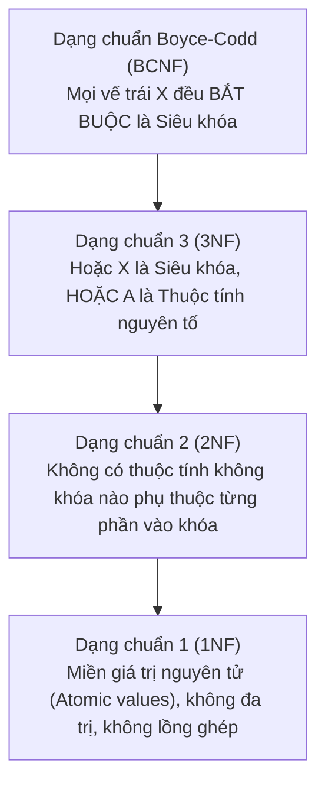

# CHƯƠNG 4 (QUYỂN 2): CHUẨN HÓA CƠ SỞ DỮ LIỆU (1NF, 2NF, 3NF, BCNF) & THUẬT TOÁN BERNSTEIN

### 1. Phân Cấp Các Dạng Chuẩn Trong Cơ Sở Dữ Liệu

### 2. Định Nghĩa & Tiêu Chuẩn Phân Loại Dạng Chuẩn

| Dạng chuẩn | Điều kiện thỏa mãn hình thức | Khuyết điểm loại bỏ |
| :--- | :--- | :--- |
| **1NF** | Toàn bộ miền giá trị của các thuộc tính đều nguyên tử (Atomic). | Loại bỏ thuộc tính đa trị và quan hệ lồng ghép. |
| **2NF** | Đạt 1NF VÀ mọi thuộc tính không nguyên tố đều **phụ thuộc hàm đầy đủ** vào khóa. | Loại bỏ sự phụ thuộc vào một phần của khóa ghép. |
| **3NF** | Đạt 2NF VÀ không có thuộc tính không nguyên tố nào **phụ thuộc bắc cầu** vào khóa. *Quy tắc kiểm tra:* Với mọi $X \to A \in F^+$ ($A \notin X$): 1. $X$ là siêu khóa, HOẶC 2. $A$ là thuộc tính nguyên tố. | Loại bỏ sự phụ thuộc bắc cầu giữa các thuộc tính không khóa. |
| **BCNF** | Với mọi $X \to A \in F^+$ ($A \notin X$): **$X$ bắt buộc phải là một siêu khóa**. | Loại trừ triệt để mọi dị thường xuất phát từ phụ thuộc hàm. |

### 3. Thuật Toán Chuẩn Hóa CSDL
1. **Thuật toán Chuẩn hóa về 3NF (Thuật toán tổng hợp Bernstein):**
   - Bước 1: Tìm phủ tối thiểu $F_{min}$ của $F$.
   - Bước 2: Gom các PTH có cùng vế trái: $X \to A_1, \dots, X \to A_m \implies X \to A_1 \dots A_m$.
   - Bước 3: Tạo lược đồ con $R_i = X \cup A_1 \dots A_m$ cho mỗi nhóm.
   - Bước 4: Nếu chưa có $R_i$ nào chứa trọn vẹn một khóa $K$ của $R$, thêm $R_{new} = K$.
   - Bước 5: Loại bỏ các lược đồ con là tập con của lược đồ khác.
   - *Tính chất:* **Bảo đảm 100% Bảo toàn thông tin VÀ Bảo toàn phụ thuộc hàm.**
2. **Thuật toán Chuẩn hóa về BCNF:**
   - Phân tách đệ quy theo các phụ thuộc hàm vi phạm BCNF ($X \to Y$ với $X$ không phải siêu khóa):
     $$R_1 = X \cup Y, \quad R_2 = R \setminus (Y \setminus X)$$
   - *Tính chất:* **Bảo toàn thông tin nhưng có thể làm MẤT phụ thuộc hàm.**

---

## Tinh Hoa Kiến Thức & Tóm Tắt Chuyên Sâu (Key Takeaways)
> **Chuyên đề mở rộng:** Phụ thuộc Đa trị & Dạng chuẩn 4 (4NF)

### 1. Các Ý Niệm Cốt Lõi (Key Takeaways)
- **Hạn chế của BCNF:** BCNF không loại bỏ được sự dư thừa dữ liệu phát sinh từ hai hay nhiều mối liên kết 1-nhiều độc lập trong cùng một bảng (dẫn đến tích Descartes các bộ).
- **Phụ thuộc đa trị (MVD):** $X \twoheadrightarrow Y$ biểu thị rằng tập giá trị $Y$ đi kèm với $X$ hoàn toàn độc lập với các thuộc tính còn lại $Z = U \setminus XY$.
  *MVD tầm thường:* $Y \subseteq X$ hoặc $X \cup Y = U$.
- **Mối quan hệ giữa FD và MVD:** Mọi phụ thuộc hàm đều là một phụ thuộc đa trị ($X \to Y \implies X \twoheadrightarrow Y$).

### 2. Các Tiên Đề Phụ Thuộc Đa Trị & Định Lý Fagin
- **Luật bù (Complementation):** $X \twoheadrightarrow Y \implies X \twoheadrightarrow U \setminus (XY)$. (MVD luôn tồn tại theo cặp bù).
- **Định lý Fagin:** Phép phân tách $R$ thành hai lược đồ con $\{R_1, R_2\}$ là bảo toàn thông tin $\iff$
  $$(R_1 \cap R_2) \twoheadrightarrow (R_1 \setminus R_2) \quad \text{HOẶC} \quad (R_1 \cap R_2) \twoheadrightarrow (R_2 \setminus R_1)$$

### 3. Dạng Chuẩn 4 (4NF - Fourth Normal Form)
- **Định nghĩa 4NF:** Lược đồ quan hệ $R(U, D)$ đạt 4NF nếu với mọi phụ thuộc đa trị không tầm thường $X \twoheadrightarrow Y \in D^+$, thì $X$ **bắt buộc phải là siêu khóa** của $R$.
- **Thứ bậc bao hàm:**
  $$\text{4NF} \subset \text{BCNF} \subset \text{3NF} \subset \text{2NF} \subset \text{1NF}$$
  *Nhận xét:* Nếu $R$ đạt 4NF thì $R$ chắc chắn đạt BCNF.
- **Thuật toán chuẩn hóa về 4NF:**
  Phân tách đệ quy không mất thông tin dựa trên MVD vi phạm $X \twoheadrightarrow Y$:
  $$R_1 = X \cup Y, \quad R_2 = R \setminus (Y \setminus X)$$
