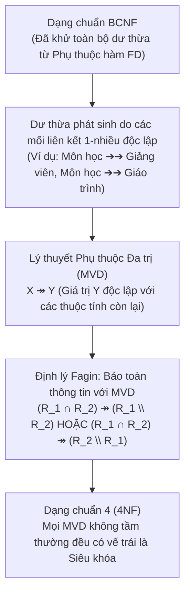

# CHƯƠNG 5 (QUYỂN 2): PHỤ THUỘC ĐA TRỊ (MVD) & DẠNG CHUẨN 4 (4NF)

### 1. Sơ Đồ Tiến Hóa Chuẩn Hóa: Từ BCNF Đến Dạng Chuẩn 4 (4NF)

### 2. Định Nghĩa Phụ Thuộc Đa Trị (Multivalued Dependency - MVD)
Cho lược đồ quan hệ $R(U)$ và $X, Y \subseteq U$, đặt $Z = U \setminus (X \cup Y)$.
Ta nói rằng **$X$ xác định đa trị $Y$** (hay **$Y$ phụ thuộc đa trị vào $X$**), ký hiệu là:
$$X \twoheadrightarrow Y$$
nếu với mọi thể hiện quan hệ $r$ trên $R$ và với bất kỳ hai bộ dữ liệu $t_1, t_2 \in r$ thỏa mãn $t_1[X] = t_2[X]$, luôn luôn tồn tại hai bộ $t_3, t_4 \in r$ sao cho:
1. $t_3[X] = t_1[X], \quad t_3[Y] = t_1[Y], \quad t_3[Z] = t_2[Z]$
2. $t_4[X] = t_1[X], \quad t_4[Y] = t_2[Y], \quad t_4[Z] = t_1[Z]$

- **MVD tầm thường (Trivial MVD):** $X \twoheadrightarrow Y$ là tầm thường nếu $Y \subseteq X$ hoặc $X \cup Y = U$.
- **Mối quan hệ giữa FD và MVD (Luật sao chép):**
  $$X \to Y \implies X \twoheadrightarrow Y$$
  *(Mọi phụ thuộc hàm đều là một trường hợp đặc biệt của phụ thuộc đa trị).*

### 3. Định Lý Fagin (Lossless Join Với MVD)
> **Định lý Fagin:** Phép phân tách lược đồ quan hệ $R$ thành hai lược đồ con $\rho = \{R_1, R_2\}$ (với $R_1 \cup R_2 = U$) là **bảo toàn thông tin (Lossless Join)** khi và chỉ khi:
> $$(R_1 \cap R_2) \twoheadrightarrow (R_1 \setminus R_2) \quad \text{HOẶC} \quad (R_1 \cap R_2) \twoheadrightarrow (R_2 \setminus R_1)$$

### 4. Dạng Chuẩn 4 (4NF - Fourth Normal Form)
- **Định nghĩa:** Lược đồ quan hệ $R(U, D)$ đạt Dạng chuẩn 4 (4NF) nếu với mọi phụ thuộc đa trị không tầm thường $X \twoheadrightarrow Y \in D^+$ (nghĩa là $Y \not\subseteq X$ và $XY \subset U$):
  $$X \text{ bắt buộc phải là một siêu khóa của } R$$
- **Quan hệ thứ bậc hoàn chỉnh:**
  $$\text{4NF} \subset \text{BCNF} \subset \text{3NF} \subset \text{2NF} \subset \text{1NF}$$
