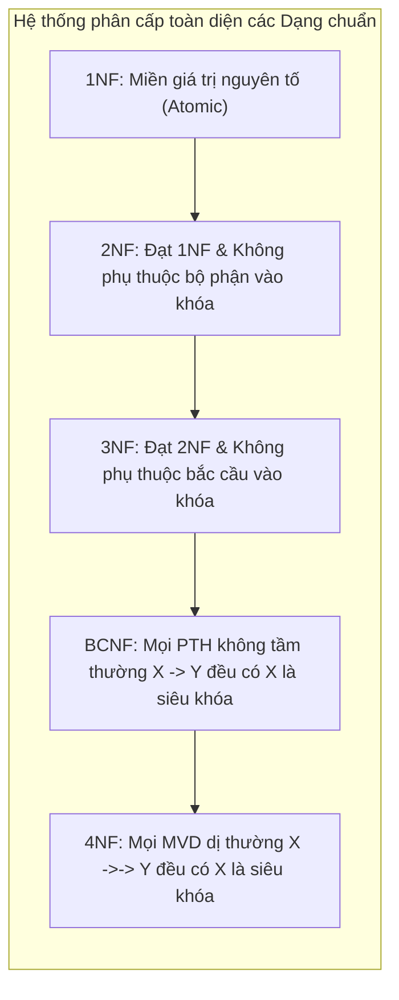
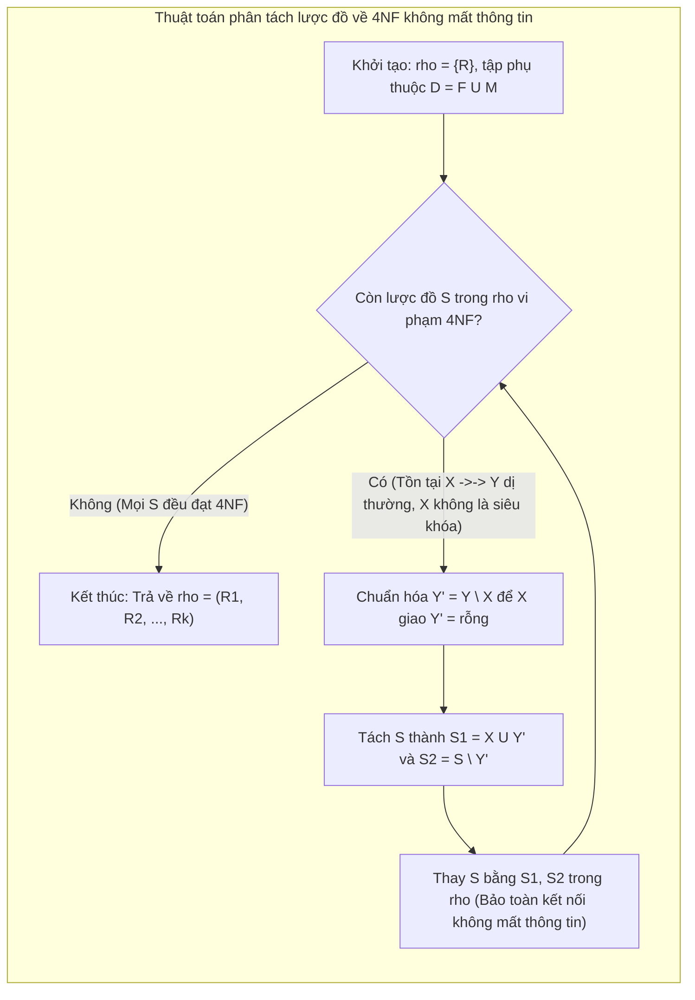

# Phần II - Chương 5: Phụ thuộc đa trị và Dạng chuẩn 4 (4NF) (Phương pháp Ghi chép Cornell)

> **Hướng dẫn sử dụng ghi chú Cornell (Cornell Note-taking System):**
> - **Cột Trái (Cue Column — Từ khóa / Câu hỏi gợi nhớ):** Chứa các khái niệm trọng tâm, câu hỏi kích thích trí nhớ, tên tiên đề/định lý và công thức mấu chốt. Hãy che cột phải và dùng cột trái để tự truy hồi kiến thức.
> - **Cột Phải (Note-taking Column — Ghi chú chi tiết):** Trình bày đầy đủ định nghĩa toán học, ví dụ minh họa, hệ tiên đề `A1–A8`, chứng minh định lý và thuật toán bám sát Phần II - Chương 5 giáo trình *Thực hành Cơ sở dữ liệu (Phần II - Thiết kế, ĐH Huế 2022)*.
> - **Phần Tổng kết (Summary):** Cô đọng bản chất cốt lõi ngay sau mỗi mục và cuối toàn chương để hệ thống hóa nhanh trước khi làm bài tập.

---

## 1. Động cơ Thực tiễn & Các Định nghĩa về Phụ thuộc Đa trị (MVD) (Mục 5.1)

| Từ khóa / Câu hỏi gợi nhớ | Ghi chú chi tiết (Nội dung cốt lõi) |
| :--- | :--- |
| **Tại sao `BCNF` vẫn chưa đủ? (Ví dụ quan hệ `GIANGDAY`)** | Phụ thuộc hàm (`PTH`) giúp chuẩn hóa lược đồ về `3NF` hoặc `BCNF`, nhưng không phải là loại phụ thuộc duy nhất trong thực tế. Khi tồn tại sự **độc lập giữa hai tập thuộc tính** trên cùng một thuộc tính khóa chung, `PTH` không diễn tả được ràng buộc này và gây ra **dư thừa dữ liệu**. **Ví dụ quan hệ `GIANGDAY(TENGV, MONHOC, LOP)`:** - `(Lê Đông Giang, Nhập môn CSDL, Tin2A)` - `(Lê Đông Giang, CSDL nâng cao, Tin4A)` - `(Lê Đông Giang, Phân tích thiết kế hệ thống, Tin4A)` - `(Lê Đông Giang, CSDL nâng cao, Tin 4B)` **Phân tích:** Một giảng viên dạy nhiều môn học ở nhiều lớp khác nhau; giữa `MONHOC` và `LOP` độc lập nhau theo `TENGV`. Khóa của `GIANGDAY` là toàn bộ `(TENGV, MONHOC, LOP)` nên bảng đã đạt `BCNF`, nhưng dữ liệu vẫn bị lặp lại dư thừa và không thể phân rã chỉ dựa trên `PTH`. Ràng buộc này gọi là **phụ thuộc đa trị (MVD)**. |
| **Mục tiêu của Chương 5** | 1. Tìm hiểu các khái niệm cơ bản của **phụ thuộc đa trị** (`MVD`). 2. Giới thiệu **dạng chuẩn 4 (`4NF`)** — dạng chuẩn của CSDL khi xét đồng thời `PTH` và phụ thuộc đa trị. |
| **Định nghĩa Phụ thuộc đa trị ($X \twoheadrightarrow Y$)** | Cho tập thuộc tính $U$, $X, Y \subseteq U$, $R$ là quan hệ xác định trên tập thuộc tính $U$, đặt $Z = U \setminus XY$ (với $XY = X \cup Y$). Ta nói **$X$ xác định đa trị $Y$** (hay $Y$ phụ thuộc đa trị vào $X$), ký hiệu **$X \twoheadrightarrow Y$**, nếu với mọi quan hệ $r$ hợp lệ trên $R(U)$ và với mọi cặp hai bộ $t_1, t_2 \in r$ bất kỳ thỏa $t_1[X] = t_2[X]$, thì tồn tại bộ $t_3 \in r$ sao cho: - $t_3[X] = t_1[X]$ - $t_3[Y] = t_1[Y]$ - $t_3[Z] = t_2[Z]$ |
| **Tính đối xứng & Sự tồn tại của bộ $t_4$** | Do vai trò đối xứng giữa $t_1$ và $t_2$ ($t_1[X] = t_2[X]$), khi tráo đổi vai trò $t_1 \leftrightarrow t_2$, trong $r$ tất yếu còn tồn tại bộ **$t_4 \in r$** sao cho: - $t_4[X] = t_2[X] = t_1[X]$ - $t_4[Y] = t_2[Y]$ - $t_4[Z] = t_1[Z]$ với $Z = U \setminus XY$. *(Ý nghĩa: Với mỗi giá trị của $X$, tập giá trị trên $Y$ và tập giá trị trên $Z$ kết hợp độc lập theo tích Đề-các).* |
| **Các trường hợp đặc biệt của MVD** | 1. **Nếu $Y = \emptyset$:** $X \twoheadrightarrow \emptyset$ luôn đúng với mọi quan hệ. 2. **Nếu $X = \emptyset$:** $\emptyset \twoheadrightarrow Y$ thỏa trên quan hệ khi và chỉ khi tập giá trị trên $Y$ **độc lập** với các thuộc tính còn lại trong quan hệ. 3. **Với quan hệ $r$ trên $YZ$ ($X = \emptyset, Y \cap Z = \emptyset$):** $\emptyset \twoheadrightarrow Y$ thỏa trên $r$ khi và chỉ khi **$r = r[Y] * r[Z]$** (tích kết nối tự nhiên / tích Đề-các của hai hình chiếu). |
| **Ví dụ minh họa $A \twoheadrightarrow CD$ trên bảng `R(A,B,C,D,E,F)`** | Cho quan hệ `R(A, B, C, D, E, F)` có các bộ: - $t_1 = (\text{S101}, \text{G}, \text{H}, 7.5, \text{J}, \text{P})$ - $t_2 = (\text{S101}, \text{G}, \text{K}, 8.0, \text{M}, \text{Q})$ - $t_3 = (\text{S101}, \text{G}, \text{H}, 7.5, \text{M}, \text{Q})$ *(lưu ý bản in giáo trình có lỗi đánh máy số 7.5 thành 6.5 ở bảng, phần giải thích ghi rõ `(H, 7.5)`)* - $t_4 = (\text{S101}, \text{G}, \text{K}, 8.0, \text{J}, \text{P})$ *(bản in ghi 8.8)* **Kiểm chứng:** Với $t_1, t_2 \in r$ có $t_1[A] = t_2[A] = \text{S101}$, tồn tại $t_3 \in r$ thỏa $t_3[A] = t_1[A] = \text{S101}$, $t_3[CD] = t_1[CD] = (\text{H}, 7.5)$, và $t_3[BEF] = t_2[BEF] = (\text{G}, \text{M}, \text{Q})$, đồng thời tồn tại $t_4 \in r$ tương ứng đối xứng $\Rightarrow R$ thỏa **$A \twoheadrightarrow CD$**. - Tập tất cả phụ thuộc đa trị trên lược đồ ký hiệu là **`MVD`** (*MultiValued Dependencies*). **`PTH` là trường hợp đặc biệt của `MVD`.** |
| **Phụ thuộc đa trị cơ sở (`Elementary MVD`)** | Phụ thuộc đa trị $X \twoheadrightarrow Y$ của quan hệ $R$ được gọi là **phụ thuộc đa trị cơ sở** nếu thỏa hai tính chất: 1. **(i)** $Y \neq \emptyset$ và $X \cap Y = \emptyset$ (và $XY \neq U$). 2. **(ii)** **Tồn tại duy nhất** cặp $X' \subseteq X$ và $Y' \subseteq Y$ ($Y' \neq \emptyset$) sao cho $X' \twoheadrightarrow Y'$ là một MVD của $R$ (tức chính là $X' = X, Y' = Y$; không thể thu gọn $X$ hay $Y$ thành tập con thực sự nhỏ hơn mà vẫn giữ được MVD). **Ví dụ:** Cho `R(A,B,C,D,E,F)` gồm 4 bộ: `(a,b,c1,d1,e1,f1)`, `(a,b,c2,d2,e2,f2)`, `(a,b,c1,d1,e2,f2)`, `(a,b,c2,d2,e1,f1)`. - Trong $R$ có $AB \twoheadrightarrow CD$ và $A \twoheadrightarrow CD$, nhưng $A \not\twoheadrightarrow C$ và $A \not\twoheadrightarrow D$. - Vì có $A \subset AB$ đã thỏa $A \twoheadrightarrow CD$ nên **$AB \twoheadrightarrow CD$ không là phụ thuộc đa trị cơ sở**, còn **$A \twoheadrightarrow CD$ là phụ thuộc đa trị cơ sở**. |
| **Phụ thuộc đa trị dị thường (`Nontrivial MVD`)** | Cho lược đồ quan hệ $R(U)$, phụ thuộc đa trị $X \twoheadrightarrow Y$ được gọi là **phụ thuộc đa trị dị thường** (không tầm thường) nếu thỏa đồng thời 3 điều kiện: 1. $Y \neq \emptyset$ 2. $Y \not\subseteq X$ 3. $XY \neq U$ (tức $X \cup Y$ không chứa tất cả thuộc tính của $R$). *(Ngược lại, nếu $Y \subseteq X$ hoặc $XY = U$ thì là MVD tầm thường — luôn đúng trên mọi quan hệ của $R$).* |

> **Tóm tắt Mục 1 (Cornell Summary):** Phụ thuộc đa trị $X \twoheadrightarrow Y$ mô tả sự độc lập giữa tập thuộc tính $Y$ và phần bù $Z = U \setminus XY$ ứng với mỗi giá trị của $X$ (luôn đi kèm cặp bộ hoán vị $t_3, t_4$), giải thích tại sao một quan hệ đạt `BCNF` như `GIANGDAY(TENGV, MONHOC, LOP)` vẫn bị dư thừa dữ liệu. Giáo trình phân biệt rõ MVD tầm thường ($Y = \emptyset$, $Y \subseteq X$ hoặc $XY = U$), **MVD dị thường** ($Y \neq \emptyset, Y \not\subseteq X, XY \neq U$) và **MVD cơ sở** (tối tiểu ở cả hai vế $X$ và $Y$).

---

## 2. Hệ Tiên đề A1–A8 cho Phụ thuộc Hàm & Phụ thuộc Đa trị và Định lý Phân tách (Mục 5.2 - 5.3)

| Từ khóa / Câu hỏi gợi nhớ | Ghi chú chi tiết (Nội dung cốt lõi) |
| :--- | :--- |
| **Hệ tiên đề A1–A8 (Quy ước ký hiệu)** | Cho $R(U)$ với $U = \{A_1, A_2, \dots, A_n\}$ và $X, Y, Z, V, W \subseteq U$; ký hiệu $XY = X \cup Y$. Hệ tiên đề kết hợp `PTH` và `MVD` gồm 8 luật (đầy đủ và đúng đắn): |
| **A1, A2, A3: Ba tiên đề Armstrong cho `PTH`** | - **A1 — Phản xạ đối với PTH (*Reflexivity*):** Nếu $Y \subseteq X \subseteq U$ thì $X \to Y$. - **A2 — Tăng trưởng đối với PTH (*Augmentation*):** Nếu $X \to Y$ và $Z \subseteq U$ thì $XZ \to YZ$. - **A3 — Bắc cầu đối với PTH (*Transitivity*):** Nếu $X \to Y$ và $Y \to Z$ thì $X \to Z$. |
| **A4, A5, A6: Ba tiên đề riêng cho `MVD`** | - **A4 — Luật bù đối với MVD (*Complementation*):** Nếu $X \twoheadrightarrow Y$ thì $X \twoheadrightarrow U \setminus XY$ *(chú ý: PTH không có luật bù, chỉ MVD mới có luật bù đối xứng giữa $Y$ và $Z = U \setminus XY$).* - **A5 — Tăng trưởng đối với MVD (*Augmentation*):** Nếu $X \twoheadrightarrow Y$ và $V \subseteq W$ ($V, W \subseteq U$) thì $WX \twoheadrightarrow VY$. - **A6 — Bắc cầu đối với MVD (*Transitivity*):** Nếu $X \twoheadrightarrow Y$ và $Y \twoheadrightarrow Z$ thì $X \twoheadrightarrow Z \setminus Y$. |
| **A7, A8: Hai tiên đề kết nối `PTH` và `MVD`** | - **A7 — Luật sao chép (*Replication*):** Nếu $X \to Y$ thì $X \twoheadrightarrow Y$ *(mọi PTH đều là trường hợp đặc biệt của MVD).* - **A8 — Luật giao thoa / hợp nhất (*Coalescence*):** Nếu $X \twoheadrightarrow Y$, $W \to Z$ với $Z \subseteq Y$ và $W \cap Y = \emptyset$ thì suy ra PTH $X \to Z$. |
| **4 Luật suy diễn bổ sung cho `MVD`** | Suy ra được từ hệ tiên đề `A1–A8`: 1. **Luật hợp (*Union*):** Nếu $X \twoheadrightarrow Y$ và $X \twoheadrightarrow Z$ thì $X \twoheadrightarrow YZ$. 2. **Luật tựa bắc cầu (*Pseudotransitivity*):** Nếu $X \twoheadrightarrow Y$ và $WY \twoheadrightarrow Z$ thì $WX \twoheadrightarrow Z \setminus WY$ *(hoặc $Z \setminus XY$ vì mọi thuộc tính thuộc $W$ đã nằm ở vế trái $WX$).* 3. **Luật tựa bắc cầu hỗn hợp (*Mixed pseudotransitivity*):** Nếu $X \twoheadrightarrow Y$ và $XY \to Z$ thì $X \to Z \setminus Y$. 4. **Luật tách (*Decomposition*):** Nếu $X \twoheadrightarrow Y$ và $X \twoheadrightarrow Z$ thì: &nbsp;&nbsp;- $X \twoheadrightarrow Y \cap Z$ &nbsp;&nbsp;- $X \twoheadrightarrow Y \setminus Z$ &nbsp;&nbsp;- $X \twoheadrightarrow Z \setminus Y$ |
| **Khác biệt cốt lõi giữa Luật tách của `PTH` và `MVD`** | - **Với `PTH`:** Từ $X \to Y$ luôn suy ra được $X \to A$ với **mọi** $A \in Y$. - **Với `MVD`:** **Không thể** tùy ý tách $X \twoheadrightarrow Y$ thành $X \twoheadrightarrow A$ ($A \in Y$). $X \twoheadrightarrow A$ chỉ suy ra được nếu tồn tại một tập $Z$ sao cho $X \twoheadrightarrow Z$ và thỏa $Z \cap Y = \{A\}$ hoặc $Y \setminus Z = \{A\}$. |
| **Định lý 5.3 (Điều kiện cần & đủ cho phép tách đôi không mất thông tin)** | Cho $r$ là quan hệ của lược đồ $R(U)$, $X, Y \subseteq U$ và $Z = U \setminus XY$. **Phát biểu:** Quan hệ $r$ thỏa phụ thuộc đa trị **$X \twoheadrightarrow Y$** khi và chỉ khi $r$ được tách **không mất mát thông tin** thành hai quan hệ trên các lược đồ tương ứng **$R_1 = R[XY]$** và **$R_2 = R[XZ]$** (tức $r = \pi_{XY}(r) * \pi_{XZ}(r)$). |
| **Chứng minh Định lý 5.3 (2 chiều)** | - **Chiều thuận ($\Rightarrow$):** Giả sử $X \twoheadrightarrow Y$ thỏa trên $r$. Đặt $r_1 = \pi_{R_1}(r)$, $r_2 = \pi_{R_2}(r)$. Xét $t \in r_1 * r_2$: theo định nghĩa kết nối tự nhiên và phép chiếu, tồn tại $t_3, t_4 \in r$ sao cho $t_3[XY] = t[XY]$ và $t_4[XZ] = t[XZ]$ (nên $t_3[X] = t_4[X] = t[X]$). Áp dụng $X \twoheadrightarrow Y$ cho $t_3, t_4 \in r$, tồn tại bộ $t' \in r$ thỏa $t'[X] = t_3[X]$, $t'[Y] = t_3[Y] = t[Y]$, $t'[Z] = t_4[Z] = t[Z]$, tức $t' = t \in r$. Suy ra $r_1 * r_2 \subseteq r$, kết hợp $r \subseteq r_1 * r_2 \implies r = r_1 * r_2$. - **Chiều đảo ($\Leftarrow$):** Giả sử $r = r_1 * r_2$ với $r_1 = \pi_{XY}(r), r_2 = \pi_{XZ}(r)$. Xét $t_1, t_2 \in r$ bất kỳ có $t_1[X] = t_2[X]$. Khi đó $t_3' = t_1[XY] \in r_1$ và $t_4' = t_2[XZ] \in r_2$ khớp nhau trên $X$. Vì $r = r_1 * r_2$, kết nối $t_3' * t_4'$ cho bộ $t \in r$ thỏa $t[XY] = t_1[XY]$ và $t[XZ] = t_2[XZ]$ (tức $t[X]=t_1[X], t[Y]=t_1[Y], t[Z]=t_2[Z]$). Vậy $r$ thỏa $X \twoheadrightarrow Y$. |

> **Tóm tắt Mục 2 (Cornell Summary):** Hệ tiên đề `A1–A8` mở rộng Armstrong thêm luật bù (`A4`), tăng trưởng MVD (`A5`), bắc cầu MVD (`A6`), sao chép (`A7`) và giao thoa (`A8`), kéo theo 4 luật bổ sung (Hợp, Tựa bắc cầu, Tựa bắc cầu hỗn hợp, Tách giao/hiệu). Điểm mấu chốt cần nhớ: MVD không có luật tách tùy ý về từng thuộc tính đơn như PTH, và **Định lý 5.3** nối trực tiếp $X \twoheadrightarrow Y$ với phép tách đôi không mất thông tin $(XY, XZ)$.

---

## 3. Bao đóng $D^+$, Cơ sở Phụ thuộc của $X$ & Kiểm tra Kết nối Không Mất Thông tin (Mục 5.4 - 5.5)

| Từ khóa / Câu hỏi gợi nhớ | Ghi chú chi tiết (Nội dung cốt lõi) |
| :--- | :--- |
| **Bao đóng $D^+$ của tập phụ thuộc $D = F \cup M$** | Cho $D = F \cup M$ gồm tập PTH $F$ và tập MVD $M$. **Bao đóng $D^+$** (trong sách còn ký hiệu $D^*$) là tập tất cả các PTH và MVD được suy diễn logic từ $D$ bằng hệ tiên đề `A1–A8` cho đến khi không sinh thêm phụ thuộc mới nào. **Bài toán thành viên:** Kiểm tra $X \twoheadrightarrow Y \in D^+$ bằng cách xác định **cơ sở phụ thuộc của $X$** đối với $D$ và xem $Y \setminus X$ có là hợp của một số tập trong cơ sở phụ thuộc đó hay không. |
| **Khái niệm Cơ sở phụ thuộc của $X$ (Mục 5.4.1)** | Gọi $M(X)$ là họ tất cả các tập $Y \subseteq U$ sao cho $(X \twoheadrightarrow Y) \in D^+ = (F \cup M)^+$. Tồn tại một họ con **duy nhất** các tập $\{Y_1, Y_2, \dots, Y_n\}$ thỏa 3 tính chất: 1. Mọi tập $Y_i$ đều **khác rỗng** ($Y_i \neq \emptyset$). 2. Mọi cặp tập trong họ con là **rời nhau / phân biệt** ($Y_i \cap Y_j = \emptyset, \forall i \neq j$). 3. Mỗi tập thuộc $M(X)$ đều là **hợp** của một số tập từ họ con này. Họ con gồm các tập không rỗng, tối tiểu trong $M(X)$ này gọi là **cơ sở phụ thuộc của $X$** (*Dependency Basis of X*). |
| **Chuyển đổi $D$ về tập MVD & Suy ra `PTH` từ Cơ sở phụ thuộc (Mục 5.4.2)** | Để tính cơ sở phụ thuộc của $X$ đối với $D = F \cup M$, ta quy về tập toàn các MVD $M'$ gồm: - Tất cả MVD thuộc $D$. - Với mỗi PTH $(W \to Y) \in D$ ($Y = \{A_1, \dots, A_k\}$), thay bằng tập các MVD $W \twoheadrightarrow A_1, \dots, W \twoheadrightarrow A_k$. **Điều kiện suy ra PTH $X \to A$ ($A \notin X$):** $X \to A \in D^+$ khi và chỉ khi: 1. **(i)** $\{A\}$ là một tập đơn (tập độc lập một phần tử) trong cơ sở phụ thuộc của $X$ đối với $M'$; **và** 2. **(ii)** Tồn tại $(W \to Z) \in D$ với $A \notin W$ và $A \in Z$. |
| **Thuật toán tính Cơ sở phụ thuộc của $X$ đối với $M$** | - **Input:** Tập MVD $M$ trên tập thuộc tính $U$ và $X \subseteq U$. - **Output:** Cơ sở phụ thuộc của $X$ đối với $M$. - **Các bước thực hiện:**   1. **Khởi tạo $T$:** $T$ là họ gồm các tập $Z \subseteq U$ sao cho với mỗi $W \twoheadrightarrow Y \in M$ mà $W \subseteq X$, lấy $Z = Y \setminus X$ hoặc $Z = U \setminus XY$ (và tập nền $U \setminus X$ nếu cần phủ).   2. **Làm rời nhau (tạo $S$):** Nếu còn cặp $Z_1, Z_2 \in T$ giao nhau ($Z_1 \cap Z_2 \neq \emptyset$, $Z_1 \neq Z_2$), thay chúng bằng $Z_1 \cap Z_2$, $Z_1 \setminus Z_2$, $Z_2 \setminus Z_1$ (loại bỏ tập rỗng). Kết quả thu được họ các tập rời nhau $S$.   3. **Tinh chỉnh lặp:** Lặp đến khi không đổi: tìm một $(V \twoheadrightarrow W) \in M$ và một tập $Y \in S$ sao cho $Y \cap W \neq \emptyset$, $Y \not\subseteq W$ (và $V \cap Y = \emptyset$), khi đó thay $Y$ trong $S$ bằng hai tập $Y \cap W$ và $Y \setminus W$.   4. **Kết quả:** Họ $S$ cuối cùng (loại bỏ tập thuộc $X$ nếu còn) chính là **cơ sở phụ thuộc của $X$**. |
| **Thuật toán Bảng mở rộng (Chase) kiểm tra Kết nối Không mất thông tin với `PTH` + `MVD` (Mục 5.5.1)** | - **Input:** Lược đồ $R(A_1, \dots, A_n)$, phép tách $\rho = (R_1, \dots, R_k)$, tập PTH $F$ và tập MVD $M$. - **Bước 1 (Lập ma trận $k \times n$):** Hàng $i$ ứng với $R_i$, cột $j$ ứng với $A_j$. Ô $(i, j) = a_j$ nếu $A_j \in R_i$, ngược lại ô $(i, j) = b_{ij}$. - **Bước 2 (Biến đổi bảng lặp):**   - **Khi gặp PTH $X \to Y \in F$:** Nếu có các hàng giống nhau trên $X$ nhưng khác nhau trên $Y$, đồng nhất chúng trên từng thuộc tính $A_j \in Y$: nếu một hàng có $a_j$ và hàng kia có $b_{ij}$ thì đổi thành **$a_j$**; nếu cả hai là $b_{i_1 j}, b_{i_2 j}$ thì đổi thành cùng một ký hiệu $b$ (ví dụ $b_{i_1 j}$).   - **Khi gặp MVD $X \twoheadrightarrow Y \in M$:** Nếu tồn tại hai hàng $t_1, t_2$ trong bảng mà $t_1[X] = t_2[X]$, thì **thêm một hàng mới $u$** vào bảng với: $u[X] = t_1[X] = t_2[X]$, $u[Y] = t_1[Y]$, và $u[U \setminus XY] = t_2[U \setminus XY]$ *(nếu $u$ chưa có trong bảng)*. - **Bước 3 (Kết luận):** Dừng khi không đổi được ký hiệu $a/b$ và không thêm được hàng mới. Nếu bảng xuất hiện **ít nhất một dòng toàn các giá trị $a_1, a_2, \dots, a_n$** $\Rightarrow$ **Không mất mát thông tin**; ngược lại $\Rightarrow$ **Mất mát thông tin**. |
| **Định lý 5.5.2 (Kiểm tra nhanh phép tách đôi với `PTH` + `MVD`)** | Cho lược đồ $R$, phép tách đôi $\rho = (R_1, R_2)$ và tập $D = F \cup M$. **Định lý:** Phép tách $\rho = (R_1, R_2)$ là **không mất thông tin** khi và chỉ khi: $$(R_1 \cap R_2) \twoheadrightarrow (R_1 \setminus R_2) \in D^+$$ (hoặc tương đương bởi luật bù: $(R_1 \cap R_2) \twoheadrightarrow (R_2 \setminus R_1) \in D^+$). **Ý nghĩa chứng minh:** Với mọi $t, s \in r$, bộ kết nối $u$ thỏa $u[R_1]=t[R_1], u[R_2]=s[R_2]$ tồn tại khi và chỉ khi $t[R_1 \cap R_2] = s[R_1 \cap R_2]$, và điều kiện để $u \in r$ chính xác là định nghĩa của MVD $(R_1 \cap R_2) \twoheadrightarrow (R_1 \setminus R_2)$. |

> **Tóm tắt Mục 3 (Cornell Summary):** Để suy diễn trên $D = F \cup M$ mà không phải liệt kê toàn bộ $D^+$, ta tính **cơ sở phụ thuộc của $X$** bằng cách khởi tạo các tập từ $W \subseteq X$, làm rời nhau bằng phép giao/hiệu, rồi chẻ nhỏ dần bằng các MVD còn lại. Khi kiểm tra tính không mất thông tin của phép tách: nếu tách thành $k$ bảng dùng **bảng mở rộng Chase** (cho phép **thêm hàng mới $u$** khi gặp $X \twoheadrightarrow Y$); nếu tách đôi $\rho=(R_1, R_2)$ chỉ cần kiểm tra điều kiện $(R_1 \cap R_2) \twoheadrightarrow (R_1 \setminus R_2)$ theo **Định lý 5.5.2**.

---

## 4. Dạng Chuẩn 4 (`4NF`) & Thuật toán Phân tách về Dạng Chuẩn `4NF` (Mục 5.6)

| Từ khóa / Câu hỏi gợi nhớ | Ghi chú chi tiết (Nội dung cốt lõi) |
| :--- | :--- |
| **Khái niệm Dạng chuẩn 4 (`4NF`)** | `4NF` là sự tổng quát hóa của dạng chuẩn `BCNF` áp dụng cho các lược đồ quan hệ có xét đến **phụ thuộc đa trị (`MVD`)**. **Định nghĩa:** Cho lược đồ $R(U)$ và tập phụ thuộc $D$ (`PTH` và `MVD`) trên $R$. $R$ ở **dạng chuẩn bốn (`4NF`)** nếu với mọi phụ thuộc đa trị $X \twoheadrightarrow Y \in D^+$ là **dị thường** (tức $Y \neq \emptyset$, $Y \not\subseteq X$ và $XY \neq U$), thì **$X$ phải chứa một khóa của $R$** (tức $X$ là siêu khóa). *(Lưu ý: Khái niệm khóa không thay đổi — vẫn là tập thuộc tính xác định hàm toàn bộ $R$, tức $X^+ = U$).* |
| **Mệnh đề: 4 Tính chất của `4NF`** | 1. **(i)** $R$ ở `4NF` khi và chỉ khi mọi MVD cơ sở trên $R$ đều là phụ thuộc xác định một thuộc tính, có dạng $X \twoheadrightarrow A$ *(xuất phát từ PTH $X \to A$ với $X$ là siêu khóa)*. 2. **(ii)** $R(U)$ ở `4NF` nếu mọi phụ thuộc đa trị cơ sở $X \twoheadrightarrow Y \in D^+$ đều thỏa $X^+ = U$. 3. **(iii)** Với mọi phụ thuộc đa trị $X \twoheadrightarrow Y \in D^+$ mà $Y \neq \emptyset$, $Y \not\subseteq X$, $XY \neq U$ thì $X^+ = U$. 4. **(iv)** **Quan hệ bao hàm giữa các dạng chuẩn:** Nếu $R$ ở **`4NF`** thì $R$ chắc chắn ở **`BCNF`**, và do đó ở **`3NF`** ($\text{4NF} \subset \text{BCNF} \subset \text{3NF} \subset \text{2NF} \subset \text{1NF}$). |
| **Thuật toán phân tách lược đồ về `4NF` không mất thông tin** | - **Input:** Lược đồ quan hệ $R$ (hoặc phân tách ban đầu $\rho = \{R\}$ đã ở 3NF) và tập phụ thuộc $D = F \cup M$. - **Output:** Phép tách $\rho = (R_1, R_2, \dots, R_k)$ **không mất mát thông tin** đối với $D$ và mỗi $R_i$ đều đạt **`4NF`**. - **Phương pháp:**   1. Tìm một lược đồ $S \in \rho$ **chưa đạt `4NF`** đối với hình chiếu của $D$ lên $S$: tức tồn tại MVD $X \twoheadrightarrow Y$ trên $S$ với $Y \neq \emptyset$, $Y \not\subseteq X$, $XY \neq S$ nhưng $X$ **không chứa khóa** của $S$.   2. Đảm bảo $X \cap Y = \emptyset$ (nếu giao khác rỗng, thay $Y$ bằng $Y \setminus X$ nhờ A1, A7 và luật tách).   3. Thay thế $S$ trong $\rho$ bằng hai lược đồ con: **$S_1 = XY$** và **$S_2 = S \setminus Y$** *(tức $S_2 = X \cup (S \setminus XY)$)*.   4. Vì $S_1 \cap S_2 = X$ và $S_1 \setminus S_2 = Y$, nên $(S_1 \cap S_2) \twoheadrightarrow (S_1 \setminus S_2)$ $\Rightarrow$ phép kết nối $S_1$ và $S_2$ luôn **không mất mát thông tin** theo Định lý 5.5.2 *(lưu ý bản in giáo trình dòng 5084 rớt chữ "không")*.   5. Lặp lại cho tới khi mọi lược đồ trong $\rho$ đều đạt `4NF`. |
| **Ví dụ chi tiết trong giáo trình: Phân tách về `(GBC, GA, GDE)`** | Xét lược đồ `R(G, A, B, C, D, E)` *(bản in giáo trình mục ví dụ đánh nhầm thiếu G ở tiêu đề thành `R(ABCDE)` nhưng ngay dòng dưới ghi `R = GABCDE`)*, với tập phụ thuộc `D` gồm: `G -> A`, `BC -> G`, `G ->-> BC`, `G ->-> DE`, `BD -> C`, `BA -> C`. - **Suy diễn bổ sung:**   - `G ->-> BC`, `G -> A` $\implies G \twoheadrightarrow A$ (A7) $\implies G \twoheadrightarrow ABC$ (Hợp) $\implies G \twoheadrightarrow DE$ (Luật bù A4).   - `BC -> G`, `G -> A` $\implies BC \to A$ (A3) $\implies BC \to GA$ (Hợp) $\implies BC \twoheadrightarrow GA$ (A7) và $BC \twoheadrightarrow DE$ (A4). - **Bước 1 (Xét `R = GABCDE`):** Khóa của $R$ chứa `BD` và `E` (do `BD -> C`, `BC -> G`, `G -> A`, còn `E` chỉ liên kết qua MVD `G ->-> DE`), nên `R` chưa ở `4NF`. Chọn MVD vi phạm `G ->-> BC` (`G` không chứa khóa).   $\Rightarrow$ Tách `R` thành: **$R_1 = GBC$** và **$R_2 = R \setminus BC = GADE$** *(bản in ghi nhầm thành `GCDE`, nhưng bước tách sau cho thấy `R2` tách ra `GA` và `GDE` nên `R2` chính xác là `GADE`)*. - **Bước 2 (Kiểm tra $R_1 = GBC$):** Có PTH `BC -> G`, khóa là `BC`. Phụ thuộc `G ->-> BC` không vi phạm hay `G`? Lưu ý trong giáo trình nhận xét trên $R_1 = GBC$, `G ->-> BC` lúc này có $XY = GBC = R_1$ (trở thành MVD tầm thường trên $R_1$!) và không còn PTH/MVD nào chiếu lên $R_1$ vi phạm `4NF` $\Rightarrow$ **$R_1 = GBC$ đạt `4NF`**. *(Chú ý quan trọng: khi chiếu lên $R_1$, $XY = U_1$ làm MVD `G ->-> BC` thành tầm thường, chỉ còn kiểm tra `BC -> G` thỏa `BC` là khóa).* - **Bước 3 (Kiểm tra $R_2 = GADE$):** Khóa trên $R_2$ là `GDE` (hoặc `GD` nếu xét chiếu). Chọn MVD `G ->-> A` (từ PTH `G -> A`), vì `G` không chứa khóa của $R_2$ $\Rightarrow$ tách $R_2$ thành **$R_{21} = GA$** (khóa `G`, đạt `4NF`) và **$R_{22} = R_2 \setminus A = GDE$** (không còn phụ thuộc vi phạm, đạt `4NF`). - **Kết luận:** $R$ được phân tách không mất thông tin về 3 lược đồ `4NF` là **`(GBC, GA, GDE)`**. |

> **Tóm tắt Mục 4 (Cornell Summary):** `4NF` siết chặt điều kiện của `BCNF` sang cả các phụ thuộc đa trị: mọi MVD dị thường $X \twoheadrightarrow Y$ ($Y \neq \emptyset, Y \not\subseteq X, XY \neq U$) đều phải có vế trái $X$ là **siêu khóa** ($X^+ = U$). Mọi lược đồ ở `4NF` đều tự động đạt `BCNF` và `3NF`. Thuật toán tách về `4NF` tách dần từng lược đồ vi phạm $S$ theo $X \twoheadrightarrow Y$ (với $X \cap Y = \emptyset$) thành $S_1 = XY$ và $S_2 = S \setminus Y$, đảm bảo tính **không mất mát thông tin** ở từng bước (như ví dụ `R(GABCDE)` tách thành `(GBC, GA, GDE)`).

---

## Tóm tắt toàn chương (Cornell Summary)

1. **Động cơ & Khái niệm `MVD` (Mục 5.1):** `BCNF` vẫn có thể dư thừa dữ liệu (như `GIANGDAY(TENGV, MONHOC, LOP)`) do sự độc lập giữa các tập thuộc tính. Phụ thuộc đa trị $X \twoheadrightarrow Y$ yêu cầu với hai bộ $t_1, t_2$ trùng trên $X$ phải tồn tại các bộ hoán vị $t_3, t_4$ trên $Y$ và $Z = U \setminus XY$. Cần phân biệt MVD tầm thường, **MVD dị thường** ($Y \neq \emptyset, Y \not\subseteq X, XY \neq U$) và **MVD cơ sở** (tối tiểu không rút gọn được).
2. **Hệ tiên đề `A1–A8` & Định lý Phân tách (Mục 5.2 – 5.3):** Kết hợp 3 tiên đề PTH (`A1–A3`), 3 tiên đề MVD (`A4` Luật bù, `A5` Tăng trưởng MVD, `A6` Bắc cầu MVD) và 2 tiên đề liên kết (`A7` Sao chép, `A8` Giao thoa), cùng 4 luật bổ sung (Hợp, Tựa bắc cầu, Tựa bắc cầu hỗn hợp, Tách giao/hiệu). **Định lý 5.3** khẳng định $r$ thỏa $X \twoheadrightarrow Y \iff r = \pi_{XY}(r) * \pi_{XZ}(r)$.
3. **Bao đóng $D^+$, Cơ sở phụ thuộc & Kết nối không mất thông tin (Mục 5.4 – 5.5):** Bài toán thành viên $X \twoheadrightarrow Y \in D^+$ giải bằng thuật toán tính **cơ sở phụ thuộc** của $X$. Kiểm tra phép tách nhiều lược đồ dùng **bảng mở rộng Chase** (đồng nhất $a/b$ với PTH và **thêm hàng mới** khi gặp MVD); kiểm tra tách đôi $(R_1, R_2)$ dùng **Định lý 5.5.2**: $(R_1 \cap R_2) \twoheadrightarrow (R_1 \setminus R_2) \in D^+$.
4. **Dạng chuẩn `4NF` (Mục 5.6):** $R$ đạt `4NF` khi mọi MVD dị thường $X \twoheadrightarrow Y \in D^+$ đều có $X$ chứa khóa ($\text{4NF} \Rightarrow \text{BCNF} \Rightarrow \text{3NF}$). Phân rã về `4NF` bằng cách liên tiếp tách lược đồ vi phạm $S$ thành $S_1 = XY$ và $S_2 = S \setminus Y$ cho tới khi toàn bộ đạt `4NF`.

---

## Câu hỏi tự kiểm tra nhanh (Self-Testing Cues)

1. Tại sao quan hệ `GIANGDAY(TENGV, MONHOC, LOP)` đã đạt chuẩn `BCNF` nhưng vẫn tồn tại dư thừa dữ liệu và bất thường cập nhật?
2. Phát biểu định nghĩa toán học của $X \twoheadrightarrow Y$ bằng bộ $t_1, t_2, t_3, t_4$, và cho biết ý nghĩa của trường hợp đặc biệt $\emptyset \twoheadrightarrow Y$ khi $r$ chỉ có hai tập thuộc tính $Y, Z$.
3. Phân biệt điều kiện của **phụ thuộc đa trị dị thường** và **phụ thuộc đa trị cơ sở**; giải thích vì sao trong ví dụ Mục 5.1.2, $AB \twoheadrightarrow CD$ không phải là phụ thuộc đa trị cơ sở.
4. Viết đầy đủ **Hệ tiên đề `A1–A8`** và nêu rõ sự khác biệt quan trọng giữa **luật tách của PTH** với **luật tách của MVD**.
5. Khi chạy thuật toán bảng mở rộng (Chase) để kiểm tra kết nối không mất thông tin có mặt cả `PTH` và `MVD`, thao tác xử lý cho `MVD` khác với `PTH` ở điểm nào?
6. Phát biểu định nghĩa **`4NF`** và giải thích vì sao trong ví dụ tách `R(GABCDE)` thành `(GBC, GA, GDE)`, phụ thuộc `G ->-> BC` không còn vi phạm trên `R1 = GBC`?
