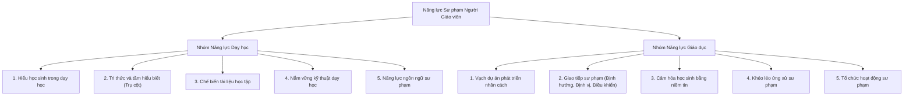

# CHƯƠNG 5: TÂM LÝ HỌC NHÂN CÁCH NGƯỜI GIÁO VIÊN

> *"Trong việc giáo dục, tất cả phải dựa vào nhân cách người giáo dục. Bởi vì sức mạnh của giáo dục chỉ bắt nguồn từ nhân cách mà có."*  
> — **K.D. Usinxki**

---

## 1. Sự Cần Thiết Phải Trau Dồi Nhân Cách Của Người Giáo Viên

1. **Sản phẩm lao động của người giáo viên là nhân cách học sinh:**
   - Sản phẩm sư phạm là kết quả lao động tổng hợp của cả thầy và trò, nhằm biến tinh hoa văn hóa nhân loại thành tài sản riêng của thế hệ trẻ.
   - Nhân cách của người giáo viên là công cụ lao động chủ yếu để tạo nên sản phẩm giáo dục chất lượng cao.
2. **Giáo viên là người quyết định trực tiếp chất lượng đào tạo:**
   - Dù khoa học kỹ thuật phát triển với các phương tiện dạy học hiện đại (máy tính, AI, thiết bị thông minh), không một công nghệ nào có thể thay thế được ảnh hưởng nhân cách sống động của người thầy đối với học sinh.
3. **Giáo viên là "cầu nối" văn hóa giữa các thế hệ:**
   - Nền văn hóa nhân loại và dân tộc chỉ được bảo toàn, phát triển thông qua sự lĩnh hội ở thế hệ trẻ theo phương thức nhà trường với vai trò chủ đạo của người thầy giáo.

---

## 2. Cấu Trúc Nhân Cách Người Giáo Viên

Nhân cách người giáo viên là sự thống nhất hữu cơ giữa hai thành phần cốt lõi: **Phẩm chất nhân cách** và **Năng lực sư phạm**.

### 2.1. Các phẩm chất nhân cách cơ bản
- **Thế giới quan khoa học duy vật biện chứng:**
  - Định hướng nhận thức chính trị, niềm tin và chi phối toàn bộ phương pháp giáo dục của người thầy; gắn bài giảng với thực tiễn cách mạng của đất nước.
- **Lý tưởng nghề nghiệp (Lý tưởng đào tạo thế hệ trẻ):**
  - **Hạt nhân trong cấu trúc nhân cách người giáo viên.**
  - Biểu hiện ở sự say mê nghề nghiệp, lương tâm chức nghiệp, đức hy sinh tận tụy và tinh thần trách nhiệm cao cả. A.S. Makarenko khẳng định: Nếu trường sư phạm không giáo dục lý tưởng nghề dạy học thì coi như không giáo dục gì cả.
- **Lòng yêu trẻ (Đạo đức nghề nghiệp cao quý):**
  - Tôn trọng nhân cách trẻ, gần gũi, quan tâm công bằng không thiên vị; không nuông chiều ủy mị nhưng cũng không nghiêm khắc thô bạo; yêu thương kết hợp với yêu cầu cao hợp lý.
- **Lòng yêu nghề (Yêu lao động sư phạm):**
  - Gắn bó khăng khít với lòng yêu trẻ; là động lực giúp người thầy không ngừng tự học, cải tiến phương pháp giảng dạy. L.N. Tolstoy khẳng định: Người thầy giáo có tình yêu trong công việc là đủ để trở thành người giáo viên tốt.
- **Phẩm chất đạo đức và ý chí:**
  - Tinh thần trách nhiệm, lòng nhân đạo, tính mục đích, tính nguyên tắc, khiêm tốn, giản dị, kiên nhẫn, tính tự kiềm chế và tác phong mô phạm mẫu mực.

---

### 2.2. Năng lực sư phạm của người giáo viên

#### A. Nhóm năng lực dạy học
1. **Năng lực hiểu học sinh:** Khả năng thâm nhập thế giới nội tâm của trẻ. Có hai mức độ: mức độ thấp (qua bài làm, câu trả lời) và mức độ cao (qua ánh mắt, nét mặt, tiếng xì xào).
2. **Tri thức và tầm hiểu biết (Năng lực trụ cột):**
   - Nắm vững và hiểu biết sâu rộng về môn mình phụ trách và các khoa học lân cận.
   - V.A. Sukhomlinsky viết: *"Khi nào tầm hiểu biết của giáo viên rộng hơn chương trình của nhà trường một cách vô bờ bến, thì lúc đó giáo viên mới là một thợ cả lành nghề, một nghệ sĩ, một nhà thơ của quá trình sư phạm."*
3. **Năng lực chế biến tài liệu học tập:** Gia công sư phạm làm cho tài liệu trừu tượng trở nên trực quan, vừa sức, phù hợp tâm lý lứa tuổi và đảm bảo tính logic.
4. **Năng lực nắm vững kỹ thuật dạy học:** Tổ chức bài giảng khoa học, đặt học sinh vào vị trí người "khám phá" tự chiếm lĩnh tri thức.
5. **Năng lực ngôn ngữ sư phạm:** Biểu đạt mạch lạc, chính xác, giàu hình tượng, ngữ điệu truyền cảm, kết hợp phương tiện phi ngôn ngữ linh hoạt.

#### B. Nhóm năng lực giáo dục
1. **Năng lực vạch dự án phát triển nhân cách:** Dựa vào mục tiêu đào tạo để tiên đoán sự phát triển phẩm chất của từng học sinh và hướng hoạt động sư phạm đạt mục đích đó.
2. **Năng lực giao tiếp sư phạm:**
   - *Kỹ năng định hướng giao tiếp:* Đọc vị nhân cách qua biểu hiện bên ngoài.
   - *Kỹ năng định vị:* Đồng cảm, biết đặt mình vào vị trí của học sinh.
   - *Kỹ năng điều khiển giao tiếp:* Làm chủ cảm xúc bản thân, duy trì đề tài hấp dẫn.
3. **Năng lực cảm hóa học sinh:** Gây ảnh hưởng trực tiếp đến tình cảm và ý chí của học sinh bằng niềm tin, sự gương mẫu và uy tín chân chính.
4. **Năng lực khéo léo ứng xử sư phạm:** Tài nghệ sư phạm trong việc phát hiện và giải quyết mau lẹ, tinh tế các tình huống bất ngờ mà không nóng vội, thô bạo.
5. **Năng lực tổ chức hoạt động sư phạm:** Xây dựng tập thể học sinh đoàn kết và phối hợp chặt chẽ các lực lượng giáo dục (gia đình, nhà trường, xã hội).

---

## 3. Uy Tín Của Người Giáo Viên

### 3.1. Khái niệm và vai trò của uy tín
- **Khái niệm:** Uy tín của người giáo viên là giá trị xã hội của người thầy, là sự phát triển cao của nhân cách do **tài năng sư phạm** và **tấm lòng đức độ** tạo nên.
- **Vai trò:** Quyết định trực tiếp hiệu quả giáo dục; tạo nên sức mạnh tinh thần cảm hóa học sinh, khiến học sinh kính trọng, yêu mến và noi theo.

### 3.2. Phân loại uy tín
| Loại uy tín | Cơ sở hình thành | Bản chất & Hậu quả |
| :--- | :--- | :--- |
| **Uy tín thật (Uy tín chân chính)** | Toát lên từ toàn bộ cuộc sống, lao động kiên trì, tài năng sư phạm, lòng thương yêu học sinh và sự gương mẫu mẫu mực. | Tồn tại bền vững; tạo ra hào quang hấp dẫn tự nhiên; mỗi lời nói cử chỉ của thầy đều là bài học sống động cho học sinh noi theo (Ph.N. Gonobolin). |
| **Uy tín giả** | Dựa trên quyền uy hình thức, các thủ thuật giả tạo: trấn áp dọa nạt, khoe khoang khoác lác, hoặc lối sống xuề xòa, nuông chiều học sinh vô nguyên tắc. | Tạm thời, giả tạo; làm học sinh sợ hãi hoặc coi thường; nhanh chóng thất bại và để lại hậu quả giáo dục tiêu cực. |

### 3.3. Con đường xây dựng uy tín chân chính (theo N.D. Levitov)
1. Lòng thương yêu học sinh và sự tận tụy sâu sắc với nghề nghiệp.
2. Đối xử công bằng, dân chủ, không thiên vị, không định kiến với bất kỳ học sinh nào.
3. Luôn có ý chí vươn lên, không ngừng tự học nâng cao trình độ chuyên môn và nghiệp vụ sư phạm.
4. Có phương pháp giảng dạy sáng tạo, nghệ thuật ứng xử sư phạm khéo léo và hiệu quả.
5. Luôn giữ tác phong mô phạm, gương mẫu trước học sinh về mọi mặt ở mọi nơi, mọi lúc.

---

## Tinh Hoa Kiến Thức & Tóm Tắt Chuyên Sâu (Key Takeaways)
> **Chuyên đề mở rộng:** Tâm Lý Học Nhân Cách Người Giáo Viên - Từ Năng Lực Trụ Cột Đến Uy Tín Chân Chính

### 1. Bản Đồ Đa Chiều Cấu Trúc Nhân Cách Sư Phạm
- **Hạt nhân định hướng:** *Lý tưởng đào tạo thế hệ trẻ* gắn liền với lòng yêu nghề, yêu trẻ.
- **Nền tảng tri thức:** *Tri thức và tầm hiểu biết rộng lớn* (năng lực trụ cột).
- **Bộ công cụ kỹ thuật:** *Kỹ thuật dạy học, chế biến tài liệu và ngôn ngữ sư phạm*.
- **Nghệ thuật thấu cảm:** *Giao tiếp sư phạm, cảm hóa và khéo léo ứng xử*.
- **Giá trị xã hội đỉnh cao:** *Uy tín chân chính*.

### 2. Nghệ Thuật Khéo Léo Ứng Xử Sư Phạm Trong Xử Lý Xung Đột
- Tình huống bất ngờ trong lớp học là phép thử khắc nghiệt đối với nhân cách người thầy.
- **Ba nguyên tắc ứng xử vàng:**
  1. *Lắng dịu cảm xúc:* Không xử lý học sinh khi bản thân đang nổi cơn thịnh nộ; biến thế bị động thành chủ động bằng một nụ cười hoặc câu nói hóm hỉnh.
  2. *Bảo vệ lòng tự trọng của học sinh:* Nghiêm khắc với hành vi sai trái nhưng tôn trọng nhân cách của người học; gặp riêng giải quyết thay vì bêu rếu trước tập thể.
  3. *Tính giới hạn và công bằng:* Khen thưởng hay trách phạt đều phải có liều lượng vừa vặn và công tâm tuyệt đối.

### 3. Bản Chất Của Uy Tín Chân Chính Trong Kỷ Nguyên Số
- Trong thời đại công nghệ số, học sinh không tôn sùng giáo viên chỉ vì danh xưng hay bằng cấp.
- Uy tín chân chính được tạo dựng từ:
  - Sự uyên thâm về tri thức chuyên môn vượt xa các câu trả lời của AI.
  - Sự chính trực, công tâm và tấm lòng yêu thương bao dung học trò.
  - Tác phong mô phạm nhất quán giữa lời nói và việc làm.
