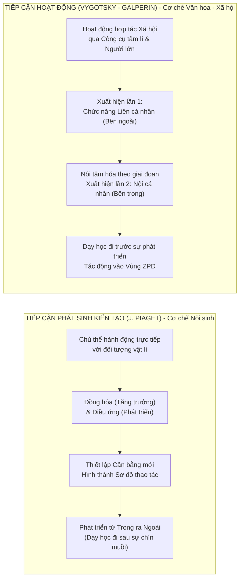

# CHƯƠNG 1: MỘT SỐ HƯỚNG TIẾP CẬN TRÍ TUỆ TRONG TÂM LÍ HỌC

> **Hướng dẫn học tập theo Phương pháp ghi chép Cornell (Cornell Note-taking System):**
> Tài liệu lí thuyết Chương 1 được thiết kế chuẩn hóa theo cấu trúc **Cornell Note-taking System** gồm 3 vùng nhận thức gắn kết chặt chẽ:
> 1. **Cột Từ khóa & Câu hỏi gợi nhớ (Cue Column - Cột trái):** Chứa các thuật ngữ cốt lõi, tên học giả, niên đại và các câu hỏi định hướng tư duy giúp người học chủ động truy xuất thông tin (Active Recall).
> 2. **Cột Ghi chú chi tiết (Note-taking Column - Cột phải):** Hệ thống hóa toàn bộ luận điểm triết học, cơ chế tâm lí, thực nghiệm kinh điển, đóng góp và hạn chế của từng trường phái nghiên cứu trí tuệ.
> 3. **Phần Tóm tắt cốt lõi (Cornell Summary - Cuối mỗi mục & cuối chương):** Cô đọng bản chất phương pháp luận và giá trị lịch sử của từng hướng tiếp cận trong vài câu súc tích.

---

## Sơ đồ tổng quan 7 hướng tiếp cận trí tuệ trong Tâm lí học

```mermaid
flowchart TD
    TT["NGHIÊN CỨU TRÍ TUỆ TRONG TÂM LÍ HỌC"] --> H1["1.1. Liên tưởng & Hành động tinh thần"]
    TT --> H2["1.2. Tiếp cận Hành vi"]
    TT --> H3["1.3. Tiếp cận Sinh học"]
    TT --> H4["1.4. Tiếp cận Hình thái (Gestalt)"]
    TT --> H5["1.5. Tiếp cận Phát sinh trí tuệ (Kiến tạo)"]
    TT --> H6["1.6. Tiếp cận Hoạt động"]
    TT --> H7["1.7. Lí thuyết thông tin - TLH Nhận thức"]

    H1 --> H1a["Thuyết Liên tưởng Anh<br>(Hartley, Mill, Spencer):<br>Tư duy tái tạo hình ảnh"]
    H1 --> H1b["Trường phái Würzburg Đức<br>(Külpe, Selz, Bühler):<br>Thao tác tinh thần nội tại"]

    H2 --> H2a["Hành vi cổ điển S-R<br>(Watson, Thorndike, Skinner):<br>Thử và sai, kĩ xảo, ngôn ngữ thầm"]
    H2 --> H2b["Hành vi mới S-S & TOTE<br>(Tolman, Miller, Galanter, Pribram):<br>Cấu trúc nhận thức & Kế hoạch hành vi"]

    H3 --> H3a["Sinh lí - Thần kinh<br>(Pavlov, Lashley, Goldstein):<br>Phản xạ có ĐK & Định khu não bộ"]
    H3 --> H3b["Tập tính học<br>(Lorenz):<br>Cơ chế dấu ấn (Imprinting)"]
    H3 --> H3c["Di truyền học & Ưu sinh<br>(Galton, Burt, Jensen, Wilson):<br>Tranh luận Bẩm sinh - Môi trường"]

    H4 --> H4a["Tâm lí học Gestalt<br>(Wertheimer, Köhler, Koffka):<br>Cấu trúc chỉnh thể, Bừng hiểu (Insight)"]

    H5 --> H5a["Tâm lí học Phát sinh J. Piaget:<br>Thích ứng (Đồng hóa - Điều ứng - Cân bằng)<br>Bản chất thao tác & 4 giai đoạn phát triển"]

    H6 --> H6a["Tâm lí học Hoạt động Xô viết<br>(Vygotsky, Leontiev, Rubinstein, Galperin):<br>Công cụ tâm lí, Nội tâm hóa, ZPD"]

    H7 --> H7a["Xử lí thông tin & Trí tuệ nhân tạo<br>(Turing, Neumann, Simon, Fischer):<br>Mô hình 3 thành tố & Mô phỏng máy tính"]
```

---

## 1.1. Tiếp cận liên tưởng và Tiếp cận hành động tinh thần

| Từ khóa / Câu hỏi gợi nhớ | Ghi chú chi tiết (Nội dung cốt lõi) |
| :--- | :--- |
| **Nền tảng triết học** *Hai hướng tiếp cận cổ điển bắt nguồn từ những trào lưu triết học đối lập nào?* | • Là hai hướng tiếp cận cổ điển tiêu biểu cho hai trường phái triết học đối lập được du nhập vào nghiên cứu tư duy, trí tuệ: • **Tiếp cận liên tưởng:** Bắt nguồn từ **triết học duy vật - duy cảm Anh** (đề cao kinh nghiệm cảm tính). • **Tiếp cận hành động tinh thần:** Bắt nguồn từ **triết học duy lí Đức** (từ I. Kant, J.G. Fichte đến G.W.F. Hegel – đề cao lí tính thuần túy bên trong). |
| **1.1.1. Thuyết liên tưởng** *Đại biểu và các luận điểm tâm lí học cơ bản của trường phái liên tưởng Anh là gì?* | • **Đại biểu chính:** Các nhà triết học, tâm lí học Anh: **D. Hartley** (D. Ghatli, 1705–1836), **J.S. Mill** (D.S. Milơ, 1806–1873), **H. Spencer** (H. Spenxơ, 1820–1903). • **Ba luận điểm nền tảng:**   1. Tâm lí (hiểu theo nghĩa yếu tố ý thức) được cấu thành từ các **cảm giác**. Cảm giác là cái thứ nhất, là cơ sở; còn biểu tượng, ý nghĩ, tình cảm... là cái thứ hai, xuất hiện nhờ **liên tưởng các cảm giác**.   2. Điều kiện hình thành liên tưởng là **sự gần gũi** của các quá trình tâm lí.   3. Các mối liên tưởng bị quy định bởi **sự linh hoạt** của các thành phần được liên tưởng và **tần số nhắc lại** của chúng trong kinh nghiệm. • **Cơ sở sinh lí thần kinh:** Sau này dựa vào cơ chế **phản xạ có điều kiện** do **I.P. Pavlov** phát hiện. |
| **Tư duy & Trí tuệ theo Thuyết liên tưởng** *Các nhà liên tưởng giải thích bản chất tư duy, phân loại liên tưởng và sự phát triển trí tuệ như thế nào?* | • **Bản chất tư duy:** Tư duy là quá trình thay đổi tự do tập hợp các hình ảnh, là sự liên tưởng các biểu tượng. Tư duy luôn là **tư duy hình ảnh** và mang tính chất **tư duy tái tạo** (quan tâm chủ yếu tới tốc độ và mức độ liên kết, tái tạo các hình ảnh/biểu tượng đã có). • **4 loại liên tưởng:**   1. Liên tưởng giống nhau.   2. Liên tưởng tương phản.   3. Liên tưởng gần nhau về không gian và thời gian.   4. **Liên tưởng nhân quả** (đóng vai trò đặc biệt quan trọng trong các quá trình trí tuệ). • **Phát triển trí tuệ & Khác biệt cá nhân:** Sự phát triển trí tuệ chỉ là quá trình **tích lũy về lượng** các mối liên tưởng. Sự khác biệt về trình độ trí tuệ được quy về **số lượng** các mối liên tưởng và **tốc độ hoạt hóa** các liên tưởng đó. • **Đánh giá & Hạn chế:** Cố gắng giải thích tâm lí theo hướng khách quan, kéo tâm lí học gần với sinh lí học; nhưng chưa thoát khỏi **tư duy siêu hình** và phương pháp quy nạp hình thức. Mới chỉ nêu nguyên tắc giải thích **máy móc** về trí tuệ mà chưa đề cập đến bản chất, cấu trúc và vai trò của trí tuệ trong hoạt động của con người. |
| **1.1.2. Tiếp cận hành động tinh thần (Trường phái Würzburg)** *Trường phái Würzburg sử dụng phương pháp gì và quan niệm thế nào về bản chất của tư duy?* | • **Đại biểu chính:** Các nhà tâm lí học Đức thuộc trường phái **Vuxbua (Würzburg)**: **O. Külpe** (O. Quynpe, 1862–1915), **O. Selz** (O. Denxơ, 1881–1944), **K. Bühler** (K. Biulơ, 1897–1963). • **Phương pháp nghiên cứu:** Thực nghiệm giải các bài toán tư duy kết hợp với **phương pháp tự quan sát (nội quan thực nghiệm)** – nghiệm thể hầu hết là các nhà tâm lí chuyên nghiệp, thường xuyên thông báo diễn biến tư duy của mình khi giải quyết nhiệm vụ. • **Luận điểm cốt lõi về bản chất tư duy:**   1. Tư duy là **hành động bên trong** của chủ thể nhằm **xem xét các mối quan hệ** (quan hệ là tất cả những gì không mang đặc điểm của hình ảnh cảm tính, là sự tổng hợp phong phú các khái niệm).   2. Quá trình tư duy diễn ra **độc lập, không cần sự hỗ trợ của các biểu tượng cảm tính rời rạc** (tư duy phi hình ảnh).   3. Hành động tư duy là công việc của **"cái tôi"** chủ thể, chịu sự định hướng của **nhiệm vụ (bài toán tư duy)**. Khi nhận ra bài toán, chủ thể biến các chỉ dẫn bên ngoài thành **tự chỉ dẫn** bên trong.   4. **Tính lựa chọn của tư duy** bị quy định bởi sự vận động của tự chỉ dẫn (tăng cường một số liên tưởng, ức chế và dập tắt các liên tưởng khác). |
| **Đóng góp của O. Selz & Đánh giá trường phái Würzburg** *Cấu trúc lại bài toán tư duy là gì? Đóng góp và hạn chế của phái Würzburg?* | • **Công trình của O. Selz (O. Denxơ):** Chỉ ra thực chất của tư duy là **sự vận hành của các thao tác trí tuệ** (phân tích, tổng hợp, trừu tượng hóa, khái quát hóa - tạo ra sự giống nhau...) để giải quyết bài toán qua nhiều giai đoạn. Trong đó, giai đoạn **nhận thức đầu bài toán và cấu trúc lại nó** để tạo ra **tình huống có vấn đề** là quan trọng nhất. Thực chất giải bài toán tư duy là quá trình **cấu trúc lại bài toán đó**. • **Đóng góp lớn:** Lần đầu tiên trong tâm lí học, tư duy/trí tuệ được nghiên cứu như một **hành động bên trong**, một quá trình vận động của các **thao tác trí tuệ** có đối tượng là các **mối quan hệ**, khắc phục quan niệm giản đơn, máy móc của thuyết liên tưởng. • **Hạn chế:** Do ảnh hưởng của **triết học duy lí Đức**, tư duy bị coi thuần túy là hành động tinh thần khép kín bên trong, tách rời các yếu tố khách quan bên ngoài (bài toán chỉ có tác dụng khởi động ban đầu, sau đó thao tác tự vận động theo lôgic nội tại). Do đó, **bản chất xã hội** và **lôgic tâm lí** của tư duy vẫn chưa được giải quyết. |

> **Tóm tắt Mục 1.1 (Cornell Summary):**
> Thuyết liên tưởng Anh và Trường phái Würzburg Đức đại diện cho hai thái cực triết học cổ điển khi nghiên cứu trí tuệ: Thuyết liên tưởng quy trí tuệ về sự kết hợp cơ học và tái tạo các hình ảnh cảm tính dựa trên kinh nghiệm (duy cảm), trong khi trường phái Würzburg phát hiện ra bản chất thao tác tinh thần và định hướng nhiệm vụ của tư duy khi giải quyết mối quan hệ (duy lí), song cả hai đều chưa thấy được nguồn gốc thực tiễn - xã hội của trí tuệ.

---

## 1.2. Tiếp cận hành vi (Thuyết hành vi cổ điển & Các học thuyết hành vi mới)

| Từ khóa / Câu hỏi gợi nhớ | Ghi chú chi tiết (Nội dung cốt lõi) |
| :--- | :--- |
| **1.2.1. Thuyết hành vi cổ điển (S - R)** *Mục tiêu ra đời, đại biểu và đối tượng nghiên cứu của Tâm lí học hành vi cổ điển là gì?* | • **Bối cảnh & Mục tiêu:** Ra đời đầu thế kỉ XX tại Mỹ nhằm khắc phục tính chủ quan, nội quan trong tâm lí học đương thời, hướng tới xây dựng nền tâm lí học khách quan. • **Đại biểu xuất sắc:** **J. Watson** (1878–1958), **E.L. Thorndike** (E.L. Toocđai, 1874–1949), **E. Tolman** (1886–1959), **B.F. Skinner** (B.Ph. Skinnơ, 1904–1990). • **Quan điểm cốt lõi:**   1. **Phủ nhận nghiên cứu ý thức:** Cho rằng ý thức không đóng vai trò điều chỉnh hoạt động và không thể nghiên cứu bằng phương pháp khách quan.   2. **Đối tượng duy nhất là Hành vi:** Tâm lí (của cả người và động vật) chỉ là các dạng hành vi – tập hợp các **phản ứng (R - Response)** của cơ thể đáp lại các **kích thích (S - Stimulus)** từ môi trường bên ngoài.   3. **Phương pháp nghiên cứu:** Quan sát khách quan và thực nghiệm (chủ yếu trên động vật như chuột, chim bồ câu rồi ngoại suy sang con người) để mô tả, lượng hóa tương quan $S - R$. |
| **Cơ chế hình thành hành vi trí tuệ & 3 dạng tư duy của J. Watson** *Hành vi trí tuệ hình thành theo cơ chế nào? Watson phân chia tư duy thành mấy dạng?* | • **Cơ sở sinh lí & Cơ chế hình thành:** Dựa trên **phản xạ có điều kiện**. Cơ chế hình thành hành vi là sự mò mẫm theo nguyên tắc **"thử và sai" (Trial and Error)** qua nhiều lần cho tới khi xác lập được phản ứng phù hợp, luyện tập và củng cố nó. Điều khiển việc hình thành hành vi trí tuệ được quy về việc sắp xếp "môi trường các kích thích" hay **"điều kiện hóa hành vi"**. • **Định nghĩa hành vi trí tuệ:** Là các phản ứng có hiệu quả mà cá thể học được nhằm đáp lại kích thích của môi trường; tư duy được coi giống như **kĩ xảo**. • **Quan điểm của J. Watson về tư duy:** Đồng nhất hành vi trí tuệ với **ngôn ngữ bên trong** và chia tư duy thành **3 dạng**:   1. **Dạng 1:** Các thói quen, kĩ xảo ngôn ngữ đơn giản (ví dụ: đọc thuộc một đoạn thơ hay đoạn văn mà không làm thay đổi trật tự từ).   2. **Dạng 2:** Giải quyết các nhiệm vụ tuy không mới nhưng ít gặp và phải có hành vi ngôn ngữ kèm theo (ví dụ: nhớ lại một đoạn thơ hay sự kiện đã thoáng qua trong kí ức).   3. **Dạng 3:** Giải quyết các nhiệm vụ mới, buộc cơ thể lâm vào hoàn cảnh phức tạp, đòi hỏi phải giải quyết bằng ngôn ngữ trước khi thực hiện hành động cụ thể. |
| **1.2.2. Sự phân hóa thành 3 nhánh Hành vi sau Watson** *Sau J. Watson, trường phái hành vi phân hóa thành những nhánh nào?* | • **Nhánh 1 - Tâm lí học hành vi bảo thủ (Thuyết $S - R$):** Trung thành với các luận điểm cơ giới ban đầu của J. Watson; đại biểu là **B.F. Skinner**. • **Nhánh 2 - Tâm lí học hành vi mới (Thuyết $S - S$):** Nghiên cứu các **yếu tố trung gian** của chủ thể trong sơ đồ kích thích - phản ứng, đó chính là **quá trình nhận thức / cấu trúc nhận thức**; đại biểu là **E. Tolman**. • **Nhánh 3 - Tâm lí học hành vi chủ quan (Thuyết TOTE):** Đại biểu là **G.A. Miller (O. Milơ), E. Galanter, K. Pribram**. TOTE là chữ viết tắt tiếng Anh của chu trình 4 bước: **T (Test - Thử/Kiểm tra) $\rightarrow$ O (Operate - Thao tác) $\rightarrow$ T (Test - Thử lại) $\rightarrow$ E (Exit - Thoát ra)**. |
| **So sánh đối chiếu 3 thuyết: $S-R$, $S-S$ và $TOTE$** *Ba học thuyết hành vi khác nhau ở 3 tiêu chí cốt lõi nào?* | • **Tiêu chí 1: Nhân tố phát động hành vi:**   ◦ *Thuyết $S-R$ (Cổ điển):* Các kích thích / phản ứng bên ngoài.   ◦ *Thuyết $S-S$ (Hành vi mới - Tolman):* Các **"cấu trúc nhận thức"**.   ◦ *Thuyết TOTE (Hành vi chủ quan):* Các quá trình ở trung ương thần kinh, trí nhớ, tâm thế, sự mong đợi... • **Tiêu chí 2: Kết quả học tập:**   ◦ *Thuyết $S-R$:* Là **kĩ xảo** (một trật tự nào đó của các cử động).   ◦ *Thuyết $S-S$:* Là **"các cấu trúc nhận thức"** (sự phản ánh một tình huống nào đó). • **Tiêu chí 3: Phương pháp ứng xử / thích ứng:**   ◦ *Thuyết $S-R$:* Phương thức thích ứng là **"thử và sai"**.   ◦ *Thuyết $S-S$:* Phụ thuộc vào **cấu trúc của tình huống khách quan** (tổ chức tình huống quy định sự hoạt hóa của cá thể và sự nắm bắt các quan hệ bản chất).   ◦ *Thuyết TOTE:* Đề cao **hình ảnh, kế hoạch của các phản ứng** (kinh nghiệm, tri thức đã có và sự chỉ dẫn quá trình tiến hành hành vi quy định chất lượng ứng xử). |
| **Đánh giá chung về Tiếp cận hành vi** *Công lao và hạn chế lớn nhất của Tâm lí học hành vi là gì?* | • **Công lao:** Đưa **tính chặt chẽ khoa học, khách quan** vào nghiên cứu trí tuệ. Muốn huấn luyện một chức năng tâm lí phải đưa chủ thể vào các điều kiện xác định, tức là **thông minh hóa nội dung dạy học theo một quy trình chặt chẽ** để quan sát và kiểm soát quá trình hình thành hành vi tâm lí (cơ sở của dạy học chương trình hóa, công nghệ dạy học). • **Hạn chế:** Cực đoan hóa yếu tố môi trường kích thích bên ngoài, coi nhẹ tính tích cực và vai trò chủ thể của người học, dẫn đến thuyết **"định mệnh xã hội"** trong dạy học và phát triển tâm lí. |

> **Tóm tắt Mục 1.2 (Cornell Summary):**
> Tiếp cận hành vi đã cách mạng hóa phương pháp nghiên cứu tâm lí học theo hướng khách quan hóa và quy trình hóa việc kiểm soát hành vi, phát triển từ mô hình cơ giới $S-R$ (thử và sai, kĩ xảo) của Watson và Skinner sang việc thừa nhận biến số trung gian nhận thức ($S-S$ của Tolman) và kế hoạch điều chỉnh hành vi ($TOTE$ của Miller, Galanter, Pribram), nhưng nhìn chung vẫn hạ thấp tính chủ thể sáng tạo và dẫn tới nguy cơ "định mệnh xã hội".

---

## 1.3. Tiếp cận sinh học

| Từ khóa / Câu hỏi gợi nhớ | Ghi chú chi tiết (Nội dung cốt lõi) |
| :--- | :--- |
| **Nguồn gốc & 3 lĩnh vực của Tiếp cận sinh học** *Tiếp cận sinh học nghiên cứu trí tuệ trên những phương diện chủ yếu nào?* | • Bắt nguồn từ thuyết tiến hóa hành vi cá thể (thu được do tập nhiễm và sự phức tạp hóa các hành vi bản năng). Khác với tâm lí học hành vi chỉ khai thác tương tác hành vi - môi trường, tiếp cận sinh học đi sâu vào **3 lĩnh vực chính**:   1. Nghiên cứu **cơ sở sinh lí - thần kinh** của hoạt động trí tuệ.   2. Nghiên cứu vai trò và sự phát triển của các **hành vi bản năng và tự tạo** (tập tính học).   3. Nghiên cứu vai trò của **yếu tố di truyền trí tuệ** giữa các thế hệ. |
| **1.3.1. Cơ sở sinh lí - thần kinh của trí tuệ** *Những công trình nào đặt nền móng cho việc giải thích cơ sở não bộ của trí tuệ?* | • **Học thuyết phản xạ và hoạt động thần kinh cấp cao:** Do các nhà sinh lí học Nga đứng đầu là **I.P. Pavlov** lĩnh xướng. Sự hình thành, dập tắt các phản xạ có điều kiện và các quy luật hoạt động thần kinh cấp cao ở người là cơ sở sinh lí - thần kinh trực tiếp của hoạt động trí tuệ. • **Lí thuyết định khu chức năng tâm lí trên não bộ:** Các công trình của **K.S. Lashley** (K.X. Lésli, nhà sinh lí học Mỹ, 1890–1958), **K. Goldstein** (K. Gônđơstêin, nhà tâm lí - sinh lí học Đức, 1878–1965) chứng minh rằng việc làm tổn thương các vùng thần kinh trên não bộ sẽ dẫn đến làm mất hoặc rối loạn khả năng tiến hành các hành động tâm lí, trí tuệ tương ứng. |
| **1.3.2. Tập tính học & Cơ chế dấu ấn (Imprinting)** *Cơ chế dấu ấn của Lorenz và tập tính học người nghiên cứu vấn đề gì?* | • **Cơ chế dấu ấn (Imprinting):** Nghiên cứu của **K. Lorenz** (R. Lorenz) cho thấy ảnh hưởng sâu sắc của **dấu ấn ban đầu** đối với các hành vi tiếp theo của cá thể. Kết quả này được vận dụng cả trong việc triển khai các thao tác trí tuệ lẫn trong ứng xử xã hội. • **Tập tính học về con người hiện nay:** Chú trọng nghiên cứu mối quan hệ giữa **các nền văn hóa, xã hội riêng** với phương thức tư duy, giải quyết các bài toán trí tuệ của các thành viên trong nền văn hóa đó (vai trò "tiềm ẩn" của yếu tố văn hóa đối với đời sống tâm lí cá nhân). |
| **1.3.3. Di truyền học trí tuệ & Thuyết ưu sinh** *Các học giả phương Tây đã đưa ra những tỉ lệ định lượng nào về di truyền và môi trường?* | • **Thuyết ưu sinh học (Eugenics):** Khởi xướng bởi nhà tâm lí học, nhân chủng học người Anh **F. Galton** (Pa. Galton, 1822–1911) với cuốn *"Thiên tài di truyền"* (1869), tuyệt đối hóa vai trò di truyền của trí thông minh. • **Các số liệu định lượng gây tranh cãi:**   ◦ **Cyril Burt** (Cyril Bua, Anh, 1966): Khẳng định trí năng con người **80% do di truyền**, **20% do môi trường**.   ◦ **A. Jensen** (1969): Đưa ra tỉ lệ **60% do di truyền** và **40% do môi trường**.   ◦ **C. Jencks** (Jensks, Mỹ, 1972): Đưa ra tỉ lệ **45% do di truyền**, **35% do môi trường** và **20% do sự tương tác** giữa hai yếu tố. • **Trường phái sinh học - xã hội (Sociobiology, 1975):** Do **E.O. Wilson** khởi xướng tại Mỹ, cho rằng do cạnh tranh xã hội nên chỉ ai có sức mạnh mới có cơ may bảo tồn và chuyển giao gen cho đời sau – cổ súy cho thuyết ưu sinh xã hội, dẫn tới phân biệt chủng tộc và đẳng cấp về trí tuệ. |
| **Thực tiễn khoa học & Nghiên cứu trẻ sinh đôi** *Khoa học chân chính đánh giá như thế nào về vai trò của di truyền đối với trí tuệ?* | • **Bằng chứng bệnh lí bẩm sinh:** Sự sai lệch nhiễm sắc thể của thai nhi hoặc khuyết tật bẩm sinh là nguyên nhân gây chậm phát triển trí khôn (như **hội chứng Down**, **bệnh đầu bé**, **bệnh đần độn do thiếu i-ốt**). • **Nghiên cứu trẻ sinh đôi cùng trứng:** Các công trình của **I.I. Kanaev** (I.I. Canáev, 1959) cũng như phân tích của **Z. Kimpling và Jarvik** (1993) đều kết luận: **Không tìm thấy ảnh hưởng quyết định tuyệt đối** của riêng yếu tố di truyền hoặc riêng yếu tố môi trường đối với sự phát triển trí tuệ. • **Kết luận phương pháp luận:** Không thể coi nhẹ yếu tố sinh học (tiền đề vật chất) của trí tuệ, nhưng tuyệt đối không được cường điệu hóa vai trò của nó dẫn đến các kết luận cực đoan, phi khoa học và phản động. |

> **Tóm tắt Mục 1.3 (Cornell Summary):**
> Tiếp cận sinh học làm sáng tỏ tiền đề vật chất của trí tuệ thông qua cơ sở hoạt động thần kinh cấp cao (Pavlov), định khu chức năng não bộ (Lashley, Goldstein) và cơ chế dấu ấn tập tính (Lorenz); đồng thời các nghiên cứu sinh đôi (Kanaev, Kimpling & Jarvik) đã bác bỏ thuyết ưu sinh cực đoan của Galton, Burt, Jensen và Wilson, khẳng định di truyền chỉ là tiền đề sinh học chứ không quyết định sẵn trình độ trí tuệ.

---

## 1.4. Tiếp cận hình thái (Gestalt / Ghestan)

| Từ khóa / Câu hỏi gợi nhớ | Ghi chú chi tiết (Nội dung cốt lõi) |
| :--- | :--- |
| **Khái niệm Gestalt & Đại biểu** *Thuật ngữ Gestalt có nghĩa là gì và những nhà tâm lí học nào sáng lập trường phái này?* | • **Khái niệm:** **Ghestan (Gestalt)** là từ tiếng Đức có nghĩa là **tổ chức, hình thể, cấu trúc hay hình thái**. • **Thời gian & Đại biểu:** Xuất hiện vào thập niên đầu thế kỉ XX tại Đức, do **M. Wertheimer** (M. Vecthâyme, 1880–1943), **W. Köhler** (V. Kolơ, 1887–1967) và **K. Koffka** (K. Copca, 1886–1941) đề xướng. Trong lĩnh vực nghiên cứu trí tuệ, người có đóng góp nổi bật nhất là **W. Köhler**. |
| **Nguyên lí cấu trúc chỉnh thể trong Tri giác và Tư duy** *Vì sao các nhà Gestalt khẳng định một tổng thể có tổ chức khác với tổng số các thành phần?* | • **Nguyên lí chỉnh thể:** Sự vật khách quan không được tiếp nhận như các kích thích riêng rẽ mà được tổ chức theo những **hình thái (Gestalt)**. Một tổng thể có tổ chức **khác về chất** so với tổng số các thành phần rời rạc của nó (Ví dụ: một bản nhạc không phải là tổng số các nốt nhạc cộng lại, mà là một cấu trúc giai điệu; thay đổi trật tự các nốt nhạc sẽ tạo ra bản nhạc mới). • **Thành tựu trong nghiên cứu Tri giác:** Phát hiện ra **tính ổn định**, **tính cấu trúc**, và quy luật lệ thuộc giữa hình ảnh đối tượng (**"hình"**) với không gian bao quanh nó (**"nền"**). |
| **Cơ chế "Bừng hiểu" (Insight) & Cấu trúc lại tình huống** *Tư duy giải quyết vấn đề diễn ra theo cơ chế nào theo quan điểm Gestalt?* | • **Trọng tâm nghiên cứu tư duy:** Quan tâm đến vai trò của hình ảnh trực giác và sự biến đổi, cải tổ các cấu trúc nhận thức (**"tổ chức lại"**, **"định hướng lại"**), giúp tư duy mang tính **sáng tạo** chứ không phải thuật toán hay liên tưởng máy móc. • **Hiện tượng "Bừng hiểu" (Insight):** Tư duy là sự hiểu biết bất ngờ (**bừng hiểu - Insight**) các quan hệ bản chất của tình huống có vấn đề, không được chuẩn bị sẵn trực tiếp bởi hoạt động phân tích trước đó và độc lập với các phép thử mò mẫm. • **Thực nghiệm của W. Köhler trên khỉ hình người (Chimpanzee):** Nghiên cứu hành vi tìm đường vòng (đường tắt), sử dụng công cụ (nối gậy, xếp chồng các hòm gỗ để lấy chuối). • **Cơ chế tâm lí của hành động thông minh:**   1. Khi lâm vào tình huống có vấn đề, chủ thể xuất hiện một **sự căng thẳng tâm lí**.   2. Trong trường tri giác, các thành phần của tình huống tạo thành một **chỉnh thể (Gestalt)**.   3. Tình huống có vấn đề được **cấu trúc lại (tổ chức lại)**, nhờ đó một bộ phận được đặt vào **quan hệ mới** và **bộc lộ thuộc tính, tính chất chức năng mới** (ví dụ: cái hòm từ chỗ là vật chứa trở thành bệ đứng). |
| **"Sức ỳ" chức năng của kinh nghiệm cũ & Giá trị ứng dụng** *Kinh nghiệm quá khứ đóng vai trò gì? Thành tựu Gestalt được ứng dụng vào trắc nghiệm nào?* | • **Đối lập với thuyết liên tưởng về vai trò của kinh nghiệm:** Thuyết Gestalt cho rằng kinh nghiệm quá khứ không những chưa đủ để giải quyết nhiệm vụ mới mà đôi khi còn **cản trở** quá trình tìm lời giải, vì nó tạo ra **"sức ỳ" về mặt chức năng (Functional Fixedness)** của đối tượng được sử dụng. • **Yêu cầu phương pháp luận của Gestalt:** Để hiểu trí tuệ người hiện đại cần nghiên cứu trí tuệ tổ tiên loài người; phải dùng **thực nghiệm** với các bài toán có **mức độ phức tạp khác nhau** để làm rõ khả năng thực sự của nghiệm thể. • **Giá trị ứng dụng hiện đại:** Phát hiện về sự phát sinh tri giác và tư duy trong trường tri giác khi cấu trúc lại bài toán là cơ sở lí luận trực tiếp của **Trắc nghiệm khuôn hình tiếp diễn (Progressive Matrices)** có độ khó tăng dần do nhà tâm lí học người Anh **J.C. Raven** soạn thảo và chuẩn hóa. |

> **Tóm tắt Mục 1.4 (Cornell Summary):**
> Tâm lí học Gestalt (Wertheimer, Köhler, Koffka) bác bỏ cả sự liên tưởng bộ phận lẫn cơ chế "thử và sai" mù quáng, giải thích hành động trí tuệ như một quá trình **cấu trúc lại trường tri giác** để nắm bắt quan hệ bản chất thông qua sự **"bừng hiểu" (Insight)** và vượt qua "sức ỳ chức năng" của kinh nghiệm cũ – đặt nền tảng lí luận cho trắc nghiệm trí tuệ phi ngôn ngữ Raven.

---

## 1.5. Tiếp cận phát sinh trí tuệ (Tiếp cận kiến tạo của J. Piaget)

| Từ khóa / Câu hỏi gợi nhớ | Ghi chú chi tiết (Nội dung cốt lõi) |
| :--- | :--- |
| **Tác giả, Điểm xuất phát & Phương pháp nghiên cứu** *J. Piaget tiếp cận trí tuệ từ góc độ nào và bằng những phương pháp gì?* | • **Tác giả:** Nhà tâm lí học vĩ đại người Thụy Sĩ **Jean Piaget** (G. Piagiê, 1896–1980) cùng các cộng sự đã kiên trì nghiên cứu suốt hơn nửa thế kỉ. • **Điểm xuất phát:** Kết hợp góc độ **sinh học** và **lôgic học**; kế thừa có phê phán quan niệm của **É. Claparède** (Claparet, 1873–1940) và **W. Stern** (U. Stecnơ, 1871–1938) coi trí tuệ là *"sự thích ứng tâm lí đối với các điều kiện mới"*, cũng như quan điểm của Gestalt. • **Định nghĩa của Piaget:** Trí tuệ là **cấu trúc tâm lí có tính chất thuận nghịch**, là **trạng thái cân bằng** cao nhất của cơ thể với môi trường. Khác với tri giác (tri thức trực tiếp), trí tuệ là **tri thức gián tiếp** nảy sinh khi hoàn cảnh có vấn đề. • **Phương pháp nghiên cứu:** Chủ yếu là **phương pháp lâm sàng tâm lí (Clinical method)**, kết hợp với trắc nghiệm và quan sát khách quan. • **Hai bộ phận hữu cơ của học thuyết:**   1. **Tâm lí học phát sinh (Psychologie Génétique):** Học thuyết về chức năng, cấu trúc và sự phát sinh, phát triển của trí tuệ.   2. **Tâm lí học lứa tuổi (Psychologie Infantile):** Học thuyết về các giai đoạn phát triển trí tuệ ở trẻ em. |
| **Hai chức năng bất biến & 4 khái niệm gốc sinh học** *Đồng hóa, Điều ứng, Sơ đồ và Cân bằng vận hành như thế nào trong sự thích ứng trí tuệ?* | • **Hai chức năng cơ bản (hai yếu tố bất biến sinh học):** **Tính tổ chức kinh nghiệm** và **Sự thích ứng**. • **4 khái niệm cốt lõi giải thích cơ chế thích ứng:**   1. **Sơ đồ / Cơ cấu (Scheme):** Cấu trúc nhận thức bao gồm một lớp các thao tác giống nhau theo một trật tự nhất định, tạo thành một thể thống nhất, bền vững.   2. **Đồng hóa (Assimilation):** Chủ thể tái lập một số đặc điểm của khách thể nhận thức và **đưa chúng vào trong các sơ đồ đã có** (chế biến kích thích cho phù hợp với sự áp đặt của cấu trúc cũ). Về lí thuyết, đồng hóa không làm thay đổi cấu trúc mà chỉ mở rộng cái đã biết $\rightarrow$ **Đồng hóa là sự tăng trưởng (về lượng)**.   3. **Điều ứng (Accommodation):** Quá trình chủ thể **biến đổi cấu trúc (sơ đồ) đã có để tạo ra cấu trúc mới** phù hợp với những đòi hỏi đa dạng của kích thích mới $\rightarrow$ **Điều ứng là sự phát triển (về chất)**.   4. **Cân bằng (Equilibrium):** Quá trình **tự cân bằng** của chủ thể giữa hai quá trình **Đồng hóa** và **Điều ứng** (khi mất cân bằng - *Déséquilibre*, chủ thể buộc phải điều ứng để thiết lập trạng thái cân bằng mới cao hơn). |
| **Bản chất thao tác (Operations) của trí tuệ** *Thao tác trí tuệ là gì, có những đặc tính nào và phát triển qua những mức độ nào?* | • **Nguồn gốc thao tác:** Trí tuệ có **bản chất thao tác** và được trẻ em tự xây dựng nên bằng chính **hành động (Action)** của mình trong mối tác động qua lại giữa chủ thể với đối tượng. • **Định nghĩa Thao tác (Operation):** Là **hành động bên trong**, nảy sinh từ các hành động có đối tượng bên ngoài nhưng đã được **rút gọn**, và đối tượng của nó không phải là sự vật có thực mà là các **hình ảnh, biểu tượng, kí hiệu**. • **3 tính chất đặc trưng của thao tác:**   1. **Tính thuận nghịch (Réversible):** Khả năng tiến hành hành động theo hai chiều ngược nhau và quay về điểm xuất phát.   2. **Tính bảo tồn (Conservation):** Nhận thức được sự bất biến của số lượng, khối lượng, thể tích... bất chấp sự thay đổi hình dạng bên ngoài.   3. **Tính liên kết (Associative):** Các thao tác kết hợp với nhau tạo thành hệ thống (cấu trúc thao tác). • **Hai mức độ phát triển thao tác:** Từ mức **thao tác cụ thể** (thao tác trên các vật liệu cụ thể, hành động thực tiễn) tiến lên mức **thao tác hình thức** (thao tác trên kí hiệu, khái niệm, mệnh đề – mức trưởng thành). |
| **Quy luật chuyển đoạn & 4 giai đoạn phát triển trí tuệ** *Đặc trưng của một giai đoạn trí tuệ là gì? Hãy nêu 4 giai đoạn phát triển theo Piaget.* | • **Hai quy luật phát triển:** Tăng trưởng liên tục từng tí một (nhờ đồng hóa) và **phát triển nhảy vọt, chuyển đoạn theo nguyên lí thống hợp (Integration)**. • **4 đặc trưng của một giai đoạn (Stade) trí tuệ:**   1. Thành tựu giai đoạn sau là sự **kế tiếp** giai đoạn trước theo trật tự hằng định.   2. Là sự **thống hợp** các cấu trúc đã có từ giai đoạn trước.   3. Mỗi giai đoạn là một **cấu trúc tổng thể các sơ đồ** chứ không phải sự xếp chồng cơ học.   4. Mỗi giai đoạn đều gồm các **cấu trúc đã có, đang có và các yếu tố chuẩn bị** cho giai đoạn tiếp sau. • **4 giai đoạn phát triển trí tuệ lớn ở trẻ em:**   1. **Giai đoạn cảm giác - vận động (Giác - động / Sensori-motor):** Từ $0$ đến $1,5 - 2$ tuổi.   2. **Giai đoạn tiền thao tác (Pre-operational):** Từ $1,5 - 2$ tuổi đến $7$ tuổi.   3. **Giai đoạn thao tác cụ thể (Concrete operational):** Từ $7 - 8$ tuổi đến $11 - 12$ tuổi.   4. **Giai đoạn thao tác hình thức (Formal operational):** Từ sau $11 - 12$ tuổi. • **4 yếu tố chi phối sự phát triển qua các giai đoạn:** (1) Sự trưởng thành và chín muồi các chức năng sinh lí thần kinh; (2) Sự luyện tập và kinh nghiệm thu được qua hành động với đối tượng; (3) Tương tác của các yếu tố xã hội; (4) **Tính chủ thể và sự phối hợp chung của hành động** (yếu tố kết nối 3 yếu tố trên thành một thể thống nhất). |
| **Đánh giá đóng góp & Hạn chế của Thuyết kiến tạo Piaget** *Vì sao nói Piaget đề cao cơ chế phát triển nội sinh và hạn chế của ông được khắc phục bởi ai?* | • **Đóng góp vĩ đại:** Xác lập cách tiếp cận phát sinh - phát triển; sáng tạo phương pháp lâm sàng tâm lí; chứng minh hoạt động trí tuệ không chỉ tái lập vật thể bên ngoài mà **làm thay đổi chính cấu trúc của chủ thể nhận thức**; phân chia hệ thống các giai đoạn phát triển. • **Hạn chế phương pháp luận:**   1. Sử dụng quá nhiều khái niệm sinh học, toán học và lôgic học, biến trí tuệ thành hệ thống **lôgic - sinh học, cấu trúc toán** mà **bỏ qua bản chất và nội dung văn hóa - xã hội**.   2. Đề cao tuyệt đối yếu tố **tự hành động nội sinh** của trẻ (trẻ tự phát triển trí tuệ từ bên trong, sau đó xã hội mới thâm nhập vào để "nhuộm màu" và xã hội hóa cái đã có), chưa đánh giá đúng **vai trò định hướng của người lớn và dạy học**.   3. Chưa làm rõ cơ chế **chuyển hóa từ hành động bên ngoài thành thao tác bên trong**.   4. Cố định hóa các giai đoạn phát triển theo tuổi sinh học (trong khi thực nghiệm của **P.Ya. Galperin** chứng minh rằng với dạy học phát triển, trẻ có thể hình thành các thao tác trí tuệ sớm hơn nhiều so với mốc tuổi của Piaget). |

> **Tóm tắt Mục 1.5 (Cornell Summary):**
> Học thuyết kiến tạo phát sinh của J. Piaget là đỉnh cao của tâm lí học thế kỉ XX khi giải thích sự phát triển trí tuệ như quá trình chủ thể tự kiến tạo hệ thống **thao tác có tính thuận nghịch và bảo tồn** thông qua cơ chế **Đồng hóa – Điều ứng – Cân bằng** trải qua **4 giai đoạn hằng định** (Giác động $\rightarrow$ Tiền thao tác $\rightarrow$ Thao tác cụ thể $\rightarrow$ Thao tác hình thức); tuy nhiên, việc quy sự phát triển về cơ chế thích nghi nội sinh sinh học - lôgic đã khiến Piaget xem nhẹ nguồn gốc lịch sử - xã hội và vai trò chủ đạo của dạy học.

---

## 1.6. Tiếp cận hoạt động (Tâm lí học hoạt động Xô viết)

| Từ khóa / Câu hỏi gợi nhớ | Ghi chú chi tiết (Nội dung cốt lõi) |
| :--- | :--- |
| **Đại biểu, Nền tảng triết học & Cách mạng phương pháp luận** *Tiếp cận hoạt động đã giải quyết mâu thuẫn giữa Tâm lí học nội quan và Tâm lí học hành vi như thế nào?* | • **Đại biểu kiệt xuất:** Các nhà tâm lí học Nga Xô viết: **L.S. Vygotsky** (L.X. Vưgôtxki), **A.N. Leontiev** (A.N. Lêônchiép), **S.L. Rubinstein** (X.L. Rubinstêin), **P.Ya. Galperin** (P.Ia. Galpêrin)... Hình thành từ những năm 1930 và đạt đỉnh cao lí luận vào những năm 1975. • **Nền tảng phương pháp luận:** Dựa trên **Triết học duy vật biện chứng và duy vật lịch sử** với luận điểm gốc: Con người tự làm ra chính bản thân mình bằng lao động và hoạt động xã hội; ý thức là sự phản ánh thực tiễn đời sống vật chất. • **Cuộc cách mạng đối tượng & phương pháp:** Khắc phục sự bế tắc của Tâm lí học hành vi (bỏ rơi ý thức) và Tâm lí học nội quan (nghiên cứu ý thức một cách chủ quan) bằng cách **đưa ý thức trở lại làm đối tượng nghiên cứu nhưng thông qua việc phân tích khách quan hoạt động thực tiễn**. Chìa khóa là phát hiện quy luật chuyển hóa từ **hoạt động vật chất bên ngoài thành hoạt động tâm lí bên trong (nội tâm hóa)** và ngược lại (**ngoại tâm hóa**). • **Hai nguyên tắc phương pháp luận trụ cột:** **Nguyên tắc gián tiếp** và **Nguyên tắc lịch sử - phát sinh**. |
| **Hai mức độ trí tuệ & Vai trò của Công cụ tâm lí (Vygotsky)** *Trí tuệ bậc cao khác trí tuệ bậc thấp ở điểm cốt lõi nào?* | • **Phân biệt 2 mức độ trí tuệ (L.S. Vygotsky):**   1. **Trí tuệ bậc thấp (tự nhiên):** Có phần giống trí tuệ động vật (như trong thực nghiệm của Köhler, Stern trên khỉ), đặc trưng bởi mối quan hệ **trực tiếp** Kích thích – Phản ứng ($S - R$).   2. **Trí tuệ bậc cao (văn hóa - người):** Chỉ có ở con người, đặc trưng bởi sự tham gia của **ngôn ngữ** và mối quan hệ **gián tiếp** giữa chủ thể với đối tượng thông qua **công cụ tâm lí (kí hiệu tâm lí - Psychological Tools)**. • **Nguồn gốc xã hội - lịch sử:** Môi trường văn hóa - xã hội không chỉ là "điều kiện" tương tác mà chính là **nguồn gốc** của sự phát triển trí tuệ. Trí tuệ cấp cao hình thành theo **cơ chế lĩnh hội** các kinh nghiệm xã hội - lịch sử, dùng công cụ tâm lí để cải tổ các chức năng bậc thấp thành cấu trúc mới. |
| **Quy luật hình thành chức năng tâm lí cấp cao & Các bước của Galperin** *Quy luật "hai lần xuất hiện" của Vygotsky được phát biểu như thế nào?* | • **Quy luật phổ biến về sự hình thành các chức năng tâm lí cấp cao (L.S. Vygotsky):**   *"Bất kì chức năng tâm lí cấp cao nào của trẻ em trong quá trình phát triển cũng đều được thể hiện **hai lần**: **Lần đầu** là hoạt động tập thể, hoạt động xã hội, tức là **chức năng tâm lí bên ngoài** (liên cá nhân - Interpsychological). **Lần thứ hai** là hoạt động cá nhân, là phương pháp bên trong của tư duy trẻ em, tức là **chức năng tâm lí bên trong** (nội cá nhân - Intrapsychological)."* • **Cơ chế chuyển hóa theo giai đoạn (P.Ya. Galperin):** Quá trình chuyển hóa từ hoạt động vật chất bên ngoài thành hành động trí tuệ bên trong không diễn ra tức thời mà trải qua một hệ thống các khâu, **các bước hình thành hành động trí tuệ theo giai đoạn** cùng với cơ sở định hướng của hành động. |
| **Hoạt động chủ đạo, Hợp tác với người lớn & Vùng phát triển gần nhất (ZPD)** *Vì sao dạy học phải đi trước sự phát triển và hướng vào vùng phát triển gần nhất?* | • **Vai trò của Hoạt động chủ đạo (A.N. Leontiev):** Trí tuệ trẻ em được hình thành bằng chính hoạt động của trẻ, đặc biệt phụ thuộc vào **hoạt động chủ đạo** trong từng giai đoạn lứa tuổi. • **Vai trò trung gian của người lớn & Dạy học tương tác:** Trẻ em không thể tự mình phát triển trí tuệ đơn độc **"theo kiểu Robinson"**. Mọi hoạt động của trẻ với thế giới đồ vật đều có **người lớn làm trung gian**. Trí tuệ bậc cao là sản phẩm của sự **hoạt động và hợp tác** giữa trẻ với người lớn $\rightarrow$ **Dạy học hợp tác (tương tác)** giữa hai chủ thể (người dạy - người học) là phương thức hiệu quả nhất. • **Dạy học phát triển & Vùng phát triển gần nhất (ZPD - Zone of Proximal Development):** Dạy học chân chính không được đi sau phụ họa cho sự phát triển mà **phải đi trước sự phát triển, kéo theo sự phát triển**; không chỉ hướng vào trình độ hiện thời mà phải tác động vào **vùng phát triển gần nhất** trong trí tuệ của học sinh. • **Lưu ý hạn chế cần tránh:** Vì nhấn mạnh cơ chế **lĩnh hội (tái tạo kinh nghiệm xã hội)** nên nếu không xác định đúng giới hạn của sự lặp lại sẽ dễ dẫn đến **coi nhẹ yếu tố sáng tạo cá nhân** (điều mà Gestalt, Piaget và Lí thuyết thông tin rất đề cao). |

> **Tóm tắt Mục 1.6 (Cornell Summary):**
> Tiếp cận hoạt động (Vygotsky, Leontiev, Rubinstein, Galperin) đã tạo nên cuộc cách mạng triệt để khi khẳng định **nguồn gốc lịch sử - văn hóa - xã hội** của trí tuệ người: trí tuệ bậc cao mang tính **gián tiếp thông qua công cụ tâm lí (ngôn ngữ)**, hình thành qua cơ chế **nội tâm hóa (xuất hiện 2 lần: từ xã hội bên ngoài vào cá nhân bên trong)** gắn với **hoạt động chủ đạo**, sự hợp tác với người lớn và nguyên lí **dạy học đi trước sự phát triển (tác động vào Vùng phát triển gần nhất - ZPD)**.

---

## Sơ đồ so sánh Cơ chế phát triển trí tuệ: J. Piaget vs. L.S. Vygotsky & P.Ya. Galperin

---

## 1.7. Tiếp cận lí thuyết thông tin - Tâm lí học nhận thức

| Từ khóa / Câu hỏi gợi nhớ | Ghi chú chi tiết (Nội dung cốt lõi) |
| :--- | :--- |
| **Bối cảnh ra đời, Tác giả tiên phong & 2 hướng nghiên cứu lớn** *Sự ra đời của máy tính và điều khiển học đã mở ra hai hướng nghiên cứu trí tuệ nào?* | • **Bối cảnh & Niên đại:** Ra đời vào những năm **1950** nhờ sự thâm nhập mạnh mẽ của lí thuyết thông tin, điều khiển học và kĩ thuật máy tính, đồng thời khai sinh lĩnh vực **Trí tuệ nhân tạo (Artificial Intelligence - AI)**. • **Những người tiên phong:** Nhà toán học, triết học người Anh **Alan Turing** (1912–1954), nhà toán học Mỹ gốc Hungary **J. von Neumann** (1903–1957), tiếp đến là **A. Newell** (A. Niuel), **H.A. Simon** (T. Saimon), **M. Minsky** (M. Minski), **J. McCarthy** (J. Macati). • **Hai hướng nghiên cứu lớn:**   1. **Hướng thứ nhất (Tâm lí học nhận thức):** Phân tích và mô tả hoạt động trí tuệ, nhận thức của con người theo **cơ chế tiếp nhận và xử lí thông tin**.   2. **Hướng thứ hai (Trí tuệ nhân tạo & Mô phỏng):** Phân tích và **mô phỏng các cơ chế hoạt động của trí óc** con người trên máy tính (lí thuyết giải bài toán suy luận, lí thuyết may rủi, ngôn ngữ trí tuệ nhân tạo, nhận dạng mẫu, người máy, mạng thần kinh nhân tạo...). |
| **Mô hình 3 thành tố xử lí thông tin của R. Fischer (1992)** *R. Fischer mô tả bộ máy xử lí thông tin của não bộ qua 3 thành tố nào?* | • **Các tác giả tiêu biểu hướng thứ nhất:** **E. Tolman** (1970), **E. Tulving** (1972) và đặc biệt là **R. Fischer** (1992). • **Mô hình 3 thành tố hoạt động trí tuệ của R. Fischer (1992):** Xem não bộ là bộ máy xử lí thông tin gồm:   1. **Thành tố tiếp nhận thông tin (Đầu vào - Input):** Tiếp nhận các ngữ liệu mới thông qua hoạt động thể chất và các giác quan.   2. **Thành tố thể hiện (Đầu ra - Output):** Cái mà cá nhân tạo ra như sự phản ánh của trí nhớ, các ý tưởng và hành động giải quyết vấn đề.   3. **Thành tố điều khiển (Siêu thành tố - Metacomponent):** Các quá trình điều khiển trí nhớ, lập kế hoạch, lựa chọn chiến lược và ra quyết định. • **Quan điểm đa dạng trí tuệ của Fischer:** Con người có nhiều dạng trí tuệ: **ngôn ngữ, lôgic - toán, hình tượng/không gian, âm nhạc, vận động, trí tuệ xã hội (giao tiếp)**; mỗi dạng đều vận hành như một bộ máy tiếp nhận và xử lí thông tin chuyên biệt. |
| **Tổng kết phương pháp luận toàn Chương 1** *Thái độ khoa học đúng đắn khi tiếp cận các trường phái tâm lí học về trí tuệ là gì?* | • Mỗi hướng tiếp cận ra đời trong bối cảnh lịch sử - xã hội xác định, thường tuyệt đối hóa khía cạnh mình phát hiện nên vừa có **đóng góp tích cực** vừa có **hạn chế cực đoan**. • **Quan điểm hiện đại:** Không bài xích phủ nhận sạch trơn nhưng cũng **tránh khuynh hướng chiết trung, lắp ghép máy móc**. • **Tư tưởng chủ đạo:** Đứng vững trên lập trường **triết học duy vật biện chứng và lịch sử**, lấy các nguyên tắc phương pháp luận của **Tâm lí học hoạt động** làm nền tảng để phân tích, đánh giá, kế thừa và tích hợp tinh hoa của tất cả các hướng tiếp cận. |

> **Tóm tắt Mục 1.7 (Cornell Summary):**
> Tiếp cận lí thuyết thông tin và Tâm lí học nhận thức (từ những năm 1950 với Turing, Neumann, Newell, Simon, Minsky, McCarthy, Tulving, Fischer) đã hiện đại hóa việc nghiên cứu trí tuệ bằng cách mô hình hóa não bộ như hệ thống xử lí thông tin gồm **3 thành tố (Đầu vào – Siêu thành tố điều khiển – Đầu ra)** và mở ra kỉ nguyên **Trí tuệ nhân tạo (AI)**.

---

## Tóm tắt toàn chương (Cornell Summary)

1. **Tiếp cận Liên tưởng (Hartley, Mill, Spencer) & Hành động tinh thần Würzburg (Külpe, Selz, Bühler):** Đại diện cho sự đối lập giữa duy cảm Anh (quy tư duy về liên tưởng, tái tạo hình ảnh cảm tính) và duy lí Đức (phát hiện bản chất thao tác tinh thần phi hình ảnh và việc cấu trúc lại bài toán, nhưng tách rời tư duy khỏi thế giới khách quan).
2. **Tiếp cận Hành vi (Watson, Skinner, Tolman, Miller - Galanter - Pribram):** Đưa phương pháp khách quan vào tâm lí học, đi từ công thức cơ giới $S-R$ (thử và sai, kĩ xảo, ngôn ngữ thầm) đến việc bổ sung cấu trúc nhận thức trung gian ($S-S$) và kế hoạch hành vi ($TOTE$), đặt cơ sở cho quy trình hóa dạy học nhưng mắc sai lầm "định mệnh xã hội".
3. **Tiếp cận Sinh học (Pavlov, Lashley, Goldstein, Lorenz, Galton, Kanaev):** Khẳng định cơ sở thần kinh cấp cao, định khu não bộ và cơ chế dấu ấn tập tính, đồng thời thông qua các nghiên cứu sinh đôi cùng trứng để bác bỏ thuyết ưu sinh di truyền cực đoan (Burt, Jensen, Wilson).
4. **Tiếp cận Hình thái - Gestalt (Wertheimer, Köhler, Koffka):** Khám phá tính chỉnh thể của tri giác và cơ chế giải quyết vấn đề thông qua sự **"bừng hiểu" (Insight)** nhờ cấu trúc lại trường tri giác, vượt qua "sức ỳ chức năng" của kinh nghiệm cũ, làm cơ sở cho trắc nghiệm Raven.
5. **Tiếp cận Phát sinh trí tuệ - Kiến tạo (J. Piaget):** Giải thích trí tuệ như hệ thống **thao tác thuận nghịch** được chủ thể tự kiến tạo qua cơ chế thích ứng (**Đồng hóa – Điều ứng – Cân bằng**) phát triển qua **4 giai đoạn hằng định** (Giác động, Tiền thao tác, Thao tác cụ thể, Thao tác hình thức), nhưng tuyệt đối hóa tính nội sinh lôgic - sinh học.
6. **Tiếp cận Hoạt động (Vygotsky, Leontiev, Rubinstein, Galperin):** Khẳng định bản chất **lịch sử - văn hóa - xã hội** của trí tuệ bậc cao (sử dụng **công cụ tâm lí/kí hiệu**, hình thành qua **quy luật 2 lần xuất hiện / nội tâm hóa theo giai đoạn**), đề cao vai trò trung gian của người lớn và nguyên lí **dạy học đi trước sự phát triển (Vùng phát triển gần nhất - ZPD)**.
7. **Tiếp cận Lí thuyết thông tin - Tâm lí học nhận thức (Turing, Neumann, Simon, Fischer):** Giải mã trí tuệ dưới góc độ hệ thống xử lí thông tin (**Đầu vào – Siêu thành tố điều khiển – Đầu ra**) và mô phỏng nhận thức bằng **Trí tuệ nhân tạo (AI)**.

---

## Câu hỏi tự kiểm tra nhanh (Self-Testing Cues)

1. Vì sao nói thuyết liên tưởng chỉ xem tư duy là "tư duy tái tạo", trong khi trường phái Würzburg lại coi giải quyết bài toán là quá trình "cấu trúc lại bài toán"?
2. Phân tích sự khác biệt giữa thuyết hành vi cổ điển ($S-R$), thuyết hành vi mới ($S-S$) và thuyết hành vi chủ quan ($TOTE$) trên 3 tiêu chí: nhân tố phát động, kết quả học tập và phương pháp ứng xử.
3. Hiện tượng "bừng hiểu" (Insight) và "sức ỳ chức năng" trong tâm lí học Gestalt được giải thích như thế nào qua các thực nghiệm của W. Köhler?
4. Phân biệt "Đồng hóa" (Assimilation) và "Điều ứng" (Accommodation) trong lí thuyết của J. Piaget. Tại sao Piaget khẳng định "Đồng hóa là tăng trưởng, Điều ứng là phát triển"?
5. Phát biểu quy luật hình thành các chức năng tâm lí cấp cao của L.S. Vygotsky và giải thích ý nghĩa sư phạm của khái niệm "Vùng phát triển gần nhất" (ZPD).
6. Trình bày mô hình 3 thành tố xử lí thông tin của R. Fischer (1992) và hai hướng nghiên cứu chính của tiếp cận lí thuyết thông tin trong tâm lí học trí tuệ.
