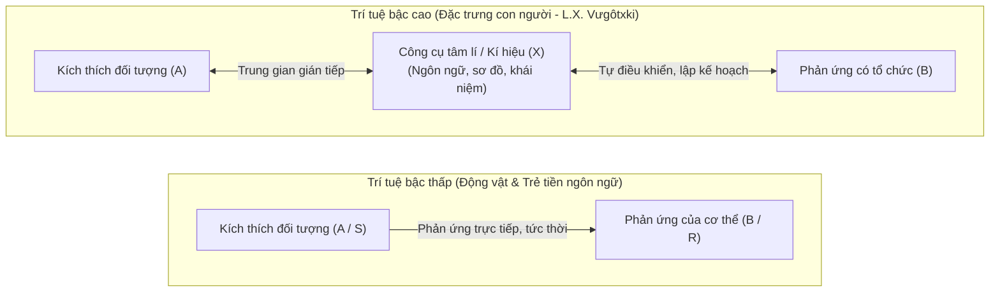

# CHƯƠNG 2: CẤU TRÚC CỦA TRÍ TUỆ

> **Phương pháp ghi chép Cornell (Cornell Note-taking System):**
> Tài liệu lý thuyết Chương 2 được biên soạn theo cấu trúc ghi chép Cornell gồm 3 phần cốt lõi giúp tối ưu hóa việc lĩnh hội, hệ thống hóa và ôn tập kiến thức:
> 1. **Cột Từ khóa / Câu hỏi gợi nhớ (Cue Column - bên trái):** Nêu các thuật ngữ trọng tâm, tên tác giả, mô hình lý thuyết và câu hỏi định hướng nhằm kích hoạt trí nhớ chủ động khi tự kiểm tra.
> 2. **Cột Ghi chú chi tiết (Note-taking Column - bên phải):** Trình bày đầy đủ nội dung học thuật, luận điểm, phân loại, ví dụ thực nghiệm và đánh giá ưu - nhược điểm của từng mô hình cấu trúc trí tuệ theo đúng giáo trình *Tâm lý học Trí tuệ*.
> 3. **Phần Tóm tắt cốt lõi (Cornell Summary - cuối mỗi mục và cuối chương):** Cô đọng bản chất lý luận và ý nghĩa sư phạm của từng nhóm mô hình.

Trí tuệ con người không phải là một khối thống nhất đơn giản mà là một cấu trúc tâm lí phức tạp gồm nhiều thành phần, nhiều tầng bậc có quan hệ chế ước lẫn nhau. Lịch sử nghiên cứu cấu trúc trí tuệ đi từ các mô hình hai thành phần và đa nhân tố (dựa trên phương pháp phân tích nhân tố gắn với trắc nghiệm tâm lí) đến các mô hình phân tích theo đơn vị (nhấn mạnh bản chất văn hóa - xã hội, công cụ tâm lí và tính chỉnh thể đa dạng của trí tuệ).

```mermaid
flowchart TD
    A["Cấu trúc của Trí tuệ (Chương 2)"] --> B["2.1. Khái niệm trí tuệ"]
    A --> C["2.2. Mô hình cấu trúc hai thành phần"]
    A --> D["2.3. Mô hình cấu trúc đa nhân tố"]
    A --> E["2.4. Mô hình cấu trúc theo phân tích đơn vị"]

    B --> B1["Thuật ngữ: Trí tuệ, trí khôn, trí thông minh, trí năng, trí lực"]
    B --> B2["3 nhóm định nghĩa: Học tập/Lao động - Tư duy trừu tượng - Thích ứng"]
    B --> B3["4 đặc trưng cơ bản của trí tuệ"]

    C --> C1["C. Spearman (1904): Nhân tố G (chung) & Nhân tố S (chuyên biệt)"]
    C --> C2["Menchinxcaia & Canbanova-Menle: Tri thức đối tượng & Thủ thuật trí tuệ"]
    C --> C3["Cattell (Trí lỏng - Trí tinh luyện), Hebb (Trí A - Trí B)"]
    C --> C4["Jensen (Trình độ I - II), Nguyễn Khắc Viện (Trí làm - Trí nghĩ)"]

    D --> D1["L.L. Thurstone: 7 năng lực tinh thần cơ bản (N, V, W, S, M, P, R)"]
    D --> D2["J.P. Guilford: Khối vuông 5x4x6=120 yếu tố; Tư duy hội tụ & phân kì"]
    D --> D3["R.J. Sternberg: Thuyết 3 thành phần (Cấu trúc - Kinh nghiệm - Ngữ cảnh)"]
    D --> D4["D.N. Perkins: Năng lực + Thủ thuật + Chuyên môn; 3 cấp độ học tư duy"]

    E --> E1["Phân biệt Phân tích nhân tố vs Phân tích đơn vị (Ví dụ H2O, Hàng hóa)"]
    E --> E2["L.X. Vưgôtxki: Trí tuệ bậc thấp (S-R) & Trí tuệ bậc cao (A - X - B)"]
    E --> E3["H. Gardner (1983): 8 tiêu chí nhận diện & 7 dạng trí tuệ độc lập"]
```

---

## 2.1. Khái niệm trí tuệ

| Từ khóa / Câu hỏi gợi nhớ | Ghi chú chi tiết (Nội dung cốt lõi) |
|---|---|
| **Sự đa dạng thuật ngữ và gốc từ Latinh** | Trong khoa học và đời sống sinh hoạt có rất nhiều tên gọi chỉ lĩnh vực trí tuệ: *trí tuệ, trí khôn, trí lực, trí thông minh, trí óc, trí làm, trí nghĩ*. - **Trong tiếng Latinh:** Trí tuệ có nghĩa là hiểu biết, thông tuệ. - **Trong tiếng Anh và tiếng Pháp:** Tương ứng với thuật ngữ *Intelligence*. |
| **Giải thích trong Từ điển Tiếng Việt** | - **Trí khôn:** Khả năng suy nghĩ và hiểu biết. - **Trí tuệ:** Khả năng nhận thức lí tính đạt đến một trình độ nhất định (ví dụ: *Trí tuệ minh mẫn*). - **Trí năng:** Năng lực hiểu biết (ví dụ: *Phát triển trí năng của con người*). - **Trí lực:** Năng lực trí tuệ (ví dụ: *Tập trung trí lực vào công việc*). - **Trí óc:** Óc của con người, được coi là biểu trưng của khả năng nhận thức, tư duy (ví dụ: *Mở mang trí óc*). - **Trí thông minh:** Có 2 nghĩa: (1) Có trí lực tốt, hiểu nhanh, tiếp thu nhanh (*Một cậu bé thông minh*); (2) Nhanh trí và khôn khéo, tài tình trong cách ứng đáp đối phó (*Câu trả lời thông minh*). |
| **Quan niệm của các học giả Việt Nam về các thuật ngữ** | - **Nguyễn Khắc Viện (1991):** Phân biệt rõ *trí khôn* và *trí tuệ*. **Trí khôn** là khả năng hành động thích nghi với những biến động của hoàn cảnh, thiên về hành động. **Trí tuệ** cũng là khả năng thích nghi nhưng thiên về tư duy trừu tượng. - **Phạm Hoàng Gia (1979), Nguyễn Kế Hào (1985):** Coi **trí thông minh** là một phẩm chất cao của trí tuệ, mà cốt lõi là tính chủ động, linh hoạt và sáng tạo của tư duy để giải quyết tối ưu vấn đề nào đó trong những tình huống mới, phức tạp. - **Hệ thống hóa thuật ngữ:** Có thể quy *trí khôn, trí tuệ, trí thông minh* vào khái niệm **trí tuệ** (thể hiện các mức độ khác nhau của khái niệm này); còn *trí năng, trí lực* thuộc bình diện năng lực hoạt động trí tuệ của cá nhân. |
| **3 nhóm định nghĩa chính về trí tuệ là gì?** | Tuy có rất nhiều định nghĩa khác nhau, có thể khái quát tương đối thành **3 nhóm chính**: 1. **Nhóm 1:** Coi trí tuệ là khả năng hoạt động lao động và học tập của cá nhân. 2. **Nhóm 2:** Đồng nhất trí tuệ với năng lực tư duy trừu tượng của cá nhân. 3. **Nhóm 3:** Coi trí tuệ là năng lực thích ứng tích cực của cá nhân. |
| **Nhóm 1: Khả năng học tập và lao động (Ananhev, Binet)** | - **B.G. Ananhev (Nga):** Trí tuệ là đặc điểm tâm lí phức tạp của con người mà kết quả của công việc học tập và lao động phụ thuộc vào nó. - Giữa kết quả học tập và khả năng trí tuệ có quan hệ nhân quả nhưng **không phải là quan hệ tương ứng 1-1**. - **A. Binet (1857–1911):** Ngay từ năm 1905, bằng trắc nghiệm (test trí lực), ông đã xác định được những học sinh học kém do khả năng trí tuệ và tách biệt với những em học kém do lười biếng hoặc do nguyên nhân khác. |
| **Nhóm 2: Đồng nhất trí tuệ với năng lực tư duy trừu tượng** | - Quy hẹp khái niệm trí tuệ vào thành phần cốt lõi của nó là **tư duy** và gần như đồng nhất chúng với nhau. - **Đại biểu:** A. Binet (1905), L. Terman (1937), G.X. Côtxchuc (1971), V.A. Cruchetxki (1976), R. Sternberg (1986), D.N. Perkins (1987). |
| **Nhóm 3: Năng lực thích ứng tích cực của cá nhân** | Đây là nhóm quan niệm phổ biến hơn cả, thu hút nhiều nhà nghiên cứu lớn: **U. Sterner (U. Stern), G. Piagie, Đ. Wechsler, R. Zazzo, F. Raynal, A. Rieunier, N. Sillamy**: - **G. Piagie (1969):** Bất kì trí tuệ nào cũng đều là một sự thích ứng. - **Đ. Wechsler (1939):** Trí tuệ là khả năng tổng thể để hoạt động một cách có suy nghĩ, tư duy hợp lí, chế ngự được môi trường xung quanh. - **F. Raynal & A. Rieunier (1997):** Trí tuệ là khả năng xử lí thông tin để giải quyết vấn đề và nhanh chóng thích nghi với tình huống mới. - **N. Sillamy (1997):** Trí tuệ là khả năng hiểu các mối quan hệ sẵn có giữa các yếu tố của tình huống và thích nghi để thực hiện cho lợi ích bản thân. |
| **Quan niệm của Gestalt và các nhà trắc nghiệm học** | - **Tâm lí học Ghestan (Gestalt):** Quan tâm nhiều đến thành phần sáng tạo trong các thao tác trí tuệ của cá nhân. - **Các nhà trắc nghiệm học:** Quan tâm tới hiệu quả thực hiện các bài tập trắc nghiệm, định nghĩa đơn giản *"trí tuệ là cái mà trắc nghiệm đo được"*. Do tính chất thực dụng, loại định nghĩa này không thể làm định hướng lí luận trong nghiên cứu thực tiễn. |
| **4 đặc trưng cơ bản của trí tuệ là gì?** | Các quan niệm về trí tuệ không loại trừ nhau mà chỉ khác ở khía cạnh được nhấn mạnh. Để hiểu bao quát, cần tính đến **4 đặc trưng cơ bản**: 1. Trí tuệ là **yếu tố tâm lí có tính độc lập tương đối** với các yếu tố tâm lí khác của cá nhân. 2. Trí tuệ có **chức năng đáp ứng mối quan hệ tác động qua lại giữa chủ thể với môi trường sống**, tạo ra sự thích ứng tích cực của cá nhân. 3. Trí tuệ **được hình thành và biểu hiện trong hoạt động** của chủ thể. 4. Sự phát triển của trí tuệ **chịu ảnh hưởng của yếu tố sinh học** của cơ thể và **chịu sự chế ước của các yếu tố văn hóa - xã hội**. |

> **Tóm tắt Mục 2.1 (Cornell Summary):** Thuật ngữ *trí khôn, trí tuệ, trí thông minh* phản ánh các mức độ khác nhau của khái niệm trí tuệ (từ hành động thích nghi cụ thể đến tư duy trừu tượng và phẩm chất sáng tạo cao), trong khi *trí năng, trí lực* chỉ năng lực hoạt động trí tuệ. Các định nghĩa về trí tuệ tập trung vào 3 nhóm (năng lực học tập/lao động, năng lực tư duy trừu tượng, năng lực thích ứng tích cực) và hội tụ ở 4 đặc trưng cốt lõi: tính độc lập tương đối, chức năng thích ứng tích cực, hình thành và biểu hiện qua hoạt động, chịu ảnh hưởng của sinh học và sự chế ước của văn hóa - xã hội.

---

## 2.2. Mô hình cấu trúc trí tuệ hai thành phần

| Từ khóa / Câu hỏi gợi nhớ | Ghi chú chi tiết (Nội dung cốt lõi) |
|---|---|
| **Bối cảnh xuất hiện mô hình hai thành phần** | Đầu thế kỉ XX, trong các công trình của A. Binet và Th. Simon, trí tuệ được coi như một khối chung thống nhất (*"phán đoán tốt, hiểu biết tốt, lập luận tốt"*). Câu hỏi đặt ra là trí tuệ có phải một khối thống nhất hay gồm nhiều yếu tố? Hướng tiếp cận **phân tích nhân tố (phân tích yếu tố)** đã dẫn đến sự ra đời của các mô hình cấu trúc trí tuệ hai thành phần. |
| **2.2.1. Mô hình trí tuệ của C. Spearman (1863–1945)** | Nhà tâm lí học người Anh C. Spearman từ năm **1904** khẳng định trí tuệ không phải một khối duy nhất mà là cấu trúc có các thành phần theo thứ bậc: - **Nhân tố G (General - Yếu tố chung):** Như tính linh hoạt, sự mềm dẻo thần kinh... tạo ra năng lực tâm lí chung định hướng cho mọi hoạt động và đảm bảo hiệu quả thực hiện nhiều trắc nghiệm khác nhau. - **Nhân tố S (Special - Yếu tố chuyên biệt):** Hiểu biết và năng khiếu riêng đảm bảo sự thành công trong từng hoạt động chuyên biệt (như làm toán, chơi nhạc...). - **Đánh giá:** Giá trị thực tiễn không cao vì quá chung và trừu tượng, nhưng có đóng góp lịch sử to lớn là **mở ra phương pháp phân tích nhân tố** trong nghiên cứu và soạn thảo trắc nghiệm đo lường trí tuệ. |
| **2.2.2. Mô hình của N.A. Menchinxcaia & E.N. Canbanova-Menle** | Cấu trúc trí tuệ gồm **2 thành phần**: 1. **Tri thức về đối tượng (cái được phản ánh):** Là nguyên liệu, phương tiện của hoạt động trí tuệ (*"một cái đầu trống rỗng không thể suy nghĩ được; cái đầu càng có nhiều kinh nghiệm và tri thức thì càng có nhiều khả năng suy luận hơn"*). Thể hiện ở số lượng khái niệm khoa học, cách kết hợp và độ bền vững kết cấu của nó. 2. **Các thủ thuật trí tuệ (phương thức phản ánh):** Là hệ thống các thao tác được hình thành đặc biệt để giải quyết nhiệm vụ theo một kiểu nhất định. - **Ý nghĩa sư phạm:** Phát triển trí tuệ cho trẻ không được chỉ tăng số lượng tri thức (dẫn đến **nhồi nhét** trong dạy học) hoặc chỉ rèn thủ thuật trống rỗng, mà phải phát triển đồng thời cả hai. - **Hạn chế:** Còn quá trừu tượng, mới chủ yếu quan tâm tới các thao tác trí óc mà chưa đề cập hàng loạt thao tác khác (kể cả thao tác vật chất). |
| **Mô hình của R. Cattell (1967): Trí lỏng & Trí tinh luyện** | Chia trí tuệ cá nhân thành 2 thành phần: - **Trí tuệ lỏng (Fluid Intelligence):** Có từ khi mới sinh (bẩm sinh), là cơ sở cho các khả năng tư duy, trí nhớ, khả năng lập luận... - **Trí tuệ tinh luyện (Crystallized Intelligence):** Bao gồm những kiến thức, kĩ năng thu được qua học tập và kinh nghiệm trong suốt cả đời người. |
| **Mô hình của D. Hebb (1974): Trí tuệ A & Trí tuệ B** | Chia trí tuệ thành 2 phần: - **Trí tuệ A:** Tiềm năng sinh học có từ khi mới sinh, là nguyên liệu cơ bản cho sự phát triển các năng lực trí tuệ sau này. - **Trí tuệ B:** Kết quả của sự tương tác giữa trí tuệ A với môi trường sống và giáo dục. |
| **Mô hình của A. Jensen (1969): Trình độ I & Trình độ II** | Chia trí tuệ thành 2 mức độ: - **Trình độ I (Trí tuệ cụ thể, thực hành):** Tham gia giải quyết các hoạt động đời thường. - **Trình độ II (Trí tuệ trừu tượng):** Tham gia vào các hoạt động nhận thức khoa học, khái quát. |
| **Mô hình của Nguyễn Khắc Viện (1991): Trí làm & Trí nghĩ** | Đề xuất 2 mức trí tuệ: - **Trí làm:** Giúp thích nghi với một tình huống cụ thể, tìm ra các giải pháp phù hợp với những thuộc tính cụ thể của sự vật. - **Trí nghĩ:** Trí tuệ trừu tượng, có sự tham gia của ngôn ngữ, dùng kí hiệu và biểu tượng tượng trưng để biểu hiện các sự vật và mối quan hệ giữa chúng. |

> **Tóm tắt Mục 2.2 (Cornell Summary):** Các mô hình cấu trúc hai thành phần bước đầu vượt qua quan niệm coi trí tuệ là một khối nguyên vẹn đơn giản. Dù phân chia theo phạm vi tác động (nhân tố chung G và chuyên biệt S của Spearman), theo nội dung - thao tác (tri thức và thủ thuật trí tuệ của Menchinxcaia), theo nguồn gốc bẩm sinh - tập nhiễm (trí lỏng và trí tinh luyện của Cattell; trí A và trí B của Hebb) hay theo trình độ phản ánh (trình độ I và II của Jensen; trí làm và trí nghĩ của Nguyễn Khắc Viện), các mô hình này đã đặt nền móng cho phương pháp phân tích nhân tố và chống lại lối dạy học nhồi nhét tri thức đơn thuần.

---

## 2.3. Mô hình cấu trúc trí tuệ đa nhân tố

| Từ khóa / Câu hỏi gợi nhớ | Ghi chú chi tiết (Nội dung cốt lõi) |
|---|---|
| **Xu hướng đa nhân tố** | Phương pháp phân tích nhân tố kích thích các nhà tâm lí học đi sâu vào tầng vi mô của trí tuệ, tạo ra các mô hình đa thành phần tiêu biểu: L.L. Thurstone, L.A. Venghe, J.P. Guilford, R.J. Sternberg, D.N. Perkins. |
| **2.3.1. Mô hình 7 năng lực tinh thần cơ bản của L.L. Thurstone (1887–1955)** | Nhà tâm lí học Mỹ L.L. Thurstone không tán thành quy trí tuệ thành một khối duy nhất mà dùng phương pháp thống kê tách ra **7 yếu tố đặc trưng (7 năng lực tinh thần cơ bản)** tham gia vào sự thành công của mọi trắc nghiệm: 1. **Yếu tố N (Number):** Khả năng hiểu và vận dụng số, bao gồm các thao tác với những con số. 2. **Yếu tố V (Verbal comprehension):** Khả năng hiểu (lĩnh hội) được ngôn ngữ nói và viết. 3. **Yếu tố W (Word fluency):** Sự hoạt bát ngôn ngữ, biểu hiện qua khả năng dùng từ ngữ chính xác và linh hoạt. 4. **Yếu tố S (Space):** Khả năng về không gian, bao hàm khả năng biểu tượng về vật thể trong không gian. 5. **Yếu tố M (Memory):** Trí nhớ (khả năng ghi nhớ và tái hiện). 6. **Yếu tố P (Perceptual):** Khả năng tri giác nhanh và chính xác. 7. **Yếu tố R (Reasoning):** Khả năng suy luận lôgic. |
| **2.3.2. Mô hình Khối vuông trí tuệ 3 chiều của J.P. Guilford (1959)** | Là công trình phân tích nhân tố chi tiết nhất về số lượng phần tử. Guilford quan niệm mọi hoạt động trí tuệ là sự vận động của các **thao tác** nhằm phản ánh **nội dung** sự vật và đem lại một **sản phẩm** nhất định. Sự kết hợp 3 chiều tạo thành **Khối vuông trí tuệ (Mô hình 3 chiều)** gồm **$5 \times 4 \times 6 = 120$ yếu tố**: - **Mặt Thao tác (5 yếu tố):** (1) Nhận dạng các sự kiện (nhận thức); (2) Trí nhớ; (3) Tư duy hội tụ (tư duy tái tạo); (4) Tư duy phân kì (tư duy sáng tạo); (5) Khả năng đánh giá. - **Mặt Nội dung phản ánh (4 yếu tố):** (1) Hình ảnh (tượng hình); (2) Tượng trưng (biểu tượng/kí hiệu); (3) Ngữ nghĩa (khái niệm); (4) Hành vi (ứng xử). - **Mặt Sản phẩm (6 yếu tố):** (1) Đơn vị (cá thể - các yếu tố giản đơn); (2) Lớp/loại (toàn bộ các yếu tố có đặc tính giống nhau); (3) Quan hệ (liên kết giữa các yếu tố hay các lớp như nguyên nhân, hệ quả, mâu thuẫn); (4) Hệ thống (toàn bộ các yếu tố được tổ chức lại với nhau); (5) Chuyển hóa (chuyển từ trạng thái này sang trạng thái khác); (6) Tổ hợp/bao hàm (quan hệ nhân quả, suy luận, quy nạp). |
| **Quan điểm của J.P. Guilford về Trí tuệ sáng tạo (Tư duy hội tụ vs Tư duy phân kì)** | Guilford phân định hai thành phần tư duy trong trí tuệ: - **Tư duy hội tụ (Convergence thinking):** Là thành phần lôgic của trí tuệ, làm cơ sở cho việc phát hiện, tìm hiểu những sự vật, hiện tượng, mối quan hệ, quy luật vốn tồn tại khách quan trong tự nhiên, xã hội và con người mà trước đó ta chưa biết — tức là tạo ra các **phát minh**. - **Tư duy phân kì (Divergence thinking):** Là loại tư duy sáng tạo, làm cơ sở để cá nhân tạo ra cái mới, độc đáo và có ích cho xã hội mà trước đó chưa từng có (như các **sáng chế kĩ thuật**, sáng tạo văn học - nghệ thuật, quân sự...). - **4 đặc trưng của tư duy sáng tạo:** (1) Tính linh hoạt (*Flexibility*); (2) Tính mềm dẻo/trôi chảy (*Fluency*); (3) Tính độc đáo (*Originality*); (4) Tính nhạy cảm vấn đề (*Problem-sensibility*). - **Ý nghĩa phương pháp luận:** Chỉ ra hạn chế của các trắc nghiệm IQ truyền thống vốn chỉ đo thành phần lôgic khuôn mẫu (tư duy hội tụ) mà bỏ sót thành phần sáng tạo (tư duy phân kì). |
| **2.3.3. Thuyết 3 thành phần trí tuệ (Triarchic Theory) của R.J. Sternberg (1986)** | Giáo sư Đại học Yale (Mỹ) R.J. Sternberg cho rằng mọi lí thuyết giải thích trí tuệ phải giải quyết 3 vấn đề: (1) Liên kết trí tuệ với thế giới bên trong; (2) Giải thích mối quan hệ giữa trí tuệ với thế giới hiện thực bên ngoài; (3) Liên kết thao tác trí tuệ với kinh nghiệm cá nhân. Từ đó ông xây dựng **Thuyết 3 thành phần: Cấu trúc – Kinh nghiệm – Điều kiện (Ngữ cảnh)**: 1. **Thành phần Cấu trúc (bên trong):** Gồm 3 bộ phận có độ tương hỗ cao:    - *Siêu cấu trúc (Metacomponents):* Thành phần điều khiển, có chức năng lập kế hoạch, theo dõi và đánh giá các chiến lược giải quyết vấn đề.    - *Thành phần thực hiện (Performance components):* Triển khai các chỉ dẫn của siêu cấu trúc (suy luận các mối quan hệ, áp dụng quan hệ vào kích thích mới, so sánh chất lượng kích thích).    - *Thành phần tiếp thu tri thức (Knowledge-acquisition components):* Liên quan khả năng tiếp thu và sử dụng ngôn ngữ, nắm bắt ngữ cảnh thông qua **3 quá trình lựa chọn**: (a) *Chọn mã* (phát hiện sự kiện tương quan chưa rõ ràng, như Fleming phát hiện nấm mốc làm chết vi trùng khi tìm ra Penicillin); (b) *Chọn các tổ hợp* (kết hợp các sự kiện tưởng như không liên quan); (c) *Chọn sự kết hợp* (kết hợp thông tin mới và thông tin cũ). 2. **Thành phần Kinh nghiệm:** Chỉ ra trí tuệ tập trung ở hai cực: **khả năng ứng phó sáng tạo với tình huống mới** và **sự tự động hóa trong xử lí thông tin đã quen thuộc**. Hàm ý quan trọng: Cùng đạt điểm trắc nghiệm cao, trẻ làm lần đầu mới thực sự thể hiện trí thông minh sáng tạo, còn trẻ đã được huấn luyện làm đi làm lại chỉ là sản phẩm của sự tự động hóa kinh nghiệm. 3. **Thành phần Ngữ cảnh (Điều kiện bên ngoài):** Động lực chính của trí tuệ là sự thích ứng với môi trường theo **3 nghĩa**: (1) *Thích ứng* với môi trường thực tại (biến đổi bản thân cho phù hợp môi trường); (2) *Sắp xếp, cải tạo* môi trường hiện tại cho phù hợp với nhu cầu của mình; (3) *Lựa chọn môi trường mới* thuận lợi hơn sau khi đánh giá môi trường hiện tại. Do đó, đánh giá trí tuệ phải tính đến văn hóa, thời đại và lứa tuổi. |
| **Chương trình dạy phát triển năng lực trí tuệ 5 phần của R.J. Sternberg (1986)** | Dựa trên mô hình 3 thành phần, Sternberg thiết kế chương trình rèn luyện trí tuệ gồm **5 phần**: 1. Cung cấp thông tin cơ sở và thảo luận về mô hình 3 thành phần của trí tuệ. 2. Cung cấp tài liệu huấn luyện thích hợp cho các kĩ năng trí tuệ bên trong (siêu cấu trúc, thực hiện, tiếp thu tri thức). 3. Cung cấp chỉ dẫn và thực hành giải quyết các vấn đề khác nhau. 4. Cung cấp các bài tập vận dụng thực tế. 5. Thảo luận nhóm về động cơ và xúc cảm liên quan tới hoạt động trí tuệ (khắc phục sự thiếu kiên trì, tự ti, hoặc quá tự tin...). |
| **2.3.4. Mô hình tổng hợp của D.N. Perkins (1986, 1987)** | Giáo sư Đại học Harvard D.N. Perkins tổng hợp 3 quan niệm rời rạc trước đó thành công thức cấu trúc trí tuệ: $$\text{Trí tuệ} = \text{Năng lực (thần kinh)} + \text{Thủ thuật (tư duy)} + \text{Trình độ chuyên môn}$$ - **Năng lực cá nhân (yếu tố sinh học/thần kinh):** Đại biểu như A. Jensen, H. Gardner; nhà trường có vai trò không lớn vì rất phức tạp và lâu dài. - **Trình độ chuyên môn:** Hiểu biết nội dung chuyên môn và lập luận trên lĩnh vực đó; đòi hỏi tích lũy qua nhiều năm tháng. - **Thủ thuật trí tuệ (chiến thuật tư duy):** Có thể dạy và huấn luyện trực tiếp trong nhà trường để nâng cao đáng kể trí tuệ học sinh. - **3 nội dung dạy tư duy:** (1) Vận dụng trí tuệ; (2) Chọn phương pháp tiếp cận đúng; (3) Dạy thủ pháp tư duy. - **3 cấp độ của việc học tư duy theo Perkins:**   1. *Nhận thức vấn đề:* Đụng chạm tới khung nhận thức (khung tư duy), làm phong phú khả năng khái quát, mô hình hóa và tạo khung tư duy riêng.   2. *Giai đoạn nhập tâm (tự động hóa):* Rèn luyện khung tư duy đến mức áp dụng tự giác, thuần thục thông qua rèn luyện trí nhớ, giúp giải phóng bộ nhớ và không phụ thuộc hoàn cảnh.   3. *Chuyển hóa (chuyển giao):* Sử dụng hệ thống tư duy linh hoạt vào các hoàn cảnh khác nhau (không xuất hiện ngẫu nhiên mà phải được huấn luyện). |
| **3 hạn chế cố hữu của phương pháp phân tích nhân tố là gì?** | Mặc dù thuận lợi cho việc đo đạc, chẩn đoán và bồi dưỡng từng kĩ năng, các mô hình phân tích nhân tố đều mắc **3 hạn chế phương pháp luận cơ bản**: 1. Chia cắt tổng thể trí tuệ trọn vẹn thành các yếu tố rời rạc để lượng hóa, làm mất bản chất tâm lí chỉnh thể và làm lu mờ mối quan hệ chức năng, tương hỗ giữa các yếu tố. 2. Khó phát hiện cơ chế hình thành và vận hành của trí tuệ trong từng thời điểm cũng như trong toàn bộ quá trình phát triển. 3. Không xác định được sự chế ước của các yếu tố văn hóa - xã hội đối với sự phát triển trí tuệ cá nhân. |

> **Tóm tắt Mục 2.3 (Cornell Summary):** Các mô hình cấu trúc đa nhân tố đã đi sâu mổ xẻ cấu trúc vi mô của trí tuệ: từ 7 năng lực tinh thần cơ bản của Thurstone, khối vuông 120 yếu tố và sự phân biệt tư duy hội tụ – phân kì của Guilford, đến thuyết 3 thành phần (Cấu trúc – Kinh nghiệm – Ngữ cảnh) của Sternberg và công thức tích hợp (Năng lực + Thủ thuật + Chuyên môn) của Perkins. Tuy có đóng góp lớn cho đo lường và dạy học rèn luyện kĩ năng tư duy, hướng phân tích nhân tố vẫn mang hạn chế cố hữu là chia cắt trí tuệ thành những mảnh rời rạc, bỏ qua cơ chế phát sinh và bản chất văn hóa – xã hội của trí tuệ.

---

## 2.4. Một số mô hình cấu trúc trí tuệ theo phương pháp phân tích đơn vị

| Từ khóa / Câu hỏi gợi nhớ | Ghi chú chi tiết (Nội dung cốt lõi) |
|---|---|
| **2.4.1. Bản chất của phương pháp phân tích đơn vị (so sánh với phân tích nhân tố)** | - **Phân tích nhân tố (phân tích theo phần tử):** Chia sự vật trọn vẹn thành các nguyên tố biệt lập mang tính chất khác hẳn chỉnh thể ban đầu.   + *Ví dụ Hóa học:* Tách nước ($\text{H}_2\text{O}$) thành Ôxy (duy trì sự cháy) và Hydrô (chất cháy), từ đó không thể giải thích tại sao nước lại dập tắt lửa.   + *Ví dụ Kinh tế chính trị học trước C. Mác:* Tách hàng hóa thành giá trị sử dụng (do sản xuất) và sự lưu thông, dẫn đến kết luận sai lầm rằng tư bản hình thành trong lưu thông. - **Phân tích đơn vị:** Phân chia sự vật thành những **đơn vị nhỏ nhất mà ở đó vẫn bảo toàn nguyên vẹn bản chất cố hữu của chỉnh thể ban đầu**.   + *Ví dụ Hóa học & Sinh học:* Phân tích nước thành **phân tử nước ($\text{H}_2\text{O}$)**; phân tích cơ thể sống thành **tế bào sống**.   + *Ví dụ Kinh tế chính trị học của C. Mác:* Lấy **hàng hóa trừu tượng** (gồm giá trị sử dụng và giá trị trao đổi) làm đơn vị phân tích, chứng minh tư bản nảy sinh do bóc lột sức lao động trừu tượng của công nhân kết tinh trong hàng hóa. - **Trong Tâm lí học:** **L.X. Vưgôtxki (1997)** là người đầu tiên vận dụng phương pháp phân tích đơn vị kết hợp với phương pháp công cụ (gián tiếp) để tìm ra đơn vị tâm lí tối thiểu vừa chỉ rõ cấu trúc, vừa bảo toàn nội dung tâm lí – xã hội của trí tuệ. |
| **2.4.2. Cấu trúc trí tuệ theo L.X. Vưgôtxki: Hai giả thuyết xuất phát** | Vưgôtxki nghiên cứu trí tuệ bắt đầu từ phạm trù hoạt động thực tiễn dựa trên **2 giả thuyết gốc**: 1. Tính chất **gián tiếp** của các chức năng tâm lí người thông qua **công cụ kí hiệu (phương tiện tâm lí)**. 2. Nguồn gốc của các chức năng tâm lí cấp cao bên trong đều chuyển hóa từ hoạt động xã hội vốn lúc đầu ở bên ngoài. |
| **Cấu trúc Trí tuệ bậc thấp (Theo L.X. Vưgôtxki)** | Có ở động vật (gà, chuột, chim bồ câu, khỉ trong thí nghiệm của Thorndike, Skinner, Köhler) và trẻ em giai đoạn tiền ngôn ngữ: - **Đặc điểm:** (1) Là những phản ứng trực tiếp, cụ thể, tức thời, bị giam hãm trong trường tri giác trực tiếp (khi sự vật không có trước mặt thì phản ứng không xảy ra); (2) Hoàn toàn **không có sự tham gia của ngôn ngữ và các kí hiệu** làm phương tiện trung gian (theo V. Köhler, thiếu ngôn ngữ và kí hiệu là nguyên nhân khiến khỉ không có mầm mống phát triển văn hóa). - **Cấu trúc 2 thành phần (S – R hoặc A – B):** Gồm (1) Các kích thích của môi trường và (2) Các phản ứng của cơ thể (từ mò mẫm thử - sai đến "bừng hiểu" trực quan). |
| **Cấu trúc Trí tuệ bậc cao và vai trò cải tổ của Ngôn ngữ** | Khác biệt với trí tuệ bậc thấp **về chất** (chứ không chỉ về độ phức tạp) qua 2 dấu hiệu: sự tham gia của **ngôn ngữ** và vai trò của **công cụ tâm lí**: - Ở động vật, hành vi trí tuệ thực hành và hành vi kí hiệu (chỉ gắn với cảm xúc) tách rời nhau; ở con người, chúng **hợp nhất thành một hệ thống hoàn chỉnh**. - **2 chức năng của ngôn ngữ:** *Lập kế hoạch* và *Tổ chức hành vi*. - **2 sự cải tổ hành vi trí tuệ nhờ ngôn ngữ:**   1. *Giảm tính trực tiếp và ngẫu nhiên:* Hoạt động của trẻ tách thành 2 phần kế tiếp nhau — phần đầu giải quyết ở bình diện ngôn ngữ (chuẩn bị lời giải), phần thứ hai thực hiện bằng vận động.   2. *Hướng vào cả đối tượng khách quan lẫn hành vi/động cơ của chính chủ thể:* Tạo ra **hai dãy kích thích** (dãy 1 từ đối tượng đến hành vi; dãy 2 thông qua hành vi ngôn ngữ giúp trẻ tự làm chủ bản thân như một đối tượng khách quan, biến nỗ lực ngẫu hứng lộn xộn thành hành vi có kế hoạch, tiếp cận được những đối tượng nằm ngoài trường tri giác trực tiếp). |
| **Bản chất Công cụ tâm lí và Cấu trúc 3 thành phần ($A \leftrightarrow X \leftrightarrow B$)** | - **Mô phỏng từ công cụ lao động của C. Mác:** Hoạt động lao động gồm 3 thành phần (Lao động của chủ thể – Công cụ lao động – Đối tượng lao động). - **So sánh Công cụ kĩ thuật và Công cụ tâm lí:**   + *Giống nhau:* Đều là cấu thành nhân tạo mang bản chất văn hóa – xã hội, đóng vai trò **trung gian** giữa chủ thể và đối tượng.   + *Khác nhau cơ bản về hướng tác động:* **Công cụ kĩ thuật** hướng ra bên ngoài để làm biến đổi đối tượng vật chất; **Công cụ tâm lí** (ngôn ngữ, sơ đồ, thủ thuật ghi nhớ, kí hiệu đại số, khái niệm...) không làm thay đổi đối tượng bên ngoài mà **hướng vào bên trong nhằm làm chủ, điều khiển và cải tổ cấu trúc các chức năng tâm lí, hành vi của chính bản thân hoặc người khác**. - **Đơn vị tâm lí tối thiểu của trí tuệ bậc cao:** Là **cấu trúc 3 thành phần không thể chia cắt**: Kích thích đối tượng ($A$) $\leftrightarrow$ Kích thích phương tiện/Công cụ tâm lí ($X$) $\leftrightarrow$ Phản ứng của chủ thể ($B$). - **Ý nghĩa lí luận & sư phạm:** Mở ra hướng nghiên cứu nội dung lịch sử – văn hóa của trí tuệ; đánh giá trình độ trí tuệ của trẻ thông qua loại công cụ kí hiệu trẻ sử dụng (khái niệm kinh nghiệm hay khái niệm khoa học); khẳng định con đường cốt lõi phát triển trí tuệ cho trẻ là dạy trẻ biết sử dụng các phương tiện tâm lí. |
| **2.4.3. Mô hình nhiều dạng trí tuệ (Multiple Intelligences) của H. Gardner (1983)** | Nhà tâm lí học Mỹ H. Gardner không tán thành việc tuyệt đối hóa trắc nghiệm IQ và phân tích nhân tố. Ông tiếp cận theo hướng **phân tích đơn vị**, đặt trí tuệ trong bối cảnh sinh học thần kinh kết hợp với văn hóa, xã hội và giáo dục để công bố **Lí thuyết về nhiều dạng trí khôn (1983)**. |
| **8 dấu hiệu (tiêu chí) để nhận dạng một dạng trí khôn theo H. Gardner** | 1. **Sự khu biệt các trung khu chức năng của não:** Tổn thương một vùng não làm phá hủy một năng lực cụ thể mà không làm mất các năng lực khác (chứng tỏ tính độc lập). 2. **Sự tồn tại một số ít dân cư ngoại lệ:** Về thống kê có những cá nhân siêu việt (thần đồng, bác học) hoặc khiếm khuyết riêng biệt ở một chức năng. 3. **Các thao tác quan trọng, cốt lõi nhất (thao tác hạt nhân):** Các thao tác xử lí thông tin đặc trưng (ví dụ: nhạy cảm với quan hệ âm thanh là thao tác hạt nhân của trí tuệ âm nhạc). 4. **Lịch sử phát triển rõ ràng, đặc biệt:** Trải qua các giai đoạn phát triển xác định, bộc lộ qua các tình huống phân hóa năng khiếu hay hiệu quả huấn luyện. 5. **Lịch sử tiến hóa:** Có mầm mống riêng lẻ trong thế giới động vật và được tích hợp ở con người. 6. **Các bằng chứng thực nghiệm:** Được kiểm chứng tính tự trị và sự tương tác giữa bài tập huấn luyện với dạng trí tuệ qua thực nghiệm tâm lí học. 7. **Sự giúp đỡ của các số liệu đo lường tâm lí học:** Các trắc nghiệm chuẩn hóa chứng minh sự độc lập tương đối giữa các nhiệm vụ. 8. **Nhạy cảm đối với việc giải mã trong hệ thống kí hiệu:** Mỗi dạng trí tuệ gắn với hệ thống kí hiệu mang nghĩa văn hóa – xã hội riêng (ngôn ngữ, tranh ảnh, kí hiệu toán, nốt nhạc...). |
| **7 loại trí tuệ tương đối độc lập của H. Gardner và định khu não bộ** | 1. **Trí tuệ ngôn ngữ:** Làm chủ ngôn ngữ nói và viết. *Thao tác cơ bản:* ngữ âm, cú pháp, ngữ nghĩa, thực hành ngôn ngữ. *Định khu não:* **Bán cầu não trái** (thùy trán kiểm soát khả năng nói, thùy thái dương điều khiển sự hiểu ngôn ngữ). Được coi là trí tuệ nổi bật của con người. 2. **Trí tuệ âm nhạc:** Nhạy cảm với hệ thống dấu hiệu âm thanh (nốt nhạc, giai điệu, nhịp điệu) và sáng tạo âm nhạc. *Định khu não:* **Bán cầu não phải** (khu trú ít tập trung hơn ngôn ngữ, có thể biến mất khi não tổn thương). 3. **Trí tuệ lôgic – toán:** Tính toán phức tạp, lí luận sâu sắc, nhìn thấu vấn đề và cảm nhận giải pháp trước khi có bằng chứng (tiêu biểu ở các nhà khoa học, nổi bật thời trai trẻ). *Định khu não:* **Bán cầu não trái** nhưng không chuyên biệt tại một vùng hẹp; suy giảm do sự thoái hóa/lão hóa toàn bộ não hơn là do tổn thương cục bộ. 4. **Trí tuệ thị giác – không gian:** Tri giác, tưởng tượng và làm rõ không gian của các vật thể. *Định khu não:* **Bán cầu não phải**; tổn thương vùng này khiến cá nhân không nhận ra người thân và những nơi chốn quen thuộc. 5. **Trí tuệ vận động cơ thể:** Kiểm soát cơ thể, tái tạo điệu bộ phù hợp hoàn cảnh và điều khiển đồ vật bằng tay nhanh nhạy (diễn viên kịch câm, diễn viên múa, thợ thủ công). *Định khu não:* **Trung tâm vận động của bán cầu não phải kiểm soát phần trái cơ thể và ngược lại**. 6. **Trí tuệ liên cá nhân:** Tạo lập mối quan hệ, thấu hiểu và thấu cảm với người khác, khôn ngoan trong ứng xử xã hội (nhà sư phạm, linh mục, cha mẹ thành công). *Định khu não:* **Thùy trán**; tổn thương vùng này làm mất khả năng thấu cảm và làm thay đổi nhân cách. 7. **Trí tuệ nội tâm:** Hiểu biết sâu sắc cảm xúc, tình cảm của chính bản thân, tự định hướng cách cư xử hợp lí; **trẻ tự kỉ** là biểu hiện khiếm khuyết rõ nét của năng lực này. *Định khu não:* **Thùy trán** (tổn thương **phần dưới thùy trán** gây **hưng phấn quá mức**; tổn thương **phần trên thùy trán** gây ra **sự vô cảm**). |
| **Đánh giá mô hình của H. Gardner** | - Mọi người đều có cả 7 loại trí tuệ nhưng khác nhau ở trình độ từng loại và cách kết hợp chúng. - Khác với Sternberg (chú trọng ứng dụng trắc nghiệm), Gardner đặc biệt quan tâm đến **tác động sư phạm** nhằm phát hiện năng khiếu và định hướng nghề nghiệp cho trẻ. - **Hạn chế:** Nguyên tắc phân loại còn mang tính kinh nghiệm và lệ thuộc có phần quá mức vào cơ chế thần kinh – di truyền. |

> **Tóm tắt Mục 2.4 (Cornell Summary):** Phương pháp phân tích đơn vị khắc phục triệt để hạn chế chia cắt siêu hình của phân tích nhân tố bằng cách giữ nguyên bản chất chỉnh thể của trí tuệ. L.X. Vưgôtxki xác định đơn vị tối thiểu của trí tuệ bậc cao ở người là cấu trúc 3 thành phần gián tiếp ($A \leftrightarrow X \leftrightarrow B$) với sự tham gia của ngôn ngữ và công cụ tâm lí mang bản chất văn hóa – xã hội. Trong khi đó, H. Gardner dựa trên 8 tiêu chí sinh học – văn hóa để xác lập 7 dạng trí tuệ tương đối độc lập gắn với các vùng định khu não bộ khác nhau, mở ra hướng giáo dục cá biệt hóa và phát triển đa năng khiếu cho người học.

---

## Tóm tắt toàn chương (Cornell Summary)

1. **Về khái niệm và đặc trưng của trí tuệ:** Các thuật ngữ *trí khôn, trí tuệ, trí thông minh* phản ánh các cấp độ phát triển từ hành động thích nghi cụ thể đến tư duy trừu tượng và phẩm chất sáng tạo linh hoạt. Bất chấp sự đa dạng của 3 nhóm định nghĩa (năng lực học tập – lao động, năng lực tư duy trừu tượng, năng lực thích ứng tích cực), trí tuệ luôn mang **4 đặc trưng cơ bản**: có tính độc lập tương đối, thực hiện chức năng thích ứng tích cực với môi trường, hình thành và biểu hiện qua hoạt động, chịu ảnh hưởng của tiền đề sinh học và sự chế ước của lịch sử – văn hóa – xã hội.
2. **Về các mô hình cấu trúc hai thành phần:** Đánh dấu bước chuyển từ quan niệm trí tuệ nguyên khối sang phân tích cấu trúc, tiêu biểu là mô hình nhân tố chung $G$ và nhân tố chuyên biệt $S$ của **C. Spearman** (khởi xướng phương pháp phân tích nhân tố), mô hình *tri thức về đối tượng + thủ thuật trí tuệ* của **N.A. Menchinxcaia** (chống dạy học nhồi nhét), mô hình *trí lỏng + trí tinh luyện* của **R. Cattell**, *trí A + trí B* của **D. Hebb**, *trình độ I + trình độ II* của **A. Jensen** và *trí làm + trí nghĩ* của **Nguyễn Khắc Viện**.
3. **Về các mô hình cấu trúc đa nhân tố:** Đi sâu lượng hóa các thành tố vi mô của trí tuệ, từ 7 năng lực tinh thần cơ bản của **L.L. Thurstone**, khối vuông 3 chiều ($5 \times 4 \times 6 = 120$ yếu tố) và sự phân định tư duy hội tụ (phát minh) với tư duy phân kì sáng tạo (sáng chế, gồm 4 đặc trưng: linh hoạt, mềm dẻo, độc đáo, nhạy cảm vấn đề) của **J.P. Guilford**, đến thuyết 3 thành phần (*Cấu trúc – Kinh nghiệm – Ngữ cảnh*) của **R.J. Sternberg** và công thức tổng hợp ($\text{Trí tuệ} = \text{Năng lực} + \text{Thủ thuật} + \text{Trình độ chuyên môn}$ cùng 3 cấp độ *Nhận thức vấn đề – Nhập tâm – Chuyển hóa*) của **D.N. Perkins**.
4. **Về các mô hình cấu trúc theo phương pháp phân tích đơn vị:** Khắc phục 3 hạn chế cố hữu của phương pháp phân tích nhân tố bằng cách giữ trọn bản chất tâm lí – xã hội của trí tuệ. **L.X. Vưgôtxki** phân biệt trí tuệ bậc thấp ($S - R$ trực tiếp) với trí tuệ bậc cao ($A \leftrightarrow X \leftrightarrow B$ gián tiếp qua công cụ tâm lí/kí hiệu ngôn ngữ có chức năng lập kế hoạch và tự điều khiển hành vi). **H. Gardner** xác lập 8 tiêu chí nhận diện và 7 dạng trí tuệ độc lập (ngôn ngữ, âm nhạc, lôgic – toán, thị giác – không gian, vận động cơ thể, liên cá nhân, nội tâm), tạo cơ sở khoa học cho giáo dục toàn diện và hướng nghiệp.

---

## Câu hỏi tự kiểm tra nhanh (Self-Testing Cues)

1. Hãy phân biệt các thuật ngữ *trí khôn, trí tuệ, trí thông minh, trí năng, trí lực* theo Từ điển Tiếng Việt và quan điểm của Nguyễn Khắc Viện, Phạm Hoàng Gia, Nguyễn Kế Hào.
2. Trình bày 3 nhóm định nghĩa chính về trí tuệ và phân tích 4 đặc trưng cơ bản của trí tuệ cá nhân.
3. So sánh mô hình hai nhân tố ($G$ và $S$) của C. Spearman với mô hình hai thành phần (*tri thức* và *thủ thuật trí tuệ*) của N.A. Menchinxcaia. Ý nghĩa sư phạm của mô hình Menchinxcaia là gì?
4. Phân biệt *trí tuệ lỏng – trí tuệ tinh luyện* (R. Cattell), *trí tuệ A – trí tuệ B* (D. Hebb), *trình độ I – trình độ II* (A. Jensen) và *trí làm – trí nghĩ* (Nguyễn Khắc Viện).
5. Trình bày 7 năng lực tinh thần cơ bản của L.L. Thurstone và giải thích cấu trúc Khối vuông trí tuệ 120 yếu tố ($5 \times 4 \times 6$) của J.P. Guilford.
6. Theo J.P. Guilford, tư duy hội tụ và tư duy phân kì khác nhau như thế nào? Nêu 4 đặc trưng của tư duy sáng tạo và ý nghĩa của nó đối với việc đánh giá các trắc nghiệm truyền thống.
7. Phân tích Thuyết 3 thành phần trí tuệ (*Cấu trúc – Kinh nghiệm – Ngữ cảnh*) và chương trình phát triển trí tuệ 5 phần của R.J. Sternberg. Vì sao một điểm số trắc nghiệm cao chưa chắc đã phản ánh trí thông minh sáng tạo?
8. Giải thích công thức $\text{Trí tuệ} = \text{Năng lực} + \text{Thủ thuật} + \text{Trình độ chuyên môn}$ và 3 cấp độ học tư duy của D.N. Perkins. Vì sao nhà trường cần tập trung dạy thủ thuật tư duy?
9. Phân tích sự khác biệt về bản chất nhận thức giữa **phương pháp phân tích nhân tố** và **phương pháp phân tích đơn vị** thông qua ví dụ phân tử nước ($\text{H}_2\text{O}$) và hàng hóa của C. Mác.
10. Trình bày cấu trúc trí tuệ bậc thấp và trí tuệ bậc cao theo L.X. Vưgôtxki. Công cụ tâm lí khác công cụ kĩ thuật ở điểm cơ bản nào, và ngôn ngữ đã cải tổ hành vi trí tuệ của trẻ ra sao?
11. Nêu 8 dấu hiệu nhận dạng một trí khôn và phân tích 7 loại trí tuệ cùng cơ sở định khu não bộ theo lí thuyết đa trí tuệ của H. Gardner.
