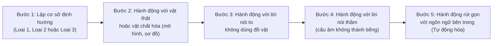

# CHƯƠNG 3: SỰ HÌNH THÀNH VÀ PHÁT TRIỂN TRÍ TUỆ QUA CÁC GIAI ĐOẠN LỨA TUỔI

> **Hướng dẫn học tập theo phương pháp ghi chép Cornell (Cornell Note-taking System):**
> Tài liệu lý thuyết Chương 3 được thiết kế theo cấu trúc ghi chép Cornell chuẩn hóa gồm 3 phần:
> - **Cột Từ khóa / Câu hỏi gợi nhớ (Cue Column - bên trái):** Nêu các khái niệm hạt nhân, luận điểm xuất phát, tên các nhà tâm lý học và câu hỏi định hướng ôn tập để kích hoạt khả năng tự truy xuất kiến thức (Active Recall).
> - **Cột Ghi chú chi tiết (Note-taking Column - bên phải):** Trình bày hệ thống, đầy đủ và chính xác các định nghĩa, cơ chế phát sinh, giai đoạn phát triển, quy luật tâm lý và ví dụ thực nghiệm từ giáo trình *Tâm lý học Trí tuệ*.
> - **Phần Tóm tắt (Cornell Summary - cuối mỗi mục và cuối chương):** Cô đọng bản chất cốt lõi của từng phần giúp sinh viên nắm vững bức tranh tổng thể về sự hình thành và phát triển trí tuệ cá nhân qua các giai đoạn lứa tuổi.

Xung quanh vấn đề hình thành và phát triển trí tuệ trẻ em có hai nội dung trung tâm cần giải quyết: **(1) Cơ chế phát sinh thao tác trí tuệ từ các hành động vật chất bên ngoài** và **(2) Sự phát triển trí tuệ của trẻ em qua các giai đoạn lứa tuổi**. Chương này tập trung phân tích các quan điểm tiêu biểu nhất — đặc biệt là thuyết phát sinh nhận thức của J. Piaget và thuyết hoạt động tâm lý của trường phái tâm lý học Xô viết (L.S. Vygotsky, A.N. Leontiev, P.Ya. Galperin, D.B. Elkonin) cùng quan điểm nhân cách – xã hội của H. Wallon.

```mermaid
flowchart TD
    A["Chương 3: Sự hình thành và phát triển trí tuệ qua các giai đoạn lứa tuổi"] --> B["3.1. Phân biệt Hành động & Thao tác trí tuệ"]
    A --> C["3.2. Thuyết phát sinh trí tuệ của J. Piaget"]
    A --> D["3.3. Thuyết hoạt động tâm lý (Vygotsky, Leontiev, Galperin)"]
    A --> E["3.4. Các giai đoạn và nhịp độ phát triển trí tuệ"]
    A --> F["3.5. Vấn đề xã hội hóa trí tuệ trẻ em"]

    B --> B1["Quan điểm J. Piaget: Nội hiện hành động thành thao tác thuận nghịch"]
    B --> B2["Quan điểm A.N. Leontiev: Hoạt động - Hành động - Thao tác"]
    B --> B3["Các hướng giải thích phát sinh: Nội sinh, Tiên nghiệm, Gestalt, Kiến tạo"]

    C --> C1["Cơ chế: Sơ đồ/Cấu trúc - Đồng hóa - Điều ứng - Cân bằng"]
    C --> C2["4 giai đoạn: Giác-động (6 kì), Tiền thao tác, Thao tác cụ thể, Thao tác hình thức"]

    D --> D1["L.S. Vygotsky: Lĩnh hội văn hóa, Công cụ kí hiệu kép, Tư duy & Ngôn ngữ (2 tuổi)"]
    D --> D2["P.Ya. Galperin: 5 bước hình thành hành động trí tuệ, 4 thông số, 3 loại định hướng"]

    E --> E1["Phân kì: Piaget (4), H. Wallon (7), Vygotsky (Khủng hoảng), Elkonin (Lớp A - Lớp B)"]
    E --> E2["Nhịp độ: 6 tuổi đạt 1/3, 8 tuổi đạt 1/2, 12 tuổi đạt 3/4; Trí tuệ người cao tuổi"]

    F --> F1["Piaget: Thu được ý thức (P -> C, C') & 3 mức trừu tượng phản chiếu; Duy kỉ -> Xã hội"]
    F --> F2["Vygotsky: Quy luật 2 lần xuất hiện; Ngôn ngữ xã hội -> Tự kỉ -> Bên trong"]
```

---

## 3.1. Phân biệt hành động và thao tác trí tuệ

| Từ khóa / Câu hỏi gợi nhớ | Ghi chú chi tiết (Nội dung cốt lõi) |
|---|---|
| Vì sao cần phân biệt hành động và thao tác trí tuệ? | Trước khi xác định những nguyên lý chung về sự hình thành và phát triển trí tuệ cá nhân, cần phân biệt rõ hai khái niệm cơ bản thường bị đồng nhất là **hành động trí tuệ (Action)** và **thao tác trí tuệ (Operation)**. Trong tâm lý học có hai cách giải thích điển hình của J. Piaget và A.N. Leontiev. |
| Quan điểm của J. Piaget về Hành động và Thao tác trí tuệ là gì? | - **Hành động (Action):** Là các ứng xử của cá nhân đối với sự tác động của các yếu tố môi trường bên ngoài (tác động thực, vật chất lên sự vật có thực). - **Thao tác (Operation):** Là các hành động bên ngoài đã được chuyển vào bên trong (**nội hiện**) và đã được **rút gọn**. Đối tượng của thao tác không phải là sự vật vật chất có thực mà là các **hình ảnh, biểu tượng, ký hiệu**. Thao tác là hành động tinh thần ở bên trong. - **Ba tính chất đặc trưng của thao tác theo Piaget:**   1. **Tính thuận nghịch:** Khả năng đảo ngược hành động tư duy về điểm xuất phát.   2. **Tính bảo tồn:** Khả năng xác định được cái bất biến trong cái biến đổi.   3. **Tính liên kết:** Sự kết hợp các thao tác riêng thành một cấu trúc chỉnh thể (không có thao tác nào tồn tại riêng rẽ, độc lập). - **Vai trò:** Cấu trúc thao tác là tiêu chuẩn để Piaget phân biệt các trình độ trí tuệ của trẻ em: trí tuệ tiền thao tác, thao tác trí tuệ cụ thể và trí tuệ thao tác hình thức. |
| Quan điểm của A.N. Leontiev về Hành động và Thao tác trong cấu trúc hoạt động? | - Giải thích hành động và thao tác trong cấu trúc chung của **Hoạt động (Hoạt động – Hành động – Thao tác)**. - **Hành động trí tuệ:** Là một hành động tâm lý trọn vẹn, chịu sự chi phối bởi một **mục đích được ý thức**. - **Thao tác:** Là phương tiện, là **cơ cấu kỹ thuật** để triển khai hành động đến mục đích đó. Thao tác **không có mục đích tâm lý riêng**; cấu trúc của thao tác được định hình trong các phương tiện (công cụ) kỹ thuật. - **Sự hình thành thao tác từ hành động:** Thời kỳ đầu, việc học cách sử dụng công cụ là một hành động tâm lý có mục đích. Sau khi được luyện tập, rút gọn, thuần thục và **kỹ thuật hóa** (tước bỏ mục đích riêng và chuyển vào trong một hành động khác), hành động đó trở thành thao tác. |
| Ba hình thức thể hiện của đối tượng, hành động và thao tác theo tâm lý học hoạt động? | Căn cứ vào **hình thức thể hiện của đối tượng** (vật thật, ký hiệu của vật thật, ý nghĩ về vật) và **phương tiện sử dụng**, có 3 hình thức hành động và 3 loại thao tác tương ứng: 1. **Hành động vật chất / Thao tác vật chất:** Đối tượng là các dạng **vật thật**, phương tiện là các **công cụ kỹ thuật** (thao tác trên vật thật). 2. **Hành động tinh thần / Thao tác tinh thần:** Đối tượng là các dạng **ký hiệu**, phương tiện là **ký hiệu ngôn ngữ**. 3. **Hành động trí óc / Thao tác trí óc:** Đối tượng là **ý nghĩ của chủ thể**, công cụ là **ngôn ngữ bên trong** (ngôn ngữ không lời, hướng vào bên trong chủ thể, gồm những mảnh ký hiệu cơ động chứa nghĩa khách quan của sự vật và ý của chủ thể). - **Tiêu chuẩn đánh giá trình độ trí tuệ:** Không chỉ dựa vào sự hiện diện của thao tác mà còn căn cứ vào **cách triển khai các thao tác đó đến mục đích** (phương tiện và cách chủ thể sử dụng phương tiện). Nói đến hành động là hướng tới tính trọn vẹn và tính mục đích; nói tới thao tác là hướng tới cơ cấu kỹ thuật của hành động. |
| Nhóm quan điểm Nội sinh giải thích sự phát sinh thao tác trí tuệ như thế nào? | Quy các quan niệm giải thích sự phát sinh thao tác trí tuệ trong mối quan hệ chủ thể – môi trường thành 2 nhóm lớn: **Nội sinh** và **Kiến tạo**. - **Quan điểm bản chất sinh học (bẩm sinh):** Coi trí tuệ đã có sẵn ở dạng tiềm tàng trong cơ thể (năng khiếu bẩm sinh). Sự phát triển chỉ là sự **bộc lộ** những tiềm năng đó dưới tác động của hoàn cảnh sống chứ không phải là sự hình thành mới. - **Quan điểm tiên nghiệm của trường phái Würzburg (Vuxbua):** Coi hành vi trí tuệ là những **cấu trúc nội tại, tiên nghiệm** đã có của cá nhân, được bộc lộ dần khi giải quyết nhiệm vụ tư duy. Các kích thích của hoàn cảnh (đầu bài toán) chỉ có tác dụng **khởi động**, làm bộc lộ cấu trúc đã có chứ không hình thành qua tương tác với hiện thực. |
| Trường phái Gestalt (Hình thái) giải thích sự phát sinh cấu trúc trí tuệ ra sao? | - Coi cấu trúc trí tuệ của động vật và trẻ chưa biết nói là quá trình **cấu trúc lại các hình ảnh tri giác** trên cơ sở các hành động vật chất, mang tính hình thức. - Các cấu trúc này không liên hệ trực tiếp với các hành động trước đó mà là kết quả của sự **bừng hiểu (Insight)** — sự gặp gỡ và chuyển hóa tức thời giữa cấu trúc vật lý bên ngoài với cấu trúc trí tuệ của cá nhân trong trường tri giác. - **Đánh giá:** Không hoàn toàn nội sinh cũng không hoàn toàn kiến tạo vì chỉ mang tính tức thời, không đặt ra lịch sử và cơ chế hình thành. Tuy nhiên có **2 đóng góp lớn**: (1) Chỉ ra các cấu trúc trí tuệ có tính hình thức, tách khỏi tri giác thực tại; (2) Khẳng định cần có sự liên hệ, tác động qua lại giữa yếu tố vật lý và tâm lý. |
| Nhóm quan điểm Kiến tạo (Liên tưởng, Hành vi và Tương tác) giải thích như thế nào? | - **Tâm lý học liên tưởng (chủ nghĩa kinh nghiệm):** Coi trí tuệ và sự phát triển của nó chỉ là sự hình thành và hoạt hóa các mối liên tưởng. Khác biệt trình độ trí tuệ quy về **số lượng mối liên tưởng** và **tốc độ hoạt hóa** chúng. - **Tâm lý học hành vi (tạo tác hành vi):** Coi hành vi trí tuệ là các phản ứng tạo ra trong tương tác cơ thể – môi trường nhằm đảm bảo lợi ích chủ thể. Tuy nhiên giải thích máy móc theo nguyên tắc ướm thử kinh nghiệm cũ vào kích thích mới qua cơ chế mày mò **"thử và sai"** và củng cố phụ thuộc hoàn toàn vào kích thích bên ngoài. - **Quan điểm kiến tạo tương tác (bao trùm nhất):** Các thao tác trí tuệ (kể cả thao tác hình thức cấp cao) được hình thành bắt đầu từ **những hành động vật chất**, là sự kết tinh giữa kinh nghiệm thực tế với sự sản xuất riêng của chủ thể. Hai lý thuyết đỉnh cao của hướng này là **Thuyết phát sinh trí tuệ của J. Piaget** và **Thuyết lĩnh hội thao tác trí tuệ của tâm lý học hoạt động**. |

> **Tóm tắt Mục 3.1 (Cornell Summary):** J. Piaget định nghĩa thao tác trí tuệ là hành động vật chất bên ngoài đã được nội hiện, rút gọn trên các biểu tượng/ký hiệu với 3 tính chất (thuận nghịch, bảo tồn, liên kết); trong khi A.N. Leontiev đặt hành động (quá trình hướng tới mục đích có ý thức) và thao tác (phương tiện, cơ cấu kỹ thuật đã được tự động hóa/kỹ thuật hóa) trong cấu trúc chung của hoạt động với 3 mức (vật chất, tinh thần/ký hiệu, trí óc/ngôn ngữ bên trong). Vượt qua các quan điểm nội sinh bẩm sinh, tiên nghiệm (Würzburg), bừng hiểu tức thời (Gestalt) hay kiến tạo máy móc (liên tưởng, hành vi thử - sai), tâm lý học hiện đại tập trung vào sự kiến tạo thao tác trí tuệ từ hành động vật chất thông qua học thuyết của J. Piaget và lý thuyết hoạt động tâm lý.

---

## 3.2. Sự phát sinh và phát triển trí tuệ trẻ em theo lý thuyết của J. Piaget

| Từ khóa / Câu hỏi gợi nhớ | Ghi chú chi tiết (Nội dung cốt lõi) |
|---|---|
| Những luận điểm xuất phát của J. Piaget dựa trên những nền tảng khoa học nào? | J. Piaget xuất thân là nhà sinh vật học (nghiên cứu sự thích nghi của loài nhuyễn thể) và được trang bị sâu sắc Khoa học luận (*Épistémologie*), triết học và lôgic học. Ngay trang đầu cuốn *"Tâm lý học trí khôn"*, ông khẳng định: **"Mọi giải thích tâm lý học sớm hay muộn cuối cùng cũng dựa vào sinh học hoặc lôgic học."** - **Góc độ phôi học / sinh học:** Nghiên cứu tâm lý học về trí tuệ phải tạo dựng lại sự phát sinh và các bước hình thành trí tuệ từ dạng đơn giản nhất đến mức trưởng thành, giống như nhà phôi học mô tả các thời kỳ phát triển của thai nhi. - **Góc độ lôgic học:** Vì hiện tượng trí tuệ mang tính chức năng, không thể "cầm nắm" vật chất được nên phải vận dụng **khoa học lôgic** (khoa học hình thức hóa) để tường minh hóa cấu trúc trí tuệ. Hai khái niệm công cụ trung tâm là **Cấu trúc (Sơ đồ)** và **Thích nghi**. |
| Khái niệm Cấu trúc (Sơ đồ) được J. Piaget kế thừa và phát triển như thế nào? | - Khái niệm **cấu trúc (sơ đồ)** bắt nguồn từ triết học của **I. Kant** (sử dụng sơ đồ tiên nghiệm làm cấu trúc hình thức tổng hợp tư liệu cảm tính). - Khác với trường phái Würzburg (coi sơ đồ là tiên nghiệm có sẵn) và Gestalt (coi cấu trúc là sự cấu trúc hóa lại tức thì), J. Piaget đứng trên **quan điểm kiến tạo cấu trúc**: kết hợp nghiên cứu nội dung tâm lý thực nghiệm với sơ đồ lôgic – toán học, trong đó quá trình phản ánh đồng thời là quá trình trẻ tự kiến tạo, hình thành các cấu trúc từ hành động vật lý bên ngoài. |
| Hai mặt của một hành vi trí tuệ theo J. Piaget là gì? | Khi phân tích một hành vi ứng xử trí tuệ, Piaget tách thành 2 mặt gắn bó chặt chẽ: 1. **Mặt cảm xúc:** Tạo ra **động lực, năng lượng** cho hành vi ứng xử. 2. **Mặt nhận thức (hiểu biết):** Là sự **cấu trúc hóa**, tạo ra các cấu trúc trí tuệ giúp cá nhân thiết lập sự cân bằng với môi trường (từ sơ cấu giác – động đến cấu trúc thao tác hình thức). |
| Cơ chế Thích nghi trí tuệ: Đồng hóa, Điều ứng và Cân bằng vận hành ra sao? | Sự phát triển trí tuệ là sự phát triển tiếp tục của các yếu tố sinh học nhằm tổ chức kinh nghiệm để thích ứng với môi trường (thích ứng sinh học mang tính vật chất, còn thích ứng trí tuệ mang tính **chức năng**): - **Đồng hóa trí tuệ (Đồng hóa chức năng):** Não tiếp nhận thông tin từ kích thích bên ngoài, tái lập một số đặc điểm của khách thể và **đưa vào trong các cấu trúc (sơ đồ) đã có** (chế biến kích thích cho phù hợp với sự áp đặt của cấu trúc cũ). Đồng hóa là sự **tăng trưởng**. - **Điều ứng:** Quá trình chủ thể thích nghi với đòi hỏi đa dạng của môi trường bằng cách **biến đổi những cấu trúc đã có để tạo ra cấu trúc mới**. Điều ứng là sự **phát triển**. - **Cân bằng:** Quá trình tự cân bằng của chủ thể giữa **đồng hóa** và **điều ứng**. Sự phát triển trí tuệ là quá trình liên tục hình thành, phá vỡ và tái hình thành các cấu trúc theo hướng ngày càng hoàn thiện. |
| Giai đoạn 1: Các cấu trúc Giác – động được hình thành qua mấy trình độ? | Khi mới sinh, trẻ chưa có hành động và trí khôn, chỉ có các cảm giác và cử động phản xạ bẩm sinh. Ngay sau đó trẻ luyện tập các cử động này qua **3 dạng đồng hóa khởi đầu**: (1) *Đồng hóa tái tạo kiểu chức năng* (luyện tập cử động mút); (2) *Đồng hóa khái quát hóa* (mở rộng động tác bú sang các vật khác); (3) *Đồng hóa xác nhận* (phân biệt vú mẹ với vật khác). Sự phát triển cấu trúc giác – động diễn ra qua **6 trình độ (6 thời kỳ nhỏ)**: 1. **Luyện tập phản xạ bẩm sinh (0–1 tháng):** Cử động mút, bấu, víu... 2. **Hình thành cấu trúc tri giác và thói quen vận động đầu tiên (1–4 tháng):** Kết hợp tay với miệng để mút ngón tay (vẫn là cấu trúc đơn, liền khối, chưa phải trí khôn). 3. **Phản ứng vòng tròn thứ cấp (4–8 tháng):** Kết hợp tri giác và vận động tạo nên **cấu trúc giác – động** có tính khái quát, bắt đầu liên kết cử động làm phương tiện đạt kết quả (kéo dây để chuông kêu). 4. **Phối hợp các sơ cấu / Phản ứng vòng tròn cấp hai (8–12 tháng):** Xuất hiện quan hệ **mục đích – phương tiện** (ý định đạt mục đích xuất hiện trước phương tiện: trẻ gạt vật cản để lấy đồ chơi). **Trí khôn bắt đầu xuất hiện** nhưng còn thụ động, tái tạo. 5. **Phản ứng vòng tròn cấp ba (12–18 tháng):** Xuất hiện các phản ứng mới có tính **sáng tạo** do hứng thú tìm tòi, phát hiện; cấu trúc vừa phân hóa vừa phân biệt (kéo tấm thảm có đồ chơi lại gần, dùng gậy khều đồ chơi). 6. **Kết hợp linh hoạt các cấu trúc / Bừng hiểu giác – động (18–24 tháng):** Các cấu trúc giác – động trở nên cơ động, kết hợp linh hoạt tạo ra giải pháp tức thì như sự "bừng hiểu" và xuất hiện mầm mống nội hiện khách thể (biểu tượng). |
| Giai đoạn 2: Các cấu trúc Tiền thao tác gồm những bước chuyển và phân đoạn nào? | Trước khi có cấu trúc biểu trưng, trí khôn giác – động chỉ là dãy kế tiếp nhau (**kết hợp dọc**) như **cuộn phim quay chậm** mà chưa có khả năng kết hợp ngang. Để chuyển từ cấu trúc giác – động lên **cấu trúc biểu trưng (trí khôn suy ngẫm)** cần **3 điều kiện**: 1. Tăng nhanh tốc độ hoạt hóa các cấu trúc đã có để kết hợp thành một khối hiểu biết đồng thời. 2. Xuất hiện phương pháp nhận thức mới bằng cách tái nhận cấu trúc không cần sự có mặt của sự vật. 3. Xuất hiện các hành động biểu trưng và các biểu tượng (trò chơi biểu trưng: dùng ghế thay ngựa, nhai giả vờ). - **Hai mức độ trong giai đoạn Tiền thao tác:**   + **Tư duy biểu trưng và tiền khái niệm (1,5–2 đến 4 tuổi):** Nhờ ngôn ngữ và bắt chước, trẻ phân biệt được **cái biểu đạt** và **cái được biểu đạt**.   + **Tư duy trực giác (4 đến 6–7 tuổi):** Dựa vào cấu trúc tri giác phản ánh tổng thể sự vật và đi theo các biến đổi không gian/hình dạng (cục đất sét, nước trong lọ). Đã có tính hình thức và dựa vào hình ảnh khách quan nhưng **chưa có khả năng bảo tồn và chưa đảo ngược được**, nên vẫn chưa phải là tư duy thao tác. |
| Giai đoạn 3 & 4: Các cấu trúc Thao tác cụ thể và Thao tác hình thức có đặc trưng gì? | - **Cấu trúc thao tác cụ thể (7–8 đến 11–12 tuổi):** Xuất hiện khi cấu trúc trực giác trở nên cơ động đến mức trẻ đạt được **khả năng bảo tồn** và **khả năng đảo ngược (thuận nghịch)**, nhưng vẫn phải triển khai trên vật liệu là **các vật cụ thể**. - **Cấu trúc thao tác hình thức (từ sau 11–12 tuổi):** Thao tác tư duy tách khỏi vật cụ thể, triển khai bằng các **mệnh đề lôgic** và suy luận dựa trên các **giả thuyết/giả định** (ví dụ: trẻ thao tác hình thức suy luận được *"nếu một con gà có 3 chân thì 5 con gà có 15 chân"*, trong khi trẻ thao tác cụ thể bác bỏ vì thực tế gà không có 3 chân). |
| Bốn nhóm thao tác cơ bản trong cấu trúc thao tác của J. Piaget là gì? | Trong cấu trúc thao tác của trẻ có **4 nhóm thao tác cơ bản** giúp hình thành các khái niệm số, không gian, thời gian, tốc độ, nguyên nhân và ngẫu nhiên: 1. **Phân loại (Classification):** Nhóm hợp các phần tử hoặc lồng chúng vào nhau theo cấp bậc các lớp (phân lớp), ví dụ: $A + A' = B$; $(A + A') + B = A + (B + A')$. 2. **Phân hạng (Sériation):** Xác lập quan hệ không đối xứng biểu hiện sự khác biệt giữa các phần tử, xây dựng bất đẳng thức $D < E < F$ (nhận ra đồng thời $E > D, C, B, A$ và $E < F, G...$), phát hiện **tính chất bắc cầu** của quan hệ — liên quan trực tiếp đến hình thành khái niệm số. 3. **Thay thế (Tương ứng):** Nếu $A + B = C$ và $A$ tương ứng với $D$, $B$ tương ứng với $E$, thì có thể thay thế $D + E = C$ hoặc $A + E = B + D = C$. 4. **Các thao tác quan hệ:** Bao gồm các cặp quan hệ thuận – nghịch như Bằng nhau ($A = B \leftrightarrow B = A$), Khác nhau ($A \neq B \leftrightarrow B \neq A$), Thuộc ($A \in B$), Trong/Bao hàm ($A \subset B$), Hơn ($A > B$). |
| Đánh giá ưu điểm và hạn chế trong lý thuyết phát sinh trí tuệ của J. Piaget? | - **Đóng góp:** Vạch ra lược đồ phát sinh cấu trúc trí tuệ hoàn chỉnh từ sơ cấu sinh học đến thao tác hình thức; đề cao **sự kiến tạo tích cực** của trẻ bằng chính hành động của mình thông qua cơ chế đồng hóa và điều ứng. - **Hạn chế:** Nhìn nhận sự phát triển chủ yếu là quá trình trẻ **tự phát triển** dưới áp lực bên ngoài của môi trường xã hội; mới chủ yếu mô tả **kết quả** cấu trúc chứ chưa vạch rõ cơ chế chuyển hóa cụ thể từ hành động vật chất bên ngoài thành cấu trúc tâm lý bên trong (vấn đề này được tâm lý học Xô viết giải quyết triệt để hơn). |

> **Tóm tắt Mục 3.2 (Cornell Summary):** Xuất phát từ sinh học và lôgic học, J. Piaget giải thích sự phát triển trí tuệ như quá trình kiến tạo các cấu trúc nhận thức thông qua cơ chế thích nghi gồm Đồng hóa (tăng trưởng), Điều ứng (phát triển) và Cân bằng. Cấu trúc trí tuệ phát triển liên tục từ các sơ cấu Giác – động (qua 6 thời kỳ nhỏ), chuyển sang Tiền thao tác (biểu trưng/tiền khái niệm và trực giác nhờ 3 điều kiện), tiến tới Thao tác cụ thể (khi xuất hiện khả năng bảo tồn, thuận nghịch và 4 nhóm thao tác: phân loại, phân hạng, thay thế, quan hệ trên vật thật) và đạt đỉnh cao ở Thao tác hình thức (suy luận mệnh đề lôgic và giả định).

---

## 3.3. Sự hình thành và phát triển trí tuệ của trẻ em theo lý thuyết hoạt động tâm lý

| Từ khóa / Câu hỏi gợi nhớ | Ghi chú chi tiết (Nội dung cốt lõi) |
|---|---|
| Ba luận điểm triết học Mác – Lênin làm cơ sở phương pháp luận cho tâm lý học hoạt động là gì? | Khác với Piaget xuất phát từ sinh học và lôgic học, tâm lý học hoạt động dựa trên **triết học duy vật biện chứng và duy vật lịch sử** với 3 luận điểm gốc: 1. **Con người tự sản xuất ra chính bản thân mình bằng lao động:** Trong lao động sản xuất ra tư liệu sinh hoạt, mọi sự khác biệt về bản chất, trí tuệ và xã hội của cá nhân được hình thành và bộc lộ. 2. **Bản chất con người là tổng hòa các quan hệ xã hội:** Sự phong phú về tinh thần và trí tuệ của cá nhân phụ thuộc vào sự phong phú của các mối liên hệ xã hội hiện thực của họ. 3. **Sự tác động biện chứng giữa con người và hoàn cảnh xã hội:** Xã hội sản xuất ra con người như thế nào thì con người cũng sản xuất ra xã hội như thế ấy (*"Con người tạo ra hoàn cảnh đến mức nào thì hoàn cảnh cũng tạo ra con người đến mức ấy"*). |
| Sự khác biệt về chất giữa kinh nghiệm động vật và kinh nghiệm con người theo L.S. Vygotsky? | Trong tác phẩm *"Ý thức như một vấn đề của tâm lý học hành vi"*, L.S. Vygotsky phân biệt: - **Ở động vật (2 loại kinh nghiệm):** (1) *Kinh nghiệm loài* (di truyền sinh học, bản năng); (2) *Kinh nghiệm tự tạo của cá thể* trong đời sống. Cả hai đều mang nguồn gốc sinh học nhằm giúp con vật **thích nghi thụ động** với biến đổi môi trường. - **Ở con người (3 loại kinh nghiệm):** Ngoài kinh nghiệm loài và kinh nghiệm cá thể (đã được cải biến), con người có thêm **kinh nghiệm lịch sử – xã hội** được tích lũy, kết tinh (vật hóa) trong các sản phẩm văn hóa vật chất và tinh thần qua nhiều thế hệ, tạo nên sự **thích ứng tích cực tâm lý – xã hội**. |
| Cơ chế Lĩnh hội khác cơ chế Thích nghi sinh học như thế nào? Vai trò của người lớn và giao tiếp? | - **Thích nghi sinh học:** Thay đổi thuộc tính loài và hành vi bẩm sinh do đòi hỏi của môi trường. - **Lĩnh hội:** Quá trình trẻ tái tạo lại cho bản thân những thuộc tính, năng lực và phương thức hành vi của người lớn đã được **vật hóa** trong các sản phẩm văn hóa. Hoạt động của người lớn là quá trình *vật hóa* vào sản phẩm, còn hoạt động lĩnh hội của trẻ là quá trình **tách hoạt động đó ra khỏi vật phẩm** để chuyển thành năng lực của bản thân. - **Vai trò trung gian của người lớn:** Trẻ **không thể tự lực trực tiếp** lĩnh hội thế giới đồ vật văn hóa mà **bắt buộc phải thông qua người lớn và giao tiếp** (*"Con đường từ đồ vật đến trẻ em và từ trẻ em đến đồ vật đều đi qua người khác"*). Các mức độ học của trẻ đi từ **bắt chước** $\rightarrow$ **học tập có chủ đích ở nhà trường** $\rightarrow$ **tự học**, nhưng ở mức nào cũng luôn có sự hợp tác người lớn – trẻ em. |
| Quan điểm của L.S. Vygotsky về công cụ ký hiệu và nguồn gốc phát sinh tư duy – ngôn ngữ? | - **Quy luật phát triển của hoạt động ký hiệu:** Ký hiệu ban đầu là phương tiện của mối liên hệ và hợp tác xã hội (chức năng tâm lý bên ngoài), sau đó mới chuyển thành phương tiện làm chủ hành vi của chính bản thân (chức năng tổ chức tâm lý cá nhân). - **Nguồn gốc phát sinh Tư duy và Ngôn ngữ (chủng loại & cá thể):**   + Tư duy và ngôn ngữ có **nguồn gốc phát sinh khác nhau** và ban đầu phát triển theo hai con đường độc lập.   + Có giai đoạn **"tiền trí tuệ"** trong sự phát triển ngôn ngữ và giai đoạn **"tiền ngôn ngữ"** trong sự phát triển tư duy (ở khỉ dạng người không bao giờ có sự kết hợp giữa tư duy và ngôn ngữ).   + Ở trẻ em, đến mốc khoảng **2 tuổi**, hai con đường phát triển của tư duy và ngôn ngữ **giao nhau (kết hợp với nhau)**: từ đó **tư duy trở thành tư duy ngôn ngữ** và **ngôn ngữ trở thành ngôn ngữ trí tuệ**. |
| Ngôn ngữ cải tổ hành vi thực hành của trẻ và tạo ra "công cụ kép" như thế nào? | Khi ngôn ngữ xuất hiện và tham gia vào việc sử dụng công cụ, hành vi của trẻ được cải tổ căn bản theo **2 khía cạnh**: 1. **Giảm tính ngẫu nhiên, trực tiếp:** Hoạt động trí tuệ cấp cao tách thành **2 phần kế tiếp nhau** — phần đầu thực hiện trên **bình diện ngôn ngữ** (lập kế hoạch), phần sau triển khai bằng **vận động thực tiễn**. 2. **Tạo ra "công cụ kép" (tổ hợp hành động):** Ký hiệu ngôn ngữ vừa **hướng vào đối tượng** bên ngoài để giải quyết nhiệm vụ, vừa **hướng vào chính chủ thể** giúp trẻ đối diện với bản thân như một đối tượng khách quan để tự kiểm soát và làm chủ hành vi của mình. |
| Ba quy tắc phát triển và suy thoái các chức năng tâm lý cấp cao của L.S. Vygotsky là gì? | 1. **Quy tắc cải tổ tận gốc:** Mỗi chức năng tâm lý cấp cao không phải là sự nối dài trực tiếp của chức năng đơn giản tương ứng mà là sự thay đổi tận gốc hướng phát triển trên bình diện mới (một cấu thành mới đặc thù). 2. **Quy tắc hệ thống:** Các chức năng tâm lý cấp cao không xếp chồng lên các quá trình đơn giản như một tầng riêng mà là một **hệ thống tâm lý mới** kết hợp phức tạp các chức năng đơn giản. 3. **Quy tắc tan rã ngược chiều trong bệnh lý:** Khi suy thoái bệnh lý, trước hết diễn ra sự **phá hủy mối liên hệ giữa chức năng ký hiệu và chức năng tự nhiên** (quá trình tan rã diễn ra ngược lại với quá trình hình thành). |
| Cấu trúc vĩ mô của Hoạt động và cơ chế chuyển hóa Hành động thành Thao tác theo A.N. Leontiev? | - **Ba thành tố tương ứng (Chủ thể $\leftrightarrow$ Đối tượng):**   1. **Hoạt động $\leftrightarrow$ Động cơ:** Động cơ là đối tượng có chức năng **kích thích** chủ thể (trả lời câu hỏi *Vì cái gì?*).   2. **Hành động $\leftrightarrow$ Mục đích:** Mục đích là đối tượng được ý thức có chức năng **hướng dẫn** chủ thể (trả lời câu hỏi *Đạt tới cái gì?*). Hành động là đơn vị tâm lý độc lập tạo nên đời sống của hoạt động.   3. **Thao tác $\leftrightarrow$ Phương tiện / Điều kiện:** Thao tác là **cơ cấu kỹ thuật** phụ thuộc vào điều kiện khách quan và lôgic công cụ (trả lời câu hỏi *Đạt tới bằng cách nào?*). - **Cơ chế chuyển hóa Hành động $\rightarrow$ Thao tác:** Ban đầu, một kỹ năng mới (ví dụ: *nhóm gộp các phần tử*) được thực hiện như một **hành động có mục đích riêng**. Sau khi chủ thể nắm vững lôgic đối tượng, luyện tập thuần thục và **"kỹ thuật hóa"** (tước bỏ mục đích riêng của nó để đưa vào làm phương tiện cho hành động lớn hơn như *làm phép tính cộng, trừ*), hành động đó rút gọn và trở thành **thao tác**. |
| Cấu trúc hành động (Định hướng – Thực hiện) và 4 thông số của hành động theo P.Ya. Galperin? | Vận dụng luận đề của C. Mác (*"Ý niệm chẳng qua chỉ là vật chất được đem chuyển vào trong đầu óc con người và được cải biên trong đó"*), P.Ya. Galperin xây dựng lý thuyết hình thành hành động trí tuệ theo giai đoạn: - **Hai phần của hành động:**   + **Phần định hướng (quyết định phần thực hiện):** Có 3 chức năng: (1) *Nhận thức* (hiểu cần làm gì); (2) *Lập kế hoạch* (làm như thế nào); (3) *Kiểm tra và điều chỉnh* hành động theo mẫu.   + **Phần thực hiện:** Triển khai tái diễn và cải tổ hành động qua các hình thức vật liệu từ ngoài vào trong. - **Bốn thông số (Parameters) xác định hành động:**   1. **Hình thức (mức độ) thực hiện hành động** (gồm 3 mức chính: với vật thật/vật chất hóa; với lời nói to; trong đầu).   2. **Độ khái quát** của hành động.   3. **Độ khai triển (hay mức độ rút gọn)** của hành động.   4. **Độ thành thạo (thuần thục)** của hành động. *(Thông số 1 xác định mức độ thực hiện; 3 thông số sau xác định chất lượng của hành động).* |
| Năm bước hình thành hành động trí tuệ của P.Ya. Galperin diễn ra như thế nào? | 1. **Bước 1 – Lập cơ sở định hướng của hành động:** Chỉ ra vật mẫu (hành động mẫu, vật liệu mẫu, sản phẩm mẫu), chia hành động thành các thao tác vừa sức và phân bố sang vật liệu mới. Đây là khâu then chốt quyết định chất lượng hành động. 2. **Bước 2 – Hành động với đồ vật thật hoặc dạng vật chất hóa (sơ đồ, mô hình, hình vẽ):** Là nguồn gốc của mọi hành động trí tuệ trọn vẹn. Chủ thể dùng tay triển khai **hết cỡ** các thao tác để bộc lộ lôgíc khách quan, đồng thời tiến hành **khái quát hóa** (rút ra thuộc tính bản chất) và luyện tập để **rút gọn có chủ ý**. 3. **Bước 3 – Hành động với lời nói to không dùng đồ vật:** Đối tượng hành động tách khỏi điểm tựa vật thật và nhập vào **lời nói to có quy tắc ngữ pháp**. Ngôn ngữ lúc này không chỉ là thông báo về hành động mà chính là **hành động bằng ngôn ngữ** để bản thân và người khác giám sát; cũng được triển khai hết cỡ, khái quát và rút gọn. 4. **Bước 4 – Hành động với lời nói thầm (nói bên ngoài nhưng không thành tiếng):** Không phải là "lấy ngôn ngữ trừ âm thanh" đơn thuần mà là **cấu tạo lại ngôn ngữ**, chuyển hình ảnh âm thanh của từ thành **biểu tượng cấu âm** không phát ra tiếng (vừa là điểm tựa vật chất cuối cùng vừa là hành động tinh thần bên trong). 5. **Bước 5 – Hành động rút gọn với lời nói bên trong (trong đầu):** Ngôn ngữ không còn hướng ra ngoài, cấu trúc ngữ âm và ngữ pháp rút gọn tối đa, nội dung vật chất của hành động cô đặc trong **nghĩa của từ** và vận hành tự động hóa hoàn toàn trong đầu. |
| Vấn đề Nghĩa – Ý, Hành động kiểm tra chuyển thành Chú ý và 3 loại cơ sở định hướng của Galperin? | - **Sự hình thành Nghĩa, Ý và Chú ý:** Đi kèm hành động thực hiện luôn có **hành động kiểm tra** (đối chiếu với mẫu). Hành động kiểm tra chuyển vào trong và rút gọn nhanh hơn hành động thực hiện, cuối cùng biến thành **sự chú ý (hành động tự quan sát)**. Ở bước ngôn ngữ bên trong, hành động phân đôi thành nội dung vật chất ngoài cảm tính (**Nghĩa**) và động tác chú ý thuần túy của chủ thể (**Ý**). - **Ba loại cơ sở định hướng điển hình** (phân loại dựa trên 3 tiêu chuẩn: *Độ khái quát, Tính đầy đủ, Chủ thể định hướng* — tổ hợp lý thuyết có 8 loại, thực tiễn có 3 loại chính):   + **Loại 1 (Từng phần, không đầy đủ, học sinh tự định hướng):** Chỉ có mẫu và sản phẩm, không có chỉ dẫn; học sinh mò mẫm theo cơ chế **"thử và sai"** chậm chạp, thiếu ổn định, đổi điều kiện là phải làm lại từ đầu.   + **Loại 2 (Từng phần, đầy đủ, giáo viên cho sẵn):** Có đủ mẫu và chỉ dẫn các điểm tựa; học sinh thực hiện nhanh, ít sai lầm nhưng **thụ động**, chỉ áp dụng được cho một nhiệm vụ cụ thể, sang vật liệu mới lại cần giáo viên chỉ dẫn lại.   + **Loại 3 (Khái quát, đầy đủ, học sinh tự lập trên cơ sở phương pháp chung):** Giáo viên trang bị **phương pháp phân tích chung**, học sinh tự xác lập các điểm tựa cho từng tình huống cụ thể. Tuy lúc đầu mất thời gian huấn luyện phương pháp chung nhưng mang lại **tính chủ động, khái quát và khả năng di chuyển (ứng dụng) cao nhất**. |

> **Tóm tắt Mục 3.3 (Cornell Summary):** Dựa trên triết học Mác – Lênin, tâm lý học hoạt động khẳng định sự phát triển trí tuệ trẻ em không phải là thích nghi sinh học thụ động mà là quá trình **lĩnh hội kinh nghiệm lịch sử – xã hội** thông qua vai trò trung gian của người lớn và công cụ ký hiệu (Vygotsky chỉ ra tư duy và ngôn ngữ giao nhau lúc 2 tuổi tạo nên công cụ kép cải tổ hành vi). Về mặt cơ chế, A.N. Leontiev làm rõ sự chuyển hóa từ Hành động (có mục đích) thành Thao tác (phương tiện kỹ thuật), còn P.Ya. Galperin cụ thể hóa quy trình nội tâm hóa qua **5 bước hình thành hành động trí tuệ** (Định hướng $\rightarrow$ Vật thật/Vật chất hóa $\rightarrow$ Lời nói to $\rightarrow$ Lời nói thầm $\rightarrow$ Ngôn ngữ bên trong), được đo bằng **4 thông số** và tối ưu hóa nhờ **cơ sở định hướng Loại 3 (khái quát, đầy đủ, học sinh tự xác lập)**.

---

## 3.4. Các giai đoạn phát triển của trí tuệ cá nhân

| Từ khóa / Câu hỏi gợi nhớ | Ghi chú chi tiết (Nội dung cốt lõi) |
|---|---|
| Bốn đặc trưng của một giai đoạn (Stade) và 4 giai đoạn phát triển trí tuệ theo J. Piaget là gì? | - **Bốn đặc trưng của một giai đoạn trí tuệ theo J. Piaget:**   1. Thành tựu trí khôn giai đoạn sau là sự **kế tiếp** giai đoạn trước.   2. Là sự **thống hợp** các cấu trúc đã có từ giai đoạn trước.   3. Mỗi giai đoạn là một **cấu trúc tổng thể** các sơ đồ chứ không phải sự xếp chồng cơ học.   4. Mỗi giai đoạn đều gồm các cấu trúc **đã có, đang có và các yếu tố chuẩn bị** cho giai đoạn tiếp sau. - **Bốn giai đoạn lớn và các mốc tuổi:**   1. **Giai đoạn Giác – động (0 đến 1,5–2 tuổi):** Trí tuệ vận động, chưa có biểu tượng và thao tác, gồm 6 thời kỳ nhỏ: *(1) Phản xạ bẩm sinh (0–1 tháng); (2) Thói quen vận động & tri giác đầu tiên (1–4 tháng); (3) Phản ứng vòng tròn thứ cấp (4–8 tháng); (4) Phối hợp phương tiện – mục đích (8–12 tháng); (5) Phản ứng vòng tròn cấp 3 – phát hiện phương tiện mới (12–18 tháng); (6) Phát sinh giải pháp sáng tạo & bắt đầu nhập tâm hành vi (18–24 tháng).*   2. **Giai đoạn Tiền thao tác (2 đến 6–7 tuổi):** Gồm 2 phân đoạn *Trí tuệ tượng trưng (1,5–2 đến 4 tuổi)* và *Trí tuệ trực giác (4 đến 6–7 tuổi)*. Đặc trưng bởi tính **duy kỷ, trực giác, tổng thể, xếp kề hình ảnh**, chưa có bảo tồn và chưa có tính thuận nghịch.   3. **Giai đoạn Thao tác cụ thể (7–8 đến 11–12 tuổi):** Xuất hiện khả năng bảo tồn (số lượng, độ dài, trọng lượng, khối lượng), phân loại, phân hạng và khái niệm không gian – thời gian trên vật thật.   4. **Giai đoạn Thao tác hình thức (11–12 đến 14–15 tuổi):** Suy luận trên các mệnh đề lôgic và giả thuyết không cần điểm tựa vật cụ thể; trí tuệ đạt mức trưởng thành. |
| Quan điểm của Henri Wallon (H. Valông) và 7 giai đoạn phát triển tâm lý, trí tuệ trẻ em? | Khác với Piaget tách cấu trúc nhận thức khỏi các mặt khác của nhân cách, **H. Wallon (1879–1962)** đặt sự phát triển trí tuệ trong **mối quan hệ hữu cơ với tổng thể nhân cách, cảm xúc và tương tác xã hội** qua **7 giai đoạn**: 1. **Giai đoạn xung động (0–6 tháng):** Các phản xạ tự động đáp lại kích thích môi trường. 2. **Giai đoạn cảm xúc (6–10 tháng):** Phát triển nhanh các biểu hiện cảm xúc (sợ hãi, vui mừng...) giao tiếp với người lớn. 3. **Giai đoạn giác – động (10–14 tháng):** Khởi đầu của trí khôn hành động. 4. **Giai đoạn phóng chiếu (14 tháng – 2 tuổi):** Trẻ biết đi, biết nói, thăm dò đồ vật, học tên gọi và đa dạng hóa quan hệ với mọi người. 5. **Giai đoạn cá thể hóa (3–6 tuổi):** Phát triển mạnh "Cái tôi" qua 3 thời kỳ nhỏ: **3 tuổi (thời kỳ chống đối)** – tách mình khỏi người khác; **4–5 tuổi (thời kỳ ái kỷ)** – tập trung vào bản thân, thích khoe khoang, nhận biết ký hiệu ngôn ngữ; **5–6 tuổi** – phát triển tư duy trực giác, tổng thể và xếp kề hình ảnh. 6. **Giai đoạn đến trường (6 đến 12–13 tuổi):** Mở rộng quan hệ xã hội, tư duy khách quan hơn, đi sâu vào thuộc tính sự vật và cách sử dụng. 7. **Giai đoạn dậy thì / Thanh thiếu niên:** Quay sự chú ý trở lại bản thân và nhu cầu của "Cái tôi", khủng hoảng thúc đẩy tìm kiếm lý do tồn tại và quy luật chi phối sự vật, làm bùng nổ năng lực suy luận và kết hợp khái niệm trừu tượng. |
| Hai tiêu chuẩn phân chia lứa tuổi và 3 đặc điểm của "Khủng hoảng lứa tuổi" theo L.S. Vygotsky? | - **Hai căn cứ phân chia giai đoạn của L.S. Vygotsky:** (1) **Các cấu trúc tâm lý mới (cấu tạo mới)** xuất hiện lần đầu ở mỗi độ tuổi; (2) **Động thái phát triển** (sự luân phiên giữa các thời kỳ ổn định kéo dài và các thời kỳ khủng hoảng ngắn). - **Ba đặc điểm của giai đoạn khủng hoảng lứa tuổi:**   1. Ranh giới bắt đầu và kết thúc khó xác định rõ, nhưng luôn có **điểm cực đại (đỉnh điểm)** căng thẳng tột độ.   2. Trẻ trở nên **khó tiếp xúc, khó giáo dục**, giảm hứng thú và thành tích học tập, nội tâm dằn vặt.   3. Có xu thế **tạm dừng hoặc thụt lùi biểu kiến**, tạo bước ngoặt cách mạng chuyển sang giai đoạn mới. - **Các giai đoạn và mốc khủng hoảng theo Vygotsky:** Sơ sinh (0–2 tháng, *Khủng hoảng sơ sinh*) $\rightarrow$ Tuổi ẵm ngửa (2 tháng – 1 năm, *Khủng hoảng 1 tuổi*) $\rightarrow$ Tuổi ấu thơ (1–3 năm, *Khủng hoảng 3 tuổi*) $\rightarrow$ Trước tuổi học (3–7 tuổi, *Khủng hoảng 7 tuổi*) $\rightarrow$ Tuổi học sinh (8–12 tuổi, *Khủng hoảng 13 tuổi*) $\rightarrow$ Tuổi trưởng thành. |
| Quan điểm "Hoạt động chủ đạo" của A.N. Leontiev và sự luân phiên Lớp A – Lớp B của D.B. Elkonin? | - **A.N. Leontiev:** Mỗi giai đoạn phát triển được đặc trưng bởi một **hoạt động chủ đạo**. Sự thay đổi hoạt động chủ đạo đánh dấu bước chuyển sang giai đoạn lứa tuổi mới. - **D.B. Elkonin (Đ.B. Elcônhin):** Dựa vào 2 lớp đối tượng mà trẻ hướng tới — **Lớp A (Quan hệ người – người / xã hội, động cơ – nhu cầu)** và **Lớp B (Quan hệ người – đồ vật / công cụ và phương thức hành động trí tuệ)** — ông chỉ ra quy luật luân phiên có tính chu kỳ qua **6 giai đoạn**:   1. **Giai đoạn sơ sinh / hài nhi (0–1 tuổi) – Lớp A:** Giao tiếp xúc cảm trực tiếp với mẹ và người lớn.   2. **Giai đoạn tuổi thơ / ấu nhi (1–3 tuổi) – Lớp B:** Hoạt động với đồ vật (học cách dùng cốc, thìa, bát, đũa theo kiểu người); kết thúc bằng *Khủng hoảng 3 tuổi*.   3. **Giai đoạn mẫu giáo (3 đến 6–7 tuổi) – Lớp A:** Hoạt động vui chơi đóng vai theo chủ đề (chiếm lĩnh các quan hệ và chuẩn mực xã hội của người lớn).   4. **Giai đoạn học sinh nhỏ / tiểu học (6–7 đến 11–12 tuổi) – Lớp B:** Hoạt động học tập (lĩnh hội tri thức khoa học và phương thức hành động trí tuệ); kết thúc bằng *Khủng hoảng dậy thì*.   5. **Giai đoạn học sinh lớn / thiếu niên (12 đến 16–17 tuổi) – Lớp A:** Giao tiếp thân mật, quan hệ bạn bè, thân hữu.   6. **Giai đoạn thanh niên và trưởng thành (từ 18 tuổi trở lên) – Lớp B:** Hoạt động học tập – nghề nghiệp chuyên môn và khoa học. |
| Nhịp độ phát triển trí tuệ qua các lứa tuổi và đặc điểm trí tuệ người cao tuổi (Cattell, Phạm Khuê)? | - **Nhịp độ phát triển ở trẻ em và thanh thiếu niên:** Không diễn ra đều đặn mà tăng cực nhanh trong **6 năm đầu đời** (đặc biệt 2–3 năm đầu) và gần đạt mức trưởng thành vào khoảng **12 tuổi**:   + Đến **6 tuổi:** Đạt khoảng **1/3 (33%)** sự phát triển trí tuệ.   + Đến **8 tuổi:** Đạt khoảng **1/2 (50%)** sự phát triển trí tuệ.   + Đến **12 tuổi:** Đạt khoảng **3/4 (75%)** mức trưởng thành. - **Sự phát triển và lão hóa hệ thần kinh:** Lúc mới sinh não trẻ đạt **1/4 trọng lượng** não người lớn; sau **25 tuổi** mỗi ngày có hàng vạn tế bào thần kinh chết đi và tăng lên sau **45 tuổi**, nhưng chưa làm suy giảm trí tuệ trước **60 tuổi**; sự lão hóa não xuất hiện phổ biến ở tuổi **70**. - **Trí tuệ người cao tuổi theo R. Cattell:** Thành phần **"Trí tuệ lỏng" (Fluid Intelligence)** gắn với cơ chế sinh lý thần kinh thường bị suy giảm theo tuổi già, trong khi **"Trí tuệ tinh luyện / kết tinh" (Crystallized Intelligence)** gồm vốn tri thức và kinh nghiệm sống vẫn hoạt động bình thường. - **Theo Phạm Khuê (1997):** Sự suy giảm trí tuệ ở người già dễ nhận thấy nhất ở sự giảm sút **trí nhớ ngắn hạn** (nhớ sự kiện hiện thời), tốc độ phản ứng trí tuệ và khả năng trừu tượng hóa nhanh suy giảm hơn so với các **thao tác đã tự động hóa và ngôn ngữ**. Chế độ rèn luyện trí óc hợp lý giúp làm chậm quá trình lão hóa này. |

> **Tóm tắt Mục 3.4 (Cornell Summary):** Các nhà tâm lý học phân chia giai đoạn phát triển trí tuệ dựa trên những tiêu chuẩn khác nhau nhưng bổ sung cho nhau: J. Piaget dựa vào cấu trúc thao tác (4 giai đoạn), H. Wallon dựa vào sự thống nhất giữa cảm xúc, nhân cách và xã hội (7 giai đoạn), L.S. Vygotsky dựa vào cấu trúc tâm lý mới và các cuộc khủng hoảng lứa tuổi, còn A.N. Leontiev và D.B. Elkonin dựa vào sự luân phiên có quy luật của hoạt động chủ đạo giữa Lớp A (quan hệ người – người) và Lớp B (quan hệ người – đồ vật/tri thức) qua 6 giai đoạn. Về nhịp độ, trí tuệ phát triển bùng nổ ở đầu đời (6 tuổi đạt 1/3, 8 tuổi đạt 1/2, 12 tuổi đạt 3/4 mức trưởng thành), duy trì ổn định đến 60 tuổi và ở tuổi già chỉ suy giảm "trí tuệ lỏng" cùng trí nhớ ngắn hạn trong khi "trí tuệ tinh luyện" và kỹ năng tự động hóa vẫn được bảo tồn.

---

## 3.5. Vấn đề xã hội hóa trí tuệ trẻ em

| Từ khóa / Câu hỏi gợi nhớ | Ghi chú chi tiết (Nội dung cốt lõi) |
|---|---|
| Xã hội hóa trí tuệ là gì? Hai hướng giải thích đối lập nhau của J. Piaget và L.S. Vygotsky? | **Xã hội hóa trí tuệ** là giải quyết vấn đề bằng cơ chế nào các chức năng tâm lý, trí tuệ cá nhân có được bản chất xã hội (chuyển *"trí tuệ xã hội"* thành *"trí tuệ cá nhân"*). Trong tâm lý học tồn tại hai hướng giải thích điển hình và đối lập nhau: hướng của **J. Piaget** và hướng của **L.S. Vygotsky (cùng H. Wallon)**. |
| Cơ chế nhập tâm theo J. Piaget: Mức "Thu được ý thức qua hành động" ($P \rightarrow C$ và $P \rightarrow C'$) diễn ra như thế nào? | J. Piaget phê phán sơ đồ liên tưởng hai thành phần $S \rightarrow R$ và đề xuất sơ đồ có mặt chủ thể $S \rightarrow Og \rightarrow R$. Quá trình chuyển hành động bên ngoài thành thao tác bên trong gồm 2 mức lớn. Ở mức thứ nhất (**Thu được ý thức qua hành động**): - Khởi đầu từ **vùng ngoại biên $P$ (Périphérie)** — nơi diễn ra phản ứng tức thời trên bề mặt giao tiếp giữa chủ thể và khách thể. - Từ $P$ phát triển theo hai chiều tương hỗ:   1. **Hướng vào vùng chính tâm $C$ của khách thể ($P \rightarrow C$):** Giúp chủ thể hiểu được bản chất của vật thể, thu nhận **"vật tính"**.   2. **Hướng vào vùng chính tâm $C'$ của động tác chủ thể ($P \rightarrow C'$):** Giúp chủ thể ý thức được cơ chế bên trong của hành động, thu nhận **"hoạt tính"**. - Sự phối hợp giữa *vật tính* và *hoạt tính* làm cơ sở cho quá trình trừu tượng hóa tiếp theo. |
| Ba mức độ của quá trình "Trừu tượng phản chiếu" theo J. Piaget là gì? | 1. **Trừu tượng thực nghiệm (Abstraction empirique):** Dựa trực tiếp trên các động tác thực để rút ra các hiện tính bề ngoài của vật và động tác; mới diễn ra ở bề mặt sự vật. 2. **Trừu tượng giả thực nghiệm (Abstraction pseudo-empirique):** Dựa vào các giả động tác trên vật cụ thể để rút ra những tính chất không có sẵn trong bản thân sự vật mà do chính hoạt động phối hợp của chủ thể tạo ra; diễn ra mạnh nhất ở **giai đoạn thao tác cụ thể**. 3. **Trừu tượng phản chiếu (Abstraction réfléchissante):** Bao gồm hai quá trình bổ sung cho nhau: (a) **Phản chiếu (chiếu lên)** những phần tử rút ra từ mức thấp lên bình diện cao hơn; và (b) **Phản tư (cải tổ, tổ chức lại)** các phần tử đó trong cấu trúc mới ở mức cao, tạo ra **"trừu tượng suy lý"** biến động tác thành thao tác tư duy thuần túy. |
| Con đường xã hội hóa trí tuệ qua 3 thời kỳ theo J. Piaget (từ Duy kỷ đến Hợp tác)? | Theo J. Piaget, đời sống xã hội là một thế lực bên ngoài tác động vào trẻ qua ngôn ngữ, giá trị tinh thần và các quy tắc lôgíc, nhưng hiệu quả phụ thuộc vào cấu trúc nhận thức của từng giai đoạn: 1. **Thời kỳ Giác – động:** Môi trường xã hội chưa khác biệt nhiều với môi trường vật lý; trẻ tác động lên người khác tương tự như đồ vật sinh động, chưa có trao đổi tư tưởng. 2. **Thời kỳ Tiền thao tác (Tượng trưng và Trực giác):** Trẻ nắm được ngôn ngữ xã hội nhưng chỉ "mượn" những gì phù hợp để đồng hóa theo cách riêng. Do bị chi phối bởi **tính duy kỷ (Egocentrism)** và sự tập trung vào một dấu hiệu trực giác, trẻ làm biến dạng các tác động xã hội theo góc nhìn chủ quan của mình. 3. **Thời kỳ Thao tác (Cụ thể và Hình thức):** Nhờ khả năng thuận nghịch và thoát khỏi tính duy kỷ, trẻ bước vào **sự hợp tác thực sự** (trao đổi, tranh luận). Hoạt động thao tác bên trong và sự hợp tác xã hội bên ngoài trở thành hai mặt bổ sung cho nhau như **một trận đánh cờ mênh mông**, thiết lập sự cân bằng giữa trí tuệ cá nhân và trí tuệ xã hội. |
| Quy luật "Hai lần xuất hiện" của các chức năng tâm lý cấp cao theo L.S. Vygotsky là gì? | Ngược lại với Piaget, L.S. Vygotsky khẳng định cơ chế nhập tâm tuân theo **Quy luật hình thành các chức năng tâm lý cấp cao**: *"Bất cứ chức năng tâm lý cấp cao nào của trẻ em trong quá trình phát triển đều được thể hiện **hai lần**: **lần đầu** là hoạt động tập thể, hoạt động xã hội, tức là một **chức năng tâm lý bên ngoài (liên nhân cách / interpsychologique)**; **lần thứ hai** là hoạt động cá nhân, là phương pháp bên trong của tư duy trẻ em, tức là một **chức năng tâm lý bên trong (nội nhân cách / intrapsychologique)**."* |
| Cuộc tranh luận kinh điển giữa J. Piaget và L.S. Vygotsky về "Ngôn ngữ tự kỷ" và "Ngôn ngữ bên trong"? | - **Đặc điểm của ngôn ngữ bên trong (theo Vygotsky):** Là quá trình "chưng cất" ngôn ngữ thành ý nghĩ, tư duy bằng các nghĩa thuần túy, mang **tính vị ngữ**, **tính rút gọn tối đa về ngữ âm**, **sự chiếm ưu thế của Ý (Sense) so với Nghĩa (Meaning)** và sự kết dính các đơn vị ngữ nghĩa. - **Quan điểm của J. Piaget:**   + **Sơ đồ phát triển:** *Ngôn ngữ tự thân (phi xã hội) $\rightarrow$ Ngôn ngữ tự kỷ trung tâm $\rightarrow$ Ngôn ngữ bên ngoài (ngôn ngữ xã hội).*   + **Bản chất & Chức năng:** Ngôn ngữ tự kỷ là biểu hiện của sự **xã hội hóa chưa đầy đủ**, không có chức năng độc lập mà chỉ phụ họa cho hành vi. Khi trẻ lớn lên, ngôn ngữ tự kỷ suy giảm theo **đường cong đi xuống tới điểm 0** khi trẻ đến tuổi đi học. - **Quan điểm của L.S. Vygotsky:**   + **Sơ đồ phát triển:** *Ngôn ngữ bên ngoài (ngôn ngữ xã hội cho người khác) $\rightarrow$ Ngôn ngữ tự kỷ trung tâm $\rightarrow$ Ngôn ngữ bên trong (cho bản thân).*   + **Bản chất & Chức năng:** Ngôn ngữ tự kỷ là **khâu quá độ** chuyển từ chức năng bên ngoài vào bên trong (về mặt **cấu trúc/biểu hiện** nó còn là ngôn ngữ bên ngoài phát thành tiếng, nhưng về mặt **chức năng tâm lý** nó đã là ngôn ngữ bên trong dùng để lập kế hoạch, khắc phục trở ngại và điều khiển tư duy). Sự phát triển của nó mang tính **tiến hóa đi lên** để chuyển hóa hoàn toàn thành ngôn ngữ bên trong. |
| Bảng đối sánh 5 tiêu chí về xã hội hóa và ngôn ngữ tự kỷ giữa J. Piaget và L.S. Vygotsky? | Giáo trình tổng kết 5 tham số đối lập về nguyên tắc giữa hai học thuyết: 1. **Chuyển chức năng tâm lý:** Piaget coi là đi kèm hoạt động tự kỷ $\leftrightarrow$ Vygotsky coi là chuyển chức năng tâm lý bên ngoài thành chức năng tâm lý bên trong. 2. **Nguồn gốc của ngôn ngữ tự kỷ:** Piaget cho là từ **ngôn ngữ tự thân (cá nhân)** $\leftrightarrow$ Vygotsky cho là từ **ngôn ngữ xã hội**. 3. **Hướng phát triển:** Piaget cho là hướng ra **ngôn ngữ xã hội** $\leftrightarrow$ Vygotsky cho là hướng vào **ngôn ngữ bên trong**. 4. **Mức phát triển:** Piaget cho là **giảm dần** khi trẻ lớn (tiêu vong) $\leftrightarrow$ Vygotsky cho là **tăng dần** về chức năng theo mức độ phát triển ngôn ngữ trẻ em (chuyển thành ngôn ngữ bên trong). 5. **Tính chất xã hội hóa:** Piaget coi là quá trình **xã hội hóa dần dần** cái tự ngã vốn phi xã hội $\leftrightarrow$ Vygotsky coi là quá trình **cá nhân hóa (cá thể hóa) dần dần** các quan hệ xã hội vốn có ngay từ đầu. |

> **Tóm tắt Mục 3.5 (Cornell Summary):** Về cơ chế chuyển hành động thành thao tác và xã hội hóa trí tuệ, J. Piaget giải thích bằng sự thu nhận ý thức từ vùng ngoại biên $P$ vào vùng chính tâm của vật ($C$ - vật tính) và của động tác ($C'$ - hoạt tính) cùng 3 mức trừu tượng (thực nghiệm, giả thực nghiệm, phản chiếu), đồng thời cho rằng trí tuệ đi từ trạng thái tự thân, duy kỷ tiến dần tới hợp tác xã hội (*Ngôn ngữ tự thân $\rightarrow$ Ngôn ngữ tự kỷ $\rightarrow$ Ngôn ngữ xã hội*). Ngược lại, L.S. Vygotsky khẳng định bản chất xã hội có ngay từ đầu theo quy luật "hai lần xuất hiện" (từ liên nhân cách bên ngoài thành nội nhân cách bên trong), trong đó ngôn ngữ tự kỷ là hình thái quá độ mang chức năng điều khiển tư duy, phát triển theo con đường **cá thể hóa dần dần** (*Ngôn ngữ xã hội $\rightarrow$ Ngôn ngữ tự kỷ $\rightarrow$ Ngôn ngữ bên trong*).

---

## Tóm tắt toàn chương (Cornell Summary)

1. **Hành động và Thao tác trí tuệ:** Trong khi J. Piaget coi thao tác là hành động vật chất đã được nội hiện, rút gọn và mang tính thuận nghịch, bảo tồn, liên kết trên bình diện ký hiệu/biểu tượng, thì A.N. Leontiev phân tích hành động (quá trình hướng tới mục đích có ý thức) và thao tác (phương tiện kỹ thuật đã được tự động hóa, tước bỏ mục đích riêng) trong hệ thống *Hoạt động – Hành động – Thao tác* qua 3 hình thức (vật chất, tinh thần, trí óc).
2. **Thuyết phát sinh nhận thức của J. Piaget:** Dựa trên sinh học và lôgic học, Piaget giải thích sự kiến tạo cấu trúc trí tuệ qua cơ chế thích nghi gồm *Đồng hóa* (tăng trưởng), *Điều ứng* (phát triển) và *Cân bằng*, đi qua 4 giai đoạn kế tiếp hằng định: *Giác – động* (0–2 tuổi, 6 thời kỳ nhỏ), *Tiền thao tác* (2–7 tuổi: tượng trưng và trực giác), *Thao tác cụ thể* (7–12 tuổi: bảo tồn và 4 nhóm thao tác phân loại, phân hạng, thay thế, quan hệ trên vật thật) và *Thao tác hình thức* (sau 12 tuổi: suy luận mệnh đề và giả thuyết).
3. **Thuyết hoạt động tâm lý (Vygotsky, Leontiev, Galperin):** Dựa trên triết học Mác – Lênin, khẳng định trẻ phát triển trí tuệ bằng cơ chế **lĩnh hội** kinh nghiệm lịch sử – xã hội thông qua giao tiếp với người lớn và sử dụng công cụ ký hiệu (tư duy và ngôn ngữ giao nhau lúc 2 tuổi tạo ra công cụ kép). P.Ya. Galperin vạch rõ quy trình chuyển hành động từ ngoài vào trong qua **5 bước** (*Lập cơ sở định hướng $\rightarrow$ Hành động vật thật/vật chất hóa $\rightarrow$ Hành động lời nói to $\rightarrow$ Hành động lời nói thầm $\rightarrow$ Hành động ngôn ngữ bên trong*), đánh giá bằng **4 thông số** và tối ưu hóa qua **cơ sở định hướng Loại 3**.
4. **Phân kỳ và nhịp độ phát triển trí tuệ cá nhân:** Bên cạnh 4 giai đoạn của Piaget còn có 7 giai đoạn gắn với cảm xúc – nhân cách của H. Wallon, lý thuyết cấu trúc mới và khủng hoảng lứa tuổi của Vygotsky, và 6 giai đoạn hoạt động chủ đạo luân phiên giữa Lớp A (quan hệ người – người) với Lớp B (quan hệ người – đồ vật/tri thức) của D.B. Elkonin. Nhịp độ phát triển trí tuệ diễn ra cực nhanh ở đầu đời (6 tuổi đạt 1/3, 8 tuổi đạt 1/2, 12 tuổi đạt 3/4 mức trưởng thành), ổn định đến 60 tuổi và khi về già chỉ suy giảm "trí tuệ lỏng" cùng trí nhớ ngắn hạn trong khi "trí tuệ tinh luyện" vẫn được duy trì.
5. **Xã hội hóa trí tuệ:** J. Piaget mô tả quá trình nhập tâm qua sơ đồ $P \rightarrow C, C'$ và 3 mức trừu tượng phản chiếu, coi xã hội hóa là quá trình chuyển từ cái cá nhân duy kỷ ra cái xã hội hợp tác; ngược lại, L.S. Vygotsky chứng minh mọi chức năng tâm lý cấp cao đều xuất hiện 2 lần (xã hội trước, cá nhân sau) và con đường phát triển thực chất là quá trình **cá thể hóa dần dần** cái xã hội thông qua khâu trung gian là ngôn ngữ tự kỷ để hình thành ngôn ngữ bên trong.

---

## Câu hỏi tự kiểm tra nhanh (Self-Testing Cues)

1. Hãy so sánh cách phân biệt **Hành động trí tuệ** và **Thao tác trí tuệ** của J. Piaget và A.N. Leontiev. Ba tính chất của thao tác theo Piaget và 3 hình thức hành động/thao tác theo Leontiev là gì?
2. Trình bày các khái niệm công cụ của J. Piaget (**Cấu trúc/Sơ đồ, Đồng hóa, Điều ứng, Cân bằng**) và phân tích sự hình thành các cấu trúc trí tuệ qua 4 giai đoạn lớn (đặc biệt là 6 thời kỳ nhỏ của giai đoạn Giác – động và 4 nhóm thao tác cơ bản).
3. Phân tích sự khác biệt giữa cơ chế **Thích nghi sinh học** và cơ chế **Lĩnh hội kinh nghiệm lịch sử – xã hội** theo L.S. Vygotsky. Vì sao mốc **2 tuổi** và sự xuất hiện của **công cụ ký hiệu kép** lại tạo ra bước ngoặt cải tổ hành vi của trẻ?
4. Trình bày **5 bước hình thành hành động trí tuệ**, **4 thông số của hành động** và so sánh ưu, nhược điểm của **3 loại cơ sở định hướng** theo lý thuyết của P.Ya. Galperin.
5. So sánh các tiêu chí phân chia giai đoạn phát triển trí tuệ của **J. Piaget, H. Wallon, L.S. Vygotsky và D.B. Elkonin** (làm rõ quy luật luân phiên Lớp A – Lớp B). Nhịp độ phát triển trí tuệ ở các mốc 6, 8, 12 tuổi và đặc điểm trí tuệ người cao tuổi (theo R. Cattell và Phạm Khuê) diễn ra như thế nào?
6. Phân tích cơ chế **Thu được ý thức ($P \rightarrow C, C'$)** và **3 mức trừu tượng phản chiếu** của J. Piaget, đồng thời lập bảng đối sánh 5 tiêu chí giữa J. Piaget và L.S. Vygotsky về bản chất của **ngôn ngữ tự kỷ** và quá trình **xã hội hóa trí tuệ**.
