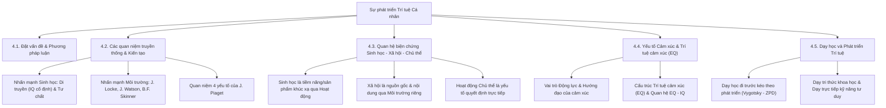

# CHƯƠNG 4: CÁC YẾU TỐ TÁC ĐỘNG TỚI SỰ PHÁT TRIỂN TRÍ TUỆ CÁ NHÂN

> **Phương pháp ghi chép Cornell (Cornell Note-taking System):** Tài liệu lý thuyết chương này được thiết kế chuẩn mực theo hệ thống ghi chép Cornell gồm 3 thành phần hữu cơ: **(1) Cột Từ khóa / Câu hỏi gợi nhớ (Cue Column)** nằm bên trái bảng giúp định vị khái niệm và kích hoạt tư duy truy hồi chủ động (Active Recall); **(2) Cột Ghi chú chi tiết (Note-taking Column)** nằm bên phải hệ thống hóa toàn bộ luận điểm học thuật, số liệu thực nghiệm và cơ chế tâm lý cốt lõi từ giáo trình; và **(3) Khối Tóm tắt (Cornell Summary)** ở cuối mỗi mục cùng cuối chương giúp đúc kết bản chất quy luật biện chứng của sự phát triển trí tuệ cá nhân.

Trong thực tiễn, hoạt động và sự phát triển trí tuệ của trẻ em không diễn ra đơn độc trên "không trung" mà luôn nằm trong mối quan hệ hữu cơ với phức hợp các yếu tố tự nhiên, xã hội và chủ thể. Việc làm sáng tỏ mối quan hệ biện chứng này vừa có ý nghĩa lý luận phương pháp luận then chốt trong tâm lý học trí tuệ, vừa mang giá trị chỉ đạo thực tiễn sâu sắc đối với công tác chẩn đoán, đo lường trí tuệ và tổ chức dạy học phát triển.

---

## 4.1. Đặt vấn đề

| Từ khóa / Câu hỏi gợi nhớ | Ghi chú chi tiết (Nội dung cốt lõi) |
|---|---|
| Ý nghĩa của việc nghiên cứu các yếu tố tác động tới trí tuệ là gì? | - Trong Chương 3 đã khẳng định vai trò quyết định của hoạt động chủ thể (J. Piaget và các nhà tâm lý học hoạt động đã chỉ rõ vai trò từng loại hoạt động qua các giai đoạn lứa tuổi). - Tuy nhiên, hoạt động và sự phát triển trí tuệ luôn diễn ra trong mối quan hệ với phức hợp các yếu tố khác. - Làm sáng tỏ mối quan hệ này vừa giải quyết tranh luận học thuật, vừa chỉ đạo thực tiễn **chẩn đoán, đo lường trí tuệ trẻ em**, tổ chức **dạy học** và các lĩnh vực xã hội liên quan. |
| Tại sao phương pháp phân tích nhân tố tách rời lại bế tắc khi nghiên cứu trí tuệ? | - Nếu dùng phương pháp phân tích nhân tố để tách biệt riêng rẽ sự tác động trực tiếp của từng yếu tố bên ngoài lên chủ thể thì sẽ không bao giờ có câu trả lời cuối cùng. - Khác với khoa học tự nhiên (có thể khu biệt quan hệ trực tiếp giữa hai biến số), trong tâm lý học không thể tách rời sự tác động riêng lẻ của một yếu tố bên ngoài khỏi tổng thể đời sống chủ thể. |
| Ba nhóm yếu tố cơ bản liên quan tới sự phát triển trí tuệ cá nhân? | Khái quát rộng rãi trong tâm lý học gồm **3 nhóm yếu tố**: 1. **Các yếu tố sinh học – thể chất** (bẩm sinh, di truyền, cơ sở sinh lý thần kinh). 2. **Các yếu tố xã hội** (môi trường văn hóa – xã hội, giáo dục, giao tiếp). 3. **Yếu tố chủ thể** (hoạt động, nhu cầu, hứng thú, cảm xúc, ý chí của cá nhân). |
| Phê phán các quan niệm truyền thống quy kết máy móc (tiền định sinh học, định mệnh xã hội, nhị nguyên)? | - Trong lịch sử tâm lý học, nhiều học giả cố xác định mức độ ảnh hưởng riêng rẽ của từng yếu tố để quy kết vai trò quyết định trực tiếp cho **hoặc yếu tố sinh học** (tiền định sinh học), **hoặc yếu tố xã hội** (định mệnh xã hội). - Những người theo lối trung dung (nhị nguyên máy móc) thì coi cả hai yếu tố có vai trò ngang nhau. - **Phê phán theo quan điểm biện chứng:** Mọi cách quy kết trực tiếp như vậy đều **máy móc, cực đoan và phiến diện**, bởi trí tuệ cá nhân không phải là một tổ hợp lắp ghép cơ học từ nhiều bộ phận rời rạc, mà là **một đơn vị tâm lý trọn vẹn**, hình thành và phát triển trong quá trình phát triển chung của đời sống con người. |
| Đâu là yếu tố quyết định và động lực của sự phát triển trí tuệ? | - Yếu tố quyết định trực tiếp và là động lực của sự hình thành, phát triển trí tuệ cá nhân chính là **đời sống và hoạt động của cá nhân đó**. - Hoạt động cá nhân không bắt đầu từ "hư vô" hay diễn ra trên "không trung", mà phải dựa trên những cơ sở nhất định và trong điều kiện xác định — tức là thường xuyên nằm trong mối quan hệ với **cái tự nhiên** và **cái xã hội** cụ thể. |
| Cái tự nhiên và cái xã hội tham gia vào sự phát triển trí tuệ bằng cơ chế nào? | - Các yếu tố tự nhiên và xã hội **không tham gia trực tiếp** vào cấu thành trí tuệ mà chỉ là **cái đặt ra đối với chủ thể**. - Chúng chỉ thực sự trở thành cái tự nhiên hay cái xã hội trong sự phát triển trí tuệ của cá nhân **khi và chỉ khi diễn ra sự tương tác giữa chúng với cá nhân đó thông qua hoạt động**. - Vì vậy, câu hỏi khoa học đúng đắn không phải là *"cái nào quyết định, cái nào hơn cái nào"*, mà phải là: **Chúng cung cấp cái gì và cung cấp như thế nào cho chủ thể trong quá trình phát triển?** Trọng tâm là giải quyết mối quan hệ tác động biện chứng giữa **Tự nhiên – Xã hội – Chủ thể**. |

> **Tóm tắt Mục 4.1 (Cornell Summary):** Trí tuệ cá nhân là một đơn vị tâm lý trọn vẹn chứ không phải tổ hợp cơ học của các nhân tố rời rạc. Do đó, mọi quan điểm quy kết vai trò quyết định trực tiếp cho riêng yếu tố sinh học, riêng yếu tố môi trường hay cộng gộp máy móc cả hai đều phiến diện. Yếu tố tự nhiên và xã hội chỉ chuyển hóa thành chất liệu phát triển trí tuệ khi được khúc xạ thông qua **hoạt động tích cực của chủ thể**.

---

## 4.2. Một số quan niệm về các yếu tố ảnh hưởng tới sự phát triển trí tuệ cá nhân

| Từ khóa / Câu hỏi gợi nhớ | Ghi chú chi tiết (Nội dung cốt lõi) |
|---|---|
| Đặc trưng chung và hai hướng của các quan niệm nhấn mạnh yếu tố sinh học (4.2.1)? | - **Đặc trưng:** Cố gắng xác lập mối quan hệ trực tiếp giữa yếu tố sinh học với sự phát triển và khác biệt cá nhân về trí tuệ; bỏ qua hoặc xem nhẹ nội dung xã hội của trí tuệ và tác động của môi trường văn hóa – xã hội. - **Hai hướng chính:** (1) Quan niệm nhấn mạnh yếu tố **di truyền trí tuệ**; (2) Quan niệm nhấn mạnh yếu tố **tư chất, bẩm sinh**. |
| Nội dung cốt lõi và hệ lụy của quan niệm di truyền trí tuệ (4.2.1.1)? | - **Tư tưởng chủ đạo:** Trí tuệ được quyết định theo con đường di truyền sinh học (gen) giữa các thế hệ; những người cực đoan cho rằng chỉ một thiểu số người có năng lực trí tuệ ưu việt. - **Hệ lụy chính trị – xã hội:** Hình thành **thuyết ưu sinh (Eugenics)** và hàng loạt học thuyết phân biệt chủng tộc, sắc tộc về trí tuệ (như quan điểm của C. Burt, A. Jensen). - **Cơ sở dữ liệu họ viện dẫn:** Dựa vào chỉ số IQ qua trắc nghiệm (Tests), nghiên cứu trên động vật, phương pháp trẻ em sinh đôi và so sánh giữa các nhóm chủng tộc. |
| Ba luận điểm khoa học phê phán thuyết di truyền trí tuệ là gì? | **Luận điểm phê phán thứ nhất (Về bản chất chỉ số IQ và trắc nghiệm):** - Dùng duy nhất trắc nghiệm để khẳng định sự khác biệt bản chất trí tuệ giữa các cá nhân/nhóm xã hội là thiếu cơ sở khoa học. - Ngay cả trắc nghiệm tốt nhất, quy trình nghiêm ngặt nhất cũng chỉ phản ánh mức độ trí tuệ của cá nhân **tại một thời điểm nhất định**. - Chỉ số IQ không phải là con số cố định "dán trên trán" đứa trẻ hay một hằng số bất biến truyền từ cha mẹ sang con cái.  **Luận điểm phê phán thứ hai (Về phương pháp sinh đôi và ảnh hưởng của hoàn cảnh văn hóa gia đình):** - Các nghiên cứu sinh đôi theo hướng di truyền không tách bạch được biến số di truyền khỏi biến số điều kiện nuôi dưỡng. - **Kimling và Jarvik (1993):** Phân tích **52 công trình nghiên cứu** trí tuệ trẻ em có các mối quan hệ huyết thống khác nhau đã chứng minh điều kiện sống chung hay sống trong hoàn cảnh khác nhau tác động mạnh mẽ đến yếu tố di truyền, làm thay đổi vai trò của nó đối với trí tuệ. - **Nghiên cứu trẻ em da đen nuôi trong gia đình da trắng ở Mỹ:** Nhằm bác bỏ quan điểm di truyền cực đoan của A. Jensen, nhiều nhà tâm lý học Mỹ dùng chính trắc nghiệm IQ khảo sát trẻ da đen được nuôi dưỡng trong các gia đình da trắng, kết quả điểm IQ trung bình đạt **106**, tương đương điểm trung bình chuẩn quốc gia của trẻ em da trắng tại Mỹ. - **Nghiên cứu của R. Zajonc và cộng sự (1973):** Khảo sát trên **386.114 thanh niên Hà Lan (19 tuổi)** sống trong các gia đình có quy mô số con từ 1 đến 9. Kết quả: điểm trí tuệ trung bình giảm dần theo quy mô số con và thứ tự sinh theo chuỗi: **2 con $\rightarrow$ 3 con $\rightarrow$ 4 con $\rightarrow$ 1 con $\rightarrow$ 5 con $\rightarrow$ 6 con $\rightarrow$ 7 con $\rightarrow$ 8 con $\rightarrow$ 9 con** (trừ trường hợp con một, gia đình càng đông con thì điểm trí tuệ trung bình càng giảm, và con đầu lòng có điểm trí tuệ cao hơn con út). Từ đó Zajonc khẳng định ảnh hưởng của các mô hình **"văn hóa" gia đình** tới trí tuệ.  **Luận điểm phê phán thứ ba (Về khái niệm chủng tộc):** - Hiện nay không tồn tại chủng tộc thuần khiết theo nghĩa sinh học; chủng tộc ở Mỹ và phương Tây thực chất là một **khái niệm xã hội**. - Sự chênh lệch IQ giữa trẻ da đen và da trắng trong nghiên cứu của C. Burt và A. Jensen phản ánh **sự khác biệt về điều kiện kinh tế – xã hội** chứ không phải điều kiện sinh học. |
| Hai xu hướng trong quan niệm về yếu tố tư chất, bẩm sinh (4.2.1.2)? | - Mọi hiện tượng tâm lý đều có cơ sở sinh lý – thần kinh (định khu chức năng thần kinh và cơ chế lý – hóa sinh trên não). Tuy nhiên khi giải quyết mối quan hệ giữa cơ sở thần kinh và trí tuệ đã tách thành 2 xu hướng:   1. **Xu hướng siêu hình:** Đề cao quá mức cơ sở sinh lý thần kinh và các trung khu não bộ, coi chúng là yếu tố có trước và quy định trực tiếp trí tuệ.   2. **Xu hướng biện chứng:** Đặt yếu tố tư chất bẩm sinh trong mối quan hệ biện chứng với hành động của chủ thể. |
| Quan niệm nhấn mạnh yếu tố môi trường (4.2.2): Nguồn gốc triết học và đại biểu tâm lý học? | - **Nguồn gốc triết học:** Triết học duy cảm Anh thế kỷ XVII – XVIII, tiêu biểu là **J. Locke (G. Lôccơ)** với luận điểm tâm hồn trẻ em như một **"tờ giấy trắng" (Tabula rasa)** mà xã hội có thể viết lên đó bất cứ điều gì mong muốn. - **Biểu hiện trong Tâm lý học hành vi:** Công thức cố hữu $S \rightarrow R$ (*Stimulant* [Kích thích] $\rightarrow$ *Reaction* [Phản ứng]).   + **J. Watson:** Tin tưởng tuyệt đối rằng có thể tạo ra hệ thống hành vi bất kỳ bằng cách thiết lập hệ thống kích thích tương ứng, xã hội có thể "nhào nặn" bất kỳ đứa trẻ bình thường nào thành mẫu người mong muốn bất kể nguồn gốc xuất thân.   + **B.F. Skinner (B.Ph. Skinnơ):** Hiện thực hóa bằng hệ thống **dạy học chương trình hóa – dạy học bằng người máy**. - **Phê phán:** Quan điểm của J. Watson rơi vào **"định mệnh xã hội"** cực đoan; còn dạy học bằng máy của B.F. Skinner khiến người học chỉ thu nhận những kiến thức chi tiết, vụn vặt, thiếu tính hệ thống và thiếu sáng tạo. Đến những năm 1960, quy luật luyện tập (*law of exercise*) của E. Thorndike và lý thuyết củng cố (*theory of reinforcement*) của B.F. Skinner bị phê phán mạnh mẽ và suy yếu. |
| Quan niệm của J. Piaget về 4 yếu tố ảnh hưởng tới sự phát triển trí tuệ (4.2.3)? | Trong lý thuyết kiến tạo, **J. Piaget (G. Piagie)** khẳng định sự phát sinh và phát triển trí tuệ chịu sự chi phối của **4 yếu tố**: 1. **Sự tăng trưởng cơ thể và sự chín muồi của phức hợp hệ thần kinh – nội tiết:** Mở rộng các khả năng thần kinh đã có thành khả năng mới; chỉ là **điều kiện cần chứ chưa đủ** (phải có luyện tập và kinh nghiệm). Vai trò quy định trực tiếp của sự chín muồi thần kinh **giảm dần** qua các giai đoạn lứa tuổi. 2. **Sự luyện tập và kinh nghiệm thu được qua hoạt động với đối tượng:** Gồm 2 loại kinh nghiệm:    - *Kinh nghiệm vật lý:* Tác động lên đối tượng để **trừu xuất các thuộc tính vật lý** khỏi sự vật.    - *Kinh nghiệm lôgic – toán:* Tác động lên đối tượng nhằm nhận biết **kết quả của sự phối hợp hành động** (trừu xuất khỏi chính hành động để cấu trúc hóa hành động, ví dụ trẻ 5–6 tuổi phát hiện tổng của một tập hợp độc lập với thứ tự sắp xếp không gian hay thứ tự đếm). Piaget rất đề cao kinh nghiệm lôgic – toán và cho rằng ở trẻ em nó **có trước** kinh nghiệm vật lý. 3. **Sự tương tác và chuyển giao xã hội:** Có tính hai mặt: một mặt xã hội hóa cung cấp khuôn mẫu trí tuệ xã hội theo lứa tuổi; mặt khác tác động xã hội chỉ có hiệu lực khi có **sự đồng hóa tích cực của trẻ**. 4. **Tính chủ thể và sự phối hợp chung của các hành động cá nhân (Sự tự cân bằng):** Phối hợp cả 3 yếu tố trên thông qua cơ chế **đồng hóa và điều ứng** để hình thành các cấu trúc trí tuệ theo trật tự kế tiếp hằng định (không thể chủ quan nôn nóng "đốt cháy giai đoạn"). Tính chủ thể còn biểu hiện ở vai trò của tình cảm và động cơ. |

> **Tóm tắt Mục 4.2 (Cornell Summary):** Các quan niệm truyền thống thường rơi vào hai thái cực siêu hình: hoặc tuyệt đối hóa di truyền sinh học (coi IQ là hằng số bất biến, dẫn tới thuyết ưu sinh và phân biệt chủng tộc — đã bị bác bỏ bởi các nghiên cứu của Kimling & Jarvik, Zajonc), hoặc tuyệt đối hóa môi trường kích thích bên ngoài (J. Locke, J. Watson, B.F. Skinner — dẫn tới thuyết định mệnh xã hội). J. Piaget đã tiến một bước dài khi chỉ ra 4 yếu tố (sự chín muồi thần kinh – nội tiết, kinh nghiệm vật lý & lôgic-toán, tương tác xã hội, và tính chủ thể tự cân bằng), đặt nền móng cho cách nhìn tích hợp xoay quanh hoạt động của trẻ.

---

## 4.3. Mối quan hệ giữa các yếu tố Sinh học – Xã hội và Chủ thể trong sự phát sinh, phát triển trí tuệ cá nhân

| Từ khóa / Câu hỏi gợi nhớ | Ghi chú chi tiết (Nội dung cốt lõi) |
|---|---|
| Đánh giá thuyết hội tụ hai yếu tố của W. Stern (V. Stecnơ)? | - Nhà tâm lý học Đức **W. Stern (1871–1938)** đề xuất **thuyết hội tụ hai yếu tố**: sự phát triển trí tuệ là kết quả tác động lẫn nhau giữa yếu tố sinh học (tạo ra tiềm năng) và môi trường xã hội (quy định việc triển khai tiềm năng đó thuận lợi hay kém hiệu quả). - **Ưu điểm:** Tích cực hơn các quan điểm tiền định độc tôn một yếu tố. - **Hạn chế căn bản:** Yếu tố **chủ thể** vẫn chưa được đặt ra trực tiếp, nên chưa giải quyết được chìa khóa bản chất của sự phát triển trí tuệ cá nhân. |
| Về phương diện loài, A.N. Leontiev chia quá trình tiến hóa từ động vật lên con người thành mấy giai đoạn (4.3.1)? | Theo C. Mác và Ph. Ăngghen, lịch sử loài người đã tạo ra chính cơ thể con người. **A.N. Leontiev (A.N. Lêônchev)** chia quá trình chuyển từ động vật lên người thành **3 giai đoạn**: 1. **Giai đoạn I – Chuẩn bị về mặt sinh vật của con người** (đầu kỷ thứ ba đến cuối kỷ thứ tư): Động vật cao cấp biết dùng công cụ thô sơ chưa qua chế tạo và có phương tiện giao tiếp đơn giản. **Quy luật sinh vật học chiếm độc tôn**. 2. **Giai đoạn II – Chuyển sang người** (từ vượn người đến người *Neanderthal*): Con người bắt đầu **chế tạo công cụ lao động**, hình thành lao động và xã hội. Quy luật sinh vật học vẫn chiếm ưu thế (tiếp tục biến đổi hình thái giải phẫu), nhưng đã xuất hiện nhân tố mới là **các quy luật xã hội – lịch sử** do lao động sản xuất tạo ra. 3. **Giai đoạn III – Con người hiện đại (*Homo Sapiens*):** Tổ chức cơ thể người đã hoàn thành với đầy đủ thuộc tính sinh vật cần thiết. **Quy luật xã hội – lịch sử trở thành quy luật duy nhất** điều khiển sự phát triển của con người hiện đại (quy luật biến dị, di truyền vẫn tồn tại nhưng không quyết định sự phát triển xã hội của loài người). |
| Về phương diện cá nhân, yếu tố sinh học tác động tới trí tuệ qua cơ chế nào? (Ẩn dụ ván bài & công thức Edison) | - Mối quan hệ giữa yếu tố sinh học (bẩm sinh, di truyền, tư chất thần kinh) với sự phát triển trí tuệ **không phải là quan hệ trực tiếp**, mà được **khúc xạ và phát động gián tiếp thông qua hoạt động của chủ thể**. - **Khía cạnh 1 – Sinh học là tiềm năng đặt ra trước chủ thể:**   + Tư chất thần kinh chỉ đặt ra các khả năng khác nhau, còn khai thác thế nào hoàn toàn tùy thuộc vào hoạt động của chủ thể.   + **Hình ảnh ẩn dụ ván bài:** Giống như người chơi bài lúc đầu nhận được những quân bài tốt hoặc xấu khác nhau (gây thuận lợi hoặc khó khăn ban đầu), nhưng thắng cuộc hay hiệu quả cuộc chơi được quyết định bởi **chính người sử dụng các quân bài đó**.   + **Nghiên cứu của M. Csikszentmihalyi:** Phân tích lao động trí tuệ của **99 nhà khoa học, nghệ sĩ, nhà văn kiệt xuất** (nhiều người đạt giải Nobel) đã chứng minh những trí não sáng tạo vĩ đại đều phát triển theo công thức của **Th. Edison**: **"1% thông minh, 99% mồ hôi"**. - **Khía cạnh 2 – Các trung khu chức năng thần kinh vừa là tiềm năng vừa là sản phẩm của hoạt động:**   + Khi mới sinh, trẻ có rất ít yếu tố sinh lý thần kinh bẩm sinh gắn trực tiếp với một loại trí tuệ cụ thể. Nhờ hoạt động và được hướng dẫn hợp lý, các trung khu chức năng thần kinh mới được hình thành và củng cố; ngược lại sẽ bị thui chột. Như vậy, dù với tư cách là **tiềm năng vật chất** hay là **sản phẩm của sự phát triển**, yếu tố sinh học đều phải tác động **gián tiếp thông qua hoạt động cá nhân**. |
| Vai trò của môi trường xã hội về phương diện phát triển loài (4.3.2): Mô hình tiến hóa tư duy nhân loại? | - Môi trường xã hội không đơn thuần là điều kiện làm nhanh hay chậm sự phát triển, mà là **nguồn gốc và nội dung của trí tuệ** cả về phương diện loài lẫn cá nhân. - **Hai hướng nghiên cứu lịch sử – văn hóa:** (1) Tương quan giữa tiến hóa văn hóa cộng đồng với tiến hóa trí tuệ; (2) Phương thức hành động trí tuệ đặc trưng trong các nền văn hóa khác nhau (nghiên cứu của **C. Jung, G. Mead, M. Weber**). - **Mô hình tiến hóa tư duy phổ quát của loài người:**   + *Về kiểu tư duy:* Tư duy thần thoại $\rightarrow$ Suy luận biện chứng sơ khai (quan sát tổng thể) $\rightarrow$ Tư duy siêu hình (phân tách chi tiết vật thể) $\rightarrow$ Tư duy biện chứng (xác lập nguyên lý, quy luật vận động và nguyên tắc cấu trúc, sinh thành sự vật).   + *Về tri thức, khái niệm khoa học:* Biểu tượng về thế giới $\rightarrow$ Khái niệm biện chứng trừu tượng $\rightarrow$ Khái niệm phân loại cụ thể siêu hình $\rightarrow$ Khái niệm biện chứng cụ thể $\rightarrow$ Tái tạo lại các dạng vật chất trên cơ sở nguyên tắc sinh thành của nó. |
| Tại sao trong cùng một môi trường xã hội chung, mỗi đứa trẻ lại có mức độ trí tuệ khác nhau? (Vygotsky, Elkonin, Lewin) | - Theo **L.X. Vygotsky**, những gì đứa trẻ cần có trong đời sống tâm lý không nằm sẵn trong cơ chế sinh học mà nằm bên ngoài, trong nền văn hóa – xã hội. Môi trường xã hội là **nguồn gốc** (chứ không chỉ là điều kiện như ở động vật) của sự phát triển. - Tuy nhiên, hai đứa trẻ trong cùng một gia đình, cùng lớp học, cùng khu dân cư vẫn có loại hình và mức độ trí tuệ khác nhau. Môi trường xã hội không phải là thế lực xa lạ áp đặt cưỡng bức vào trẻ, mà tuân theo định lý của **Các Mác**: *"Con người tạo ra hoàn cảnh đến mức nào thì hoàn cảnh cũng tạo ra con người đến mức ấy"*. - Môi trường xã hội chung chỉ là nguồn gốc ở dạng **tiềm năng**; nó trở thành **nguồn gốc hiện thực** khi diễn ra quan hệ sinh thành lẫn nhau với hoạt động của chủ thể, tạo nên **môi trường phát triển riêng của mỗi đứa trẻ**:   1. **"Tình huống xã hội của sự phát triển" (L.X. Vưgôtxki):** Tình huống tác động qua lại đặc thù giữa đứa trẻ với thế giới đồ vật và người lớn bao quanh trong từng giai đoạn lứa tuổi.   2. **"Môi trường cỏn con của riêng mỗi đứa trẻ" (Đ.B. Elcônhin / D.B. Elkonin):** Đứa trẻ thông qua hoạt động của mình chủ động "rút tỉa" từ môi trường xã hội chung những yếu tố phù hợp với nhu cầu phát triển của bản thân.   3. **"Trường tâm lý" (K. Lêvin / K. Lewin):** Không gian tâm lý sống động mang tính chủ thể. - Chính **môi trường riêng** được kiến tạo qua hoạt động cá nhân này mới thực sự là nguồn gốc và nội dung hiện thực của sự phát triển trí tuệ cá nhân. |

> **Tóm tắt Mục 4.3 (Cornell Summary):** Vượt qua tính chất nửa vời của thuyết hội tụ hai yếu tố (W. Stern), tâm lý học duy vật biện chứng khẳng định sự thống nhất sinh thành giữa Sinh học – Xã hội – Chủ thể. Ở cấp độ loài, quy luật xã hội – lịch sử giữ vai trò chi phối duy nhất từ giai đoạn *Homo Sapiens* (A.N. Leontiev). Ở cấp độ cá nhân, yếu tố sinh học vừa là tiền đề vật chất vừa là sản phẩm được khúc xạ qua hoạt động (như người chơi sử dụng các quân bài, "1% thông minh, 99% mồ hôi"); còn môi trường xã hội là nguồn gốc và nội dung của trí tuệ nhưng chỉ trở thành hiện thực thông qua "tình huống xã hội của sự phát triển" (Vygotsky) hay "môi trường riêng" (Elkonin) do chính hoạt động của đứa trẻ kiến tạo nên.

---

## 4.4. Yếu tố cảm xúc trong sự phát triển trí tuệ cá nhân

| Từ khóa / Câu hỏi gợi nhớ | Ghi chú chi tiết (Nội dung cốt lõi) |
|---|---|
| Quan niệm của P. Janet, Claparède, J. Piaget, L.X. Vygotsky và D. Goleman về ảnh hưởng của cảm xúc tới trí tuệ (4.4.1)? | - Định kiến thông thường cho rằng cảm xúc chỉ gây nhiễu, làm giảm hiệu suất trí tuệ là phiến diện. Thực chất, **cảm xúc và trí tuệ là hai mặt thống nhất của một hành động cá nhân**. - **P. Janet, E. Claparède:** Trong "trường cư xử" giữa chủ thể và hoàn cảnh, **cảm xúc là động lực** của ứng xử, còn tri giác, vận động và **trí tuệ là sự cấu trúc hóa** các ứng xử đó. - **J. Piaget (1997):** Mỗi ứng xử luôn bao hàm hai mặt không tách rời: **mặt năng lượng** (do cảm xúc tạo ra và điều tiết) và **mặt nhận thức hay cấu trúc** (kết quả của các thao tác trí tuệ). - **L.X. Vygotsky:** Ý nghĩ không nảy sinh từ một ý nghĩ khác mà khởi nguồn từ **lĩnh vực động cơ của ý thức** (xu hướng, cảm xúc, nhu cầu, ý chí). Ông ví **ý nghĩ như đám mây đen** mang cơn mưa từ ngữ, còn **động cơ và cảm xúc như cơn gió** thổi làm đám mây chuyển động và trút xuống trận mưa từ ngữ. - **Daniel Goleman (1995):** Nghiên cứu mối quan hệ giữa IQ và các yếu tố tính cách (*character*) của các nhà quản lý, kết luận sự thành công phụ thuộc chủ yếu vào các phẩm chất tính cách và cảm xúc hơn là chỉ số IQ đơn thuần; cảm xúc chỉ đạo trí tuệ và nhiều khi mạnh hơn cả khả năng lôgic – toán. |
| Hai vai trò cơ bản và 3 biểu hiện hướng đạo của cảm xúc trong hành động trí tuệ? | Cảm xúc tham gia vào hoạt động trí tuệ trên **2 phương diện**: vừa là **động lực** (thúc đẩy hoặc kìm hãm) vừa là **người hướng đạo** cho hành động trí tuệ. Vai trò **hướng đạo** thể hiện ở **3 khía cạnh**: 1. **Thâm nhập toàn diện:** Xâm nhập và nhuốm màu toàn bộ quá trình hành động trí tuệ ngay từ khâu tri giác sự vật đến tư duy trừu tượng. 2. **Hình thành tâm thế dẫn dắt thao tác:** Ngay khi xuất hiện một thao tác trí tuệ thì liền xuất hiện một cảm xúc tương ứng; cảm xúc này trở thành **tâm thế** dẫn dắt chuỗi thao tác tiếp theo đi theo hướng phù hợp với tâm thế đó. 3. **Chi phối việc ra quyết định:** Kết quả của mỗi thao tác/hành động trí tuệ mang lại một cảm xúc mới, và cảm xúc mới này chi phối các quyết định tiếp theo (đặc biệt khi lựa chọn phương án và kế hoạch hành động trí tuệ). |
| Nguồn gốc thuật ngữ và các định nghĩa tiêu biểu về Trí tuệ cảm xúc – EQ (4.4.2)? | - Thuật ngữ **"Trí tuệ cảm xúc" (*Emotional Intelligence*)** lần đầu tiên được hai nhà tâm lý học Mỹ **Peter Salovey** (ĐH Yale) và **John Mayer** (ĐH New Hampshire) sử dụng vào năm **1990**. - **Định nghĩa của P. Salovey & J. Mayer (1990):** Khả năng hiểu rõ cảm xúc bản thân, thấu hiểu cảm xúc của người khác, phân biệt được chúng và sử dụng chúng để hướng dẫn suy nghĩ và hành động của bản thân. - **Định nghĩa của Daniel Goleman (1995):** Khả năng giám sát các cảm giác và cảm xúc của bản thân và của người khác, phân biệt chúng và sử dụng các thông tin đó nhằm định hướng suy nghĩ và hành động của mình. - **Định nghĩa của H. Steve (1996):** Sự kết hợp giữa sự nhạy cảm về cảm xúc có tính chất tự nhiên với các kỹ năng quản lý cảm xúc có được do tự học hỏi, nhằm giúp con người đạt được hạnh phúc trong cuộc sống. - **Định nghĩa cập nhật của P. Salovey (1997):** Trong cuốn *"Sự phát triển cảm xúc và trí tuệ cảm xúc"*, ông định nghĩa EQ gồm khả năng tiếp nhận đúng, đánh giá và thể hiện cảm xúc; đánh giá và phân loại cảm xúc giúp định hướng suy nghĩ; hiểu, điều khiển và định hướng cảm xúc nhằm gia tăng sự phát triển cảm xúc và trí tuệ. - **Định nghĩa của Edward De Bono (Anh):** Loại trí tuệ giúp cá nhân đi sâu phân tích, khám phá và làm bộc lộ cảm xúc của chủ thể ra ngoài; mang bản chất là **trí tuệ trực giác, linh cảm và phi lôgic**. |
| Cấu trúc của Trí tuệ cảm xúc theo P. Salovey (5 thành phần), H. Steve (3 dấu hiệu) và 4 thành phần cốt lõi có thể đo lường? | - **Cấu trúc 5 thành phần của P. Salovey:**   1. Khả năng thấu hiểu những cảm xúc của chính mình.   2. Khả năng phát hiện, đặt tên từng cảm xúc riêng của mình và người khác; phân tích, phê phán và truyền đạt rõ ràng cảm xúc.   3. Khả năng thấu cảm, đồng cảm, đánh giá đúng, thúc đẩy, truyền cảm hứng, khuyến khích và an ủi người khác.   4. Khả năng đưa ra quyết định thông minh, tạo sự cân bằng giữa cảm xúc và lý trí.   5. Làm chủ các mối liên hệ người – người, dễ dàng tiếp xúc với người khác (quản lý cảm xúc trong giao tiếp). - **Ba dấu hiệu nhận dạng của H. Steve:** (1) Biết cảm xúc của mình và người khác cùng hành động sẽ xảy ra; (2) Biết nguyên nhân cảm xúc tích cực/tiêu cực và cách chuyển tiêu cực thành tích cực; (3) Nhận thức, nhạy cảm và có kỹ năng quản lý cảm xúc để tối đa hóa hạnh phúc. - **Bốn thành phần cốt lõi của trí tuệ cảm xúc (có thể đo lường qua trắc nghiệm):**   1. *Khả năng nhận biết, đánh giá và thể hiện cảm xúc bản thân.*   2. *Khả năng nhận biết và đánh giá cảm xúc của người khác (gắn liền với sự thấu cảm).*   3. *Khả năng điều chỉnh cảm xúc của bản thân và của người khác* (khắc phục cảm xúc tiêu cực, duy trì cảm xúc tích cực, làm dịu cơn nóng giận của người khác).   4. *Sử dụng cảm xúc để định hướng và điều khiển hành động.* |
| Cơ chế trí tuệ làm thay đổi cảm xúc (E. De Bono), vai trò của sự thấu cảm (D. Craig) và cách đo lường EQ? | - Kiểm soát cảm xúc trên thực tế còn phụ thuộc vào các phẩm chất nhân cách (bản lĩnh, nghị lực, tính cách, kiểu hướng nội/hướng ngoại, khí chất, kiểu hình thần kinh) — vốn cũng được hình thành qua kinh nghiệm văn hóa. - Theo **E. De Bono**, trí tuệ làm thay đổi cảm xúc **không phải bằng thành phần lôgic mà bằng nhận thức khách quan và sâu sắc**, giúp cảm xúc đang tàng ẩn trong tâm hồn được bộc lộ rõ ràng thành một bộ phận của hành động trí tuệ để chủ thể kiểm soát và điều khiển. - **Nghiên cứu của D. Craig (ĐH Sydney):** Chỉ ra mối quan hệ nhân quả giữa **sự thấu cảm** với hành vi cá nhân theo nguyên tắc phổ quát: **thấu cảm như thế nào sẽ có hành vi tương ứng như vậy**. - **Đo lường chỉ số EQ (*Emotion Quotient*):** Chưa có công thức toán học chung duy nhất; thường đo qua các biểu hiện cụ thể (tự đánh giá, tự kiềm chế, đồng cảm, kỷ luật, lạc quan) bằng 2 loại trắc nghiệm: **trắc nghiệm tự thuật** và **trắc nghiệm khách quan** (tuy nhiên khó khăn và kém khách quan hơn so với trắc nghiệm IQ truyền thống). |
| Bốn mối quan hệ cơ bản giữa chỉ số EQ và chỉ số IQ là gì? | Khi đặt trong hệ thống nhân cách chung (cùng với trí tuệ xã hội, trí tuệ cá nhân theo cách phân loại của H. Gardner), giữa **EQ và IQ có 4 mối quan hệ nổi bật**: 1. **Tính độc lập tương đối:** EQ và IQ độc lập tương đối với nhau trong hệ thống nhân cách chung (có người IQ cao nhưng EQ thấp và ngược lại). 2. **Bổ sung cho nhau:** EQ không đối lập với IQ mà bổ sung, hỗ trợ nhau; **chỉ số EQ cao tạo điều kiện thuận lợi cho chỉ số IQ phát triển**. 3. **Độ ổn định khác nhau:** Chỉ số **IQ có tính ổn định cao hơn** chỉ số EQ (EQ dễ được rèn luyện, biến đổi qua trải nghiệm hơn). 4. **Mức độ ảnh hưởng tới sự thành đạt:** Trí tuệ cảm xúc (EQ) ảnh hưởng tới **hiệu quả hoạt động thực tiễn và sự thành đạt của cá nhân nhiều hơn** so với trí tuệ lôgic (IQ), đồng thời giúp cá nhân thích ứng và đối phó với stress trong xã hội công nghiệp hiện đại. |

> **Tóm tắt Mục 4.4 (Cornell Summary):** Cảm xúc và trí tuệ là hai mặt năng lượng và cấu trúc không thể tách rời của hành động cá nhân (Janet, Claparède, Piaget, Vygotsky). Cảm xúc vừa là động lực vừa là người hướng đạo xuyên suốt quá trình tư duy. Ngược lại, sự thâm nhập của nhận thức trí tuệ vào đời sống xúc cảm tạo nên **Trí tuệ cảm xúc (EQ)** (Salovey & Mayer, Goleman, Steve, De Bono) với 4 năng lực cốt lõi: nhận biết cảm xúc bản thân, thấu cảm người khác, điều chỉnh cảm xúc và sử dụng cảm xúc để định hướng hành động. EQ và IQ độc lập tương đối, bổ trợ cho nhau, trong đó IQ ổn định hơn nhưng EQ lại có vai trò lớn hơn đối với sự thành công và hạnh phúc thực tiễn của con người.

---

## 4.5. Dạy học và phát triển trí tuệ

| Từ khóa / Câu hỏi gợi nhớ | Ghi chú chi tiết (Nội dung cốt lõi) |
|---|---|
| Ba nhóm quan niệm về mối quan hệ giữa dạy học và phát triển trí tuệ trẻ em (4.5.1)? | Trong tâm lý học và giáo dục học tồn tại **3 nhóm quan niệm**: 1. **Quan niệm 1 (Độc lập / Dạy học đi sau sự phát triển):** Coi phát triển trí tuệ là quá trình tự thân độc lập; dạy học chỉ đi song song hoặc đi sau, dựa trên thành tựu đã chín muồi để làm bộc lộ sự phát triển có sẵn. Bao gồm thuyết tiến hóa sinh học (S. Darwin), thuyết di truyền gen và cả thuyết kiến tạo của **J. Piaget** (coi phát triển tuân theo trật tự hằng định nội tại, dạy học không thể "đốt cháy giai đoạn" mà chỉ đi song hành). 2. **Quan niệm 2 (Đồng nhất dạy học với phát triển):** Đại diện là **Tâm lý học hành vi** với công thức $S \rightarrow R$. Coi dạy học và phát triển hoàn toàn trùng khít, chồng khít lên nhau (dạy học thế nào thì phát triển thế ấy) một cách máy móc, giáo điều. 3. **Quan niệm 3 (Dạy học đi trước và kéo theo sự phát triển – L.X. Vygotsky):** Quan niệm khoa học và cách mạng nhất. Khẳng định trước khi đến trường trẻ đã có sự phát triển nhất định; dạy học nếu đi sau sẽ kìm hãm, còn **dạy học đúng đắn phải đi trước sự phát triển và kéo sự phát triển đi lên**. |
| Hai trình độ phát triển của trẻ em theo L.X. Vygotsky và ý nghĩa của Vùng phát triển gần nhất (ZPD)? | Để dạy học đi trước sự phát triển, **L.X. Vygotsky** chỉ ra phải xác định đúng **2 trình độ phát triển** của trẻ: 1. **Trình độ phát triển hiện thời (hiện tại):** Các chức năng tâm lý **đã đạt tới mức chín muồi**; về mặt chẩn đoán, biểu hiện qua việc trẻ **độc lập giải quyết nhiệm vụ** mà không cần bất kỳ sự trợ giúp nào từ bên ngoài. 2. **Vùng phát triển gần nhất (Khả năng phát triển gần nhất – ZPD):** Các chức năng tâm lý **đang trong quá trình trưởng thành nhưng chưa chín muồi**; biểu hiện qua tình huống trẻ **hoàn thành được nhiệm vụ khi có sự hợp tác, gợi ý, giúp đỡ của người lớn/bạn bè**, mà nếu tự làm một mình thì trẻ chưa thực hiện được. - **Quy luật vận động biện chứng:** Vùng phát triển gần nhất của ngày hôm nay sẽ chuyển hóa thành trình độ hiện tại của ngày mai, đồng thời mở ra vùng phát triển gần mới cao hơn. - **Nguyên tắc thực tiễn trong dạy học:**   + Chẩn đoán tâm lý không được chỉ dừng ở trình độ hiện tại mà phải phát hiện được vùng phát triển gần nhất thông qua sự hợp tác.   + Dạy học phải tác động vào vùng phát triển gần nhất (không đi sau nhưng cũng **không được đi trước quá xa**, mà phải cận kề với sự phát triển) trên nền tảng **hoạt động hợp tác giữa thầy giáo và học sinh**. |
| Phương hướng 1 (4.5.2): Phát triển trí tuệ thông qua dạy tri thức khoa học gồm những mô hình tiêu biểu nào? | Dựa trên nguyên lý trí tuệ có hai mặt không tách rời là **nội dung tri thức** và **các thao tác trí óc dẫn đến tri thức đó**: 1. **J. Bruner (Chương trình "Xoáy trôn ốc"):** Kế thừa Piaget, xác định cấu trúc nhận thức gồm **3 mức thể hiện**: **Hành động $\rightarrow$ Biểu tượng $\rightarrow$ Khái niệm**. Đề xuất thiết kế chương trình học tập theo hình **"xoáy trôn ốc"** và khẳng định có thể dạy khái niệm lý luận trừu tượng cho học sinh nhỏ tuổi nếu có phương pháp phù hợp. 2. **P.Ia. Galperin (1952 – Lý thuyết hình thành hành động trí tuệ theo giai đoạn):** Phân tích triệt để cơ chế và các bước chuyển hóa một khái niệm (đồng thời là một hành động trí tuệ) từ **bên ngoài (xã hội)** vào **bên trong (cá nhân trẻ em)** cùng các kiểu định hướng trong dạy học. 3. **L.V. Zankov (1970 – Hệ thống dạy học phát triển):** Dựa trên ZPD của Vygotsky, đề xuất 4 nguyên tắc dạy học: (a) Tôn trọng kinh nghiệm đã có của trẻ; (b) Tăng dần mức độ và nhịp độ khó khăn của việc học; (c) **Nâng cao tỷ trọng tri thức lý luận khái quát** trong nội dung dạy học; (d) Làm cho học sinh **ý thức về toàn bộ quá trình học tập**, hình thành thái độ tự giác. 4. **A.V. Petrovski (1982):** Chỉ ra sự tương đồng giữa cấu trúc nhận thức và kiểu tư duy của cá nhân, từ đó dạy tư duy thông qua việc dạy các cấu trúc nhận thức. 5. **R. Fischer (Tâm lý học nhận thức):**    - Cấu trúc trí tuệ gồm 3 thành phần: *Siêu thành tố*, *Thành tố thể hiện*, *Thành tố tiếp nhận thông tin*.    - Quá trình tư duy gồm 3 thao tác: (1) *Tiếp nhận ngữ liệu mới (đầu vào)* $\rightarrow$ (2) *Chiến lược sử dụng kiến thức và giải quyết vấn đề (đầu ra)* $\rightarrow$ (3) *Siêu nhận thức và ra quyết định*.    - Mô hình rèn luyện kỹ năng khoa học cho trẻ gồm 3 bước: (1) **Hình thành ý tưởng** (thể hiện, thắc mắc, nêu luận đề) $\rightarrow$ (2) **Thu thập thông tin** (quan sát, giải thích, trao đổi) $\rightarrow$ (3) **Thử nghiệm lý thuyết** (khảo sát, thí nghiệm, kiểm tra). |
| Phương hướng 2 (4.5.2): Phát triển trí tuệ thông qua việc trực tiếp dạy các kỹ năng tư duy gồm những chương trình nào? | Cùng với sự tham gia của toán học, điều khiển học và lý thuyết thông tin, nhiều chương trình huấn luyện trực tiếp kỹ năng và thủ thuật tư duy đã được ứng dụng rộng rãi: 1. **Chương trình huấn luyện các thủ thuật trí tuệ** của **R. Sternberg (1987)**. 2. **Chương trình dạy học hình thành năng lực tư duy toán học (tư duy lý luận)** cho học sinh của **V.V. Davydov (V.V. Đavưđov)**. 3. **Chương trình dạy chiến lược tư duy theo chiều ngang (Lateral Thinking) và chiều dọc (Vertical Thinking)** của **E. De Bono**. 4. **Phương pháp luyện trí não** của **O. Kagayaki**. |

> **Tóm tắt Mục 4.5 (Cornell Summary):** Khác với quan niệm coi dạy học đi sau sự phát triển (Darwin, thuyết di truyền, Piaget) hay đồng nhất máy móc dạy học với phát triển (thuyết hành vi), L.X. Vygotsky khẳng định **dạy học phải đi trước và kéo theo sự phát triển** bằng cách tác động vào **Vùng phát triển gần nhất (ZPD)** thông qua sự hợp tác thầy – trò. Hiện thực hóa nguyên lý này, giáo dục hiện đại triển khai theo hai phương hướng lớn bổ trợ nhau: (1) Phát triển trí tuệ thông qua dạy hệ thống tri thức khoa học (Bruner, Galperin, Zankov, Petrovski, R. Fischer) và (2) Rèn luyện trực tiếp các kỹ năng, chiến lược và thủ thuật tư duy (Sternberg, Davydov, De Bono, Kagayaki).

---

## Tóm tắt toàn chương (Cornell Summary)

1. **Quan điểm phương pháp luận biện chứng:** Trí tuệ cá nhân là một chỉnh thể tâm lý thống nhất. Các yếu tố tự nhiên (sinh học) và xã hội (môi trường) không quyết định trực tiếp theo lối cơ học mà luôn được khúc xạ, chuyển hóa thông qua **đời sống và hoạt động tích cực của chủ thể**.
2. **Phê phán các học thuyết cực đoan và kế thừa J. Piaget:** Thuyết tiền định sinh học tuyệt đối hóa gen di truyền và coi IQ là hằng số bất biến (đã bị bác bỏ bởi các bằng chứng thực nghiệm của Kimling & Jarvik, nghiên cứu trẻ da đen trong gia đình da trắng có IQ = 106, và nghiên cứu của Zajonc trên 386.114 thanh niên Hà Lan). Thuyết định mệnh xã hội của J. Locke, J. Watson, B.F. Skinner lại biến trẻ em thành thực thể thụ động. J. Piaget đã kết nối các nhân tố qua 4 yếu tố: sự chín muồi thần kinh – nội tiết, kinh nghiệm vật lý & lôgic-toán, tương tác xã hội và tính chủ thể tự cân bằng.
3. **Cơ chế biện chứng Sinh học – Xã hội – Chủ thể:** Yếu tố sinh học (tư chất, hệ thần kinh) vừa là tiền đề vật chất ban đầu (như những quân bài trong tay người chơi, công thức Edison "1% thông minh, 99% mồ hôi") vừa là sản phẩm được kiến tạo qua hoạt động. Môi trường xã hội là nguồn gốc và nội dung của trí tuệ, nhưng chỉ trở thành hiện thực thông qua **"tình huống xã hội của sự phát triển"** (Vygotsky), **"môi trường riêng"** (Elkonin) hay **"trường tâm lý"** (K. Lewin) do chính hoạt động của đứa trẻ tạo lập.
4. **Cảm xúc và Trí tuệ cảm xúc (EQ):** Cảm xúc là mặt năng lượng, đóng vai trò **động lực** và **hướng đạo** cho mọi thao tác trí tuệ. Ngược lại, năng lực nhận thức và làm chủ cảm xúc tạo thành **Trí tuệ cảm xúc (EQ)** với 4 thành phần cốt lõi (nhận biết cảm xúc bản thân, thấu cảm người khác, điều chỉnh cảm xúc, và sử dụng cảm xúc định hướng hành động). EQ và IQ độc lập tương đối nhưng bổ sung chặt chẽ cho nhau.
5. **Dạy học phát triển trí tuệ:** Dạy học chân chính phải **đi trước sự phát triển**, tác động vào **Vùng phát triển gần nhất (ZPD)** thông qua hoạt động hợp tác thầy – trò (L.X. Vygotsky), được triển khai qua cả con đường dạy cấu trúc tri thức khoa học (Bruner, Galperin, Zankov, Fischer) lẫn huấn luyện trực tiếp kỹ năng tư duy (Sternberg, Davydov, De Bono, Kagayaki).

---

## Câu hỏi tự kiểm tra nhanh (Self-Testing Cues)

1. Tại sao không thể dùng phương pháp phân tích nhân tố tách rời như trong khoa học tự nhiên để xác định vai trò riêng rẽ của yếu tố sinh học và xã hội đối với trí tuệ cá nhân?
2. Hãy trình bày 3 luận điểm khoa học (kèm số liệu nghiên cứu của Kimling & Jarvik, Zajonc 1973 và nghiên cứu trẻ da đen nuôi trong gia đình da trắng) để bác bỏ thuyết di truyền trí tuệ cực đoan.
3. Phân tích 4 yếu tố ảnh hưởng tới sự phát triển trí tuệ theo J. Piaget. Kinh nghiệm vật lý và kinh nghiệm lôgic – toán khác nhau ở điểm nào?
4. Giải thích hình ảnh ẩn dụ "ván bài" và kết luận của M. Csikszentmihalyi trong việc làm sáng tỏ mối quan hệ giữa tư chất sinh học và hoạt động chủ thể.
5. Phân biệt môi trường xã hội chung (nguồn gốc tiềm năng) với "tình huống xã hội của sự phát triển" (Vygotsky) và "môi trường riêng" (Elkonin).
6. Cảm xúc thực hiện vai trò "hướng đạo" cho hành động trí tuệ qua 3 phương diện nào? Nêu 4 thành phần cốt lõi của Trí tuệ cảm xúc (EQ) và 4 mối quan hệ giữa EQ với IQ.
7. Phân biệt Trình độ phát triển hiện tại và Vùng phát triển gần nhất (ZPD) của L.X. Vygotsky. Tại sao nói "dạy học phải đi trước và kéo theo sự phát triển"?
8. So sánh hai phương hướng nâng cao hiệu quả dạy học phát triển trí tuệ: thông qua dạy tri thức khoa học (Bruner, Galperin, Zankov, Fischer) và thông qua dạy trực tiếp kỹ năng tư duy (Sternberg, Davydov, De Bono, Kagayaki).
