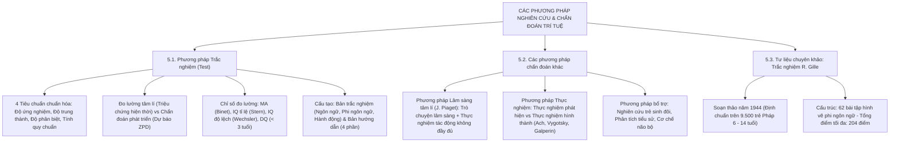

# CHƯƠNG 5: CÁC PHƯƠNG PHÁP NGHIÊN CỨU TRÍ TUỆ TRONG TÂM LÍ HỌC

> **Hướng dẫn học tập theo Phương pháp ghi chép Cornell (Cornell Note-taking System):**
> Tài liệu lý thuyết Chương 5 được thiết kế theo mô hình ghi chép khoa học **Cornell** nhằm tối ưu hóa khả năng phân tích tư duy phương pháp luận, đối chiếu các công thức đo lường và tự kiểm tra kiến thức trong môn *Tâm lý học Trí tuệ*:
> 1. **Cột Từ khóa & Câu hỏi gợi nhớ (Cue Column - Bên trái):** Hệ thống hóa các thuật ngữ cốt lõi (Trắc nghiệm chuẩn hóa, Độ ứng nghiệm, Độ trung thành, Độ phân biệt, Tính quy chuẩn, Đo lường tâm lí vs Chẩn đoán tâm lí, Tuổi trí khôn MA, Chỉ số IQ của W. Stern và D. Wechsler, Chỉ số phát triển DQ, Phân phối chuẩn Gauss, Phương pháp lâm sàng tâm lí của J. Piaget, Thực nghiệm phát hiện và Thực nghiệm hình thành, Trắc nghiệm trí tuệ đa dạng R. Gille) cùng hệ thống câu hỏi định hướng ôn tập.
> 2. **Cột Ghi chú chi tiết (Note-taking Column - Bên phải):** Giải trình tường minh định nghĩa của các học giả (Nguyễn Khắc Viện, K.M. Gurevich, F.S. Freeman, Trần Trọng Thủy, L.S. Vygotsky, A. Binet, W. Stern, D. Wechsler, R. Shaffer, J. Piaget, P.Ia. Galperin, R. Gille), phân tích công thức toán học, quy trình thực thi và phê phán phương pháp luận.
> 3. **Phần Tóm tắt (Summary - Cuối mỗi mục và cuối chương):** Khái quát hóa bản chất từng nhóm phương pháp nghiên cứu nhằm giúp người học nắm vững bức tranh toàn cảnh: kết hợp hài hòa giữa lượng hóa tiêu chuẩn (Trắc nghiệm) và phân tích cấu trúc động thái bên trong (Lâm sàng, Thực nghiệm).

---

## Sơ đồ cấu trúc tổng quan các phương pháp nghiên cứu trí tuệ

---

## 5.1. Phương pháp trắc nghiệm (Test) trong đo lường trí tuệ

| Từ khóa / Câu hỏi gợi nhớ | Ghi chú chi tiết (Nội dung cốt lõi) |
| :--- | :--- |
| **Khái niệm Trắc nghiệm (Test) là gì?** *(Định nghĩa của Nguyễn Khắc Viện 1991, K.M. Gurevich 1970, F.S. Freeman 1971)* | - **Nguyên nghĩa:** Theo Nguyễn Khắc Viện (1991), trắc nghiệm (*Test*) nguyên nghĩa là phép thử, phép đo được sử dụng rộng rãi trong đời sống xã hội và khoa học. Trong tâm lí học, không phải phép thử nào cũng là trắc nghiệm, mà trắc nghiệm phải là **phép thử đã được chuẩn hóa**, trở thành công cụ đo lường các khía cạnh tâm lí. - **Định nghĩa của K.M. Gurevich (1970):** *"Trắc nghiệm là một thử nghiệm tâm - sinh lí, đã được chuẩn hóa và thường được hạn chế về thời gian, dùng để xác lập sự khác biệt giữa các cá nhân về trí tuệ, nhân cách và những năng lực chuyên môn, theo mục đích thực tiễn của nhà nghiên cứu"*. - **Định nghĩa của Nguyễn Khắc Viện (1991):** *"Trắc nghiệm là một hệ thống biện pháp đã được chuẩn hóa về kĩ thuật, được quy định về nội dung và cách làm, nhằm đánh giá ứng xử và kết quả hoạt động của một người hay một nhóm người, cung cấp một chỉ báo về tâm lí (trí lực, cảm xúc, năng lực, nét nhân cách...), trên cơ sở đối chiếu với một thang đo đã được tiêu chuẩn hoặc với một hệ thống phân loại trên những nhóm mẫu khác nhau về phương diện xã hội"*. - **Định nghĩa của F.S. Freeman (1971):** *"Trắc nghiệm tâm lí là một công cụ đã được tiêu chuẩn hóa, dùng để đo lường khách quan một hay nhiều khía cạnh của nhân cách hoàn chỉnh qua những mẫu trả lời bằng ngôn ngữ hay phi ngôn ngữ hoặc những loại hành vi khác"*. |
| **4 Tiêu chuẩn của một trắc nghiệm chuẩn hóa** *(Validity, Fidelity, Difference, Standardize)* | Để phân biệt một trắc nghiệm đã được chuẩn hóa (*Standardized test*) với các phép thử thông thường, công cụ đó bắt buộc phải đáp ứng **4 tiêu chuẩn cốt lõi**: 1. **Độ ứng nghiệm / Độ hiệu lực (Validity - Tính hiệu quả):** Thể hiện qua hai phương diện: (a) Trắc nghiệm phải đo được đúng yếu tố tâm lí định đo; (b) Phải đo được khả năng của yếu tố đó đúng như hiệu suất của nó trong hoạt động thực tiễn thường ngày (hệ số tương quan giữa kết quả trắc nghiệm với hiệu quả hoạt động thực tiễn càng gần $1$ thì độ ứng nghiệm càng cao). Đây là tiêu chuẩn **dễ bị vi phạm nhất** khi đem trắc nghiệm chuẩn hóa ở nền văn hóa này áp dụng sang nền văn hóa khác (đặc biệt là trắc nghiệm dùng lời). Cách khắc phục: giới hạn phạm vi ứng dụng và tăng cường nghiệm pháp phi ngôn ngữ (hình ảnh, tranh vẽ, hành động). 2. **Độ tin cậy / Độ trung thành (Fidelity):** Kết quả trắc nghiệm phải có độ ổn định cao, không dao động bất thường khi đo hai lần trên cùng một đối tượng với khoảng cách thời gian nhất định. Hai cách xác định: (a) Tính hệ số tương quan giữa các chỉ số thử nghiệm lặp lại (*test-retest*) trên cùng nghiệm thể bằng cùng một trắc nghiệm; (b) Tính hệ số tương quan giữa hai nửa của cùng một trắc nghiệm (*split-half*), đồng thời có thể tăng độ trung thành bằng cách tăng số lượng bài tập. 3. **Độ phân biệt (Difference):** Khả năng đo lường và phát hiện được những khác biệt nhỏ nhất giữa các yếu tố tâm lí trong một nghiệm thể và giữa các nghiệm thể khác nhau trong nhóm. 4. **Tính quy chuẩn (Standardize):** Trắc nghiệm phải mang tính phổ biến để sử dụng cho một quần thể người dựa trên các tiêu chuẩn định chuẩn từ một nhóm mẫu đại diện cho quần thể đó. |
| **Phân biệt Đo lường tâm lí (Psychometry) và Chẩn đoán tâm lí (Psychodiagnostic)** *(Quan điểm của Trần Trọng Thủy 1992 & L.S. Vygotsky 1982)* | - **Đo lường tâm lí (Psychometry):** Là sự lượng hóa hiện trạng các yếu tố tâm lí nhờ sự trợ giúp của phương tiện khách quan và phương pháp thống kê toán học theo chuẩn đã định. - **Chẩn đoán tâm lí (Psychodiagnostic):** Là việc thu thập các tài liệu liên quan tới yếu tố tâm lí bằng nhiều phương pháp và phương tiện khác nhau, từ đó rút ra kết luận về bản chất yếu tố đó và **dự báo xu thế phát triển** của nó. - **Ba điều kiện chung của mọi chẩn đoán tâm lí (Trần Trọng Thủy, 1992):** (1) Vạch ra được cái đặc trưng, đặc biệt về phẩm chất của cá nhân trên nền các thuộc tính khác theo một sơ đồ thống nhất; (2) Không giới hạn ở việc xác nhận cái hiện có mà phải bao gồm cả **sự dự đoán**; (3) Trình bày bằng những khái niệm giải thích dựa trên tài liệu mô tả, nói lên được hành vi con người. - **Phân biệt Đo lường triệu chứng và Chẩn đoán phát triển (L.S. Vygotsky, 1982):** Đo lường chỉ là nghiên cứu triệu chứng tại một thời điểm (chỉ là trường hợp riêng, cụ thể của chẩn đoán). Chẩn đoán phát triển nghiên cứu sâu rộng toàn bộ quá trình (con đường) phát triển qua các thời kì, giai đoạn, pha với đầy đủ động thái bình thường và bất thường. Vygotsky ví nhà tâm lí học như **người làm vườn**: không chỉ căn cứ vào số quả đã chín trên cây để xác định sản lượng, mà còn phải đánh giá tình trạng những quả chưa chín và sắp chín (tức là cái đang hình thành trong **vùng phát triển gần nhất**). |
| **Tuổi trí khôn (Mental Age) và Chỉ số trí tuệ IQ của W. Stern (1912)** *(Công thức và hạn chế)* | - **Tuổi trí khôn / Tuổi trí tuệ (Mental Age - MA):** Do nhà tâm lí học Pháp **A. Binet** đưa ra năm **1905**, được xác định bằng kết quả thực hiện trắc nghiệm của trẻ so với những trẻ phát triển trung bình trong quần thể cùng tuổi đời (tính theo tháng). - **Hạn chế của Tuổi trí tuệ:** Không phản ánh được sự chênh lệch nhịp độ tiến bộ trí tuệ giữa các lứa tuổi (Ví dụ: cùng lệch $30$ tháng tuổi trí tuệ, ở trẻ $5$ tuổi đời thì bằng $1/2$ hoặc gấp rưỡi tuổi thực, nhưng ở trẻ $12{,}5$ tuổi đời chỉ tương ứng $1/5$ tuổi thực). - **Công thức IQ của W. Stern (1912 - Nhà tâm lí học Đức):** $$\text{IQ} = \frac{\text{Tuổi trí tuệ}}{\text{Tuổi đời}} \times 100$$ - **Bất cập của công thức W. Stern:** Vẫn không phản ánh đúng nhịp độ phát triển trí tuệ qua các lứa tuổi; kém hiệu quả khi đo trí tuệ người lớn (vì tuổi đời tiếp tục tăng trong khi điểm tuổi trí tuệ ngừng tăng theo tuyến tính); chịu sự chi phối nặng nề bởi khác biệt văn hóa và môi trường sống. |
| **Công thức IQ độ lệch của David Wechsler (1955), tính không bất biến của IQ và chỉ số DQ** | - **Công thức IQ của David Wechsler (1955 - Nhà tâm lí học Mỹ):** $$\text{IQ} = \left( \frac{X - X_{tb}}{d} \right) \times 15 + 100$$ *(Trong đó: $X$ là điểm trắc nghiệm của cá nhân; $X_{tb}$ là điểm trung bình cộng của nhóm mẫu chuẩn; $d$ là độ lệch chuẩn của nhóm).* - **Bản chất không bất biến của IQ (R. Shaffer, 1992):** Phủ nhận quan điểm nửa đầu thế kỉ XX cho rằng IQ do gen quy định và cố định suốt đời. IQ chỉ là một ước tính về sự thực hiện bài kiểm tra tại một thời điểm xác định, **tuyệt nhiên không phải là hằng số hay cái mác dán lên trí tuệ cá nhân suốt đời**. IQ giống như **nhiệt độ của bệnh nhân** đối với thầy thuốc: cung cấp dấu hiệu tại thời điểm đo chứ không khẳng định sự vĩnh viễn của bệnh. Sự biến đổi IQ phản ánh vai trò của hoạt động chủ thể và môi trường sống. Ngoài ra, cần đặt IQ trong tương quan với **EQ** để tuyển chọn và sử dụng nhân lực hiệu quả. - **Chỉ số phát triển DQ (Developmental Quotient):** Đối với trẻ nhỏ dưới $3$ tuổi (đặc biệt dưới $2$ tuổi), trí khôn còn sơ đẳng, sự phát triển diễn ra nhanh và biến động lớn trên bình diện **Tâm - vận động**. Do đó, người ta dùng **chỉ số phát triển DQ** cho trẻ dưới $3$ tuổi để đo mức độ thực hiện lịch trình phát triển tâm - vận động so với trẻ cùng độ tuổi, còn chỉ số IQ thường chỉ áp dụng cho trẻ từ $3 - 4$ tuổi trở lên. |
| **Phân phối chuẩn (Gauss) và Bảng phân mức trí tuệ** *(Stanford-Binet vs Wechsler)* | - **Phân phối chuẩn (Hình quả chuông Gauss):** Số trung bình, trung vị, mốt bằng nhau và đối xứng. Áp dụng **quy tắc $3d$** ($3$ độ lệch chuẩn): hầu hết các giá trị nằm trong khoảng $6d$ (chỉ có $0{,}27\%$ nằm ngoài khoảng $\pm 3d$). Trong khoảng $\pm 1d$ quanh mức trung bình chiếm khoảng **$68{,}2\%$** số nghiệm thể — được xác định là mức **"trí tuệ bình thường"**. - **Độ lệch chuẩn ($1d$):** Trong trắc nghiệm **Stanford - Binet**, $1d = 16$ điểm IQ. Trong trắc nghiệm **Wechsler**, $1d = 15$ điểm IQ. - **Bảng phân loại theo Stanford - Binet (Godefroid, 1987):** $> 139$: Ưu tú ($1\%$); $120 - 139$: Rất thông minh ($11\%$); $110 - 119$: Thông minh ($18\%$); $90 - 109$: Trung bình ($46\%$); $80 - 89$: Chậm chạp ($15\%$); $70 - 79$: Khờ dại ($6\%$); $< 70$: Chậm khôn ($3\%$). - **Bảng phân loại theo Wechsler (Godefroid, 1987):** $> 129$: Ưu tú ($2{,}2\%$); $120 - 129$: Rất thông minh ($6{,}7\%$); $110 - 119$: Thông minh ($16{,}1\%$); $90 - 109$: Trung bình ($50{,}0\%$); $80 - 89$: Khờ dại ($16{,}1\%$); $70 - 79$: Kém ($6{,}7\%$); $< 70$: Chậm khôn ($2{,}2\%$). |
| **Cấu tạo của một trắc nghiệm trí tuệ chuẩn hóa** *(5.1.2. Bản trắc nghiệm & Bản hướng dẫn)* | Một trắc nghiệm chuẩn hóa đầy đủ gồm **2 bộ phận chính**: 1. **Bản trắc nghiệm (5.1.2.1):** Bao hàm *Nội dung tâm lí* (sự cụ thể hóa khái niệm lí luận của tác giả theo quan điểm cấu trúc và phân tích nhân tố thành các định nghĩa làm việc) và *Hình thức thể hiện* (hệ thống các bài tập - *items*). Có **3 hình thức nghiệm pháp**:    - *Hình thức ngôn ngữ (từ ngữ và con số):* Phổ biến cho học sinh và người lớn (Test của P. Benedetto 1969, W. Bernard 1990, R. Amthauer: tìm từ khác loại, từ đồng nghĩa, suy luận mệnh đề, điền dãy số, đọc xuôi/ngược số). Ưu điểm: tăng tính chủ động của nghiệm thể, ít lệ thuộc nghiệm viên khi làm tập thể. Hạn chế: bị chi phối mạnh bởi văn hóa ngôn ngữ, không dùng được cho trẻ nhỏ hoặc người mù chữ.    - *Hình thức phi ngôn ngữ (hình ảnh, tranh vẽ):* Khắc phục rào cản văn hóa/ngôn ngữ (Test trí tuệ đa dạng của R. Gille, Khuôn hình tiếp diễn 60 bài của J.C. Raven, Test vẽ hình của Rey, Goodenough).    - *Hình thức hành động (thao tác vật chất):* Xếp hình bằng bìa cứng cắt rời, khối gỗ, nhựa (Test xếp khối vuông của Kohs, các tiểu nghiệm hành động của Wechsler). 2. **Bản hướng dẫn quy trình thực hiện (5.1.2.2):** Gồm **4 nội dung bắt buộc**: (1) Xuất xứ, cơ sở lí luận và quá trình soạn thảo, chuẩn hóa; (2) Phạm vi, mục đích đo lường, lưu ý và yêu cầu đối với nghiệm viên - nghiệm thể; (3) Phần chủ yếu: toàn bộ chỉ dẫn cách tiến hành, cách chấm điểm và phân tích kết quả; (4) Các khóa điểm và bảng kết quả định chuẩn để đối chiếu. |
| **Ưu điểm và Hạn chế của phương pháp trắc nghiệm** *(5.1.3. Phê phán của J. Piaget và L.S. Vygotsky)* | - **Ưu điểm (Thực tiễn & Lí luận):**   + *Thực tiễn (3 ưu điểm):* (1) Tường minh hóa, khách quan hóa và lượng hóa khái niệm lí luận thành mô hình quan sát được; (2) Tính tiêu chuẩn phổ biến giúp so sánh, phát hiện sự khác biệt cá nhân; (3) Ngắn gọn, thiết bị đơn giản, khảo sát nhanh số lượng lớn nghiệm thể (nhất là làm theo nhóm và xử lí bằng máy tính).   + *Lí luận:* Dựa vào độ ứng nghiệm và độ tin cậy thực tế để kiểm chứng ngược lại độ chân thực của khái niệm lí luận cơ sở. - **Hạn chế (3 hạn chế cốt lõi):**   1. *Chỉ đo sản phẩm/kết quả tĩnh, bỏ qua quá trình và tiềm năng phát triển:* Nguyên tắc trắc nghiệm bắt buộc nghiệm thể làm độc lập, không có sự hợp tác của nghiệm viên. **J. Piaget** (từng là trợ lí chuẩn hóa test cho Binet và Simon) chỉ rõ trắc nghiệm chỉ chú ý kết quả đúng/sai mà bỏ qua *quá trình tư duy và cấu trúc lập luận* dẫn tới câu trả lời. **L.S. Vygotsky** phê phán việc cấm hợp tác khiến trắc nghiệm chỉ đo được mức độ hiện thời (quá khứ và kết quả đã chín muồi) mà không phát hiện được **vùng phát triển gần nhất (ZPD)** khi có sự gợi mở, hợp tác.   2. *Tách rời khỏi tổng thể nhân cách:* Chỉ đo một số yếu tố trí tuệ cô lập, bỏ qua động cơ, cảm xúc, ý chí nên IQ cao trong test không đảm bảo chắc chắn thành công trong tình huống thực tiễn.   3. *Nguy cơ đánh tráo đối tượng và hiện tượng "nhờn" trắc nghiệm:* Phần lớn bài tập đo tri thức, kĩ năng, kĩ xảo dễ thay đổi qua rèn luyện; nếu lạm dụng tràn lan hoặc biến test thành công cụ huấn luyện thi cử sẽ gây hiện tượng **"nhờn" test**, làm sai lệch bản chất và phương hại đến sự phát triển trí tuệ. |

> **Tóm tắt Mục 5.1 (Cornell Summary):**
> Trắc nghiệm tâm lí (*Test*) là công cụ đo lường đã được chuẩn hóa dựa trên 4 tiêu chuẩn nghiêm ngặt (độ ứng nghiệm, độ tin cậy, độ phân biệt, tính quy chuẩn), cho phép lượng hóa nhanh mức độ trí tuệ hiện thời thông qua các chỉ số MA (Binet), IQ tỉ lệ (Stern), IQ độ lệch (Wechsler, $1d=15$) hoặc DQ (cho trẻ dưới $3$ tuổi) trên đường cong phân phối chuẩn Gauss. Tuy nhiên, như J. Piaget và L.S. Vygotsky đã chỉ rõ, trắc nghiệm chỉ ghi nhận kết quả tĩnh độc lập tại một thời điểm (như nhiệt kế đo thân nhiệt) mà không bộc lộ được cấu trúc vận hành của quá trình tư duy cũng như *vùng phát triển gần nhất* (ZPD); do đó, tuyệt đối không được đồng nhất phép đo lường triệu chứng với toàn bộ công tác chẩn đoán sự phát triển trí tuệ.

---

## 5.2. Các phương pháp khác trong chẩn đoán trí tuệ trẻ em

| Từ khóa / Câu hỏi gợi nhớ | Ghi chú chi tiết (Nội dung cốt lõi) |
| :--- | :--- |
| **Phương pháp lâm sàng (Clinique) là gì?** *(Xuất xứ y học và 2 tầng nghĩa theo Nguyễn Khắc Viện 1992, 1999)* | - **Xuất xứ và bản chất:** Bắt nguồn từ y học. Theo Nguyễn Khắc Viện (1992, 1999), lâm sàng (*Clinique*) có hai nghĩa:   + **Nghĩa hẹp:** Trực tiếp thăm khám (vận dụng các giác quan: mắt nhìn, tai nghe, tay sờ, mũi ngửi...) và hỏi chuyện người bệnh mà chưa dùng xét nghiệm để tìm dấu hiệu bệnh, tổng hợp triệu chứng, chẩn đoán sơ bộ và tiên lượng. Kết quả phụ thuộc nhiều vào **sự nhạy cảm lâm sàng** của thầy thuốc.   + **Nghĩa rộng:** Tổng hợp cả thông tin khám lâm sàng trực tiếp lẫn các phương pháp xét nghiệm kĩ thuật chính xác (**cận lâm sàng**) theo một quy trình hoàn chỉnh gồm **7 khâu**: *Khám $\rightarrow$ Hỏi chuyện $\rightarrow$ Xét nghiệm $\rightarrow$ Giả thuyết chẩn đoán $\rightarrow$ Chứng nghiệm giả thuyết $\rightarrow$ Trị liệu $\rightarrow$ Theo dõi kết quả và điều chỉnh*. - **Vận dụng vào tâm lí học:** Nghiên cứu sâu từng chủ thể bằng các kĩ thuật thăm dò (chuẩn hóa hoặc không chuẩn hóa, không nhất thiết xử lí thống kê) qua các khâu: quan sát trực giác, khám qua sản phẩm hoạt động (như vẽ tranh tự do) và đặc biệt là **hỏi chuyện lâm sàng** (biết lắng nghe, *"tùy cơ ứng biến"* linh hoạt thay vì rập khuôn câu hỏi cố định). Đây là phương pháp chủ đạo của Tâm lí học Phân tâm và Tâm lí học Phát sinh của J. Piaget. |
| **Phương pháp lâm sàng tâm lí của J. Piaget** *(Bản chất kết hợp, quy trình thực nghiệm bảo tồn, ưu điểm và hạn chế)* | - **Định nghĩa bản chất:** Phương pháp lâm sàng tâm lí của J. Piaget là **sự kết hợp giữa phương pháp lâm sàng truyền thống (trò chuyện, hỏi chuyện sâu) với thực nghiệm tác động không đầy đủ**. - **Cách thức tiến hành:** Diễn ra dưới dạng một cuộc trò chuyện tự nhiên giữa nghiệm viên và trẻ xoay quanh một nhiệm vụ cụ thể mang tính chất trò chơi (Ví dụ: *Thực nghiệm bảo tồn lượng chất* — cho trẻ chia cục bột thành hai phần bằng nhau, rồi nặn một cục thành khúc dài, vo tròn hoặc đập dẹt; mỗi lần biến đổi hình dạng đều hỏi trẻ lượng bột ở hai cục có còn bằng nhau không và *"Tại sao?"*). - **Mấu chốt kĩ thuật:** Nghệ thuật đặt câu hỏi, quan sát, lắng nghe và ghi chép toàn bộ lập luận, phản ứng tự phát của trẻ. Nghiệm viên dùng các thủ thuật khêu gợi (đưa yêu cầu, phản biện/chỉ trích giả định, động viên) để trẻ bộc lộ cấu trúc suy luận bên trong. Không bắt buộc hai đứa trẻ phải làm cùng một hành động hay trả lời cùng một câu hỏi cố định (có thể thay cục bột bằng hai cốc nước hoặc khối gỗ). - **Ưu điểm:** Khác với trắc nghiệm chuẩn hóa cấm can thiệp, sự tự do hành động của trẻ kết hợp với sự can thiệp linh hoạt của nghiệm viên tạo ra nguồn tư liệu cực kì phong phú, sâu sắc, phác họa rõ nét quá trình phát sinh và biến đổi cấu trúc trí tuệ qua các giai đoạn lứa tuổi. - **Hạn chế:** (1) Đòi hỏi nghiệm viên phải có tay nghề và kinh nghiệm rất cao; nếu can thiệp vụng về (gợi ý áp đặt) sẽ làm chệch hướng suy nghĩ thực của trẻ (nguy cơ mà trắc nghiệm chuẩn hóa không mắc phải); (2) Tư liệu thu được mang tính định tính cá nhân, **thiếu ý nghĩa thống kê đại trà** (về sau Piaget phải kết hợp cả phương pháp lâm sàng và trắc nghiệm). |
| **Phương pháp thực nghiệm và các phương pháp bổ trợ** *(Thực nghiệm phát hiện vs Thực nghiệm hình thành của Ach, Vygotsky, Galperin)* | - **Phân loại phương pháp thực nghiệm trong nghiên cứu trí tuệ:**   1. **Thực nghiệm phát hiện:** Hướng tới việc làm bộc lộ những yếu tố tâm lí hiện có và sắp có trong trí tuệ cá nhân (mang chức năng chẩn đoán trực tiếp, dù bản thân quá trình thực nghiệm cũng ít nhiều làm biến đổi đối tượng).   2. **Thực nghiệm hình thành (Thực nghiệm tác động/giáo dục):** Chủ động tác động để hình thành yếu tố tâm lí mới. Dù chức năng chẩn đoán ban đầu có vẻ mờ nhạt hơn, nhưng các nhà tâm lí học lớn như **N. Ach (A. Khơ), L.S. Vygotsky, P.Ia. Galperin** đã biến thực nghiệm hình thành thành công cụ chẩn đoán sắc bén nhất:      - **L.S. Vygotsky:** Dùng thực nghiệm hình thành để xác định vai trò của **công cụ kí hiệu ngôn ngữ** trong việc tái cấu trúc *trí tuệ thực hành* thành *trí tuệ ngôn ngữ*, từ đó đo lường chính xác **vùng phát triển gần nhất (ZPD)**.      - **P.Ia. Galperin và cộng sự:** Dùng thực nghiệm hình thành từng bước hành động trí tuệ để chứng minh khả năng **hình thành sớm** nhiều cấu trúc tư duy ở trẻ em vượt qua giới hạn lứa tuổi tự phát do J. Piaget ấn định. - **Các phương pháp bổ trợ khác:** Phương pháp nghiên cứu so sánh trẻ sinh đôi (đánh giá vai trò di truyền - môi trường); phương pháp phân tích tiểu sử (nghiên cứu nhân tài, danh nhân); các phương pháp nghiên cứu cơ chế làm việc của não bộ. - **Nguyên tắc phương pháp luận chung:** Không tuyệt đối hóa hay cực đoan hóa bất kì phương pháp đơn lẻ nào, mà phải **phối hợp đồng bộ nhiều phương pháp** tùy theo mục tiêu và nội dung nghiên cứu. |

> **Tóm tắt Mục 5.2 (Cornell Summary):**
> Để khắc phục tính chất tĩnh và bề mặt của trắc nghiệm, tâm lí học sử dụng phương pháp lâm sàng tâm lí (đỉnh cao là mô hình kết hợp trò chuyện lâm sàng với thực nghiệm tác động không đầy đủ của J. Piaget) và phương pháp thực nghiệm (đặc biệt là thực nghiệm hình thành của L.S. Vygotsky và P.Ia. Galperin). Nếu phương pháp lâm sàng của Piaget giúp giải mã cơ chế lập luận tự nhiên bên trong của trẻ, thì thực nghiệm hình thành của Vygotsky và Galperin cho phép chủ động kiến tạo các chức năng tâm lí mới và chẩn đoán chính xác tiềm năng phát triển trong *vùng phát triển gần nhất*.

---

## 5.3. Tư liệu chuyên khảo: Trắc nghiệm trí tuệ đa dạng của René Gille (1944)

| Từ khóa / Câu hỏi gợi nhớ | Ghi chú chi tiết (Nội dung cốt lõi) |
| :--- | :--- |
| **Xuất xứ, cơ sở lí luận và mẫu định chuẩn của Trắc nghiệm Gille** | - **Tác giả và năm soạn thảo:** Do nhà tâm lí học người Pháp **René Gille** soạn thảo năm **1944** với tên gọi *"Trắc nghiệm trí tuệ đa dạng"* (*Test mosaïque de Gille*). - **Cơ sở lí luận:** Dựa trên sự kết hợp giữa **lí thuyết cấu trúc trí tuệ đa thành phần** và **lí thuyết phát sinh trí tuệ trẻ em của J. Piaget**. - **Quá trình định chuẩn và phạm vi áp dụng:** Được Ủy ban Dân số Quốc gia Pháp định chuẩn trên **9.500 trẻ em** từ **$6{,}0$ đến $14{,}0$ tuổi** thuộc đủ mọi tầng lớp xã hội (con nông dân, công nhân, tiểu thương, trí thức cao cấp...). Từ năm **1954**, trắc nghiệm được ứng dụng rộng rãi ở Pháp và nhiều nước để đo lường trí tuệ trẻ em từ **$6{,}0$ đến $12{,}0$ tuổi** (kể cả trẻ đã đi học hoặc chưa đến trường, vì hoàn toàn dùng hình vẽ phi ngôn ngữ). |
| **Cấu trúc nội dung 62 bài tập hình vẽ của Trắc nghiệm Gille** | - **Quy mô:** Bao gồm **62 bài tập (hình vẽ)** thuộc các chủ đề đa dạng, đánh giá đồng thời nhiều mặt của trí lực:   1. *Tri thức cơ bản và biểu tượng không gian - kích thước - trọng lượng - vận tốc:* Nhận biết vật đóng xuống ván nhanh nhất (Hình 1), vật nhẹ nhất (Hình 2), vị trí trong/ngoài/trước/sau/trên/dưới/trái/phải (Hình 3, 18, 19, 26, 29), kích thước to/cao/dài/xa nhất (Hình 4, 21, 27, 28), tốc độ di chuyển (Hình 20), so sánh trọng lượng trên cân (Hình 55, 56).   2. *Thao tác phân loại và khái quát hóa công dụng:* Nhóm đồ vật theo công dụng ngồi, may vá, ăn uống, làm việc, đựng nước, loài rau (Hình 5, 6, 7, 33, 34, 35); tìm vật khác loại (Hình 8, 9, 10); tìm cặp vật cùng loại (Hình 11, 12).   3. *Năng lực quan sát, tri giác tổng thể và phát hiện chi tiết thiếu/vô lí:* Nhận biết cặp hình giống/khác nhau (Hình 13–17); vẽ thêm bộ phận còn thiếu trên hình (Hình 22–25); tìm mảnh ghép bị cắt rời trong bức tranh (Hình 30–32); phát hiện chi tiết vô lí trong tranh (Hình 36–39).   4. *Biểu tượng về số lượng và suy luận toán học - thời gian:* Chia số quả mận lệch nhau 2 quả (Hình 40); bài toán tương ứng 1 con chuột ăn 2 hạt thóc (Hình 41, 42); tính số quả cam theo tuổi năm nay, năm ngoái, sang năm và số bánh ăn hôm qua, ngày mai (Hình 43–47); vẽ số đĩa bằng số cốc (Hình 48).   5. *Sắp xếp chuỗi thứ tự phát triển (Seriation) và suy luận quy luật lôgic - tương tự:* Sắp xếp thứ tự độ tuổi con người, giai đoạn phát triển của cây, quá trình đào hầm (Hình 49, 50, 51); vẽ tiếp chuỗi kí hiệu theo quy luật (Hình 52–54); suy luận biến đổi hình học tương tự (Hình 57–60) và liên tưởng quan hệ tương ứng (Hình 61, 62). |
| **Quy trình tổ chức thực hiện và Nguyên tắc chấm điểm (Tổng 204 điểm)** | - **Yêu cầu tổ chức nghiêm ngặt (6 quy định):**   1. Tiến hành cá nhân hoặc theo nhóm **không quá 20 trẻ**, mỗi trẻ ngồi **1 bàn riêng** để tránh nhìn bài nhau.   2. Phòng yên tĩnh, ít người qua lại, **tuyệt đối không có người ngoài** trừ nghiệm viên và nghiệm thể.   3. Nghiệm viên phải làm quen trước với trẻ để giải tỏa căng thẳng tâm lí.   4. Chuẩn bị bút chì vót hai đầu (có bút dự phòng), phấn viết và bảng đen lớn đặt ở vị trí mọi trẻ đều nhìn rõ để nghiệm viên vẽ minh họa các hình ví dụ.   5. Lời hướng dẫn phải to, rõ ràng, lưu loát, tự nhiên, không nhấn mạnh gợi ý, **đọc đúng nguyên văn nhưng phải thuộc lòng (không được cầm bản hướng dẫn để đọc)**.   6. Điều chỉnh nhịp độ phù hợp, không để trẻ bỏ sót bài, **không được sửa bài hay gợi ý cách làm**.   7. **Nghỉ giải lao:** Sau khi làm xong **Hình 48**, bắt buộc cho nghiệm thể **nghỉ 5 phút** trước khi làm tiếp từ Hình 49 đến Hình 62. - **Nguyên tắc khóa điểm:** Quy định chi tiết điểm tối đa từ $1$ đến $9$ điểm tùy từng bài hoặc cụm bài, có quy tắc trừ điểm khi đánh dấu thừa hoặc hủy điểm ($0$ điểm) nếu đánh dấu tất cả các phương án (nhưng không lấy điểm âm). **Tổng điểm tối đa của toàn bộ 62 bài tập là 204 điểm**. |

> **Tóm tắt Mục 5.3 (Cornell Summary):**
> Trắc nghiệm trí tuệ đa dạng của René Gille (1944, định chuẩn trên 9.500 trẻ Pháp) là một mẫu hình tiêu biểu của trắc nghiệm phi ngôn ngữ kết hợp lí thuyết cấu trúc trí tuệ với tâm lí học phát sinh của J. Piaget. Với 62 bài tập hình vẽ (tổng điểm tối đa 204 điểm) cùng quy trình thực hiện chuẩn mực (nhóm tối đa 20 trẻ, thuộc lòng lời dẫn, nghỉ 5 phút sau Hình 48), công cụ này cho phép khảo sát toàn diện từ tri giác không gian, phân loại khái niệm, bảo tồn số lượng đến suy luận lôgic ở trẻ em từ 6 đến 12 tuổi kể cả khi trẻ chưa biết chữ.

---

## Tóm tắt toàn chương (Cornell Summary)

1. **Bản chất của phương pháp trắc nghiệm (Test):** Là phép thử tâm lí đã được chuẩn hóa dựa trên 4 tiêu chuẩn (độ ứng nghiệm, độ trung thành, độ phân biệt, tính quy chuẩn). Trắc nghiệm cung cấp các chỉ số định lượng khách quan (MA của Binet, IQ tỉ lệ của Stern, IQ độ lệch của Wechsler, DQ cho trẻ dưới 3 tuổi) phân bố theo đường cong chuẩn Gauss, giúp sàng lọc và so sánh nhanh diện rộng nhưng chỉ phản ánh **kết quả hiện thời (triệu chứng)** chứ không phải là hằng số bất biến suốt đời.
2. **Sự đối lập và bổ sung giữa Đo lường (Psychometry) và Chẩn đoán phát triển (Psychodiagnostic):** Theo L.S. Vygotsky và Trần Trọng Thủy, đo lường chỉ xác nhận những "quả đã chín", trong khi chẩn đoán tâm lí phải giải thích bản chất cấu trúc bên trong và dự báo những "quả đang và sắp chín" trong **vùng phát triển gần nhất (ZPD)**.
3. **Phương pháp lâm sàng tâm lí và Thực nghiệm hình thành:** Phương pháp lâm sàng của J. Piaget (trò chuyện lâm sàng kết hợp thực nghiệm tác động không đầy đủ) đi sâu khám phá cơ chế lập luận tự nhiên của trẻ, còn phương pháp thực nghiệm hình thành của L.S. Vygotsky và P.Ia. Galperin chủ động kiến tạo các chức năng tâm lí mới để chẩn đoán tiềm năng phát triển. Nghiên cứu trí tuệ hiện đại đòi hỏi sự **phối hợp đa phương pháp** thay vì cực đoan hóa bất kì công cụ đơn lẻ nào.

---

## Câu hỏi tự kiểm tra nhanh (Self-Testing Cues)

1. Phân tích 4 tiêu chuẩn của một trắc nghiệm chuẩn hóa. Tại sao "độ ứng nghiệm" (*Validity*) lại là tiêu chuẩn dễ bị vi phạm nhất khi áp dụng trắc nghiệm từ nền văn hóa này sang nền văn hóa khác?
2. So sánh công thức tính IQ tỉ lệ của W. Stern (1912) và công thức tính IQ độ lệch của D. Wechsler (1955). Tại sao đối với trẻ dưới 3 tuổi, các nhà tâm lí học lại sử dụng chỉ số DQ thay vì chỉ số IQ?
3. Trình bày sự khác biệt bản chất giữa "Đo lường tâm lí" (*Psychometry*) và "Chẩn đoán tâm lí" (*Psychodiagnostic*) theo quan điểm của Trần Trọng Thủy và L.S. Vygotsky.
4. Phân tích những phê phán của J. Piaget và L.S. Vygotsky đối với phương pháp trắc nghiệm truyền thống. Phương pháp lâm sàng tâm lí của J. Piaget đã khắc phục hạn chế đó như thế nào?
5. Trình bày cơ sở lí luận, cấu trúc nội dung và các quy định nghiêm ngặt đối với nghiệm viên khi tiến hành Trắc nghiệm trí tuệ đa dạng của René Gille (1944).
