# CHƯƠNG 6: MỘT SỐ VẤN ĐỀ VỀ TRẺ CHẬM PHÁT TRIỂN TRÍ TUỆ

> **Phương pháp ghi chép Cornell (Cornell Note-taking System):** Tài liệu này được biên soạn theo cấu trúc ghi chép Cornell nhằm tối ưu hóa việc tiếp thu, hệ thống hóa và ôn tập kiến thức học thuật. Cấu trúc gồm 3 phần: (1) **Cột Từ khóa / Câu hỏi gợi nhớ (Cue Column)** bên trái đóng vai trò kích hoạt trí nhớ chủ động; (2) **Cột Ghi chú chi tiết (Note-taking Column)** bên phải trình bày đầy đủ các khái niệm, luận điểm, số liệu thực nghiệm và cơ chế tâm lí học cốt lõi; (3) **Phần Tóm tắt (Cornell Summary)** ở cuối mỗi mục và cuối chương giúp đúc kết bản chất tri thức thành hệ thống hoàn chỉnh.

Do tính chất đặc thù, tính phổ biến và tính nhân đạo sâu sắc, vấn đề trẻ chậm phát triển trí tuệ nói riêng và trẻ khuyết tật tâm lí nói chung luôn là trọng tâm nghiên cứu liên ngành giữa tâm lí học, y học và giáo dục học đặc biệt. Chương 6 tập trung giải quyết bốn mảng vấn đề nền tảng: (1) Các quan niệm, tiêu chí chẩn đoán và phân loại mức độ chậm phát triển trí tuệ; (2) Các đặc trưng cấu trúc tâm lí và nhân cách của trẻ chậm phát triển trí tuệ; (3) Hệ thống nguyên nhân sinh học và môi trường xã hội – gia đình cùng quy luật thời điểm tác động; và (4) Các nguyên tắc, hình thức tổ chức cùng phương pháp chăm sóc, giáo dục trẻ chậm phát triển trí tuệ.

```mermaid
flowchart TD
    A["CHƯƠNG 6: TRẺ CHẬM PHÁT TRIỂN TRÍ TUỆ"] --> B["6.1. Quan niệm & Phân loại"]
    A --> C["6.2. Đặc trưng tâm lí"]
    A --> D["6.3. Nguyên nhân chủ yếu"]
    A --> E["6.4. Chăm sóc & Giáo dục"]

    B --> B1["Khái niệm: Bệnh lí (trạng thái tĩnh tại) vs Tâm lí - xã hội"]
    B --> B2["Tiêu chí: IQ < 70, Hành vi thích ứng, Nguyên nhân (Luria), AAMR & DSM"]
    B --> B3["4 mức độ: Nhẹ (90%), Vừa (6%), Nặng (3%), Rất nặng (1%)"]

    C --> C1["Cấu trúc nhân cách khác căn bản: Chậm, Cảm giác thiếu hụt, Bù trừ (Vygotsky, Adler)"]
    C --> C2["Quan hệ độc lập tương đối & tác động lẫn nhau giữa Vận động và Trí tuệ"]
    C --> C3["Nhịp độ không đều: Chậm hiểu vs Chậm hành động; Trí tuệ thực hành > Ngôn ngữ"]
    C --> C4["Sự tách rời giữa phương diện Tự nhiên và Văn hóa (L.X. Vưgôtxki)"]

    D --> D1["Tác nhân sinh học: Trước sinh (NST, gen, ngoại sinh), Trong sinh, Sau sinh"]
    D --> D2["Tác nhân môi trường xã hội - gia đình: Bỏ rơi, thiếu hụt tình cảm, cách li"]
    D --> D3["Quy luật thời điểm tác động: Càng sớm (biệt hóa thần kinh) hậu quả càng nặng"]

    E --> E1["4 Nguyên tắc: Cá thể hóa, Hướng vào bù trừ, Bình thường hóa, Hội nhập"]
    E --> E2["Hình thức tổ chức: Gia đình & Xã hội (Chuyên biệt, Hội nhập, Tương hỗ, Bình thường)"]
    E --> E3["Phương pháp giáo dục: Vận động, tạo hình, 5 bước hành động trí tuệ của P.Ya. Galperin"]
```

---

## 6.1. Các quan niệm về chậm phát triển trí tuệ

| Từ khóa / Câu hỏi gợi nhớ | Ghi chú chi tiết (Nội dung cốt lõi) |
|---|---|
| Khái niệm chậm phát triển trí tuệ (chậm khôn / thiểu năng) | - Theo **Nguyễn Khắc Viện (1991)**, chậm phát triển trí tuệ còn được gọi là **chậm khôn** hay **thiểu năng trí tuệ**. - **Bản chất:** Là hiện tượng thấp kém về trí tuệ của một cá nhân so với các thành viên khác trong xã hội. - **Biểu hiện:** Cá nhân không có khả năng hoàn thành các công việc trí óc và các hoạt động khác tương ứng với lứa tuổi, hoặc gặp nhiều khó khăn, hạn chế trong quá trình thích ứng xã hội. |
| Phân biệt dưới góc độ bệnh lí: Chậm phát triển trí tuệ vs. Mất trí (Sa sút trí tuệ) | - **Chậm phát triển trí tuệ (Thiểu năng):** Không phải là một quá trình bệnh lí đang diễn tiến theo đúng nghĩa y học, mà là một **trạng thái bệnh lí tĩnh tại** – tức là kết quả (di chứng) của một quá trình bệnh lí nào đó đã xảy ra và kết thúc trong quá khứ, làm cho sự phát triển nhân cách nói chung và trí tuệ nói riêng bị trì trệ, không đầy đủ. Đặc điểm cốt lõi là **không có sự gia tăng mức độ bệnh lí** theo thời gian; ngược lại, trong đa số trường hợp (trừ một số ít ở mức rất nặng), trí tuệ của trẻ vẫn tiếp tục phát triển trong chừng mực nhất định. - **Bệnh mất trí hay tổn thương/sa sút trí tuệ (Dementia):** Là một **quá trình bệnh lí đang tiến triển**, có chiều hướng ngày càng tăng nặng và suy thoái dần nếu không được điều trị kịp thời. |
| Góc độ tâm lí – xã hội của khái niệm chậm phát triển trí tuệ | - Chậm phát triển trí tuệ là một khái niệm mang **tính lịch sử – xã hội**. - Truyền thống tâm lí học hiện đại xem xét trí tuệ chủ yếu dựa vào hai tiêu chuẩn: **điểm chỉ số trí tuệ (IQ)** và **khả năng thích ứng** của cá nhân so với cộng đồng. - Điểm trắc nghiệm trí tuệ là một đại lượng **thống kê – xác suất**, còn mức độ thích ứng lại phụ thuộc chặt chẽ vào **đặc trưng văn hóa của cộng đồng và thời đại** mà đứa trẻ tham gia. - *Hệ quả:* Một đứa trẻ có thể bị điểm IQ thấp và bị coi là không thích ứng được (chậm trí tuệ) trong nền văn hóa của cộng đồng này, nhưng lại đạt điểm cao hơn và hòa nhập tốt (không bị coi là chậm trí tuệ) trong văn hóa của một cộng đồng khác. Do đó, phải kết hợp cả hai phương diện **bệnh lí** và **tâm lí – xã hội** khi xem xét. |
| Tiêu chí 1: Xác định theo chỉ số trí tuệ (IQ) – Ưu điểm và hạn chế | - **Tiêu chuẩn:** Là quan niệm sớm nhất và phổ biến nhất trong tâm lí học đo lường; những người có chỉ số **IQ dưới 70 điểm** (qua các trắc nghiệm chuẩn hóa) được coi là chậm phát triển trí tuệ. - **Ưu điểm:** Khách quan, đơn giản, dễ thực hiện, đặc biệt hữu ích khi cần đánh giá và phân loại nhanh trên diện rộng. - **Hạn chế:** Điểm trắc nghiệm không phải bao giờ cũng phản ánh chân thực trình độ trí tuệ thực tế và không phải lúc nào cũng tương ứng với khả năng thích ứng trong đời sống thực. Hạn chế này bộc lộ rõ nhất ở trẻ em thuộc các nguồn gốc văn hóa khác nhau hoặc sống trong hoàn cảnh kinh tế – xã hội khó khăn: nhiều trẻ bị xếp loại chậm nhẹ theo điểm test nhưng thực tế vẫn thích ứng rất tốt trong cộng đồng sinh sống. |
| Tiêu chí 2: Xác định dựa trên khả năng thích ứng của cá nhân | - **Tiêu chuẩn:** Trí tuệ được đo bằng khả năng thích ứng với môi trường sống; người chậm trí tuệ thường không thể độc lập đảm bảo cuộc sống của mình mà cần sự trợ giúp nhiều hơn bình thường. - **Hai khó khăn lớn khi thực hiện:**   1. Rất khó xác định ranh giới thế nào là thích ứng và không thích ứng (nhiều trẻ thụ động ở môi trường này nhưng lại rất chủ động ở môi trường khác).   2. *Quan trọng nhất:* Nhiều trẻ khó thích ứng với cuộc sống cộng đồng không phải do nguyên nhân suy giảm trí tuệ, mà do **các yếu tố phi trí tuệ** (như sai lầm trong giáo dục gia đình, sự hụt hẫng tình cảm, sang chấn tâm lí...). |
| Tiêu chí 3: Xác định dựa theo nguyên nhân bệnh sinh (A.R. Luria) | - **Quan điểm của nhà tâm lí học thần kinh Nga A.R. Luria (1966):** Trẻ chậm phát triển trí tuệ là những trẻ mắc phải chứng bệnh về não rất nặng từ khi còn trong bào thai hoặc trong những tháng đầu đời; **tổn thương não thực thể** là nguyên nhân chủ yếu và quan trọng dẫn đến chậm phát triển trí tuệ. - **Giá trị và hạn chế:** Có giá trị thực tiễn cao đối với việc định hướng chăm sóc, điều trị và giáo dục; tuy nhiên gặp khó khăn lớn vì nguyên nhân gây bệnh vô cùng đa dạng và nhiều nguyên nhân (đặc biệt là nguyên nhân phi thực thể) rất khó xác định chính xác trên lâm sàng. |
| Tiêu chí 4: Phân loại tổng hợp của AAMR và DSM (Luckasson, 1992) | - Hiệp hội Chậm phát triển trí tuệ Mỹ (**AAMR**) và Cẩm nang Chẩn đoán và Thống kê các rối loạn tâm thần của Hội Tâm thần học Mỹ (**DSM**) thống nhất tập trung vào **3 dấu hiệu làm việc cốt lõi**: (1) Chỉ số trí tuệ; (2) Khả năng thích ứng; (3) Giới hạn tuổi sinh học khởi phát. - Theo **Luckasson (1992)**, một trẻ được chẩn đoán chậm phát triển trí tuệ khi hội đủ 3 tiêu chuẩn:   1. **Hoạt động trí tuệ dưới mức trung bình:** Chỉ số IQ đạt từ **70 đến 75 hoặc thấp hơn**.   2. **Khiếm khuyết hành vi thích ứng:** Thiếu hụt hoặc khiếm khuyết **ít nhất 2 trong 10 lĩnh vực** hành vi thích ứng: (1) giao tiếp, (2) tự phục vụ, (3) cuộc sống gia đình, (4) kỹ năng xã hội, (5) sử dụng tiện ích cộng đồng, (6) tự định hướng, (7) chăm sóc sức khỏe và bảo vệ an toàn, (8) kỹ năng học đường chức năng, (9) giải trí, (10) lao động.   3. **Tuổi khởi phát:** Hiện tượng chậm phát triển trí tuệ xuất hiện **trước 18 tuổi**. |
| Phân loại các mức độ theo Nguyễn Khắc Viện (1991) | Dựa trên ngưỡng mở rộng (IQ < 80), **Nguyễn Khắc Viện (1991)** chia làm 4 mức độ: - **Chậm khôn nhẹ:** Chỉ số khôn (IQ) từ **70 – 80**. - **Chậm khôn vừa:** Chỉ số khôn (IQ) từ **50 – 70**. - **Chậm khôn nặng:** Chỉ số khôn (IQ) từ **30 – 50**. - **Chậm khôn rất nặng:** Chỉ số khôn (IQ) **dưới 30**. |
| Bảng phân loại 4 mức độ theo trắc nghiệm Stanford-Binet và Wechsler (IQ < 70) | Dựa theo hai thang đo chuẩn quốc tế **Stanford-Binet** và **Wechsler**, cấu trúc tỷ lệ 4 mức độ như sau: 1. **Chậm nhẹ (Mild):** IQ Stanford-Binet **52 – 69**; IQ Wechsler **55 – 69**; chiếm **90,0%** tổng số trẻ chậm trí tuệ và chiếm **2,00%** dân số chung. 2. **Chậm vừa (Moderate):** IQ Stanford-Binet **36 – 51**; IQ Wechsler **40 – 54**; chiếm **6,0%** số trẻ chậm trí tuệ và **0,13%** dân số. 3. **Chậm nặng (Severe):** IQ Stanford-Binet **20 – 35**; IQ Wechsler **25 – 39**; chiếm **3,0%** số trẻ chậm trí tuệ và **0,06%** dân số. 4. **Chậm rất nặng (Profound):** IQ Stanford-Binet **< 20**; IQ Wechsler **< 25**; chiếm **1,0%** số trẻ chậm trí tuệ và **0,02%** dân số. |
| Đặc điểm tâm lí – nhận thức của 4 mức độ theo thang phát triển của J. Piaget | - **Mức rất nặng (IQ < 20/25):** Trình độ trí tuệ tương đương giai đoạn **giác – động** (0 – 2 tuổi) của J. Piaget; phụ thuộc hoàn toàn vào sự chăm sóc của người khác. - **Mức nặng (IQ 20/25 – 35/39):** Đạt mức **trí tuệ tượng trưng (2 – 4 tuổi)** theo Piaget. Ngôn ngữ không phát triển hoặc rất kém, giao tiếp tối giản; tư duy kiểu **xếp kề** ("cái này đi với cái kia" như chén đi với đĩa, "cái này rồi đến cái kia"). Kỹ năng chỉ dựa vào trình tự hành vi được huấn luyện máy móc thành tự động chứ không dựa trên sự hiểu biết bản chất sự vật; khi một mắt xích bị phá vỡ trẻ sẽ lúng túng, hoảng hốt. Trẻ tách được mình khỏi người khác nhưng chưa đặt được mình vào vị trí người khác (vẫn ở trình độ **tự kỷ trung tâm**). - **Mức vừa (IQ 36/40 – 51/54):** Tương đương giai đoạn **tư duy tiền thao tác (4 – 7 tuổi)** của Piaget. Xây dựng được khái niệm dựa trên trải nghiệm bản thân; nhận thức theo cơ chế **"thử và sai"**. Giao tiếp đạt mức trẻ mẫu giáo; học được các lớp đầu tiểu học; đi lại độc lập ở địa bàn quen thuộc; khi lớn làm được việc giản đơn có giám sát thường xuyên. - **Mức nhẹ (IQ 52/55 – 69):** Đạt trình độ **trí tuệ thao tác cụ thể** theo Piaget. Giải quyết vấn đề bằng tư duy lôgic với các vật liệu cụ thể nhưng **không có khả năng tư duy trừu tượng bằng khái niệm**. Cuối tuổi thanh thiếu niên đạt trình độ văn hóa **lớp 6/12**; tự lực chọn bạn, giải trí, lao động nghề nghiệp; khi trưởng thành có thể sống độc lập trong cộng đồng nhưng vẫn cần hướng dẫn, trợ giúp khi gặp sức ép lớn về kinh tế hoặc tình cảm. |
| Bảng phân loại của Kirk – Kisler (dẫn theo Trần Trọng Thủy, 1992) theo 3 độ tuổi | Phân tích tiềm năng qua 3 giai đoạn: **Tuổi chưa đi học (0–5 tuổi)**, **Tuổi đi học (6–20 tuổi)**, và **Tuổi trưởng thành (> 21 tuổi)**: - **Trầm trọng (IQ < 20):** (0–5t) Chậm phát triển nhiều, tiềm năng tâm vận tối thiểu, cần chăm sóc; (6–20t) Phát triển ít nhiều về vận động, không làm được việc tự phục vụ, cần chăm sóc hoàn toàn; (>21t) Phát triển chút ít về vận động và ngôn ngữ, hoàn toàn không tự lo cho bản thân, cần chăm sóc và giám sát. - **Nặng (IQ 20–35):** (0–5t) Kém vận động, ngôn ngữ tối thiểu, không tự phục vụ, ít kỹ năng truyền đạt; (6–20t) Tập nói và truyền đạt, tập thói quen vệ sinh sơ đẳng, không học được kỹ năng học đường thông dụng nhưng tập được thói quen nếu huấn luyện có phương pháp; (>21t) Tham gia một phần tự chăm sóc dưới sự giám sát hoàn toàn, có kỹ năng tự vệ tối thiểu trong môi trường hạn chế. - **Trung bình / Vừa (IQ 36–52):** (0–5t) Có thể nói và truyền đạt, ý thức xã hội kém, vận động khá, tập tự lực với giám sát vừa phải; (6–20t) Tập được kỹ năng học đường thông dụng đến **trình độ lớp 3 khi 15–16 tuổi**; (>21t) Làm được việc lao động không đòi hỏi hoặc đòi hỏi chút ít huấn luyện chuyên môn, cần giám sát nhẹ khi gặp trở ngại kinh tế – xã hội. - **Nhẹ (IQ 53–69):** (0–5t) Phát triển được kỹ năng xã hội và truyền đạt, chỉ chậm chút ít về vận – cảm, lớn lên mới nhận ra bất thường; (6–20t) Đến 15–16 tuổi đạt kỹ năng các lớp tiểu học, không học được các môn tổng quát ở trung học, cần chương trình giáo dục đặc biệt; (>21t) Sinh hoạt xã hội và nghề nghiệp bình thường nếu được giáo dục đúng cách, chỉ cần hướng dẫn khi gặp biến cố kinh tế – xã hội lớn. - *Lưu ý phương pháp luận:* Phân loại theo điểm trắc nghiệm chỉ mang tính định lượng hành chính; muốn xác định đúng bản chất chậm của từng trẻ phải kết hợp **phân tích định tính thông qua phương pháp lâm sàng**. |

> **Tóm tắt Mục 6.1 (Cornell Summary):** Chậm phát triển trí tuệ (chậm khôn/thiểu năng) là một trạng thái bệnh lí tĩnh tại (di chứng của tổn thương quá khứ, không tăng nặng nhưng vẫn phát triển chậm) khác căn bản với quá trình bệnh lí suy thoái tăng dần của chứng mất trí, đồng thời mang bản chất lịch sử – văn hóa – xã hội. Chẩn đoán hiện đại (AAMR, DSM – Luckasson 1992) đòi hỏi kết hợp 3 tiêu chí: IQ dưới 70–75, khiếm khuyết ít nhất 2 lĩnh vực hành vi thích ứng và khởi phát trước 18 tuổi, chia thành 4 mức độ: Nhẹ (chiếm 90%, tương đương thao tác cụ thể), Vừa (6%, tiền thao tác), Nặng (3%, tượng trưng/tự kỷ trung tâm) và Rất nặng (1%, giác – động).

---

## 6.2. Đặc trưng tâm lí của trẻ em chậm phát triển trí tuệ

| Từ khóa / Câu hỏi gợi nhớ | Ghi chú chi tiết (Nội dung cốt lõi) |
|---|---|
| Đặc trưng 1: Cấu trúc nhân cách khác căn bản so với trẻ bình thường (L.X. Vưgôtxki) | - Sai lầm phổ biến là cho rằng trẻ chậm phát triển trí tuệ chỉ bị chậm riêng phần trí tuệ còn các chức năng tâm lí khác trong nhân cách vẫn bình thường. - Theo **L.X. Vưgôtxki**, trẻ chậm phát triển trí tuệ khác biệt với trẻ bình thường ở **đặc trưng cấu tạo tâm lí và cơ thể**, ở **kiểu phát triển cơ thể và nhân cách**, chứ không phải chỉ ở tỷ lệ số lượng các thành phần trí tuệ bị thiếu hụt. - Do trí tuệ luôn kết hợp hữu cơ với các chức năng tâm lí khác để tạo nên cấu trúc tâm lí trọn vẹn ở mỗi lứa tuổi, nên khi trí tuệ bị chậm, **toàn bộ các yếu tố khác của nhân cách cũng bị chậm phát triển**, hợp thành một cấu trúc tâm lí ở trình độ thấp với nhịp độ phát triển chậm. |
| Ba đặc trưng nhân cách trẻ khuyết tật và quy luật bù trừ (W. Stern, P. Gutler, A. Adler) | - Các nghiên cứu của **V. Stecner (W. Stern), P. Gutler, A. Adler** chỉ ra **3 đặc trưng cốt lõi** trong nhân cách trẻ khuyết tật nói chung và trẻ chậm trí tuệ nói riêng: (1) **Nhân cách phát triển chậm**; (2) **Cảm giác thiếu hụt (mặc cảm tự ti)**; và (3) **Xu hướng tích cực bù trừ**. - Theo **A. Adler**, khi một cơ thể không hoàn hảo về hình thái và chức năng nên không hoàn thành đầy đủ nhiệm vụ của mình, hệ thần kinh cấp cao và cấu trúc tâm lí sẽ nảy sinh *cảm giác thiếu hụt* và *xu hướng bù trừ*. - **Nguồn gốc xã hội của cảm giác thiếu hụt:** Cảm giác thiếu hụt **không nảy sinh trực tiếp** từ bản thân khiếm khuyết sinh học/trí tuệ, mà nảy sinh gián tiếp từ **sự khó khăn khi thực hiện các chức năng xã hội** và từ **sự suy giảm vị thế xã hội** của đứa trẻ do khiếm khuyết đó gây ra. - **Ý nghĩa sư phạm:** Cảm giác thiếu hụt và xu hướng bù trừ là **quy luật tâm lí cơ bản** giúp trẻ chậm phát triển không phải là một thực thể thụ động mà là một chủ thể tích cực với sức mạnh tiềm tàng mà nhà giáo dục cần khai thác. |
| Đặc trưng 2: Quan hệ vừa độc lập vừa tác động lẫn nhau giữa vận động và trí tuệ (M.O. Gurevich, T. Heller) | - Các công trình của **M.O. Gurevich, T. Geller (T. Heller)** chứng minh có **sự độc lập tương đối** giữa chậm vận động và chậm trí tuệ ở trẻ chậm phát triển trí tuệ. - Trong nhiều trường hợp, hai yếu tố này kết hợp với nhau tạo ra các dạng lâm sàng khác nhau; nhưng ở nhiều trường hợp khác, **chỉ có trí tuệ bị chậm còn yếu tố vận động vẫn phát triển bình thường**. - Đặc biệt, so với trí tuệ thì **yếu tố vận động có khả năng bù trừ cao hơn rất nhiều**. - **Ứng dụng cốt lõi:** Trong nghiên cứu và khắc phục tật chậm trí tuệ, việc có ý nghĩa quan trọng bậc nhất là **tách ra yếu tố vận động, tích cực huấn luyện và phát triển nó**, đồng thời sử dụng chính vận động làm **phương tiện bù trừ đắc lực cho sự thiếu hụt trí tuệ** của trẻ. |
| Đặc trưng 3: Mức độ và nhịp độ chậm giữa các thành phần trí tuệ không đều nhau | - Trí tuệ là một thể thống nhất nhưng không phải là một khối đồng nhất đơn giản mà gồm nhiều thành phần, nhiều dạng trí tuệ khác nhau có mức độ và tốc độ phát triển không đồng đều. - Các nghiên cứu của **M. Pechecon, P. Pinche, G. Thomson** chỉ ra hai dạng chậm trí tuệ khác nhau và **không nhất thiết trùng nhau** trên cùng một đứa trẻ: **chậm hiểu** (nhận thức) và **chậm hành động** (thao tác thực thi). - Nhiều thực nghiệm trên trẻ chậm phát triển trí tuệ theo phương pháp của **W. Köhler (V. Keler)** (vốn dùng nghiên cứu trí tuệ thực hành của khỉ hình người) đã chứng minh: **thành phần trí tuệ thực hành của trẻ chậm phát triển ít bị tổn thương và ít bị ảnh hưởng hơn nhiều so với trí tuệ ngôn ngữ**. - **Ứng dụng cốt lõi:** Cho phép tách riêng thành phần **trí tuệ thực hành** để nghiên cứu, huấn luyện chuyên sâu, làm cơ sở hình thành các **kỹ năng lao động tự phục vụ và lao động nghề nghiệp** cho trẻ. |
| Đặc trưng 4: Không có sự kết hợp giữa phương diện tự nhiên và phương diện văn hóa (L.X. Vưgôtxki) | - Theo học thuyết lịch sử – văn hóa của **L.X. Vưgôtxki (1997)**, bản chất văn hóa của sự phát triển tâm lí người là việc chủ thể nắm vững các **công cụ tâm lí văn hóa** (đặc biệt là hệ thống kí hiệu và ngôn ngữ) thông qua các chức năng tâm lí tự nhiên để cấu trúc lại chúng thành các chức năng tâm lí cấp cao. - Ở trẻ chậm phát triển trí tuệ: các chức năng tâm lí tự nhiên vẫn còn ở dạng nguyên thủy; khả năng lĩnh hội và sử dụng các công cụ tâm lí văn hóa (nhất là **công cụ ngôn ngữ**) hết sức hạn chế. - Trẻ vừa có vốn ngôn ngữ ít ỏi, vừa **không có khả năng sử dụng vốn ngôn ngữ đó một cách đầy đủ và có ý thức vào trong hoạt động trí tuệ**, dẫn đến việc trẻ không thể tiến hành các hoạt động trí tuệ cấp cao với các thao tác hình thức, trừu tượng. - **Kết luận bản chất:** Sự **tách rời giữa thành phần tự nhiên với thành phần văn hóa** và sự nghèo nàn của thành phần văn hóa chính là bản chất cốt lõi trong cấu trúc trí tuệ của trẻ chậm phát triển. |

> **Tóm tắt Mục 6.2 (Cornell Summary):** Tâm lí trẻ chậm phát triển trí tuệ mang 4 đặc trưng cấu trúc: (1) Toàn bộ cấu trúc nhân cách biến đổi theo kiểu riêng với nhịp độ chậm, nhưng hàm chứa cảm giác thiếu hụt (do giảm vị thế xã hội) và xu hướng tích cực bù trừ (Vygotsky, Adler); (2) Vận động có tính độc lập tương đối với trí tuệ và có khả năng bù trừ cao hơn hẳn (Gurevich, Heller); (3) Sự suy giảm không đồng đều giữa các thành phần (chậm hiểu không trùng với chậm hành động; trí tuệ thực hành ít tổn thương hơn trí tuệ ngôn ngữ theo thực nghiệm kiểu Köhler); và (4) Sự tách rời giữa chức năng tâm lí tự nhiên và công cụ tâm lí văn hóa – ngôn ngữ khiến trẻ không đạt tới tư duy thao tác hình thức (Vygotsky).

---

## 6.3. Các nguyên nhân chủ yếu gây chậm phát triển trí tuệ

| Từ khóa / Câu hỏi gợi nhớ | Ghi chú chi tiết (Nội dung cốt lõi) |
|---|---|
| Phân nhóm tổng quát các tác nhân gây chậm phát triển trí tuệ | Các nguyên nhân gây chậm phát triển trí tuệ vô cùng đa dạng nhưng được quy về **2 nhóm lớn**: 1. **Các tác nhân sinh học:** Khiếm khuyết thực thể hoặc rối loạn chức năng của hệ thần kinh, hệ nội tiết hay cơ quan cơ thể (thường là thủ phạm chính gây ra các mức độ **chậm nặng và rất nặng**). 2. **Các tác nhân môi trường xã hội và gia đình:** Sự thiếu hụt điều kiện chăm sóc, giao tiếp, văn hóa – giáo dục (là nguyên nhân của **đa số các trường hợp chậm nhẹ**). |
| Tác nhân sinh học trước khi sinh – Nhóm nội sinh (Di truyền NST, Gen, Đa yếu tố) | Bao gồm các bất thường di truyền và chuyển hóa bẩm sinh: - **Lỗi nhiễm sắc thể (NST):** Hội chứng **Down** (ba NST 21), hội chứng **Cri-du-chat** (tiếng mèo kêu – mất đoạn nhánh ngắn NST số 5), hội chứng **Turner** (XO). Những trẻ mắc các hội chứng này thường có các biểu hiện hình thái và rối nhiễu tâm trí có thể nhận diện bằng mắt thường. - **Lỗi gen (chủ yếu do thiếu hụt một loại enzym/chất men gây rối loạn chuyển hóa):** Bệnh **PKU (Phenylketonuria)**, hội chứng **Sanfilippo**, chứng **xơ cứng dạng củ**, hội chứng **gãy nhiễm sắc thể (Fragile X)**, hội chứng **Rett**, hội chứng **Williams-Beuren**, hội chứng **Angelman**, hội chứng **Prader-Willi**. - **Rối loạn do nhiều yếu tố kết hợp:** Chứng **tràn dịch màng não (não úng thủy)**, chứng **tật đầu nhỏ (Microcephaly)**, chứng **rối loạn chức năng tuyến giáp trạng (suy giáp bẩm sinh)**. |
| Tác nhân sinh học trước khi sinh – Nhóm ngoại sinh (Lây nhiễm & Nhiễm độc thai kì) | Tác động từ môi trường bên ngoài vào cơ thể người mẹ trong thời kì mang thai: - **Do lây nhiễm khi người mẹ mang thai:** Nhiễm vi rút **sởi Rubella**, **vi rút cự bào (CMV – Cytomegalovirus)**, xoắn khuẩn **giang mai**. - **Do nhiễm độc và bức xạ:** Người mẹ bị nhiễm các hóa chất độc hại như **thuốc chống động kinh**, **chất độc màu da cam (Dioxin)**, bất đồng miễn dịch **kháng thể Rh** giữa mẹ và thai nhi, hoặc **nhiễm độc phóng xạ**. |
| Tác nhân sinh học trong khi sinh (Tai biến sản khoa) | - **Ngạt và thiếu oxy não:** Do đẻ lâu, suy thai, nhau thai quấn cổ hoặc bong nhau sớm... dẫn đến trẻ không thở hoặc không khóc ngay sau khi sinh. - **Tổn thương não cơ học trong khi sinh:** Do người mẹ đẻ khó hoặc do tác hại của dụng cụ y tế trợ giúp sản khoa (điển hình là dùng kẹp **phoóc-xép / forceps** kéo đầu trẻ gây xuất huyết hoặc chấn thương sọ não). - **Đẻ non hoặc thiếu trọng lượng (nhẹ cân sơ sinh):** Hệ thần kinh trung ương và các cơ quan chưa trưởng thành đầy đủ khi ra đời. |
| Tác nhân sinh học sau khi sinh | Các yếu tố bệnh lí và chấn thương tác động vào cơ thể trẻ trong những năm đầu đời, chia thành 3 nhóm: - **Di chứng do viêm nhiễm:** Viêm não, viêm màng não, biến chứng nặng của bệnh sởi, thủy đậu, ho gà... - **Các tổn thương não thực thể:** Chấn thương sọ não do tai nạn, té ngã, ngạt nước/ngạt thở, tổn thương do các bệnh lí nội sọ (như u não) hoặc di chứng của các can thiệp phẫu thuật não. - **Suy dinh dưỡng nặng và kéo dài:** Làm suy giảm nghiêm trọng sự phát triển cấu trúc và chức năng của tế bào thần kinh não bộ. |
| Các tác nhân môi trường xã hội và gia đình | Đóng vai trò quyết định trong đa số trường hợp chậm phát triển trí tuệ mức độ nhẹ: - Không được chăm sóc đầy đủ về **y tế và thể chất**. - **Thiếu thốn hoặc hẫng hụt tâm lí – tình cảm xã hội** (hội chứng vắng mẹ, thiếu giao tiếp gắn bó sớm). - **Phương pháp giáo dục gia đình sai lệch** so với chuẩn chung của xã hội (hoặc bao bọc, chăm sóc quá mức làm triệt tiêu tính tự lập, hoặc bỏ rơi, thờ ơ quá mức). - **Ít có cơ hội đi học**, tiếp cận tri thức văn hóa. - **Sống cách li với xã hội**, thiếu môi trường tương tác đồng đẳng và cộng đồng. |
| Quy luật thời điểm tác động của các tác nhân gây chậm phát triển trí tuệ | - **Nội dung quy luật:** Mức độ tác hại của tác nhân gây chậm không chỉ phụ thuộc vào tính chất, cường độ và thời gian tác động, mà **phụ thuộc chủ yếu vào thời điểm xảy ra sự tác động đó** trong tiến trình phát triển của bào thai và trẻ nhỏ. - **Cơ sở sinh học:** Sự trưởng thành về hình thái và hóa sinh của cơ thể và hệ thần kinh diễn ra với tốc độ không đều qua các giai đoạn. Điều này dẫn tới 2 hệ quả: (1) Hai tác nhân khác nhau tác động cùng một thời điểm có thể gây mức độ chậm như nhau; (2) Cùng một tác nhân nhưng tác động vào các giai đoạn khác nhau sẽ gây ra mức độ hủy hoại khác hẳn nhau. - **Nguyên lí cốt lõi:** Tác nhân gây hại xuất hiện **càng sớm** trong quá trình phát triển của bào thai và trẻ sơ sinh – đặc biệt là vào giai đoạn **hệ thần kinh và các cơ quan bắt đầu hình thành và đang được biệt hóa mạnh mẽ nhất** (tốc độ cấu trúc hình thái và trao đổi sinh hóa diễn ra nhanh nhất) – thì hậu quả chậm trí tuệ **càng toàn diện và nghiêm trọng**. - Khi thai nhi đã trưởng thành hoặc khi trẻ đã bước qua giai đoạn hài nhi, các tác động ngoại sinh không còn gây ảnh hưởng lan tỏa toàn diện nữa mà **sự tổn thương có tính khu trú rõ hơn**, mức độ nguy hại đối với toàn bộ cấu trúc trí tuệ thấp hơn các giai đoạn trước. |

> **Tóm tắt Mục 6.3 (Cornell Summary):** Nguyên nhân gây chậm phát triển trí tuệ gồm nhóm tác nhân sinh học (lỗi NST như Down, Cri-du-chat, Turner; lỗi gen thiếu men chuyển hóa như PKU, Sanfilippo, Rett...; nhiễm trùng/nhiễm độc thai kì như Rubella, CMV, chất độc da cam; tai biến ngạt/forceps khi sinh; viêm não, chấn thương, suy dinh dưỡng sau sinh – thường gây chậm nặng) và nhóm tác nhân môi trường xã hội – gia đình (hẫng hụt tình cảm, giáo dục sai lệch, cách li xã hội – thường gây chậm nhẹ). Đặc biệt, mức độ nghiêm trọng tuân theo quy luật thời điểm tác động: tác nhân xâm nhập càng sớm vào thời kì hình thành và biệt hóa hệ thần kinh bào thai thì tổn thương càng lan tỏa và nặng nề.

---

## 6.4. Một số vấn đề về chăm sóc và giáo dục trẻ em chậm phát triển trí tuệ

| Từ khóa / Câu hỏi gợi nhớ | Ghi chú chi tiết (Nội dung cốt lõi) |
|---|---|
| Nguyên tắc 1: Cá thể hóa trong chẩn đoán, chăm sóc và giáo dục | - Do mỗi trẻ chậm phát triển trí tuệ có nguyên nhân bệnh sinh, mức độ tổn thương và cấu trúc tâm lí – nhân cách khác nhau, nên mọi biện pháp tác động tích cực đều phải tuân thủ **nguyên tắc cá thể hóa**. - Nguyên tắc này phải được quán triệt xuyên suốt trong cả ba khâu: **chẩn đoán – chăm sóc – giáo dục**, dù trẻ theo học ở môi trường giáo dục đặc biệt chuyên biệt hay giáo dục hòa nhập. |
| Nguyên tắc 2: Phát triển hướng vào khả năng bù trừ của trí tuệ (L.X. Vưgôtxki) | - Phê phán quan niệm siêu hình coi trí tuệ là phép cộng cơ học các bộ phận rời rạc và cho rằng bộ phận nào khiếm khuyết thì chỉ cần bù đắp định lượng trực tiếp vào bộ phận đó. - Trí tuệ trẻ em là một **khối chức năng cơ động, có khả năng bù trừ**. Do đó, mục tiêu giáo dục không phải là lấp đầy cơ học phần khiếm khuyết, mà phải **hướng tới khả năng bù trừ của trí tuệ**: tác động mạnh vào **các thành phần không bị khuyết tật hoặc bị tổn thương nhẹ hơn** (như vận động, trí tuệ thực hành, cảm xúc tích cực), thúc đẩy chúng phát triển tối đa để qua đó bù đắp cho phần thiếu hụt, vận dụng đúng **nguyên lí dạy học phát triển của L.X. Vưgôtxki**. |
| Nguyên tắc 3: Bình thường hóa (Normalization) trên 3 phương diện | - Vì tuyệt đại đa số trẻ chậm trí tuệ ở mức nhẹ và vừa (chiếm tới 96%), mục tiêu cơ bản của giáo dục đặc biệt là hướng tới cuộc sống bình thường và hòa nhập. - **Bản chất của nguyên tắc bình thường hóa:** Không có nghĩa là biến một đứa trẻ chậm phát triển thành trẻ bình thường theo nghĩa sinh học, mà là **làm cho mô hình và điều kiện sống hàng ngày của trẻ trở nên gần tới mức tối đa với những tình huống của trẻ bình thường** trong xã hội, tùy theo mức độ khuyết tật. - Thể hiện trên **3 phương diện cốt lõi**:   1. **Sự tôn trọng trẻ em** (tôn trọng nhân phẩm và quyền phát triển của trẻ).   2. **Phù hợp với đặc điểm và lứa tuổi** của từng trẻ.   3. **Tạo cơ hội cho trẻ tham gia vào cuộc sống bình thường**. - *Ý nghĩa:* Thúc đẩy thái độ ứng xử "bình thường" của cộng đồng, xóa bỏ sự kì thị và giúp trẻ tránh được những mặc cảm tự ti thứ phát. |
| Nguyên tắc 4: Hội nhập (Integration) và 3 mức độ hội nhập | - Gắn liền hữu cơ với nguyên tắc bình thường hóa; yêu cầu cách tiếp cận giáo dục **không xoáy sâu vào khiếm khuyết của trẻ mà chủ yếu hướng vào việc cải tạo các điều kiện môi trường mà đứa trẻ sẽ hội nhập**. - Tùy theo mức độ chậm và yêu cầu giáo dục, có **3 mức độ hội nhập** từ thấp đến cao:   1. **Hội nhập thân thể (thể chất):** Trẻ có mặt trong cùng một không gian vật lí với trẻ bình thường.   2. **Hội nhập chức năng:** Trẻ cùng tham gia vào các hoạt động sinh hoạt, vui chơi, học tập chung.   3. **Hội nhập xã hội:** Trẻ trở thành thành viên thực thụ được chấp nhận, giao tiếp bình đẳng và có vị thế trong nhóm xã hội/cộng đồng. |
| Các hình thức tổ chức chăm sóc và giáo dục: Tại gia đình và ngoài xã hội | 1. **Chăm sóc và giáo dục tại gia đình:** Gia đình là môi trường thường xuyên và quan trọng nhất. Cha mẹ cần được trang bị kiến thức về đặc điểm tâm – sinh lí trẻ chậm phát triển, nắm vững kỹ năng chăm sóc – giáo dục và nên tham gia các lớp bồi dưỡng chuyên môn. 2. **Bốn hình thức tổ chức giáo dục xã hội (tùy mức độ chậm):**   - **Các trường chuyên biệt:** Dạy riêng trẻ chậm phát triển trí tuệ (thường dành cho mức nặng hoặc vừa cần can thiệp sâu).   - **Các lớp chuyên (lớp hội nhập):** Đặt bên trong các trường phổ thông dạy trẻ bình thường.   - **Giáo dục tương hỗ:** Dành cho **trẻ chậm nhẹ** – trẻ vẫn theo học chính khóa tại các lớp bình thường, nhưng trước đó và trong suốt quá trình học, trẻ được học phụ đạo/hỗ trợ thêm tại các lớp chuyên biệt.   - **Giáo dục bình thường (Hòa nhập hoàn toàn):** Trẻ học chung hoàn toàn trong lớp bình thường, đòi hỏi giáo viên phải có sự quan tâm đặc biệt với phương pháp cá biệt hóa, cùng sự đồng cảm của bạn bè và phụ huynh trong lớp. |
| Phương pháp giáo dục và việc vận dụng lí thuyết của P.Ya. Galperin | - **Hoạt động giáo dục chủ đạo:** Tổ chức thông qua các **trò chơi vận động, hoạt động tạo hình, vẽ, thể dục** và học tập vừa sức. - **Kỹ thuật dạy đọc, viết và làm toán hiệu quả cao:** Vận dụng lí thuyết **hình thành hành động trí tuệ theo giai đoạn (5 bước) của P.Ya. Galperin** vào việc dạy đọc, viết tiếng mẹ đẻ và tính toán cho trẻ chậm phát triển. - **Yêu cầu sư phạm nghiêm ngặt:** Khi vận dụng quy trình của Galperin cho trẻ chậm phát triển trí tuệ, giáo viên phải **hết sức kiên trì và tuân thủ chặt chẽ từng bước của quy trình**, đặc biệt không được đốt cháy giai đoạn mà phải dừng lại thật kĩ ở **các bước hành động vật chất hóa, hành động với đồ vật bên ngoài** trước khi chuyển dần vào ngôn ngữ và biểu tượng bên trong. |

> **Tóm tắt Mục 6.4 (Cornell Summary):** Chăm sóc và giáo dục trẻ chậm phát triển trí tuệ phải tuân thủ 4 nguyên tắc vàng: Cá thể hóa, Phát triển hướng vào khả năng bù trừ (Vygotsky), Bình thường hóa điều kiện sống (trên 3 phương diện) và Hội nhập (thân thể, chức năng, xã hội). Hệ thống tổ chức kết hợp chặt chẽ giữa gia đình với 4 mô hình trường lớp (trường chuyên biệt, lớp hội nhập, giáo dục tương hỗ, giáo dục bình thường), sử dụng các trò chơi vận động, tạo hình và đặc biệt là quy trình hình thành hành động trí tuệ của P.Ya. Galperin với sự tuân thủ nghiêm ngặt các bước hành động vật chất bên ngoài.

---

## Tóm tắt toàn chương (Cornell Summary)

1. **Bản chất và Tiêu chí chẩn đoán:** Chậm phát triển trí tuệ (chậm khôn, thiểu năng) là một **trạng thái bệnh lí tĩnh tại** (di chứng tổn thương quá khứ, không tiến triển nặng thêm), khác hẳn với **quá trình bệnh lí suy thoái tăng dần** của bệnh mất trí (sa sút trí tuệ). Việc xác định trẻ chậm phát triển trí tuệ cần kết hợp cả góc độ bệnh lí lẫn góc độ lịch sử – văn hóa – xã hội, dựa trên bộ 3 tiêu chí của AAMR & DSM (Luckasson, 1992): (1) Chỉ số IQ $\le 70 - 75$; (2) Khiếm khuyết ít nhất 2 trong 10 lĩnh vực hành vi thích ứng; và (3) Khởi phát trước 18 tuổi.
2. **Phân loại 4 mức độ:** Theo thang Stanford-Binet và Wechsler, trẻ chậm trí tuệ (khoảng 2,21% dân số) gồm: **Chậm nhẹ** (IQ 52/55–69, chiếm 90% số trẻ chậm, đạt mức *thao tác cụ thể* của Piaget, học hết lớp 6/12); **Chậm vừa** (IQ 36/40–51/54, chiếm 6%, mức *tiền thao tác*, nhận thức thử và sai, học lớp 3 khi 15–16 tuổi theo Kisler); **Chậm nặng** (IQ 20/25–35/39, chiếm 3%, mức *trí tuệ tượng trưng*, tư duy xếp kề, tự kỷ trung tâm); và **Chậm rất nặng** (IQ < 20/25, chiếm 1%, mức *giác – động*, phụ thuộc hoàn toàn).
3. **Bốn đặc trưng tâm lí cốt lõi:** (1) Toàn bộ cấu trúc nhân cách khác căn bản trẻ thường, phát triển chậm nhưng có quy luật **cảm giác thiếu hụt** (do suy giảm vị thế xã hội) và **xu hướng tích cực bù trừ** (Vygotsky, Stern, Adler); (2) Giữa **vận động và trí tuệ** có tính độc lập tương đối, vận động ít tổn thương và có khả năng bù trừ cao hơn (Gurevich, Heller); (3) Sự phát triển không đều giữa các thành phần: **chậm hiểu** không trùng khít với **chậm hành động**, **trí tuệ thực hành** ít bị ảnh hưởng hơn **trí tuệ ngôn ngữ** (thực nghiệm kiểu Köhler); (4) **Sự tách rời giữa chức năng tâm lí tự nhiên và công cụ tâm lí văn hóa (ngôn ngữ)** khiến trẻ không vươn tới được tư duy thao tác hình thức cấp cao (Vygotsky).
4. **Nguyên nhân và Quy luật thời điểm tác động:** Các mức chậm nặng chủ yếu do **tác nhân sinh học** (lỗi NST như Down, Cri-du-chat, Turner; lỗi gen thiếu men chuyển hóa như PKU, Sanfilippo, Rett, Prader-Willi, Angelman; nhiễm Rubella, CMV, giang mai, chất độc da cam trong thai kì; ngạt oxy, chấn thương forceps khi sinh; viêm não, suy dinh dưỡng sau sinh). Các mức chậm nhẹ chủ yếu do **tác nhân môi trường xã hội – gia đình** (thiếu hụt tình cảm, giáo dục sai lệch, cách li). Tác nhân gây hại tác động **càng sớm vào giai đoạn hình thành và biệt hóa hệ thần kinh bào thai** thì hậu quả càng lan tỏa và nặng nề.
5. **Nguyên tắc và Phương pháp giáo dục:** Quán triệt 4 nguyên tắc (**Cá thể hóa**, **Hướng vào khả năng bù trừ**, **Bình thường hóa**, **Hội nhập** thân thể – chức năng – xã hội), triển khai đa dạng qua gia đình, trường chuyên biệt, lớp hội nhập, giáo dục tương hỗ và giáo dục bình thường. Trong dạy học đọc, viết, tính toán, việc vận dụng **quy trình hình thành hành động trí tuệ theo giai đoạn của P.Ya. Galperin** với trọng tâm rèn luyện kĩ **bước hành động vật chất bên ngoài** mang lại hiệu quả sư phạm vượt trội.

---

## Câu hỏi tự kiểm tra nhanh (Self-Testing Cues)

1. Vì sao về phương diện bệnh lí, chậm phát triển trí tuệ được coi là một "trạng thái bệnh lí" chứ không phải là một "quá trình bệnh lí" như chứng mất trí (sa sút trí tuệ)?
2. Hãy phân tích 3 tiêu chuẩn chẩn đoán chậm phát triển trí tuệ của AAMR và DSM (theo Luckasson, 1992). Vì sao không thể chỉ dùng duy nhất điểm trắc nghiệm IQ hoặc duy nhất tiêu chí thích ứng xã hội?
3. Hãy lập bảng đối chiếu 4 mức độ chậm phát triển trí tuệ (Nhẹ, Vừa, Nặng, Rất nặng) theo: điểm IQ (Stanford-Binet & Wechsler), tỷ lệ % trong nhóm trẻ chậm, giai đoạn phát triển trí tuệ tương ứng của J. Piaget, và khả năng học tập – lao động theo bảng Kirk-Kisler.
4. Theo L.X. Vưgôtxki và A. Adler, "cảm giác thiếu hụt" ở trẻ chậm phát triển trí tuệ có nguồn gốc từ đâu và đóng vai trò gì trong cơ chế bù trừ nhân cách?
5. Hai phát hiện thực nghiệm về mối quan hệ giữa "vận động – trí tuệ" (Gurevich, Heller) và giữa "trí tuệ thực hành – trí tuệ ngôn ngữ" (theo phương pháp Köhler) có ý nghĩa sư phạm như thế nào đối với việc dạy nghề cho trẻ chậm phát triển?
6. Giải thích luận điểm của L.X. Vưgôtxki: *"Trong cấu trúc trí tuệ của trẻ chậm phát triển, không có sự kết hợp giữa hai phương diện: tự nhiên và văn hóa"*.
7. Phân tích "quy luật thời điểm tác động" của các tác nhân gây chậm phát triển trí tuệ. Tại sao tác nhân xuất hiện ở giai đoạn bào thai đang biệt hóa thần kinh lại nguy hiểm hơn giai đoạn sau khi sinh?
8. Phân biệt 4 nguyên tắc giáo dục trẻ chậm phát triển (Cá thể hóa, Hướng vào bù trừ, Bình thường hóa, Hội nhập) và giải thích vì sao khi áp dụng phương pháp P.Ya. Galperin cho trẻ chậm phát triển lại phải đặc biệt coi trọng bước hành động vật chất bên ngoài?
