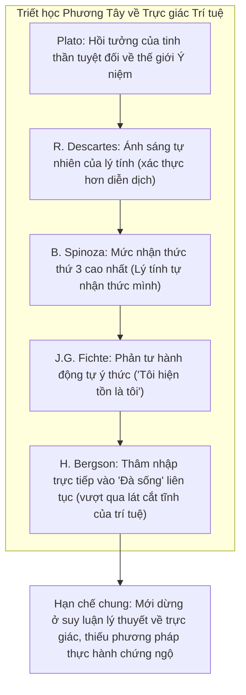
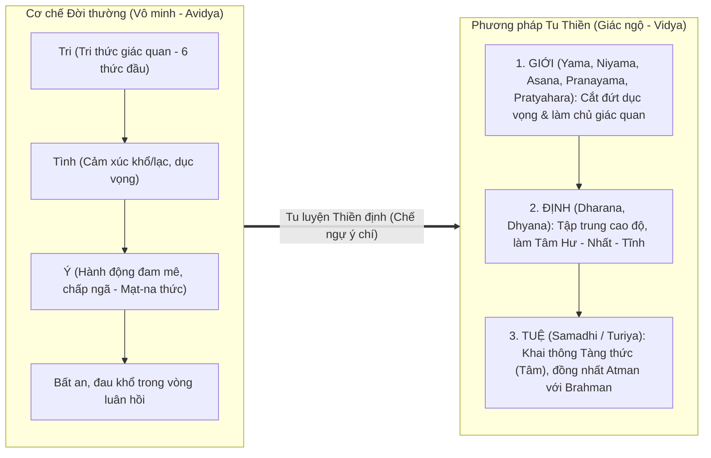

# CHƯƠNG 7: MỘT SỐ VẤN ĐỀ VỀ TRỰC GIÁC TRÍ TUỆ TRONG TRUYỀN THỐNG VĂN HÓA PHƯƠNG ĐÔNG CỔ ĐẠI

> **Phương pháp ghi chép Cornell (Cornell Note-taking System):**
> Tài liệu lý thuyết Chương 7 được biên soạn theo cấu trúc ghi chép chuẩn học thuật **Cornell** nhằm hỗ trợ người học tiếp cận các vấn đề nhận thức luận, triết học và văn hóa học về trực giác trí tuệ một cách hệ thống và sâu sắc:
> - **Cột Trái (Từ khóa / Câu hỏi gợi nhớ - Cue Column):** Tóm lược các thuật ngữ then chốt (*Physis*, *Logos*, *Intuitio*, *Đà sống*, *Tam tài*, *Brahman - Atman*, *Avidya - Vidya*, *AUM - Turiya*, *Tâm - Ý - Thức*, *Giới - Định - Tuệ*, *Bát bảo tu pháp*...) và các câu hỏi định hướng tư duy để tự kiểm tra (Active Recall).
> - **Cột Phải (Ghi chú chi tiết - Note-taking Column):** Trình bày chi tiết nội dung cốt lõi bám sát Giáo trình *Tâm lý học Trí tuệ*, phân tích cơ sở triết học phương Tây và phương pháp chứng ngộ trực giác trong các Đạo học phương Đông cổ đại.
> - **Phần Tóm tắt (Cornell Summary):** Đúc kết tinh hoa lý luận ngay sau mỗi mục lớn và tổng kết toàn chương ở cuối bài để củng cố cấu trúc nhận thức tổng thể.

---

## 7.1. Đặt vấn đề: Giới hạn của tâm lý học truyền thống và sự cần thiết nghiên cứu trực giác trí tuệ

| Từ khóa / Câu hỏi gợi nhớ | Ghi chú chi tiết (Nội dung cốt lõi) |
| :--- | :--- |
| **Cách tiếp cận truyền thống của tâm lý học về trí tuệ là gì?** | - **Trí tuệ như một hệ thống cơ động thích ứng:** Trong tâm lý học hiện đại, nhờ kết hợp thành tựu của nhiều xu hướng tiếp cận, trí tuệ được coi là một hệ thống cơ động có chức năng tạo ra các cấu trúc nhận thức, giúp cá nhân thích ứng tích cực với môi trường sống. - **Cơ chế thu nhận và xử lý dữ liệu cảm tính:** Hoạt động trí tuệ được mô tả là quá trình thu nhận các dữ liệu về đối tượng và xử lý chúng theo các cơ chế khác nhau: liên tưởng các hình ảnh, biểu tượng (*thuyết Liên tưởng*); cấu trúc lại hình ảnh tri giác dẫn đến sự bừng hiểu (*thuyết Gestalt*); đồng hóa và điều ứng kích thích (*thuyết Kiến tạo của J. Piaget*). - **Tính gián tiếp qua tài liệu giác quan:** Dù hành động trí tuệ diễn ra ở mức thao tác hay tiền thao tác, có hay không có sự tham gia của ngôn ngữ, trí tuệ vẫn được coi là quá trình chủ thể tiếp cận bản chất đối tượng một cách **gián tiếp** thông qua các tài liệu cảm tính do 5 giác quan mang lại (thu nhận, phân tích, tổng hợp, cấu trúc lại các tài liệu cảm tính). |
| **Hạn chế của tâm lý học truyền thống khi giải thích các hiện tượng trí tuệ đặc biệt là gì?** | - **Quy giản về cấu trúc thần kinh và định lượng chỉ số:** Khi giải thích nguyên nhân các mức độ cao của năng lực trí tuệ (phát triển sớm, tài năng...), tâm lý học trí tuệ thường quy về các yếu tố cấu trúc thần kinh hoặc lượng hóa qua chỉ số trí tuệ (IQ), tức là giải thích bằng đo lường, định lượng, mô tả sự kiện thực nghiệm quan sát được và bằng các **tri thức suy luận**. - **Bỏ ngỏ các hiện tượng ngoại tâm lý (Parapsychology) và xuất thần:** Những phát minh thiên tài làm đảo lộn khoa học thế giới, những hiện tượng xuất thần, công năng đặc dị của các Đạo sĩ Yoga, sự thấu cảm của các Thiền sư, hay các hiện tượng thần giao cách cảm, thôi miên, thấu thị (tiên tri sự kiện cá nhân và xã hội, đoán nhận ý nghĩ người khác từ xa, chữa bệnh bằng tinh thần, tìm hài cốt...) được gọi chung là các **hiện tượng ngoại tâm lý (Parapsychology)** hầu như chưa được đề cập chính thức trong tâm lý học trí tuệ. |
| **Các cách lý giải khác nhau về hiện tượng ngoại tâm lý và hướng tiếp cận trực giác trí tuệ?** | - **Trong tư duy thông thường:** Các hiện tượng trên thường bị coi là quyền năng riêng của một đẳng cấp (đạo sĩ Ấn Độ, Trung Hoa cổ đại), hoặc bị quy là phương pháp giải thoát chứa đầy yếu tố thần bí, ma thuật (lên đồng), hay hành vi ứng xử của những người yếm thế, tiêu cực, xa lánh xã hội. - **Cách giải thích bằng "giác quan thứ 6":** Nhiều quan niệm hiện đại cho rằng đó là kết quả của giác quan thứ 6 (ngoài 5 giác quan thông thường là thị giác, thính giác, khứu giác, vị giác và xúc giác). - **Hướng tiếp cận trực giác trí tuệ:** Trong Triết học, Văn hóa học, Thần học, Mỹ học, Văn học và Nghệ thuật, các hiện tượng này được xác nhận và giải thích là kết quả của **trực giác trí tuệ** và **phương pháp nhận thức bằng trực giác trí tuệ** — một hướng tiếp cận vượt ra ngoài khung khổ phân tích, tổng hợp, suy luận lôgic trên tài liệu cảm tính đã có. |

> **Tóm tắt Mục 7.1 (Cornell Summary):** Tâm lý học truyền thống chủ yếu xem xét trí tuệ như quá trình thu nhận, phân tích, tổng hợp và suy luận gián tiếp dựa trên dữ liệu của 5 giác quan, đồng thời giải thích tài năng thông qua cấu trúc thần kinh hoặc định lượng chỉ số IQ. Cách tiếp cận duy lý - thực nghiệm này chưa lý giải được các phát minh thiên tài đột xuất, trạng thái xuất thần của Thiền sư, công năng của Đạo sĩ Yoga và các hiện tượng ngoại tâm lý (*Parapsychology*). Do đó, việc mở rộng sang nghiên cứu **trực giác trí tuệ** trong truyền thống triết học phương Tây và văn hóa phương Đông cổ đại là yêu cầu tất yếu để hiểu trọn vẹn tiềm năng nhận thức của con người.

---

## 7.2. Vấn đề trực giác trí tuệ trong truyền thống triết học phương Tây

| Từ khóa / Câu hỏi gợi nhớ | Ghi chú chi tiết (Nội dung cốt lõi) |
| :--- | :--- |
| **7.2.1. Bản nguyên thế giới (*Physis*) trong trường phái Miletus và trường phái Elea khác nhau như thế nào?** | - **Mối liên hệ giữa bản nguyên thế giới và nhận thức luận:** Trong triết học, trí tuệ thuộc phạm trù nhận thức luận (giải quyết khả năng và phương thức nhận thức thế giới), gắn chặt với quan niệm về bản nguyên thế giới. - **Trường phái Miletus (cuối TK VII – đầu TK VI TCN) – Nhất nguyên sống động:** Các hiền triết Hy Lạp đầu tiên tìm kiếm cái cốt tủy, tự tính của sự vật gọi là **Physis** (Vật lý – tự nhiên). Họ cho rằng vật chất gắn liền với sự sống, vận động và biến hóa; không phân biệt giữa sinh và vô sinh, giữa tâm thức và vật chất. Bản nguyên thế giới mang tính linh động, biến đổi không ngừng: **Nước** (Thales), **Không khí** (Anaximenes), **Lửa** (Heraclitus). Đặc biệt ở **Heraclitus**, ngọn lửa là biểu tượng của hoạt lực, sinh khí, vận động không ngừng và là cái nhất thể của các mặt đối lập (sống - hủy diệt, cháy - tắt, động - tĩnh), được gọi là **Logos** (bản chất của thế giới). - **Trường phái Elea – Tồn tại bất biến:** Đối lập với Miletus, trường phái Elea cho rằng có một nguyên lý thiêng liêng cao hơn cả thánh thần và con người, đứng trên cai quản thế giới và **bất dịch**. **Parmenides** xem nguyên lý đó là **Tồn tại** — cái có thực duy nhất và không thay đổi. Quan niệm này mở đầu cho sự phân biệt Tâm và Vật, hình thành quan niệm về một vật chất vững chắc, bất hoại làm nền tảng cấu trúc thế giới. |
| **Thuyết nguyên tử và Nhị nguyên luận Tâm – Vật từ Plato đến Descartes, Bacon đã phân hóa nhận thức luận phương Tây ra sao?** | - **Thuyết nguyên tử của Leucippus và Democritus (TK V TCN):** Nhằm dung hòa cái tồn tại bất biến của Parmenides và sự biến dịch của Heraclitus, hai ông đưa ra khái niệm **nguyên tử** — những hạt nhỏ nhất bất khả phân chia của vật chất, hoàn toàn thụ động trong không gian trống rỗng, vận động do tác động từ bên ngoài. Từ đây xuất hiện ranh giới giữa Tâm và Vật, đặt cơ sở cho nhị nguyên luận. - **Chủ nghĩa duy tâm của Plato:** Thế giới và con người được tách làm hai: *tinh thần tuyệt đối* (có trước, bất biến, chi phối vật chất; ý niệm là chân lý vĩnh hằng) và *thế giới vật chất cảm tính* (cụ thể, không phản ánh được ý niệm). Lần đầu tiên **trực giác trí tuệ** xuất hiện như là **sự hồi tưởng của tinh thần tuyệt đối** để hình thành các ý niệm chung. - **Nhị nguyên luận duy lý siêu hình của R. Descartes vs. Duy cảm kinh nghiệm của F. Bacon, J. Locke (TK XVII–XVIII):**   + **R. Descartes (Đêcáctơ):** Đẩy sự tách biệt Tâm – Vật đến cực đoan (lĩnh vực ý thức và lĩnh vực vật chất hoàn toàn độc lập; thế giới vật chất như một bộ máy khổng lồ; con người lý trí chỉ huy con người thân xác). Phương pháp *phân tích – suy lý* của ông mở đường cho quan niệm về **trực giác trí tuệ** phát triển.   + **F. Bacon (Bêcơn) và J. Locke (Lôccơ):** Đại diện cho chủ nghĩa duy cảm – kinh nghiệm ở Anh với phương pháp *quy nạp phân loại*, khuyến khích lý thuyết về **tri thức giác quan – kinh nghiệm, thực chứng**. - **Sự phục hồi phép biện chứng khoa học:** Khắc phục tư duy siêu hình, triết học duy vật biện chứng và vật lý học hiện đại đã quay trở lại cái nhìn biện chứng ở mức cao hơn: bản nguyên thế giới không phải là sự tách rời Tâm – Vật mà là một thể hợp nhất, vận động. |
| **7.2.2. Plato, Hegel và R. Descartes quan niệm như thế nào về cấu trúc trí tuệ và trực giác lý tính?** | - **Sự phân tầng trí tuệ từ Plato đến Hegel:** Plato chia trí tuệ thành 2 mức: *cảm tính* và *lý tính*. Các nhà triết học cổ điển Đức (điển hình là **G.W.F. Hegel**) chia trí tuệ thành 3 mức: **Cảm tính $\to$ Lý trí $\to$ Lý tính**, xác lập sự chuyển hóa biện chứng từ lý trí lên lý tính. Từ đây hình thành 2 xu hướng: (1) Đi từ cảm tính qua lý trí lên lý tính bằng quy nạp và suy luận; (2) Coi nhẹ cảm tính, đề cao lý tính và nhấn mạnh **trực giác trí tuệ** (*Intellectualis*). - **Quan niệm của R. Descartes về trực giác lý tính (*Intuitio*):**   + Chia trực giác thành *trực giác cảm tính* và *trực giác lý tính*. Ông nghi ngờ tri thức cảm tính và đòi hỏi phải kiểm tra qua ánh sáng lý tính.   + Coi **trực giác lý tính** là khả năng nhận thức cao nhất của trí tuệ, gọi là **"ánh sáng trí tuệ"** hay linh cảm của lý tính, là "tòa án" công minh để phân định đúng/sai và xác định chân lý.   + Theo Descartes, trực giác là khái niệm vững chắc do ánh sáng tự nhiên của lý tính sinh ra; nhờ tính đơn giản và trực tiếp, **trực giác còn xác thực hơn cả bản thân phép diễn dịch**, là sự tự ý thức chân lý đang hiện lên trong lý tính. |
| **B. Spinoza phân chia 3 mức độ nhận thức như thế nào và đặt trực giác trí tuệ ở vị trí nào?** | Kế thừa phương pháp phân tích toán học của Descartes, **B. Spinoza (Xpinôda)** chia nhận thức của con người thành **3 mức độ**: 1. **Mức nhận thức cảm tính – trừu tượng:** Tích lũy vô số hình ảnh đơn nhất về sự vật, trừu tượng hóa điểm khác nhau và khái quát điểm chung thành khái niệm phổ biến. Nội dung các khái niệm này không xác định, phụ thuộc cách khái quát riêng của mỗi người nên chỉ là biến thể của tri thức kinh nghiệm. 2. **Mức nhận thức suy lý – diễn dịch:** Phương pháp nhận thức phi cảm tính, đem lại các khái niệm chung phản ánh mối liên hệ tất yếu giữa chủ thể và khách thể, không mang tính chủ quan, có độ tin cậy cao, phân biệt với trí tưởng tượng cá nhân. 3. **Mức nhận thức trực giác trí tuệ (cao nhất):** Mức nhận thức lý tính tối cao. Để các mô hình suy luận có độ tin cậy, cần có các luận điểm xuất phát (các chân lý chung nhất) vốn có sẵn trong lý tính và được lý tính trực tiếp nhận thức ra. **Trực giác trí tuệ là lý tính trực tiếp nhận thức bản thân mình**, gắn liền với nhận thức suy diễn, loại bỏ mọi tác động "gây nhiễu" của cảm tính để đạt tới chân lý xác thực, vĩnh hằng, phản ánh bản chất sâu xa nhất của sự vật. |
| **Quan niệm của J.G. Fichte về trực giác trí tuệ có hai điểm khác biệt căn bản nào so với thế kỷ XVII?** | **J.G. Fichte (Phíchtơ)** và triết học duy tâm cổ điển Đức có **2 điểm khác biệt** so với Descartes và Spinoza: 1. **Trực giác trí tuệ là sự phản tư hành động tự ý thức:** Không coi trực giác là sự phản ánh trực tiếp một thực thể tĩnh của lý tính, mà nhấn mạnh **nhận thức bản thân hoạt động của tư duy lý tính** theo khẩu hiệu *"Hãy tư duy chính bản thân mình"* và nguyên tắc *"Tôi hiện tồn là tôi"*. Trực giác trí tuệ là **trực quan về hành động của ý thức (hành động tự ý thức)**, vận động giống như sự phản tư của một tia sáng qua chuỗi: *Hành động hướng tới vô hạn $\to$ Phản tư thứ nhất (xuất hiện Cảm giác) $\to$ Phản tư thứ hai (xuất hiện Trực giác) $\to$ Tưởng tượng tái hiện $\to$ Lý trí $\to$ Năng lực phán đoán $\to$ Cái Tôi thuần túy tự quy định mình*. 2. **Sự thống nhất giữa hành động và sản phẩm:** Trong trực giác trí tuệ, không có sự tách biệt giữa bản thân hành động nhận thức và sản phẩm của nó; quá trình phản tư hành động trí tuệ vừa ý thức được chính hành động ấy, vừa ý thức được sản phẩm do nó tạo ra. |
| **H. Bergson đối lập "Trí tuệ phân tích" với "Trực giác trí tuệ" trước "Đà sống" như thế nào?** | Trong triết học phương Tây hiện đại, **H. Bergson (Bécxông)** đề cập sâu sắc nhất đến trực giác trí tuệ: - **Bản thể luận "Đà sống" (*Élan vital*):** Sự sống là một dòng vận động và biến đổi liên tục ("đà sống"), không có sự tách rời giữa thể xác và tinh thần. - **Nhận thức bằng Trí tuệ (Phân tích – tạo dựng công cụ):** Đặc trưng của trí tuệ là giúp con người chế tạo công cụ bằng cách phân tích, chia cắt sự vật thành những **"lát cắt"** cố định tại những điểm dừng nhất định rồi lắp ghép lại. Do phụ thuộc vào quan điểm, biểu tượng và ngôn ngữ từ bên ngoài, trí tuệ không nắm bắt được bản chất thực sự của vận động mà chỉ tạo ra những **"tấm ảnh chụp chớp nhoáng"** tĩnh tại. - **Nhận thức bằng Trực giác (Thâm nhập vào bên trong):** Bergson chia trực giác thành *trực giác bản năng* (sự giao cảm trực tiếp ở động vật và con người) và *trực giác trí tuệ*. **Trực giác trí tuệ** là sự nhận thức trực tiếp, tức thời đối với sự vật, không cần phương tiện ngôn ngữ hay suy luận gián tiếp của lý trí, thâm nhập thẳng vào bên trong sự vật để nắm bắt sự vận động liên tục ("đà sống"). - **Mối quan hệ biện chứng giữa Trí tuệ và Trực giác:** Nếu không có trí tuệ tham gia thì trực giác chỉ dừng ở dạng bản năng; ngược lại, trực giác thâm nhập vào trí tuệ giúp nâng trí tuệ từ mức phân tích lên mức trực giác. Trí tuệ thuần túy tạo ra *khoa học và kỹ thuật cơ khí* (con người **sáng tạo**), còn trực giác mang lại *sự hiểu biết thấu suốt* (con người **thông minh**). |
| **Đánh giá chung về thành tựu và hạn chế của triết học phương Tây đối với trực giác trí tuệ?** | - **Thành tựu:** Từ Plato, Descartes, Spinoza, Fichte đến Bergson, triết học phương Tây đều đề cao trực giác trí tuệ như khởi nguồn của chân lý tối cao, nhận thức trực tiếp thực thể hoặc hành động tự ý thức từ bên trong sự vật với độ tin cậy cao hơn trí tuệ phân tích thông thường. - **Hạn chế:** Để đi đến các kết luận về trực giác trí tuệ, các triết gia phương Tây vẫn chủ yếu sử dụng **phương pháp phân tích, suy luận lý thuyết**. Vì vậy, vấn đề cốt tử nhất là **phương pháp thực hành để đạt tới nhận thức trực giác trí tuệ** vẫn chưa được làm sáng tỏ — điều mà văn hóa phương Đông cổ đại đã giải quyết triệt để bằng chính sự **chứng ngộ**. |

> **Tóm tắt Mục 7.2 (Cornell Summary):** Xuất phát từ sự phân hóa quan niệm về bản nguyên thế giới (giữa nhất nguyên biến dịch của trường phái Miletus/Heraclitus với tồn tại bất biến của Parmenides, thuyết nguyên tử của Democritus và nhị nguyên luận Tâm – Vật của Plato, Descartes), triết học phương Tây đã phát triển học thuyết về trực giác trí tuệ qua nhiều cột mốc lớn: sự hồi tưởng ý niệm (Plato), "ánh sáng lý tính" xác thực hơn diễn dịch (Descartes), cấp độ nhận thức tối cao vượt trên cảm tính và suy lý diễn dịch (Spinoza), sự phản tư hành động tự ý thức (Fichte), và sự thâm nhập trực tiếp vào "đà sống" liên tục đối lập với những "tấm ảnh chụp chớp nhoáng" của trí tuệ phân tích (Bergson). Tuy nhiên, triết học phương Tây mới giải thích trực giác bằng con đường suy luận lý thuyết chứ chưa vạch ra được phương pháp tu luyện thực nghiệm để chứng ngộ trực giác.

---

## 7.3. Trực giác trí tuệ trong truyền thống văn hóa phương Đông cổ đại

| Từ khóa / Câu hỏi gợi nhớ | Ghi chú chi tiết (Nội dung cốt lõi) |
| :--- | :--- |
| **Ba điểm khác biệt lớn giữa triết học phương Tây và các Đạo học phương Đông cổ đại là gì?** | Văn hóa phương Đông cổ đại (Ấn Độ và Trung Hoa với Ấn Độ giáo, Phật giáo, Nho giáo, Lão giáo...) không đơn thuần là tôn giáo hay triết học mà là các **Đạo học**, hệ thống giáo dục quy định đời sống xã hội. Có **3 khác biệt lớn**: 1. **Về xu hướng triết lý:** Phương Tây tách con người khỏi tự nhiên (tách Tâm – Vật), hướng nhận thức ra thế giới vật chất bên ngoài để khám phá và chinh phục tự nhiên (*triết học tự nhiên*). Ngược lại, phương Đông coi trọng sự hòa đồng theo tư tưởng **Tam Tài (Thiên – Địa – Nhân hợp nhất)**, nương theo quy luật tự nhiên để hòa đồng giữa người với người và với trời đất (*triết học xã hội / nhân sinh*). 2. **Về cơ sở triết lý:** Triết học cổ phương Tây hình thành qua sự phỏng đoán, suy luận lý thuyết của các triết gia; chân lý được thừa nhận qua lý luận. Ngược lại, Đạo học phương Đông là **triết học thực nghiệm**, xây dựng trên nền tảng trải nghiệm, kinh nghiệm và **thể nghiệm** của chính các đạo gia; chân lý phải được kiểm chứng qua **chứng ngộ**. 3. **Về sự phân nhánh trong nội bộ Đạo học phương Đông:**   + *Nhóm 1 (Nho học):* Xu hướng nhân sinh xã hội, nhân bản hóa vũ trụ (nhập tự nhiên vào xã hội); mẫu người lý tưởng là con người hành động, con người Nhân, con người xã hội; phương pháp đặc trưng là **Tu thân**.   + *Nhóm 2 (Các tôn giáo Ấn Độ, Phật giáo và Đạo giáo Trung Hoa):* Xu hướng vũ trụ hóa cá nhân (đem cá nhân hòa vào vũ trụ), mục đích tối hậu là giải thoát tinh thần; mẫu người lý tưởng là con người tu luyện, con người Tâm linh có ý thức vũ trụ; phương pháp đặc trưng là **Định thiền** (liên quan trực tiếp tới trực giác trí tuệ). |
| **7.3.1.1. Ba điểm cốt lõi trong quan niệm về vũ trụ và nhân sinh của Phật giáo và Đạo giáo là gì?** | Nhận thức luận phương Đông dựa trên biểu tượng về một **bản thể động của thế giới**, khái quát qua **3 điểm**: 1. **Khởi nguyên vũ trụ là trạng thái tuyệt đối, hư không:** Không sinh, không diệt, vượt lên mọi quy luật, tinh nguyên và biến hóa động — được gọi là **Brahman** (Tự tính vũ trụ trong Ấn Độ giáo), **Niết bàn** (Phật giáo), **Thái cực** (Kinh Dịch), hay **Đạo** (Lão giáo). 2. **Thế giới hiện hữu là hữu hạn và biến dịch không ngừng:** Vạn vật hữu hình có sau khởi nguyên vũ trụ, hoàn toàn bất định, biến hóa theo chu trình *Sinh – Trụ – Dị – Diệt* hay *Thành – Trụ – Hoại – Không*, theo vòng luân hồi *Sinh – Lão – Bệnh – Tử* và quy luật *Nhân duyên*. Thế giới hữu hình, hữu hạn chính là sự biểu hiện, biến hóa của cái tuyệt đối, vô hình, vô hạn (*Đức là biểu hiện của Đạo*). 3. **Đời sống con người là giả hợp và cõi Vô minh (*Avidya*):** Danh sắc (thể xác và linh hồn) của con người là sự **giả hợp** tạm thời của **Ngũ uẩn**, không phải thực thể bất diệt. Con người đau khổ ("đời là bể khổ") không phải vì bản thân thể xác giả hợp, mà vì chìm đắm trong **Vô minh (*Avidya*)** — u mê ngộ nhận thể xác là có thực vĩnh viễn, sinh lòng tham sống sợ chết và hành động trái tự nhiên. Để giải thoát, con người phải chuyển từ *Vô minh (Avidya)* sang trạng thái **Minh / Giác ngộ (*Vidya*)**. |
| **Phật giáo và Đạo giáo phân biệt "Tri thức (Tri kiến)" với "Trí tuệ (Giác ngộ)" như thế nào?** | - **Mức 1 – Tri thức (Tri kiến / Nhận thức giác quan – ngũ uẩn):** Nhận biết các biểu hiện của quy luật trong thế giới hiện hữu bằng quy nạp, phân tích, suy luận (nhận thức khoa học thông thường). Ở mức này, con người vẫn nằm trong trường tác động của quy luật hiện hữu và vẫn chìm trong cõi *Vô minh*. - **Mức 2 – Trí tuệ (Giác ngộ / Biết):** Vượt ra khỏi sự chi phối của quy luật hiện hữu để đạt tới trạng thái *Minh (Vidya)*, nơi tự tính cá nhân (**Atman** – tiểu vũ trụ) và tự tính vũ trụ (**Brahman** – đại vũ trụ) **đồng nhất thành một thể bất phân** (*Atman là Brahman*), xóa bỏ sự đối lập chủ thể – khách thể. "Biết" (Giác ngộ) không chỉ là hiểu biết thông thường mà là năng lực toàn diện làm biến đổi bản tính con người phàm tục thành con người giác ngộ (như Thái tử Tất-đạt-đa thành Phật), giúp cắt bỏ mọi dục vọng và Tham – Sân – Si. Phương pháp đạt tới trí tuệ không phải là hướng ra ngoài phân tích mà là **hướng vào nội tâm bằng trực tâm, truyền tâm trực tiếp (trực giác trí tuệ)** qua tu luyện tham thiền. - **Quan niệm của Lão Tử và Trang Tử (Đạo giáo):** Thế giới hữu danh sinh ra từ vô danh (**Đạo**); nguyên lý của Đạo là **Tự nhiên**. Ngôn ngữ không hàm chứa được Đạo mà chỉ có năng lực **gợi ý** để đến với Đạo. Thiên XXVI sách *Trang Tử* nêu ngụ ngôn nổi tiếng: *"Nơm là để bắt cá, được cá thì quên nơm. Bẫy là để bắt thú, được thú thì quên bẫy. Lời là để tỏ ý, được ý thì quên lời"*, và hình ảnh hai vị thánh nhân gặp nhau chỉ nhìn nhau không nói mà Đạo đã hiển hiện. Do đó, nhận thức Đạo phải bằng **truyền tâm, tâm tri, tâm hành (trực giác trí tuệ)**. |
| **7.3.1.2. Kinh *Mandukya Upanishad* và Duy thức học Phật giáo mô tả các trạng thái và cấu trúc nhận thức (*Tâm - Ý - Thức*) như thế nào?** | - **Bốn trạng thái nhận thức trong Kinh *Mandukya Upanishad* (Ấn Độ cổ đại):** Ba trạng thái đầu hợp thành âm tiết thiêng **AUM (Úm)** và trạng thái thứ tư cao nhất:   1. **Trạng thái Thức (A):** Các cơ quan nhận thức hướng ra bên ngoài, nhận biết sự vật, hiện tượng biến đổi của thế giới khách quan.   2. **Trạng thái Mộng (U):** Ý thức quay vào bên trong, phản ánh các biểu tượng, ký ức đã thu nhận lúc thức.   3. **Trạng thái Ngủ say (M):** Ý thức là một khối bất phân biệt, hầu như không liên hệ với đối tượng vật chất hay tinh thần nào.   4. **Trạng thái Siêu thoát (*Turiya* / *Anata* – cao nhất):** Bản tính cá nhân (*Atman*) và bản tính vũ trụ (*Brahman*) hòa làm một khối nhất thể bất phân; con người không nhận thức bằng giác quan hay tư duy thông thường mà bằng **truyền tâm, trực tiếp kinh nghiệm**. - **Hệ thống 8 thức (Bát thức) và cấu trúc Tâm – Ý – Thức trong Duy thức học Phật giáo:**   + **Ngũ căn và Ngũ thức (5 thức đầu):** Mắt – sắc, tai – thanh, mũi – hương, lưỡi – vị, thân – xúc. Giác quan tiếp nhận kích thích gọi là *Căn* (ngũ căn); khả năng phân biệt tạo ra nhận biết gọi là *Thức* (ngũ thức).   + **Thức thứ 6 (Ý thức):** Phân biệt, tổng hợp và phối hợp 5 thức giác quan (cùng với 5 thức đầu hợp thành tầng **Thức**).   + **Thức thứ 7 (Mạt-na thức / Ý căn / Căn thức):** Nhận ra và kiểm soát thức thứ 6, truyền công năng của thức thứ 8 và khởi phát hoạt động của các thức dưới (gọi là tầng **Ý**).   + **Thức thứ 8 (A-lạt-da thức / Tàng thức):** Chứa đựng, bao trùm và điều khiển tất cả các thức trên (gọi là tầng **Tâm / Tâm thức**). - **Sự tương ứng giữa Tâm – Ý – Thức và 4 trạng thái nhận thức:**   + **Thức (6 thức đầu)** $\leftrightarrow$ Trạng thái **Thức tỉnh (A)** $\leftrightarrow$ Nhận thức có ý thức (**Hữu thức** / giác quan).   + **Ý (Thức thứ 7)** $\leftrightarrow$ Trạng thái **Mộng (U)** $\leftrightarrow$ Lĩnh vực **Tiềm thức / Vô thức**.   + **Tâm (Thức thứ 8)** $\leftrightarrow$ Trạng thái **Ngủ say (M)** và cao hơn là **Siêu thoát (*Turiya*)** $\leftrightarrow$ Nhận thức bằng **Tâm** chính là **Trực giác trí tuệ** (nhận thức bằng toàn bộ sức mạnh trí tuệ và nhân cách con người thông qua tu thiền). |
| **7.3.2.1. Bản chất của phương pháp Thiền và cơ chế chuyển hóa từ chuỗi "Tri – Tình – Ý" sang "Giới – Định – Tuệ" là gì?** | - **Khái niệm Thiền:** Tiếng Phạn là **Dhyana**, tiếng Hán là **Chan (Thiền-na)**, tiếng Nhật là **Zen** — có nghĩa là chứng ngộ, trầm tư về chân lý đến mức triệt ngộ và in sâu trong nội thức. Thiền vừa là *phương pháp tu luyện* đạt trí tuệ viên mãn, vừa là một *môn phái Phật giáo* (Thiền tông). - **Nguyên lý làm cho Tâm "Hư – Nhất – Tĩnh":** Muốn hiểu rõ vạn vật, phải đưa Tâm về trạng thái **Hư** (hư không), **Nhất** (chuyên nhất) và **Tĩnh** (tĩnh tại, không dao động). Tu thiền thực chất là phép *định Tâm, an Tâm, dưỡng Tâm và khai Tâm* nhằm giảm thiểu các tác động chi phối ý thức, giải phóng sức mạnh của tiềm thức (vô thức). - **Sự trói buộc của chuỗi Tri – Tình – Ý đời thường:** Trong đời sống thường nhật, tri thức giác quan (**Tri**) tạo ra cảm xúc khổ/lạc và dục vọng (**Tình**), dẫn đến các hành động đam mê mù quáng (**Ý**), đẩy con người vào vòng bất an, đau khổ. - **Con đường giải phóng qua chuỗi Giới – Định – Tuệ (cốt lõi của Bát chính đạo):**   1. **Giới:** Dùng ý chí cắt đứt mọi liên hệ của tri thức giác quan và diệt trừ dục vọng.   2. **Định:** Làm cho tâm lắng dịu, tĩnh lặng, không bị ngoại cảnh và tạp niệm chi phối.   3. **Tuệ:** Khi tâm đã trong sáng, hư vô và tự do, tâm cá thể giao cảm trực tiếp với tâm vũ trụ, đạt tới trạng thái trí tuệ (giác ngộ). - **Ý nghĩa tâm lý học hiện đại:** Thiền là phương pháp sử dụng ý chí, nghị lực tập trung cao độ vào nội tâm để chiến thắng chính bản thân mình, vừa rèn luyện trí óc vừa bồi dưỡng bản lĩnh và nhân cách. |
| **7.3.2.2. Các trình độ thiền trong Phật giáo và 8 giai đoạn "Bát bảo tu pháp" của Yoga diễn ra như thế nào?** | - **Sự tương ứng giữa 4 trạng thái tâm lý và cảnh giới Phật giáo:** *Thức* $\leftrightarrow$ Giới cảnh sắc; *Mộng* $\leftrightarrow$ Giới vô sắc; *Ngủ say* $\leftrightarrow$ Giới tịch diệt; *Siêu thoát (Anata)* $\leftrightarrow$ Niết bàn. - **Phân biệt Chính đạo và Ngoại đạo:** Phật giáo gọi phép thiền của Phật tử (theo *Bát chính đạo*) là **Chính đạo**, gồm **4 trình độ định thiền**: (1) **Srotapanna** (Dự lưu), (2) **Sakrdagamin** (Nhất lai), (3) **Anagamin** (Bất hoàn), và (4) **Arhat** (A-la-hán). Phép thiền của các Đạo sĩ Yoga được gọi là **Ngoại đạo**. - **8 giai đoạn "Bát bảo tu pháp" của Đạo sĩ Yoga (tương ứng 4 trạng thái Thức, Mộng, Ngủ say, Tĩnh lặng):**   1. **Yama (Chế giới / Diệt dục):** Thực hiện các điều răn cấm, diệt trừ dục vọng.   2. **Niyama (Nội chế):** Dấn thân tu luyện, từ bỏ danh lợi, giữ tâm hồn trong sạch, bình thản, kính tin.   3. **Asana / Tọa pháp:** Quy tắc vận động và tĩnh tọa trên cơ sở tâm hồn thư thái, tinh thần ngay thẳng, tĩnh lặng.   4. **Pranayama (Điều tức pháp):** Điều hòa, kiểm soát hơi thở để thanh lọc nhân tâm.   5. **Pratyahara (Chế cảm pháp):** Kiềm chế, làm chủ các giác quan, ngăn tác động ngoại cảnh làm phân tán tâm thần.   6. **Dharana (Tổng trì pháp):** Tập trung trí tuệ và tri thức vào một ý hoặc một đối tượng duy nhất, không để nội/ngoại ý nào khác xâm nhập.   7. **Dhyana (Định):** Tập trung tư tưởng cao độ vào đối tượng chính, đạt tới trạng thái như thôi miên.   8. **Samadhi (Tuệ / Tam muội pháp):** Trạng thái xuất thần nhập hóa, làm chủ hoàn toàn tâm linh và ý chí, xóa nhòa ranh giới cách biệt giữa cá nhân với vũ trụ, đưa chân giác vào cõi không sáng lạn, nhận thức dưới góc độ vô hạn và vĩnh cửu. - **Hình thức thực hành và giá trị thời đại:** Có thể thực hành qua **Tọa thiền** (ngồi thiền – phổ biến nhất) hoặc **Kinh hành** (thiền đi), kết hợp chế độ ăn uống, sinh hoạt điều độ. Ngày nay, thiền phổ biến ở cả phương Đông lẫn Âu – Mỹ nhưng mới chủ yếu được khai thác về mặt dưỡng sinh, sức khỏe tâm – sinh lý; trong tương lai gần, cùng với sự tương đồng giữa vật lý học hiện đại (thuyết tương đối, cơ học lượng tử) và triết lý phương Đông, thiền định với tư cách là **phương pháp trực giác trí tuệ và trí tuệ cảm xúc** sẽ trở thành đối tượng nghiên cứu trọng tâm của tâm lý học trí tuệ hiện đại. |

> **Tóm tắt Mục 7.3 (Cornell Summary):** Khác với triết học phương Tây thiên về phân tích tự nhiên và suy luận lý thuyết, Đạo học phương Đông cổ đại (đặc biệt là Phật giáo và Đạo giáo) lấy tư tưởng *Tam Tài (Thiên – Địa – Nhân hợp nhất)* và sự *chứng ngộ thực nghiệm* làm nền tảng. Nhận thức luận phương Đông phân biệt rõ **Tri thức (tri kiến giác quan, ngôn ngữ hữu hạn)** với **Trí tuệ (sự giác ngộ *Vidya*, nơi tiểu vũ trụ *Atman* đồng nhất với đại vũ trụ *Brahman*, hay sự lĩnh hội *Đạo* theo nguyên lý "được ý quên lời")**. Thông qua mô hình 4 trạng thái nhận thức (*Thức A – Mộng U – Ngủ say M – Siêu thoát Turiya*) và hệ thống *Tâm (A-lạt-da thức) – Ý (Mạt-na thức) – Thức (6 thức đầu)*, văn hóa phương Đông đã xây dựng phương pháp thực hành **Thiền định** (*Giới – Định – Tuệ*, *Bát chính đạo* và *Bát bảo tu pháp* của Yoga) nhằm cắt đứt chuỗi *Tri – Tình – Ý*, đưa Tâm về trạng thái *Hư – Nhất – Tĩnh*, khai phóng tiềm thức và đạt tới trực giác trí tuệ viên mãn.

---

## Tóm tắt toàn chương (Cornell Summary)

1. **Vượt qua giới hạn của tâm lý học truyền thống:** Tâm lý học trí tuệ truyền thống chủ yếu nghiên cứu quá trình xử lý thông tin gián tiếp qua 5 giác quan và suy luận lôgic, do đó gặp giới hạn khi lý giải các phát minh thiên tài đột xuất, trạng thái xuất thần và các hiện tượng ngoại tâm lý (*Parapsychology*). Nghiên cứu **trực giác trí tuệ** mở ra cánh cửa khám phá tầng sâu tiềm thức của nhận thức con người.
2. **Hành trình nhận thức luận phương Tây về trực giác trí tuệ:** Từ sự phân cực giữa bản nguyên biến dịch (*Logos* của Heraclitus) và tồn tại bất biến (Parmenides) đến nhị nguyên luận Tâm – Vật (Plato, Descartes), các triết gia phương Tây đều khẳng định vị thế tối thượng của trực giác trí tuệ: là sự hồi tưởng ý niệm (Plato), "ánh sáng lý tính" xác thực hơn diễn dịch (Descartes), cấp độ nhận thức thứ ba cao nhất nơi lý tính tự nhận thức mình (Spinoza), sự phản tư hành động tự ý thức (Fichte), và sự thâm nhập trực tiếp vào "đà sống" liên tục (Bergson). Tuy vậy, phương Tây vẫn dùng tư duy phân tích suy luận để bàn về trực giác nên thiếu hẳn phương pháp thực hành chứng ngộ.
3. **Đóng góp độc đáo của văn hóa phương Đông cổ đại:** Đặt trên nền tảng *Thiên – Địa – Nhân hợp nhất* và tính thực nghiệm chứng ngộ, Phật giáo và Đạo giáo xem trí tuệ không chỉ là công cụ nhận thức mà là **trình độ biến đổi bản tính con người** từ *Vô minh (Avidya)* sang *Giác ngộ (Vidya)*. Bằng hệ thống lý thuyết sâu sắc về *Tâm – Ý – Thức* (8 thức của Duy thức học), 4 trạng thái *AUM – Turiya* (*Mandukya Upanishad*) cùng phương pháp **Thiền định** (*Giới – Định – Tuệ* và 8 bước *Bát bảo tu pháp* từ *Yama* đến *Samadhi*), phương Đông cổ đại đã vạch ra con đường thực hành cụ thể để làm cho Tâm *Hư – Nhất – Tĩnh*, giải phóng năng lượng vô thức và đạt tới sự giao cảm trực tiếp giữa tâm thức cá nhân với vũ trụ.

---

## Câu hỏi tự kiểm tra nhanh (Self-Testing Cues)

1. Vì sao các mô hình tâm lý học truyền thống (thuyết Liên tưởng, thuyết Gestalt, thuyết Kiến tạo, đo lường IQ) lại chưa thể giải thích thỏa đáng các phát minh thiên tài đột xuất và các hiện tượng ngoại tâm lý (*Parapsychology*)?
2. So sánh quan niệm về bản nguyên thế giới (*Physis*) giữa trường phái Miletus (Thales, Anaximenes, Heraclitus) và trường phái Elea (Parmenides). Sự xuất hiện thuyết nguyên tử của Leucippus – Democritus và triết học Plato, Descartes đã dẫn đến nhị nguyên luận Tâm – Vật như thế nào?
3. Phân tích sự phát triển quan niệm về trực giác trí tuệ qua các triết gia phương Tây: Plato, R. Descartes, B. Spinoza (3 mức nhận thức), J.G. Fichte (2 điểm khác biệt về phản tư tự ý thức) và H. Bergson (Trí tuệ phân tích vs. Trực giác trước "Đà sống").
4. Trình bày 3 điểm khác biệt cốt lõi giữa triết học phương Tây và Đạo học phương Đông cổ đại (về xu hướng triết lý, cơ sở triết lý và sự phân nhánh giữa Nho giáo với Phật giáo – Đạo giáo).
5. Phân biệt "Tri thức (Tri kiến)" và "Trí tuệ (Giác ngộ / Vidya)" trong Phật giáo và Đạo giáo. Giải thích ý nghĩa câu ngụ ngôn *"Được cá quên nơm, được ý quên lời"* của Trang Tử đối với việc nhận thức Đạo.
6. Trình bày sự tương ứng giữa 4 trạng thái nhận thức trong Kinh *Mandukya Upanishad* (*AUM* và *Turiya*) với cấu trúc 8 thức (*Tâm – Ý – Thức*) của Duy thức học Phật giáo.
7. Phân tích cơ chế tu luyện Thiền định nhằm chuyển hóa con người từ chuỗi trói buộc *Tri – Tình – Ý* sang con đường giải thoát *Giới – Định – Tuệ* (làm cho Tâm *Hư – Nhất – Tĩnh*) và trình bày 8 giai đoạn *Bát bảo tu pháp* của Yoga.
